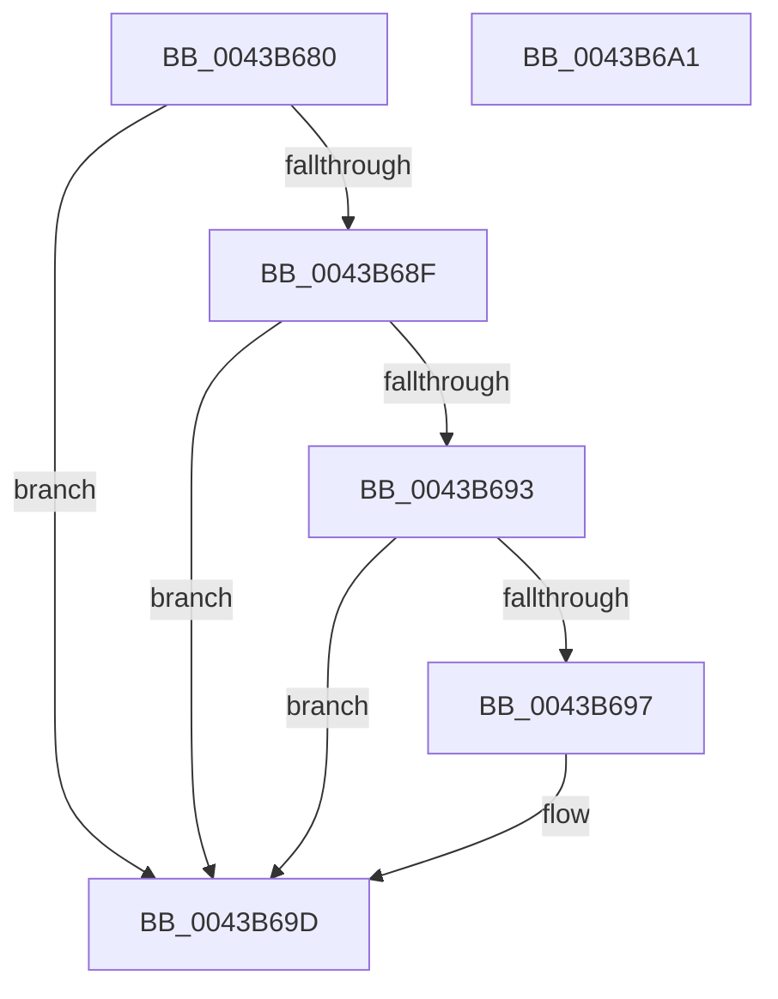

# PopBatteryGetEnergyDrainFromDischage

- RVA: `0x0043B680`–`0x0043B6A2` (길이 `34` bytes)
- VA: `0x000000014043B680`
- 실행 섹션: `.text`
- PDB 이름 있음: `예`; PDB Function 태그: `아니요`
- unwind 정보 RVA: `0x000DB714`
- 디코드: `12`개 명령, `34/34` bytes 표시
- 미해석 바이트: `0` (있으면 어셈블리에 `.byte`로 보존)

> 이 문서는 커널 이미지의 기계어와 PDB 기호를 분석해 생성했습니다. 4번과 5번은 함수 원형과 자료형을 바이너리 사용 방식에서 추정한 C 해석이며 원본 소스 복구 결과는 아닙니다.

## 1. Dependencies

- 직접 호출 지점: **0**; 고유 호출 대상: **0**
- 직접 호출자로 확인된 함수: **2**
- RIP 상대 이미지 참조: **1**

### Outgoing calls
- 직접 디코드된 call 명령이 없습니다.

### Direct callers
- [PopCalculateCsSummary](PopCalculateCsSummary_function_0043A1B0.md) at `0x0043A238`
- [PopDiagTraceCsResiliencyExit](PopDiagTraceCsResiliencyExit_function_0043AB34.md) at `0x0043ABB6`

### Static image references
- `0x0043B683` → RVA `0x00F0C090` (`.data`; read)

## 2. Other-region calls and transfers

- 다른 실행 섹션으로 향하는 call: **0**
- 별도 외부 분기/꼬리 이동을 확인하지 못했습니다.

## 3. Assembly (complete function range)

```asm
0043B680  45 33 C0                        xor r8d, r8d
0043B683  F7 05 03 0A AD 00 00 00 00 40   test dword ptr [rip + 0xad0a03], 0x40000000
0043B68D  75 0E                           jne 0x14043b69d
0043B68F  3B D1                           cmp edx, ecx
0043B691  73 0A                           jae 0x14043b69d
0043B693  85 D2                           test edx, edx
0043B695  74 06                           je 0x14043b69d
0043B697  44 8B C1                        mov r8d, ecx
0043B69A  44 2B C2                        sub r8d, edx
0043B69D  41 8B C0                        mov eax, r8d
0043B6A0  C3                              ret
0043B6A1  CC                              int3
```

## 4. C-style interpretation (structured pseudocode)

```c
__int64 __fastcall PopBatteryGetEnergyDrainFromDischage(int a1, int a2, int a3)
{
    a3 = 0;
    if (((*(unsigned int *)(v_rip + 11340291)) & (0x40000000ULL)) != 0) goto loc_0043B69D;
    if (a2 >= a1) goto loc_0043B69D;
    if (a2 != 0) {
        a3 = a1;
        a3 = (unsigned int)((a3) - (a2));
    }
    return (unsigned int)(a3);
}
```

## 5. (Beta) C Style

```c
int64_t PopBatteryGetEnergyDrainFromDischage(int32_t Arg1, int32_t Arg2, int32_t Arg3)
{
    Arg3 = 0;
    if (((*(uint32_t *)(v_rip + 0xAD0A03)) & (0x40000000ULL)) != 0) goto loc_0043B69D;
    if (Arg2 >= Arg1) goto loc_0043B69D;
    if (Arg2 != 0) {
        Arg3 = Arg1;
        Arg3 = (uint32_t)((Arg3) - (Arg2));
    }
    return (uint32_t)(Arg3);
}
```

## 6. Execution-region graph

[열기: 2D/3D 그래프와 함수 탐색 컨트롤 패널](../../../control-panel.html?section=text&rva=0x0043B680&view=graph)

- 2D 그래프는 위에서 아래로 흐르고, 3D 그래프는 빈 공간을 드래그해 회전합니다. Shift+드래그는 이동, 휠은 확대·축소, 함수 노드 선택은 대상 보고서 이동입니다.

### Static fallback


