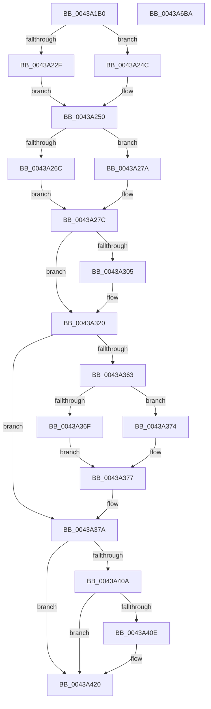

# PopCalculateCsSummary

- RVA: `0x0043A1B0`–`0x0043A6BB` (길이 `1,291` bytes)
- VA: `0x000000014043A1B0`
- 실행 섹션: `.text`
- PDB 이름 있음: `예`; PDB Function 태그: `아니요`
- unwind 정보 RVA: `0x000A4314`
- 디코드: `273`개 명령, `1,291/1,291` bytes 표시
- 미해석 바이트: `0` (있으면 어셈블리에 `.byte`로 보존)

> 이 문서는 커널 이미지의 기계어와 PDB 기호를 분석해 생성했습니다. 4번과 5번은 함수 원형과 자료형을 바이너리 사용 방식에서 추정한 C 해석이며 원본 소스 복구 결과는 아닙니다.

## 1. Dependencies

- 직접 호출 지점: **17**; 고유 호출 대상: **12**
- 직접 호출자로 확인된 함수: **1**
- RIP 상대 이미지 참조: **57**

### Outgoing calls
- `0x0043A1EF` → [PopCalculateIdleInformation](PopCalculateIdleInformation_function_0043ADEC.md) (function, `0x0043ADEC`)
- `0x0043A1F8` → [RtlGetInterruptTimePrecise](../20/RtlGetInterruptTimePrecise_function_0020A4C0.md) (function, `0x0020A4C0`)
- `0x0043A225` → [PopCurrentPowerState](../../page/A3/PopCurrentPowerState_function_00A356D8.md) (function, `0x00A356D8`)
- `0x0043A238` → [PopBatteryGetEnergyDrainFromDischage](PopBatteryGetEnergyDrainFromDischage_function_0043B680.md) (function, `0x0043B680`)
- `0x0043A242` → [PopBatteryCapacityToRate](PopBatteryCapacityToRate_function_0043B6A8.md) (function, `0x0043B6A8`)
- `0x0043A25B` → [PopMeasureEnergyChange](../../page/A9/PopMeasureEnergyChange_function_00A9E230.md) (function, `0x00A9E230`)
- `0x0043A2C2` → [PopCalculateTotalHwDripsResidency](../4F/PopCalculateTotalHwDripsResidency_function_004F9908.md) (function, `0x004F9908`)
- `0x0043A338` → [PpmConvertTimeTo](PpmConvertTimeTo_function_0043B3CC.md) (function, `0x0043B3CC`)
- `0x0043A39D` → [PpmConvertTimeTo](PpmConvertTimeTo_function_0043B3CC.md) (function, `0x0043B3CC`)
- `0x0043A3AF` → [PpmConvertTimeTo](PpmConvertTimeTo_function_0043B3CC.md) (function, `0x0043B3CC`)
- `0x0043A3C1` → [PpmConvertTimeTo](PpmConvertTimeTo_function_0043B3CC.md) (function, `0x0043B3CC`)
- `0x0043A3D1` → [KeAcquireSpinLockRaiseToDpc](../20/KeAcquireSpinLockRaiseToDpc_function_00208470.md) (function, `0x00208470`)
- `0x0043A3E5` → [KeReleaseSpinLock](../39/KeReleaseSpinLock_function_00392BA0.md) (function, `0x00392BA0`)
- `0x0043A436` → [PopQueryInputSuppressionCount](../../page/AB/PopQueryInputSuppressionCount_function_00AB79E0.md) (function, `0x00AB79E0`)
- `0x0043A44C` → [PopQueryPowerButtonSuppressionCount](../../page/AB/PopQueryPowerButtonSuppressionCount_function_00ABC338.md) (function, `0x00ABC338`)
- `0x0043A669` → [KeAcquireSpinLockRaiseToDpc](../20/KeAcquireSpinLockRaiseToDpc_function_00208470.md) (function, `0x00208470`)
- `0x0043A6A1` → [KeReleaseSpinLock](../39/KeReleaseSpinLock_function_00392BA0.md) (function, `0x00392BA0`)

### Direct callers
- [PopCaptureSleepStudyStatistics](PopCaptureSleepStudyStatistics_function_004399F4.md) at `0x00439F18`

### Static image references
- `0x0043A203` → RVA `0x00E27D08` (`.data`; read)
- `0x0043A232` → RVA `0x00E27D00` (`.data`; read)
- `0x0043A250` → RVA `0x00F0B6C0` (`.data`; read)
- `0x0043A260` → RVA `0x00F0C09C` (`.data`; read)
- `0x0043A26C` → RVA `0x00F0C0A0` (`.data`; read)
- `0x0043A27C` → RVA `0x00F0C090` (`.data`; read)
- `0x0043A2A0` → RVA `0x00E27D10` (`.data`; read)
- `0x0043A2AE` → RVA `0x00E27D20` (`.data`; read)
- `0x0043A2B7` → RVA `0x00E27DA8` (`.data`; read)
- `0x0043A2C7` → RVA `0x00F21F98` (`.data`; read)
- `0x0043A2CE` → RVA `0x00E27D28` (`.data`; read)
- `0x0043A2D5` → RVA `0x00E27D18` (`.data`; read)
- `0x0043A2F7` → RVA `0x00E27E80` (`.data`; read/write)
- `0x0043A320` → RVA `0x00E27D48` (`.data`; read)
- `0x0043A32C` → RVA `0x00E27D38` (`.data`; read)
- `0x0043A34C` → RVA `0x00E27D58` (`.data`; read)
- `0x0043A357` → RVA `0x00E27D50` (`.data`; read)
- `0x0043A38C` → RVA `0x00E27D68` (`.data`; read)
- `0x0043A3A2` → RVA `0x00E27D78` (`.data`; read)
- `0x0043A3B4` → RVA `0x00E27D90` (`.data`; read)
- `0x0043A3C6` → RVA `0x00E0B840` (`.data`; read)
- `0x0043A3D6` → RVA `0x00E0B850` (`.data`; read)
- `0x0043A3EA` → RVA `0x00E27EC0` (`.data`; read)
- `0x0043A3F3` → RVA `0x00FC6AD0` (`ALMOSTRO`; read)
- `0x0043A3FD` → RVA `0x00E27DD8` (`.data`; read)
- `0x0043A420` → RVA `0x00E27DB0` (`.data`; read)
- `0x0043A42B` → RVA `0x00E27DB8` (`.data`; read)
- `0x0043A442` → RVA `0x00E27E10` (`.data`; read)
- `0x0043A45B` → RVA `0x00E27E14` (`.data`; read)
- `0x0043A4E2` → RVA `0x00E27D24` (`.data`; read)
- `0x0043A511` → RVA `0x00E27DD9` (`.data`; read)
- `0x0043A51E` → RVA `0x00E27DC0` (`.data`; read)
- `0x0043A52B` → RVA `0x00E27DC4` (`.data`; read)
- `0x0043A538` → RVA `0x00E27DC8` (`.data`; read)
- `0x0043A545` → RVA `0x00E27DCC` (`.data`; read)
- `0x0043A552` → RVA `0x00E27DD0` (`.data`; read)
- `0x0043A55F` → RVA `0x00E27DD4` (`.data`; read)
- `0x0043A56C` → RVA `0x00E27DDC` (`.data`; read)
- `0x0043A579` → RVA `0x00E27DE0` (`.data`; read)
- `0x0043A586` → RVA `0x00E27DE4` (`.data`; read)
- `0x0043A5A7` → RVA `0x00E27DEC` (`.data`; read)
- `0x0043A5B4` → RVA `0x00E27DED` (`.data`; read)
- `0x0043A5C1` → RVA `0x00E27DF0` (`.data`; read)
- `0x0043A5CE` → RVA `0x00E27DF4` (`.data`; read)
- `0x0043A5DB` → RVA `0x00F0C9B8` (`.data`; read)
- `0x0043A5F0` → RVA `0x00E27D98` (`.data`; read)
- `0x0043A5FE` → RVA `0x00E27DA0` (`.data`; read)
- `0x0043A60C` → RVA `0x00E27E18` (`.data`; read)
- `0x0043A619` → RVA `0x00E27E1C` (`.data`; read)
- `0x0043A626` → RVA `0x00E27E20` (`.data`; read)
- `0x0043A633` → RVA `0x00E27E28` (`.data`; read)
- `0x0043A641` → RVA `0x00E27E30` (`.data`; read)
- `0x0043A64E` → RVA `0x00E27E38` (`.data`; read)
- `0x0043A65C` → RVA `0x00E27E40` (`.data`; read)
- `0x0043A66E` → RVA `0x00F0C9A8` (`.data`; read)
- `0x0043A683` → RVA `0x00F0C9B0` (`.data`; read)
- `0x0043A691` → RVA `0x00F0C9A0` (`.data`; read)

## 2. Other-region calls and transfers

- 다른 실행 섹션으로 향하는 call: **4**
  - `0x0043A225` → [PopCurrentPowerState](../../page/A3/PopCurrentPowerState_function_00A356D8.md) (`.text` → `PAGE`)
  - `0x0043A25B` → [PopMeasureEnergyChange](../../page/A9/PopMeasureEnergyChange_function_00A9E230.md) (`.text` → `PAGE`)
  - `0x0043A436` → [PopQueryInputSuppressionCount](../../page/AB/PopQueryInputSuppressionCount_function_00AB79E0.md) (`.text` → `PAGE`)
  - `0x0043A44C` → [PopQueryPowerButtonSuppressionCount](../../page/AB/PopQueryPowerButtonSuppressionCount_function_00ABC338.md) (`.text` → `PAGE`)
- 별도 외부 분기/꼬리 이동을 확인하지 못했습니다.

## 3. Assembly (complete function range)

```asm
0043A1B0  40 55                           push rbp
0043A1B2  53                              push rbx
0043A1B3  56                              push rsi
0043A1B4  57                              push rdi
0043A1B5  41 54                           push r12
0043A1B7  41 55                           push r13
0043A1B9  41 56                           push r14
0043A1BB  41 57                           push r15
0043A1BD  48 8D 6C 24 E1                  lea rbp, [rsp - 0x1f]
0043A1C2  48 81 EC C8 00 00 00            sub rsp, 0xc8
0043A1C9  0F 57 C0                        xorps xmm0, xmm0
0043A1CC  33 C0                           xor eax, eax
0043A1CE  4C 8B F9                        mov r15, rcx
0043A1D1  48 89 45 8B                     mov qword ptr [rbp - 0x75], rax
0043A1D5  48 8D 4D D7                     lea rcx, [rbp - 0x29]
0043A1D9  48 89 45 87                     mov qword ptr [rbp - 0x79], rax
0043A1DD  8B FA                           mov edi, edx
0043A1DF  0F 11 45 F7                     movups xmmword ptr [rbp - 9], xmm0
0043A1E3  0F 11 45 07                     movups xmmword ptr [rbp + 7], xmm0
0043A1E7  0F 11 45 D7                     movups xmmword ptr [rbp - 0x29], xmm0
0043A1EB  0F 11 45 E7                     movups xmmword ptr [rbp - 0x19], xmm0
0043A1EF  E8 F8 0B 00 00                  call 0x14043adec
0043A1F4  48 8D 4D 7F                     lea rcx, [rbp + 0x7f]
0043A1F8  E8 C3 02 DD FF                  call 0x14020a4c0
0043A1FD  48 8B C8                        mov rcx, rax
0043A200  48 8B D8                        mov rbx, rax
0043A203  48 2B 0D FE DA 9E 00            sub rcx, qword ptr [rip + 0x9edafe]
0043A20A  48 BE CD CC CC CC CC CC CC CC   movabs rsi, 0xcccccccccccccccd
0043A214  48 8B C6                        mov rax, rsi
0043A217  48 F7 E1                        mul rcx
0043A21A  48 8D 4D F7                     lea rcx, [rbp - 9]
0043A21E  4C 8B F2                        mov r14, rdx
0043A221  49 C1 EE 03                     shr r14, 3
0043A225  E8 AE B4 5F 00                  call 0x140a356d8
0043A22A  4D 85 F6                        test r14, r14
0043A22D  74 1D                           je 0x14043a24c
0043A22F  8B 55 03                        mov edx, dword ptr [rbp + 3]
0043A232  8B 0D C8 DA 9E 00               mov ecx, dword ptr [rip + 0x9edac8]
0043A238  E8 43 14 00 00                  call 0x14043b680
0043A23D  8B C8                           mov ecx, eax
0043A23F  49 8B D6                        mov rdx, r14
0043A242  E8 61 14 00 00                  call 0x14043b6a8
0043A247  89 45 67                        mov dword ptr [rbp + 0x67], eax
0043A24A  EB 04                           jmp 0x14043a250
0043A24C  83 65 67 00                     and dword ptr [rbp + 0x67], 0
0043A250  48 8D 15 69 14 AD 00            lea rdx, [rip + 0xad1469]
0043A257  48 8D 4D 87                     lea rcx, [rbp - 0x79]
0043A25B  E8 D0 3F 66 00                  call 0x140a9e230
0043A260  44 8B 2D 35 1E AD 00            mov r13d, dword ptr [rip + 0xad1e35]
0043A267  45 85 ED                        test r13d, r13d
0043A26A  74 0E                           je 0x14043a27a
0043A26C  6B 05 2D 1E AD 00 64            imul eax, dword ptr [rip + 0xad1e2d], 0x64
0043A273  33 D2                           xor edx, edx
0043A275  41 F7 F5                        div r13d
0043A278  EB 02                           jmp 0x14043a27c
0043A27A  32 C0                           xor al, al
0043A27C  F7 05 0A 1E AD 00 00 00 00 40   test dword ptr [rip + 0xad1e0a], 0x40000000
0043A286  B9 00 00 00 00                  mov ecx, 0
0043A28B  48 8B 55 E7                     mov rdx, qword ptr [rbp - 0x19]
0043A28F  4D 8B C6                        mov r8, r14
0043A292  0F 44 0D 07 1E AD 00            cmove ecx, dword ptr [rip + 0xad1e07]
0043A299  89 45 77                        mov dword ptr [rbp + 0x77], eax
0043A29C  48 8B 45 DF                     mov rax, qword ptr [rbp - 0x21]
0043A2A0  48 2B 05 69 DA 9E 00            sub rax, qword ptr [rip + 0x9eda69]
0043A2A7  48 89 45 97                     mov qword ptr [rbp - 0x69], rax
0043A2AB  8B 45 EF                        mov eax, dword ptr [rbp - 0x11]
0043A2AE  2B 05 6C DA 9E 00               sub eax, dword ptr [rip + 0x9eda6c]
0043A2B4  89 4D 7F                        mov dword ptr [rbp + 0x7f], ecx
0043A2B7  48 8B 0D EA DA 9E 00            mov rcx, qword ptr [rip + 0x9edaea]
0043A2BE  89 44 24 20                     mov dword ptr [rsp + 0x20], eax
0043A2C2  E8 41 F6 0B 00                  call 0x1404f9908
0043A2C7  48 8B 0D CA 7C AE 00            mov rcx, qword ptr [rip + 0xae7cca]
0043A2CE  48 2B 0D 53 DA 9E 00            sub rcx, qword ptr [rip + 0x9eda53]
0043A2D5  4C 8B 25 3C DA 9E 00            mov r12, qword ptr [rip + 0x9eda3c]
0043A2DC  4C 2B 65 D7                     sub r12, qword ptr [rbp - 0x29]
0043A2E0  48 89 45 C7                     mov qword ptr [rbp - 0x39], rax
0043A2E4  4D 03 E6                        add r12, r14
0043A2E7  48 8B C6                        mov rax, rsi
0043A2EA  48 F7 E1                        mul rcx
0043A2ED  48 C1 EA 03                     shr rdx, 3
0043A2F1  48 89 55 CF                     mov qword ptr [rbp - 0x31], rdx
0043A2F5  33 F6                           xor esi, esi
0043A2F7  F0 48 0F C1 35 80 DB 9E 00      lock xadd qword ptr [rip + 0x9edb80], rsi
0043A300  48 85 F6                        test rsi, rsi
0043A303  74 1B                           je 0x14043a320
0043A305  48 2B 35 FC D9 9E 00            sub rsi, qword ptr [rip + 0x9ed9fc]
0043A30C  48 B8 CD CC CC CC CC CC CC CC   movabs rax, 0xcccccccccccccccd
0043A316  48 F7 E6                        mul rsi
0043A319  48 8B F2                        mov rsi, rdx
0043A31C  48 C1 EE 03                     shr rsi, 3
0043A320  48 8B 05 21 DA 9E 00            mov rax, qword ptr [rip + 0x9eda21]
0043A327  BA 40 42 0F 00                  mov edx, 0xf4240
0043A32C  48 8B 0D 05 DA 9E 00            mov rcx, qword ptr [rip + 0x9eda05]
0043A333  48 89 44 24 28                  mov qword ptr [rsp + 0x28], rax
0043A338  E8 8F 10 00 00                  call 0x14043b3cc
0043A33D  48 29 44 24 28                  sub qword ptr [rsp + 0x28], rax
0043A342  49 8B C6                        mov rax, r14
0043A345  48 2B 05 FC D9 9E 00            sub rax, qword ptr [rip + 0x9ed9fc]
0043A34C  48 8B 0D 05 DA 9E 00            mov rcx, qword ptr [rip + 0x9eda05]
0043A353  48 89 45 BF                     mov qword ptr [rbp - 0x41], rax
0043A357  48 8B 05 F2 D9 9E 00            mov rax, qword ptr [rip + 0x9ed9f2]
0043A35E  48 85 C0                        test rax, rax
0043A361  74 17                           je 0x14043a37a
0043A363  48 8B 15 9E D9 9E 00            mov rdx, qword ptr [rip + 0x9ed99e]
0043A36A  48 3B D0                        cmp rdx, rax
0043A36D  76 05                           jbe 0x14043a374
0043A36F  48 2B DA                        sub rbx, rdx
0043A372  EB 03                           jmp 0x14043a377
0043A374  48 2B D8                        sub rbx, rax
0043A377  48 03 CB                        add rcx, rbx
0043A37A  48 B8 CD CC CC CC CC CC CC CC   movabs rax, 0xcccccccccccccccd
0043A384  BB 40 42 0F 00                  mov ebx, 0xf4240
0043A389  48 F7 E1                        mul rcx
0043A38C  48 8B 0D D5 D9 9E 00            mov rcx, qword ptr [rip + 0x9ed9d5]
0043A393  48 C1 EA 03                     shr rdx, 3
0043A397  48 89 55 9F                     mov qword ptr [rbp - 0x61], rdx
0043A39B  8B D3                           mov edx, ebx
0043A39D  E8 2A 10 00 00                  call 0x14043b3cc
0043A3A2  48 8B 0D CF D9 9E 00            mov rcx, qword ptr [rip + 0x9ed9cf]
0043A3A9  8B D3                           mov edx, ebx
0043A3AB  48 89 45 A7                     mov qword ptr [rbp - 0x59], rax
0043A3AF  E8 18 10 00 00                  call 0x14043b3cc
0043A3B4  48 8B 0D D5 D9 9E 00            mov rcx, qword ptr [rip + 0x9ed9d5]
0043A3BB  8B D3                           mov edx, ebx
0043A3BD  48 89 45 AF                     mov qword ptr [rbp - 0x51], rax
0043A3C1  E8 06 10 00 00                  call 0x14043b3cc
0043A3C6  48 8D 0D 73 14 9D 00            lea rcx, [rip + 0x9d1473]
0043A3CD  48 89 45 B7                     mov qword ptr [rbp - 0x49], rax
0043A3D1  E8 9A E0 DC FF                  call 0x140208470
0043A3D6  8B 1D 74 14 9D 00               mov ebx, dword ptr [rip + 0x9d1474]
0043A3DC  48 8D 0D 5D 14 9D 00            lea rcx, [rip + 0x9d145d]
0043A3E3  8A D0                           mov dl, al
0043A3E5  E8 B6 87 F5 FF                  call 0x140392ba0
0043A3EA  8B 0D D0 DA 9E 00               mov ecx, dword ptr [rip + 0x9edad0]
0043A3F0  45 33 C0                        xor r8d, r8d
0043A3F3  48 8B 05 D6 C6 B8 00            mov rax, qword ptr [rip + 0xb8c6d6]
0043A3FA  45 33 C9                        xor r9d, r9d
0043A3FD  44 0F B6 15 D3 D9 9E 00         movzx r10d, byte ptr [rip + 0x9ed9d3]
0043A405  48 85 C0                        test rax, rax
0043A408  74 16                           je 0x14043a420
0043A40A  3B 08                           cmp ecx, dword ptr [rax]
0043A40C  73 12                           jae 0x14043a420
0043A40E  48 8B 40 30                     mov rax, qword ptr [rax + 0x30]
0043A412  48 C1 E1 0A                     shl rcx, 0xa
0043A416  4C 8B 44 01 68                  mov r8, qword ptr [rcx + rax + 0x68]
0043A41B  4C 8B 4C 01 60                  mov r9, qword ptr [rcx + rax + 0x60]
0043A420  4C 2B 05 89 D9 9E 00            sub r8, qword ptr [rip + 0x9ed989]
0043A427  48 8D 4D 6F                     lea rcx, [rbp + 0x6f]
0043A42B  4C 2B 0D 86 D9 9E 00            sub r9, qword ptr [rip + 0x9ed986]
0043A432  83 65 6F 00                     and dword ptr [rbp + 0x6f], 0
0043A436  E8 A5 D5 67 00                  call 0x140ab79e0
0043A43B  8B 55 6F                        mov edx, dword ptr [rbp + 0x6f]
0043A43E  48 8D 4D 6F                     lea rcx, [rbp + 0x6f]
0043A442  2B 15 C8 D9 9E 00               sub edx, dword ptr [rip + 0x9ed9c8]
0043A448  83 65 6F 00                     and dword ptr [rbp + 0x6f], 0
0043A44C  E8 E7 1E 68 00                  call 0x140abc338
0043A451  8B 45 67                        mov eax, dword ptr [rbp + 0x67]
0043A454  41 80 E2 01                     and r10b, 1
0043A458  8B 4D 6F                        mov ecx, dword ptr [rbp + 0x6f]
0043A45B  2B 0D B3 D9 9E 00               sub ecx, dword ptr [rip + 0x9ed9b3]
0043A461  0F 10 45 87                     movups xmm0, xmmword ptr [rbp - 0x79]
0043A465  41 89 07                        mov dword ptr [r15], eax
0043A468  8B 45 7F                        mov eax, dword ptr [rbp + 0x7f]
0043A46B  41 89 47 1C                     mov dword ptr [r15 + 0x1c], eax
0043A46F  48 8B 45 97                     mov rax, qword ptr [rbp - 0x69]
0043A473  49 89 47 28                     mov qword ptr [r15 + 0x28], rax
0043A477  8B 44 24 20                     mov eax, dword ptr [rsp + 0x20]
0043A47B  41 89 47 38                     mov dword ptr [r15 + 0x38], eax
0043A47F  48 8B 44 24 28                  mov rax, qword ptr [rsp + 0x28]
0043A484  49 89 47 48                     mov qword ptr [r15 + 0x48], rax
0043A488  48 8B 45 9F                     mov rax, qword ptr [rbp - 0x61]
0043A48C  49 89 47 58                     mov qword ptr [r15 + 0x58], rax
0043A490  48 8B 45 A7                     mov rax, qword ptr [rbp - 0x59]
0043A494  49 89 47 60                     mov qword ptr [r15 + 0x60], rax
0043A498  48 8B 45 AF                     mov rax, qword ptr [rbp - 0x51]
0043A49C  49 89 47 68                     mov qword ptr [r15 + 0x68], rax
0043A4A0  48 8B 45 B7                     mov rax, qword ptr [rbp - 0x49]
0043A4A4  49 89 87 88 01 00 00            mov qword ptr [r15 + 0x188], rax
0043A4AB  48 8B 45 BF                     mov rax, qword ptr [rbp - 0x41]
0043A4AF  49 89 47 50                     mov qword ptr [r15 + 0x50], rax
0043A4B3  48 8B 45 C7                     mov rax, qword ptr [rbp - 0x39]
0043A4B7  49 89 87 90 00 00 00            mov qword ptr [r15 + 0x90], rax
0043A4BE  F3 41 0F 7F 47 08               movdqu xmmword ptr [r15 + 8], xmm0
0043A4C4  45 89 6F 18                     mov dword ptr [r15 + 0x18], r13d
0043A4C8  4D 89 77 20                     mov qword ptr [r15 + 0x20], r14
0043A4CC  4D 89 67 30                     mov qword ptr [r15 + 0x30], r12
0043A4D0  49 89 77 40                     mov qword ptr [r15 + 0x40], rsi
0043A4D4  41 89 9F 80 00 00 00            mov dword ptr [r15 + 0x80], ebx
0043A4DB  41 89 BF 84 00 00 00            mov dword ptr [r15 + 0x84], edi
0043A4E2  8B 05 3C D8 9E 00               mov eax, dword ptr [rip + 0x9ed83c]
0043A4E8  41 89 47 78                     mov dword ptr [r15 + 0x78], eax
0043A4EC  48 8B 45 CF                     mov rax, qword ptr [rbp - 0x31]
0043A4F0  49 89 47 70                     mov qword ptr [r15 + 0x70], rax
0043A4F4  8B 45 77                        mov eax, dword ptr [rbp + 0x77]
0043A4F7  02 C0                           add al, al
0043A4F9  4D 89 87 98 00 00 00            mov qword ptr [r15 + 0x98], r8
0043A500  44 0A D0                        or r10b, al
0043A503  4D 89 8F A0 00 00 00            mov qword ptr [r15 + 0xa0], r9
0043A50A  45 88 97 88 00 00 00            mov byte ptr [r15 + 0x88], r10b
0043A511  8A 05 C2 D8 9E 00               mov al, byte ptr [rip + 0x9ed8c2]
0043A517  41 88 87 89 00 00 00            mov byte ptr [r15 + 0x89], al
0043A51E  8B 05 9C D8 9E 00               mov eax, dword ptr [rip + 0x9ed89c]
0043A524  41 89 87 B0 00 00 00            mov dword ptr [r15 + 0xb0], eax
0043A52B  8B 05 93 D8 9E 00               mov eax, dword ptr [rip + 0x9ed893]
0043A531  41 89 87 B4 00 00 00            mov dword ptr [r15 + 0xb4], eax
0043A538  8A 05 8A D8 9E 00               mov al, byte ptr [rip + 0x9ed88a]
0043A53E  41 88 87 B8 00 00 00            mov byte ptr [r15 + 0xb8], al
0043A545  8B 05 81 D8 9E 00               mov eax, dword ptr [rip + 0x9ed881]
0043A54B  41 89 87 BC 00 00 00            mov dword ptr [r15 + 0xbc], eax
0043A552  8B 05 78 D8 9E 00               mov eax, dword ptr [rip + 0x9ed878]
0043A558  41 89 87 C0 00 00 00            mov dword ptr [r15 + 0xc0], eax
0043A55F  8B 05 6F D8 9E 00               mov eax, dword ptr [rip + 0x9ed86f]
0043A565  41 89 87 C4 00 00 00            mov dword ptr [r15 + 0xc4], eax
0043A56C  8B 05 6A D8 9E 00               mov eax, dword ptr [rip + 0x9ed86a]
0043A572  41 89 87 C8 00 00 00            mov dword ptr [r15 + 0xc8], eax
0043A579  8B 05 61 D8 9E 00               mov eax, dword ptr [rip + 0x9ed861]
0043A57F  41 89 87 CC 00 00 00            mov dword ptr [r15 + 0xcc], eax
0043A586  8A 05 58 D8 9E 00               mov al, byte ptr [rip + 0x9ed858]
0043A58C  41 88 87 D0 00 00 00            mov byte ptr [r15 + 0xd0], al
0043A593  8B 45 03                        mov eax, dword ptr [rbp + 3]
0043A596  41 89 87 D4 00 00 00            mov dword ptr [r15 + 0xd4], eax
0043A59D  8B 45 FF                        mov eax, dword ptr [rbp - 1]
0043A5A0  41 89 87 D8 00 00 00            mov dword ptr [r15 + 0xd8], eax
0043A5A7  8A 05 3F D8 9E 00               mov al, byte ptr [rip + 0x9ed83f]
0043A5AD  41 88 87 E0 00 00 00            mov byte ptr [r15 + 0xe0], al
0043A5B4  8A 05 33 D8 9E 00               mov al, byte ptr [rip + 0x9ed833]
0043A5BA  41 88 87 E1 00 00 00            mov byte ptr [r15 + 0xe1], al
0043A5C1  8B 05 29 D8 9E 00               mov eax, dword ptr [rip + 0x9ed829]
0043A5C7  41 89 87 E4 00 00 00            mov dword ptr [r15 + 0xe4], eax
0043A5CE  8B 05 20 D8 9E 00               mov eax, dword ptr [rip + 0x9ed820]
0043A5D4  41 89 8F 58 01 00 00            mov dword ptr [r15 + 0x158], ecx
0043A5DB  48 8D 0D D6 23 AD 00            lea rcx, [rip + 0xad23d6]
0043A5E2  41 89 87 E8 00 00 00            mov dword ptr [r15 + 0xe8], eax
0043A5E9  41 89 97 F0 00 00 00            mov dword ptr [r15 + 0xf0], edx
0043A5F0  48 8B 05 A1 D7 9E 00            mov rax, qword ptr [rip + 0x9ed7a1]
0043A5F7  49 89 87 F8 00 00 00            mov qword ptr [r15 + 0xf8], rax
0043A5FE  48 8B 05 9B D7 9E 00            mov rax, qword ptr [rip + 0x9ed79b]
0043A605  49 89 87 00 01 00 00            mov qword ptr [r15 + 0x100], rax
0043A60C  8B 05 06 D8 9E 00               mov eax, dword ptr [rip + 0x9ed806]
0043A612  41 89 87 EC 00 00 00            mov dword ptr [r15 + 0xec], eax
0043A619  8B 05 FD D7 9E 00               mov eax, dword ptr [rip + 0x9ed7fd]
0043A61F  41 89 87 5C 01 00 00            mov dword ptr [r15 + 0x15c], eax
0043A626  8B 05 F4 D7 9E 00               mov eax, dword ptr [rip + 0x9ed7f4]
0043A62C  41 89 87 60 01 00 00            mov dword ptr [r15 + 0x160], eax
0043A633  48 8B 05 EE D7 9E 00            mov rax, qword ptr [rip + 0x9ed7ee]
0043A63A  49 89 87 68 01 00 00            mov qword ptr [r15 + 0x168], rax
0043A641  8B 05 E9 D7 9E 00               mov eax, dword ptr [rip + 0x9ed7e9]
0043A647  41 89 87 70 01 00 00            mov dword ptr [r15 + 0x170], eax
0043A64E  48 8B 05 E3 D7 9E 00            mov rax, qword ptr [rip + 0x9ed7e3]
0043A655  49 89 87 78 01 00 00            mov qword ptr [r15 + 0x178], rax
0043A65C  8B 05 DE D7 9E 00               mov eax, dword ptr [rip + 0x9ed7de]
0043A662  41 89 87 80 01 00 00            mov dword ptr [r15 + 0x180], eax
0043A669  E8 02 DE DC FF                  call 0x140208470
0043A66E  48 8B 15 33 23 AD 00            mov rdx, qword ptr [rip + 0xad2333]
0043A675  48 8D 0D 3C 23 AD 00            lea rcx, [rip + 0xad233c]
0043A67C  49 89 97 10 01 00 00            mov qword ptr [r15 + 0x110], rdx
0043A683  48 8B 15 26 23 AD 00            mov rdx, qword ptr [rip + 0xad2326]
0043A68A  49 89 97 08 01 00 00            mov qword ptr [r15 + 0x108], rdx
0043A691  48 8B 15 08 23 AD 00            mov rdx, qword ptr [rip + 0xad2308]
0043A698  49 89 97 18 01 00 00            mov qword ptr [r15 + 0x118], rdx
0043A69F  8A D0                           mov dl, al
0043A6A1  E8 FA 84 F5 FF                  call 0x140392ba0
0043A6A6  48 81 C4 C8 00 00 00            add rsp, 0xc8
0043A6AD  41 5F                           pop r15
0043A6AF  41 5E                           pop r14
0043A6B1  41 5D                           pop r13
0043A6B3  41 5C                           pop r12
0043A6B5  5F                              pop rdi
0043A6B6  5E                              pop rsi
0043A6B7  5B                              pop rbx
0043A6B8  5D                              pop rbp
0043A6B9  C3                              ret
0043A6BA  CC                              int3
```

## 4. C-style interpretation (structured pseudocode)

```c
__int64 __fastcall PopCalculateCsSummary(__int64 a1, __int64 a2, __int64 a3, int a4)
{
    __int64 result;
    __int64 v_r10;
    __int64 v_r12;
    __int64 v_r14;
    __int64 v_rbx;
    __int64 v_rsi;
    __int64 v_rsp;
    unsigned __int64 v_stack_m58;
    unsigned int v_stack_m5C;
    unsigned __int64 v_stack_m5F;
    unsigned int v_stack_m60;
    unsigned __int64 v_stack_m68;
    unsigned int v_stack_m70;
    unsigned __int64 v_stack_m78;
    unsigned __int64 v_stack_m80;
    unsigned __int64 v_stack_m88;
    unsigned __int64 v_stack_m90;
    unsigned __int64 v_stack_m98;
    unsigned __int64 v_stack_mA0;
    unsigned __int64 v_stack_mA8;
    unsigned __int64 v_stack_mB0;
    unsigned __int64 v_stack_mB8;
    unsigned __int64 v_stack_mC0;
    unsigned __int64 v_stack_mC8;
    unsigned __int64 v_stack_mD4;
    unsigned __int64 v_stack_mD8;
    unsigned __int64 v_stack_mE0;
    unsigned int v_stack_mE8;
    unsigned __int64 v_stack_p10;
    unsigned int v_stack_p18;
    unsigned __int64 v_stack_p20;
    unsigned int v_stack_p8;

    v_rsp = (v_rsp) - (200);
    result = 0;
    v_stack_mD4 = 0;
    v_stack_mD8 = 0;
    v_stack_m68 = v_xmm0;
    v_stack_m58 = v_xmm0;
    v_stack_m88 = v_xmm0;
    v_stack_m78 = v_xmm0;
    result = PopCalculateIdleInformation(v_stack_m88, a2, a3, a4);
    result = RtlGetInterruptTimePrecise(v_stack_p20, a2, a3, a4);
    a1 = (result) - (*(unsigned __int64 *)(v_rip + 10410750));
    v_r14 = (a2) >> (3);
    result = PopCurrentPowerState(v_stack_m68, a2, a3, a4);
    if (v_r14 == 0) goto loc_0043A24C;
    result = PopBatteryGetEnergyDrainFromDischage((unsigned int)(*(unsigned int *)(v_rip + 10410696)), (unsigned int)(v_stack_m5C), a3, a4);
    result = PopBatteryCapacityToRate((unsigned int)((unsigned int)(result)), v_r14, a3, a4);
    v_stack_p8 = (unsigned int)(result);
    goto loc_0043A250;
loc_0043A24C:
loc_0043A250:
    result = PopMeasureEnergyChange(v_stack_mD8, v_rip + 11342953, a3, a4);
    if ((unsigned int)((unsigned int)(*(unsigned int *)(v_rip + 11345461))) == 0) goto loc_0043A27A;
    result = (unsigned int)((result) * (*(unsigned int *)(v_rip + 11345453)));
    a2 = 0;
    goto loc_0043A27C;
loc_0043A27A:
    result = 0;
loc_0043A27C:
    a1 = 0;
    if (((*(unsigned int *)(v_rip + 11345418)) & (0x40000000ULL)) == 0) { a1 = *(unsigned int *)(v_rip + 11345415); }
    v_stack_p18 = 0;
    result = (v_stack_m80) - (*(unsigned __int64 *)(v_rip + 10410601));
    v_stack_mC8 = result;
    result = (unsigned int)(((unsigned int)(v_stack_m70)) - (*(unsigned int *)(v_rip + 10410604)));
    v_stack_p20 = (unsigned int)(a1);
    v_stack_mE8 = (unsigned int)(result);
    result = PopCalculateTotalHwDripsResidency(*(unsigned __int64 *)(v_rip + 10410730), v_stack_m78, v_r14, a4);
    a1 = (*(unsigned __int64 *)(v_rip + 11435210)) - (*(unsigned __int64 *)(v_rip + 10410579));
    v_r12 = (*(unsigned __int64 *)(v_rip + 10410556)) - (v_stack_m88);
    v_stack_m98 = result;
    v_r12 = (v_r12) + (v_r14);
    a2 = (v_stack_m78) >> (3);
    v_stack_m90 = a2;
    v_rsi = 0;
    if (0 != 0) {
        v_rsi = (v_rsi) - (*(unsigned __int64 *)(v_rip + 10410492));
        v_rsi = a2;
        v_rsi = (v_rsi) >> (3);
    }
    v_stack_mE0 = *(unsigned __int64 *)(v_rip + 10410529);
    result = PpmConvertTimeTo(*(unsigned __int64 *)(v_rip + 10410501), (unsigned int)(0xF4240ULL), v_r14, a4);
    result = (v_r14) - (*(unsigned __int64 *)(v_rip + 10410492));
    v_stack_mA0 = result;
    if (*(unsigned __int64 *)(v_rip + 10410482) == 0) goto loc_0043A37A;
    if ((*(unsigned __int64 *)(v_rip + 10410398)) <= (*(unsigned __int64 *)(v_rip + 10410482))) goto loc_0043A374;
    v_rbx = (result) - (*(unsigned __int64 *)(v_rip + 10410398));
    goto loc_0043A377;
loc_0043A374:
    v_rbx = (v_rbx) - (*(unsigned __int64 *)(v_rip + 10410482));
loc_0043A377:
    a1 = (*(unsigned __int64 *)(v_rip + 10410501)) + (v_rbx);
loc_0043A37A:
    a2 = (*(unsigned __int64 *)(v_rip + 10410398)) >> (3);
    v_stack_mC0 = a2;
    result = PpmConvertTimeTo(*(unsigned __int64 *)(v_rip + 10410453), (unsigned int)((unsigned int)((unsigned int)(0xF4240ULL))), v_r14, a4);
    v_stack_mB8 = result;
    result = PpmConvertTimeTo(*(unsigned __int64 *)(v_rip + 10410447), (unsigned int)((unsigned int)((unsigned int)(0xF4240ULL))), v_r14, a4);
    v_stack_mB0 = result;
    result = PpmConvertTimeTo(*(unsigned __int64 *)(v_rip + 10410453), (unsigned int)((unsigned int)((unsigned int)(0xF4240ULL))), v_r14, a4);
    v_stack_mA8 = result;
    result = KeAcquireSpinLockRaiseToDpc(v_rip + 10294387, (unsigned int)((unsigned int)((unsigned int)(0xF4240ULL))), v_r14, a4);
    result = KeReleaseSpinLock(v_rip + 10294365, (unsigned __int8)(result), v_r14, a4);
    a3 = 0;
    a4 = 0;
    if (*(unsigned __int64 *)(v_rip + 12109526) == 0) goto loc_0043A420;
    result = *(unsigned __int64 *)(v_rip + 12109526);
    if (((unsigned int)((unsigned int)(*(unsigned int *)(v_rip + 10410704)))) < (*(unsigned int *)(*(unsigned __int64 *)(v_rip + 12109526)))) {
        result = *(unsigned __int64 *)(*(unsigned __int64 *)(v_rip + 12109526) + 48);
        a1 = ((unsigned int)(*(unsigned int *)(v_rip + 10410704))) << (10);
        a3 = *(unsigned __int64 *)(a1 + result * 1 + 104);
        a4 = *(unsigned __int64 *)(a1 + result * 1 + 96);
    }
    a3 = (a3) - (*(unsigned __int64 *)(v_rip + 10410377));
    a4 = (a4) - (*(unsigned __int64 *)(v_rip + 10410374));
    result = PopQueryInputSuppressionCount(v_stack_p10, (unsigned __int8)(result), a3, a4);
    a2 = (unsigned int)(((unsigned int)(v_stack_p10)) - (*(unsigned int *)(v_rip + 10410440)));
    result = PopQueryPowerButtonSuppressionCount(v_stack_p10, a2, a3, a4);
    v_r10 = (unsigned __int8)((*(unsigned __int8 *)(v_rip + 10410451)) & (1));
    a1 = (unsigned int)(((unsigned int)(v_stack_p10)) - (*(unsigned int *)(v_rip + 10410419)));
    *(unsigned int *)(a1) = (unsigned int)((unsigned int)(v_stack_p8));
    *(unsigned int *)(a1 + 28) = (unsigned int)((unsigned int)(v_stack_p20));
    *(unsigned __int64 *)(a1 + 40) = v_stack_mC8;
    *(unsigned int *)(a1 + 56) = (unsigned int)((unsigned int)(v_stack_mE8));
    *(unsigned __int64 *)(a1 + 72) = v_stack_mE0;
    *(unsigned __int64 *)(a1 + 88) = v_stack_mC0;
    *(unsigned __int64 *)(a1 + 96) = v_stack_mB8;
    *(unsigned __int64 *)(a1 + 104) = v_stack_mB0;
    *(unsigned __int64 *)(a1 + 392) = v_stack_mA8;
    *(unsigned __int64 *)(a1 + 80) = v_stack_mA0;
    *(unsigned __int64 *)(a1 + 144) = v_stack_m98;
    *(unsigned __int64 *)(a1 + 8) = v_xmm0;
    *(unsigned int *)(a1 + 24) = (unsigned int)((unsigned int)(*(unsigned int *)(v_rip + 11345461)));
    *(unsigned __int64 *)(a1 + 32) = v_r14;
    *(unsigned __int64 *)(a1 + 48) = v_r12;
    *(unsigned __int64 *)(a1 + 64) = v_rsi;
    *(unsigned int *)(a1 + 128) = (unsigned int)((unsigned int)(*(unsigned int *)(v_rip + 10294388)));
    *(unsigned int *)(a1 + 132) = (unsigned int)((unsigned int)((unsigned int)(a2)));
    *(unsigned int *)(a1 + 120) = (unsigned int)((unsigned int)(*(unsigned int *)(v_rip + 10410044)));
    *(unsigned __int64 *)(a1 + 112) = v_stack_m90;
    result = (unsigned __int8)(((unsigned int)(v_stack_p18)) + ((unsigned __int8)((unsigned int)(v_stack_p18))));
    *(unsigned __int64 *)(a1 + 152) = a3;
    v_r10 = (unsigned __int8)((v_r10) | ((unsigned __int8)(result)));
    *(unsigned __int64 *)(a1 + 160) = a4;
    *(unsigned __int8 *)(a1 + 136) = (unsigned __int8)(v_r10);
    *(unsigned __int8 *)(a1 + 137) = (unsigned __int8)(*(unsigned __int8 *)(v_rip + 10410178));
    *(unsigned int *)(a1 + 176) = (unsigned int)((unsigned int)(*(unsigned int *)(v_rip + 10410140)));
    *(unsigned int *)(a1 + 180) = (unsigned int)((unsigned int)(*(unsigned int *)(v_rip + 10410131)));
    *(unsigned __int8 *)(a1 + 184) = (unsigned __int8)(*(unsigned __int8 *)(v_rip + 10410122));
    *(unsigned int *)(a1 + 188) = (unsigned int)((unsigned int)(*(unsigned int *)(v_rip + 10410113)));
    *(unsigned int *)(a1 + 192) = (unsigned int)((unsigned int)(*(unsigned int *)(v_rip + 10410104)));
    *(unsigned int *)(a1 + 196) = (unsigned int)((unsigned int)(*(unsigned int *)(v_rip + 10410095)));
    *(unsigned int *)(a1 + 200) = (unsigned int)((unsigned int)(*(unsigned int *)(v_rip + 10410090)));
    *(unsigned int *)(a1 + 204) = (unsigned int)((unsigned int)(*(unsigned int *)(v_rip + 10410081)));
    *(unsigned __int8 *)(a1 + 208) = (unsigned __int8)(*(unsigned __int8 *)(v_rip + 10410072));
    *(unsigned int *)(a1 + 212) = (unsigned int)((unsigned int)(v_stack_m5C));
    *(unsigned int *)(a1 + 216) = (unsigned int)((unsigned int)(v_stack_m60));
    *(unsigned __int8 *)(a1 + 224) = (unsigned __int8)(*(unsigned __int8 *)(v_rip + 10410047));
    *(unsigned __int8 *)(a1 + 225) = (unsigned __int8)(*(unsigned __int8 *)(v_rip + 10410035));
    *(unsigned int *)(a1 + 228) = (unsigned int)((unsigned int)(*(unsigned int *)(v_rip + 10410025)));
    *(unsigned int *)(a1 + 344) = (unsigned int)(a1);
    *(unsigned int *)(a1 + 232) = (unsigned int)((unsigned int)(*(unsigned int *)(v_rip + 10410016)));
    *(unsigned int *)(a1 + 240) = (unsigned int)(a2);
    *(unsigned __int64 *)(a1 + 248) = *(unsigned __int64 *)(v_rip + 10409889);
    *(unsigned __int64 *)(a1 + 256) = *(unsigned __int64 *)(v_rip + 10409883);
    *(unsigned int *)(a1 + 236) = (unsigned int)((unsigned int)(*(unsigned int *)(v_rip + 10409990)));
    *(unsigned int *)(a1 + 348) = (unsigned int)((unsigned int)(*(unsigned int *)(v_rip + 10409981)));
    *(unsigned int *)(a1 + 352) = (unsigned int)((unsigned int)(*(unsigned int *)(v_rip + 10409972)));
    *(unsigned __int64 *)(a1 + 360) = *(unsigned __int64 *)(v_rip + 10409966);
    *(unsigned int *)(a1 + 368) = (unsigned int)((unsigned int)(*(unsigned int *)(v_rip + 10409961)));
    *(unsigned __int64 *)(a1 + 376) = *(unsigned __int64 *)(v_rip + 10409955);
    *(unsigned int *)(a1 + 384) = (unsigned int)((unsigned int)(*(unsigned int *)(v_rip + 10409950)));
    result = KeAcquireSpinLockRaiseToDpc(v_rip + 11346902, a2, a3, a4);
    *(unsigned __int64 *)(a1 + 272) = *(unsigned __int64 *)(v_rip + 11346739);
    *(unsigned __int64 *)(a1 + 264) = *(unsigned __int64 *)(v_rip + 11346726);
    *(unsigned __int64 *)(a1 + 280) = *(unsigned __int64 *)(v_rip + 11346696);
    result = KeReleaseSpinLock(v_rip + 11346748, (unsigned __int8)(result), a3, a4);
    v_rsp = (v_rsp) + (200);
    return result;
}
```

## 5. (Beta) C Style

```c
int64_t PopCalculateCsSummary(void *Arg1, int64_t Arg2, int64_t Arg3, int32_t Arg4)
{
    uint8_t *arg1 = (uint8_t *)Arg1;

    int64_t result;
    int64_t local_r10;
    int64_t local_r12;
    int64_t local_r14;
    int64_t local_rbx;
    int64_t local_rsi;
    int64_t local_rsp;
    uint64_t v_stack_m58;
    uint32_t v_stack_m5C;
    uint64_t v_stack_m5F;
    uint32_t v_stack_m60;
    uint64_t v_stack_m68;
    uint32_t v_stack_m70;
    uint64_t v_stack_m78;
    uint64_t v_stack_m80;
    uint64_t v_stack_m88;
    uint64_t v_stack_m90;
    uint64_t v_stack_m98;
    uint64_t v_stack_mA0;
    uint64_t v_stack_mA8;
    uint64_t v_stack_mB0;
    uint64_t v_stack_mB8;
    uint64_t v_stack_mC0;
    uint64_t v_stack_mC8;
    uint64_t v_stack_mD4;
    uint64_t v_stack_mD8;
    uint64_t v_stack_mE0;
    uint32_t v_stack_mE8;
    uint64_t v_stack_p10;
    uint32_t v_stack_p18;
    uint64_t v_stack_p20;
    uint32_t v_stack_p8;

    local_rsp = (local_rsp) - (200);
    result = 0;
    v_stack_mD4 = 0;
    v_stack_mD8 = 0;
    v_stack_m68 = v_xmm0;
    v_stack_m58 = v_xmm0;
    v_stack_m88 = v_xmm0;
    v_stack_m78 = v_xmm0;
    result = PopCalculateIdleInformation(v_stack_m88, Arg2, Arg3, Arg4);
    result = RtlGetInterruptTimePrecise(v_stack_p20, Arg2, Arg3, Arg4);
    Arg1 = (result) - (*(uint64_t *)(v_rip + 0x9EDAFE));
    local_r14 = (Arg2) >> (3);
    result = PopCurrentPowerState(v_stack_m68, Arg2, Arg3, Arg4);
    if (local_r14 == 0) goto loc_0043A24C;
    result = PopBatteryGetEnergyDrainFromDischage((uint32_t)(*(uint32_t *)(v_rip + 0x9EDAC8)), (uint32_t)(v_stack_m5C), Arg3, Arg4);
    result = PopBatteryCapacityToRate((uint32_t)((uint32_t)(result)), local_r14, Arg3, Arg4);
    v_stack_p8 = (uint32_t)(result);
    goto loc_0043A250;
loc_0043A24C:
loc_0043A250:
    result = PopMeasureEnergyChange(v_stack_mD8, v_rip + 11342953, Arg3, Arg4);
    if ((uint32_t)((uint32_t)(*(uint32_t *)(v_rip + 0xAD1E35))) == 0) goto loc_0043A27A;
    result = (uint32_t)((result) * (*(uint32_t *)(v_rip + 0xAD1E2D)));
    Arg2 = 0;
    goto loc_0043A27C;
loc_0043A27A:
    result = 0;
loc_0043A27C:
    Arg1 = 0;
    if (((*(uint32_t *)(v_rip + 0xAD1E0A)) & (0x40000000ULL)) == 0) { Arg1 = *(uint32_t *)(v_rip + 0xAD1E07); }
    v_stack_p18 = 0;
    result = (v_stack_m80) - (*(uint64_t *)(v_rip + 0x9EDA69));
    v_stack_mC8 = result;
    result = (uint32_t)(((uint32_t)(v_stack_m70)) - (*(uint32_t *)(v_rip + 0x9EDA6C)));
    v_stack_p20 = (uint32_t)(Arg1);
    v_stack_mE8 = (uint32_t)(result);
    result = PopCalculateTotalHwDripsResidency(*(uint64_t *)(v_rip + 0x9EDAEA), v_stack_m78, local_r14, Arg4);
    Arg1 = (*(uint64_t *)(v_rip + 0xAE7CCA)) - (*(uint64_t *)(v_rip + 0x9EDA53));
    local_r12 = (*(uint64_t *)(v_rip + 0x9EDA3C)) - (v_stack_m88);
    v_stack_m98 = result;
    local_r12 = (local_r12) + (local_r14);
    Arg2 = (v_stack_m78) >> (3);
    v_stack_m90 = Arg2;
    local_rsi = 0;
    if (0 != 0) {
        local_rsi = (local_rsi) - (*(uint64_t *)(v_rip + 0x9ED9FC));
        local_rsi = Arg2;
        local_rsi = (local_rsi) >> (3);
    }
    v_stack_mE0 = *(uint64_t *)(v_rip + 0x9EDA21);
    result = PpmConvertTimeTo(*(uint64_t *)(v_rip + 0x9EDA05), (uint32_t)(0xF4240ULL), local_r14, Arg4);
    result = (local_r14) - (*(uint64_t *)(v_rip + 0x9ED9FC));
    v_stack_mA0 = result;
    if (*(uint64_t *)(v_rip + 0x9ED9F2) == 0) goto loc_0043A37A;
    if ((*(uint64_t *)(v_rip + 0x9ED99E)) <= (*(uint64_t *)(v_rip + 0x9ED9F2))) goto loc_0043A374;
    local_rbx = (result) - (*(uint64_t *)(v_rip + 0x9ED99E));
    goto loc_0043A377;
loc_0043A374:
    local_rbx = (local_rbx) - (*(uint64_t *)(v_rip + 0x9ED9F2));
loc_0043A377:
    Arg1 = (*(uint64_t *)(v_rip + 0x9EDA05)) + (local_rbx);
loc_0043A37A:
    Arg2 = (*(uint64_t *)(v_rip + 0x9ED99E)) >> (3);
    v_stack_mC0 = Arg2;
    result = PpmConvertTimeTo(*(uint64_t *)(v_rip + 0x9ED9D5), (uint32_t)((uint32_t)((uint32_t)(0xF4240ULL))), local_r14, Arg4);
    v_stack_mB8 = result;
    result = PpmConvertTimeTo(*(uint64_t *)(v_rip + 0x9ED9CF), (uint32_t)((uint32_t)((uint32_t)(0xF4240ULL))), local_r14, Arg4);
    v_stack_mB0 = result;
    result = PpmConvertTimeTo(*(uint64_t *)(v_rip + 0x9ED9D5), (uint32_t)((uint32_t)((uint32_t)(0xF4240ULL))), local_r14, Arg4);
    v_stack_mA8 = result;
    result = KeAcquireSpinLockRaiseToDpc(v_rip + 10294387, (uint32_t)((uint32_t)((uint32_t)(0xF4240ULL))), local_r14, Arg4);
    result = KeReleaseSpinLock(v_rip + 10294365, (uint8_t)(result), local_r14, Arg4);
    Arg3 = 0;
    Arg4 = 0;
    if (*(uint64_t *)(v_rip + 0xB8C6D6) == 0) goto loc_0043A420;
    result = *(uint64_t *)(v_rip + 0xB8C6D6);
    if (((uint32_t)((uint32_t)(*(uint32_t *)(v_rip + 0x9EDAD0)))) < (*(uint32_t *)(*(uint64_t *)(v_rip + 0xB8C6D6)))) {
        result = *(uint64_t *)(*(uint64_t *)(v_rip + 0xB8C6D6) + 0x30);
        Arg1 = ((uint32_t)(*(uint32_t *)(v_rip + 0x9EDAD0))) << (10);
        Arg3 = *(uint64_t *)(arg1 + result * 1 + 0x68);
        Arg4 = *(uint64_t *)(arg1 + result * 1 + 0x60);
    }
    Arg3 = (Arg3) - (*(uint64_t *)(v_rip + 0x9ED989));
    Arg4 = (Arg4) - (*(uint64_t *)(v_rip + 0x9ED986));
    result = PopQueryInputSuppressionCount(v_stack_p10, (uint8_t)(result), Arg3, Arg4);
    Arg2 = (uint32_t)(((uint32_t)(v_stack_p10)) - (*(uint32_t *)(v_rip + 0x9ED9C8)));
    result = PopQueryPowerButtonSuppressionCount(v_stack_p10, Arg2, Arg3, Arg4);
    local_r10 = (uint8_t)((*(uint8_t *)(v_rip + 0x9ED9D3)) & (1));
    Arg1 = (uint32_t)(((uint32_t)(v_stack_p10)) - (*(uint32_t *)(v_rip + 0x9ED9B3)));
    *(uint32_t *)(arg1) = (uint32_t)((uint32_t)(v_stack_p8));
    *(uint32_t *)(arg1 + 0x1C) = (uint32_t)((uint32_t)(v_stack_p20));
    *(uint64_t *)(arg1 + 0x28) = v_stack_mC8;
    *(uint32_t *)(arg1 + 0x38) = (uint32_t)((uint32_t)(v_stack_mE8));
    *(uint64_t *)(arg1 + 0x48) = v_stack_mE0;
    *(uint64_t *)(arg1 + 0x58) = v_stack_mC0;
    *(uint64_t *)(arg1 + 0x60) = v_stack_mB8;
    *(uint64_t *)(arg1 + 0x68) = v_stack_mB0;
    *(uint64_t *)(arg1 + 0x188) = v_stack_mA8;
    *(uint64_t *)(arg1 + 0x50) = v_stack_mA0;
    *(uint64_t *)(arg1 + 0x90) = v_stack_m98;
    *(uint64_t *)(arg1 + 0x8) = v_xmm0;
    *(uint32_t *)(arg1 + 0x18) = (uint32_t)((uint32_t)(*(uint32_t *)(v_rip + 0xAD1E35)));
    *(uint64_t *)(arg1 + 0x20) = local_r14;
    *(uint64_t *)(arg1 + 0x30) = local_r12;
    *(uint64_t *)(arg1 + 0x40) = local_rsi;
    *(uint32_t *)(arg1 + 0x80) = (uint32_t)((uint32_t)(*(uint32_t *)(v_rip + 0x9D1474)));
    *(uint32_t *)(arg1 + 0x84) = (uint32_t)((uint32_t)((uint32_t)(Arg2)));
    *(uint32_t *)(arg1 + 0x78) = (uint32_t)((uint32_t)(*(uint32_t *)(v_rip + 0x9ED83C)));
    *(uint64_t *)(arg1 + 0x70) = v_stack_m90;
    result = (uint8_t)(((uint32_t)(v_stack_p18)) + ((uint8_t)((uint32_t)(v_stack_p18))));
    *(uint64_t *)(arg1 + 0x98) = Arg3;
    local_r10 = (uint8_t)((local_r10) | ((uint8_t)(result)));
    *(uint64_t *)(arg1 + 0xA0) = Arg4;
    *(uint8_t *)(arg1 + 0x88) = (uint8_t)(local_r10);
    *(uint8_t *)(arg1 + 0x89) = (uint8_t)(*(uint8_t *)(v_rip + 0x9ED8C2));
    *(uint32_t *)(arg1 + 0xB0) = (uint32_t)((uint32_t)(*(uint32_t *)(v_rip + 0x9ED89C)));
    *(uint32_t *)(arg1 + 0xB4) = (uint32_t)((uint32_t)(*(uint32_t *)(v_rip + 0x9ED893)));
    *(uint8_t *)(arg1 + 0xB8) = (uint8_t)(*(uint8_t *)(v_rip + 0x9ED88A));
    *(uint32_t *)(arg1 + 0xBC) = (uint32_t)((uint32_t)(*(uint32_t *)(v_rip + 0x9ED881)));
    *(uint32_t *)(arg1 + 0xC0) = (uint32_t)((uint32_t)(*(uint32_t *)(v_rip + 0x9ED878)));
    *(uint32_t *)(arg1 + 0xC4) = (uint32_t)((uint32_t)(*(uint32_t *)(v_rip + 0x9ED86F)));
    *(uint32_t *)(arg1 + 0xC8) = (uint32_t)((uint32_t)(*(uint32_t *)(v_rip + 0x9ED86A)));
    *(uint32_t *)(arg1 + 0xCC) = (uint32_t)((uint32_t)(*(uint32_t *)(v_rip + 0x9ED861)));
    *(uint8_t *)(arg1 + 0xD0) = (uint8_t)(*(uint8_t *)(v_rip + 0x9ED858));
    *(uint32_t *)(arg1 + 0xD4) = (uint32_t)((uint32_t)(v_stack_m5C));
    *(uint32_t *)(arg1 + 0xD8) = (uint32_t)((uint32_t)(v_stack_m60));
    *(uint8_t *)(arg1 + 0xE0) = (uint8_t)(*(uint8_t *)(v_rip + 0x9ED83F));
    *(uint8_t *)(arg1 + 0xE1) = (uint8_t)(*(uint8_t *)(v_rip + 0x9ED833));
    *(uint32_t *)(arg1 + 0xE4) = (uint32_t)((uint32_t)(*(uint32_t *)(v_rip + 0x9ED829)));
    *(uint32_t *)(arg1 + 0x158) = (uint32_t)(Arg1);
    *(uint32_t *)(arg1 + 0xE8) = (uint32_t)((uint32_t)(*(uint32_t *)(v_rip + 0x9ED820)));
    *(uint32_t *)(arg1 + 0xF0) = (uint32_t)(Arg2);
    *(uint64_t *)(arg1 + 0xF8) = *(uint64_t *)(v_rip + 0x9ED7A1);
    *(uint64_t *)(arg1 + 0x100) = *(uint64_t *)(v_rip + 0x9ED79B);
    *(uint32_t *)(arg1 + 0xEC) = (uint32_t)((uint32_t)(*(uint32_t *)(v_rip + 0x9ED806)));
    *(uint32_t *)(arg1 + 0x15C) = (uint32_t)((uint32_t)(*(uint32_t *)(v_rip + 0x9ED7FD)));
    *(uint32_t *)(arg1 + 0x160) = (uint32_t)((uint32_t)(*(uint32_t *)(v_rip + 0x9ED7F4)));
    *(uint64_t *)(arg1 + 0x168) = *(uint64_t *)(v_rip + 0x9ED7EE);
    *(uint32_t *)(arg1 + 0x170) = (uint32_t)((uint32_t)(*(uint32_t *)(v_rip + 0x9ED7E9)));
    *(uint64_t *)(arg1 + 0x178) = *(uint64_t *)(v_rip + 0x9ED7E3);
    *(uint32_t *)(arg1 + 0x180) = (uint32_t)((uint32_t)(*(uint32_t *)(v_rip + 0x9ED7DE)));
    result = KeAcquireSpinLockRaiseToDpc(v_rip + 11346902, Arg2, Arg3, Arg4);
    *(uint64_t *)(arg1 + 0x110) = *(uint64_t *)(v_rip + 0xAD2333);
    *(uint64_t *)(arg1 + 0x108) = *(uint64_t *)(v_rip + 0xAD2326);
    *(uint64_t *)(arg1 + 0x118) = *(uint64_t *)(v_rip + 0xAD2308);
    result = KeReleaseSpinLock(v_rip + 11346748, (uint8_t)(result), Arg3, Arg4);
    local_rsp = (local_rsp) + (200);
    return result;
}
```

### 관측된 메모리 오프셋

구조체 형식이 확인되지 않은 접근은 인자 기준의 오프셋으로만 기록했습니다.

| 기준 인자 | 오프셋 표현 | 폭 (bit) | 접근 |
|---|---:|---:|---|
| `Arg1` | `+ 0x0` | `32` | `W` |
| `Arg1` | `+ 0x8` | `128` | `W` |
| `Arg1` | `+ 0x18` | `32` | `W` |
| `Arg1` | `+ 0x1C` | `32` | `W` |
| `Arg1` | `+ 0x20` | `64` | `W` |
| `Arg1` | `+ 0x28` | `64` | `W` |
| `Arg1` | `+ 0x30` | `64` | `W` |
| `Arg1` | `+ 0x38` | `32` | `W` |
| `Arg1` | `+ 0x40` | `64` | `W` |
| `Arg1` | `+ 0x48` | `64` | `W` |
| `Arg1` | `+ 0x50` | `64` | `W` |
| `Arg1` | `+ 0x58` | `64` | `W` |
| `Arg1` | `+ 0x60` | `64` | `W` |
| `Arg1` | `+ 0x68` | `64` | `W` |
| `Arg1` | `+ 0x70` | `64` | `W` |
| `Arg1` | `+ 0x78` | `32` | `W` |
| `Arg1` | `+ 0x80` | `32` | `W` |
| `Arg1` | `+ 0x84` | `32` | `W` |
| `Arg1` | `+ 0x88` | `8` | `W` |
| `Arg1` | `+ 0x89` | `8` | `W` |
| `Arg1` | `+ 0x90` | `64` | `W` |
| `Arg1` | `+ 0x98` | `64` | `W` |
| `Arg1` | `+ 0xA0` | `64` | `W` |
| `Arg1` | `+ 0xB0` | `32` | `W` |
| `Arg1` | `+ 0xB4` | `32` | `W` |
| `Arg1` | `+ 0xB8` | `8` | `W` |
| `Arg1` | `+ 0xBC` | `32` | `W` |
| `Arg1` | `+ 0xC0` | `32` | `W` |
| `Arg1` | `+ 0xC4` | `32` | `W` |
| `Arg1` | `+ 0xC8` | `32` | `W` |
| `Arg1` | `+ 0xCC` | `32` | `W` |
| `Arg1` | `+ 0xD0` | `8` | `W` |

추가 오프셋 21개는 표에서 생략했습니다.

## 6. Execution-region graph

[열기: 2D/3D 그래프와 함수 탐색 컨트롤 패널](../../../control-panel.html?section=text&rva=0x0043A1B0&view=graph)

- 2D 그래프는 위에서 아래로 흐르고, 3D 그래프는 빈 공간을 드래그해 회전합니다. Shift+드래그는 이동, 휠은 확대·축소, 함수 노드 선택은 대상 보고서 이동입니다.

### Static fallback


