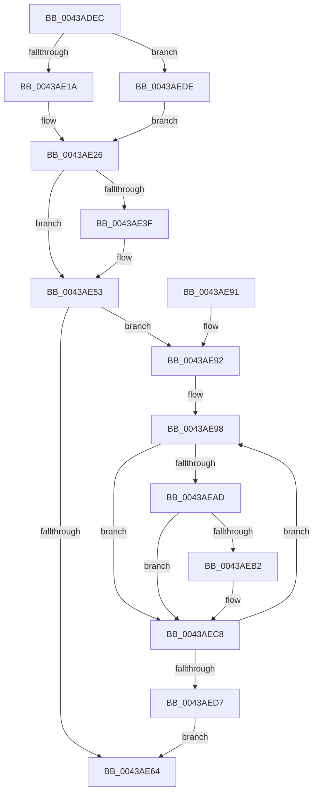

# PopCalculateIdleInformation

- RVA: `0x0043ADEC`–`0x0043AEEC` (길이 `256` bytes)
- VA: `0x000000014043ADEC`
- 실행 섹션: `.text`
- PDB 이름 있음: `예`; PDB Function 태그: `아니요`
- unwind 정보 RVA: `0x000A437C`
- 디코드: `75`개 명령, `256/256` bytes 표시
- 미해석 바이트: `0` (있으면 어셈블리에 `.byte`로 보존)

> 이 문서는 커널 이미지의 기계어와 PDB 기호를 분석해 생성했습니다. 4번과 5번은 함수 원형과 자료형을 바이너리 사용 방식에서 추정한 C 해석이며 원본 소스 복구 결과는 아닙니다.

## 1. Dependencies

- 직접 호출 지점: **3**; 고유 호출 대상: **2**
- 직접 호출자로 확인된 함수: **7**
- RIP 상대 이미지 참조: **2**

### Outgoing calls
- `0x0043AE31` → [PpmQueryPlatformStateResidency](PpmQueryPlatformStateResidency_function_0043AEF4.md) (function, `0x0043AEF4`)
- `0x0043AEA0` → [PpmConvertTimeTo](PpmConvertTimeTo_function_0043B3CC.md) (function, `0x0043B3CC`)
- `0x0043AEBA` → [PpmConvertTimeTo](PpmConvertTimeTo_function_0043B3CC.md) (function, `0x0043B3CC`)

### Direct callers
- [PopCaptureSleepStudyStatistics](PopCaptureSleepStudyStatistics_function_004399F4.md) at `0x00439B2C`
- [PopCalculateCsSummary](PopCalculateCsSummary_function_0043A1B0.md) at `0x0043A1EF`
- [PopDripsWatchdogCallbackWorker](../../page/76/PopDripsWatchdogCallbackWorker_function_0076C360.md) at `0x0076C3D0`
- [PopDripsWatchdogDiagnosticWorker](../../page/76/PopDripsWatchdogDiagnosticWorker_function_0076C600.md) at `0x0076C6B8`
- [PopDripsWatchdogStartWatchdog](../../page/A3/PopDripsWatchdogStartWatchdog_function_00A32148.md) at `0x00A321AC`
- [PopSleepstudyStartNextSession](../../page/AC/PopSleepstudyStartNextSession_function_00AC4720.md) at `0x00AC49D9`
- [PopSleepstudyStartNextSession](../../page/AC/PopSleepstudyStartNextSession_function_00AC4720.md) at `0x00AC4B8D`
- [PopSleepstudyStartNextSession](../../page/AC/PopSleepstudyStartNextSession_function_00AC4720.md) at `0x00AC4BFA`
- [PopSleepstudySnapModernStandbySessionData](../../page/AD/PopSleepstudySnapModernStandbySessionData_function_00AD529C.md) at `0x00AD52CE`

### Static image references
- `0x0043AE05` → RVA `0x00FC6AD0` (`ALMOSTRO`; read)
- `0x0043AE26` → RVA `0x00E27EC0` (`.data`; read)

## 2. Other-region calls and transfers

- 다른 실행 섹션으로 향하는 call: **0**
- 별도 외부 분기/꼬리 이동을 확인하지 못했습니다.

## 3. Assembly (complete function range)

```asm
0043ADEC  48 89 5C 24 20                  mov qword ptr [rsp + 0x20], rbx
0043ADF1  48 89 4C 24 08                  mov qword ptr [rsp + 8], rcx
0043ADF6  55                              push rbp
0043ADF7  56                              push rsi
0043ADF8  57                              push rdi
0043ADF9  41 54                           push r12
0043ADFB  41 55                           push r13
0043ADFD  41 56                           push r14
0043ADFF  41 57                           push r15
0043AE01  48 83 EC 20                     sub rsp, 0x20
0043AE05  48 8B 35 C4 BC B8 00            mov rsi, qword ptr [rip + 0xb8bcc4]
0043AE0C  33 DB                           xor ebx, ebx
0043AE0E  48 8B F9                        mov rdi, rcx
0043AE11  48 85 F6                        test rsi, rsi
0043AE14  0F 84 C4 00 00 00               je 0x14043aede
0043AE1A  48 8B 76 30                     mov rsi, qword ptr [rsi + 0x30]
0043AE1E  44 8B 7E 04                     mov r15d, dword ptr [rsi + 4]
0043AE22  44 8B 66 08                     mov r12d, dword ptr [rsi + 8]
0043AE26  8B 0D 94 D0 9E 00               mov ecx, dword ptr [rip + 0x9ed094]
0043AE2C  48 89 5C 24 70                  mov qword ptr [rsp + 0x70], rbx
0043AE31  E8 BE 00 00 00                  call 0x14043aef4
0043AE36  48 8B E8                        mov rbp, rax
0043AE39  48 83 F8 FF                     cmp rax, -1
0043AE3D  74 14                           je 0x14043ae53
0043AE3F  48 B8 CD CC CC CC CC CC CC CC   movabs rax, 0xcccccccccccccccd
0043AE49  48 F7 E5                        mul rbp
0043AE4C  48 8B EA                        mov rbp, rdx
0043AE4F  48 C1 ED 03                     shr rbp, 3
0043AE53  8B 05 67 D0 9E 00               mov eax, dword ptr [rip + 0x9ed067]
0043AE59  44 8B EB                        mov r13d, ebx
0043AE5C  44 8B F3                        mov r14d, ebx
0043AE5F  45 85 FF                        test r15d, r15d
0043AE62  75 2E                           jne 0x14043ae92
0043AE64  48 8B 44 24 70                  mov rax, qword ptr [rsp + 0x70]
0043AE69  48 89 1F                        mov qword ptr [rdi], rbx
0043AE6C  48 8B 5C 24 78                  mov rbx, qword ptr [rsp + 0x78]
0043AE71  48 89 47 08                     mov qword ptr [rdi + 8], rax
0043AE75  48 89 6F 10                     mov qword ptr [rdi + 0x10], rbp
0043AE79  44 89 6F 18                     mov dword ptr [rdi + 0x18], r13d
0043AE7D  44 89 67 1C                     mov dword ptr [rdi + 0x1c], r12d
0043AE81  48 83 C4 20                     add rsp, 0x20
0043AE85  41 5F                           pop r15
0043AE87  41 5E                           pop r14
0043AE89  41 5D                           pop r13
0043AE8B  41 5C                           pop r12
0043AE8D  5F                              pop rdi
0043AE8E  5E                              pop rsi
0043AE8F  5D                              pop rbp
0043AE90  C3                              ret
0043AE91  CC                              int3
0043AE92  48 83 C6 48                     add rsi, 0x48
0043AE96  8B F8                           mov edi, eax
0043AE98  48 8B 0E                        mov rcx, qword ptr [rsi]
0043AE9B  BA 40 42 0F 00                  mov edx, 0xf4240
0043AEA0  E8 27 05 00 00                  call 0x14043b3cc
0043AEA5  48 03 D8                        add rbx, rax
0043AEA8  83 FF FF                        cmp edi, -1
0043AEAB  74 1B                           je 0x14043aec8
0043AEAD  44 3B F7                        cmp r14d, edi
0043AEB0  75 16                           jne 0x14043aec8
0043AEB2  48 8B 0E                        mov rcx, qword ptr [rsi]
0043AEB5  BA 40 42 0F 00                  mov edx, 0xf4240
0043AEBA  E8 0D 05 00 00                  call 0x14043b3cc
0043AEBF  44 8B 6E E8                     mov r13d, dword ptr [rsi - 0x18]
0043AEC3  48 89 44 24 70                  mov qword ptr [rsp + 0x70], rax
0043AEC8  41 FF C6                        inc r14d
0043AECB  48 81 C6 00 04 00 00            add rsi, 0x400
0043AED2  45 3B F7                        cmp r14d, r15d
0043AED5  72 C1                           jb 0x14043ae98
0043AED7  48 8B 7C 24 60                  mov rdi, qword ptr [rsp + 0x60]
0043AEDC  EB 86                           jmp 0x14043ae64
0043AEDE  48 8B F3                        mov rsi, rbx
0043AEE1  44 8B FB                        mov r15d, ebx
0043AEE4  44 8B E3                        mov r12d, ebx
0043AEE7  E9 3A FF FF FF                  jmp 0x14043ae26
```

## 4. C-style interpretation (structured pseudocode)

```c
__int64 __fastcall PopCalculateIdleInformation(__int64 a1, __int64 a2)
{
    __int64 result;
    __int64 v_r13;
    __int64 v_r14;
    __int64 v_rbp;
    __int64 v_rbx;
    __int64 v_rsi;
    __int64 v_rsp;
    unsigned __int64 v_stack_p18;
    unsigned __int64 v_stack_p20;
    unsigned __int64 v_stack_p60;
    unsigned __int64 v_stack_p70;
    unsigned __int64 v_stack_p8;

    v_stack_p20 = v_rbx;
    v_stack_p8 = a1;
    v_rsp = (v_rsp) - (32);
    v_rbx = 0;
    if (*(unsigned __int64 *)(v_rip + 12106948) == 0) goto loc_0043AEDE;
loc_0043AE26:
    v_stack_p18 = 0;
    result = PpmQueryPlatformStateResidency((unsigned int)(*(unsigned int *)(v_rip + 10408084)), a2, a3, a4);
    v_rbp = result;
    if (result != -1) {
        v_rbp = a2;
        v_rbp = (v_rbp) >> (3);
    }
    if ((unsigned int)((unsigned int)(*(unsigned int *)(*(unsigned __int64 *)(*(unsigned __int64 *)(v_rip + 12106948) + 48) + 4))) != 0) goto loc_0043AE92;
loc_0043AE64:
    *(unsigned __int64 *)(a1) = 0;
    *(unsigned __int64 *)(a1 + 8) = v_stack_p18;
    *(unsigned __int64 *)(a1 + 16) = v_rbp;
    *(unsigned int *)(a1 + 24) = 0;
    *(unsigned int *)(a1 + 28) = (unsigned int)((unsigned int)(*(unsigned int *)(*(unsigned __int64 *)(*(unsigned __int64 *)(v_rip + 12106948) + 48) + 8)));
    v_rsp = (v_rsp) + (32);
    return v_stack_p18;
loc_0043AE92:
    v_rsi = (*(unsigned __int64 *)(*(unsigned __int64 *)(v_rip + 12106948) + 48)) + (72);
loc_0043AE98:
    result = PpmConvertTimeTo(*(unsigned __int64 *)(v_rsi), (unsigned int)(0xF4240ULL), a3, a4);
    v_rbx = (v_stack_p20) + (result);
    if (((unsigned int)((unsigned int)((unsigned int)(v_stack_p18)))) == -1) goto loc_0043AEC8;
    v_r13 = 0;
    if (0 == ((unsigned int)((unsigned int)((unsigned int)(v_stack_p18))))) {
        a1 = *(unsigned __int64 *)(v_rsi);
        a2 = 0xF4240ULL;
        result = PpmConvertTimeTo(a1, a2, a3, a4);
        v_r13 = *(unsigned int *)(v_rsi - 24);
        v_stack_p70 = result;
    }
    v_r14 = (unsigned int)((0) + 1);
    v_rsi = (v_rsi) + (0x400ULL);
    if (((unsigned int)(v_r14)) < ((unsigned int)((unsigned int)(*(unsigned int *)(*(unsigned __int64 *)(*(unsigned __int64 *)(v_rip + 12106948) + 48) + 4))))) goto loc_0043AE98;
    goto loc_0043AE64;
loc_0043AEDE:
    goto loc_0043AE26;
}
```

## 5. (Beta) C Style

```c
int64_t PopCalculateIdleInformation(int64_t Arg1, int64_t Arg2)
{
    int64_t result;
    int64_t local_r13;
    int64_t local_r14;
    int64_t local_rbp;
    int64_t local_rbx;
    int64_t local_rsi;
    int64_t local_rsp;
    uint64_t v_stack_p18;
    uint64_t v_stack_p20;
    uint64_t v_stack_p60;
    uint64_t v_stack_p70;
    uint64_t v_stack_p8;

    v_stack_p20 = local_rbx;
    v_stack_p8 = Arg1;
    local_rsp = (local_rsp) - (32);
    local_rbx = 0;
    if (*(uint64_t *)(v_rip + 0xB8BCC4) == 0) goto loc_0043AEDE;
loc_0043AE26:
    v_stack_p18 = 0;
    result = PpmQueryPlatformStateResidency((uint32_t)(*(uint32_t *)(v_rip + 0x9ED094)), Arg2, a3, a4);
    local_rbp = result;
    if (result != -1) {
        local_rbp = Arg2;
        local_rbp = (local_rbp) >> (3);
    }
    if ((uint32_t)((uint32_t)(*(uint32_t *)(*(uint64_t *)(*(uint64_t *)(v_rip + 0xB8BCC4) + 0x30) + 0x4))) != 0) goto loc_0043AE92;
loc_0043AE64:
    *(uint64_t *)(Arg1) = 0;
    *(uint64_t *)(Arg1 + 0x8) = v_stack_p18;
    *(uint64_t *)(Arg1 + 0x10) = local_rbp;
    *(uint32_t *)(Arg1 + 0x18) = 0;
    *(uint32_t *)(Arg1 + 0x1C) = (uint32_t)((uint32_t)(*(uint32_t *)(*(uint64_t *)(*(uint64_t *)(v_rip + 0xB8BCC4) + 0x30) + 0x8)));
    local_rsp = (local_rsp) + (32);
    return v_stack_p18;
loc_0043AE92:
    local_rsi = (*(uint64_t *)(*(uint64_t *)(v_rip + 0xB8BCC4) + 0x30)) + (72);
loc_0043AE98:
    result = PpmConvertTimeTo(*(uint64_t *)(local_rsi), (uint32_t)(0xF4240ULL), a3, a4);
    local_rbx = (v_stack_p20) + (result);
    if (((uint32_t)((uint32_t)((uint32_t)(v_stack_p18)))) == -1) goto loc_0043AEC8;
    local_r13 = 0;
    if (0 == ((uint32_t)((uint32_t)((uint32_t)(v_stack_p18))))) {
        Arg1 = *(uint64_t *)(local_rsi);
        Arg2 = 0xF4240ULL;
        result = PpmConvertTimeTo(Arg1, Arg2, a3, a4);
        local_r13 = *(uint32_t *)(local_rsi - 0x18);
        v_stack_p70 = result;
    }
    local_r14 = (uint32_t)((0) + 1);
    local_rsi = (local_rsi) + (0x400ULL);
    if (((uint32_t)(local_r14)) < ((uint32_t)((uint32_t)(*(uint32_t *)(*(uint64_t *)(*(uint64_t *)(v_rip + 0xB8BCC4) + 0x30) + 0x4))))) goto loc_0043AE98;
    goto loc_0043AE64;
loc_0043AEDE:
    goto loc_0043AE26;
}
```

## 6. Execution-region graph

[열기: 2D/3D 그래프와 함수 탐색 컨트롤 패널](../../../control-panel.html?section=text&rva=0x0043ADEC&view=graph)

- 2D 그래프는 위에서 아래로 흐르고, 3D 그래프는 빈 공간을 드래그해 회전합니다. Shift+드래그는 이동, 휠은 확대·축소, 함수 노드 선택은 대상 보고서 이동입니다.

### Static fallback


