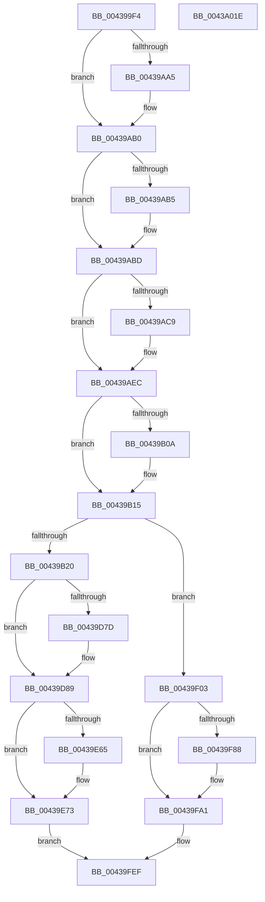

# PopCaptureSleepStudyStatistics

- RVA: `0x004399F4`–`0x0043A01F` (길이 `1,579` bytes)
- VA: `0x00000001404399F4`
- 실행 섹션: `.text`
- PDB 이름 있음: `예`; PDB Function 태그: `아니요`
- unwind 정보 RVA: `0x000A42D0`
- 디코드: `337`개 명령, `1,579/1,579` bytes 표시
- 미해석 바이트: `0` (있으면 어셈블리에 `.byte`로 보존)

> 이 문서는 커널 이미지의 기계어와 PDB 기호를 분석해 생성했습니다. 4번과 5번은 함수 원형과 자료형을 바이너리 사용 방식에서 추정한 C 해석이며 원본 소스 복구 결과는 아닙니다.

## 1. Dependencies

- 직접 호출 지점: **53**; 고유 호출 대상: **40**
- 직접 호출자로 확인된 함수: **1**
- RIP 상대 이미지 참조: **72**

### Outgoing calls
- `0x00439A62` → [memset](../6C/memset_function_006C6C40.md) (function, `0x006C6C40`)
- `0x00439AB5` → [PopIsLockConsoleTimeoutActive](../../page/91/PopIsLockConsoleTimeoutActive_function_0091238C.md) (function, `0x0091238C`)
- `0x00439AD3` → [guard_dispatch_icall](../6B/guard_dispatch_icall_function_006BAAD0.md) (function, `0x006BAAD0`)
- `0x00439AEC` → [PopAcquirePolicyLock](../../pagelk/B7/PopAcquirePolicyLock_function_00B783C0.md) (function, `0x00B783C0`)
- `0x00439B2C` → [PopCalculateIdleInformation](PopCalculateIdleInformation_function_0043ADEC.md) (function, `0x0043ADEC`)
- `0x00439B41` → [PpmGetPlatformSelectionVetoCounts](../4B/PpmGetPlatformSelectionVetoCounts_function_004BFCA0.md) (function, `0x004BFCA0`)
- `0x00439C0E` → [KeAcquireSpinLockRaiseToDpc](../20/KeAcquireSpinLockRaiseToDpc_function_00208470.md) (function, `0x00208470`)
- `0x00439C3B` → [KeReleaseSpinLock](../39/KeReleaseSpinLock_function_00392BA0.md) (function, `0x00392BA0`)
- `0x00439C47` → [PopGetEnergyCounter](../../page/AB/PopGetEnergyCounter_function_00AB1BA4.md) (function, `0x00AB1BA4`)
- `0x00439C60` → [PopNetIsCompliantNicPresent](../../page/AB/PopNetIsCompliantNicPresent_function_00AB8E04.md) (function, `0x00AB8E04`)
- `0x00439C9D` → [PopGetPowerSettingValue](../49/PopGetPowerSettingValue_function_0049C6CC.md) (function, `0x0049C6CC`)
- `0x00439CD9` → [PopGetPowerSettingValue](../49/PopGetPowerSettingValue_function_0049C6CC.md) (function, `0x0049C6CC`)
- `0x00439D05` → [PopGetPowerSettingValue](../49/PopGetPowerSettingValue_function_0049C6CC.md) (function, `0x0049C6CC`)
- `0x00439D38` → [PopGetPowerSettingValue](../49/PopGetPowerSettingValue_function_0049C6CC.md) (function, `0x0049C6CC`)
- `0x00439D55` → [PopQueryRemainingSystemIdleTime](../../page/AC/PopQueryRemainingSystemIdleTime_function_00AC60B0.md) (function, `0x00AC60B0`)
- `0x00439D71` → [PopFilterCapabilities](../../page/91/PopFilterCapabilities_function_0091141C.md) (function, `0x0091141C`)
- `0x00439D81` → [PopIsHibernateSupported](../../page/AA/PopIsHibernateSupported_function_00AA3DFC.md) (function, `0x00AA3DFC`)
- `0x00439DAD` → [PopGetPowerSettingValue](../49/PopGetPowerSettingValue_function_0049C6CC.md) (function, `0x0049C6CC`)
- `0x00439DD9` → [PopGetPowerSettingValue](../49/PopGetPowerSettingValue_function_0049C6CC.md) (function, `0x0049C6CC`)
- `0x00439E09` → [PopGetPowerSettingValue](../49/PopGetPowerSettingValue_function_0049C6CC.md) (function, `0x0049C6CC`)
- `0x00439E2A` → [PopGetPowerSettingValue](../49/PopGetPowerSettingValue_function_0049C6CC.md) (function, `0x0049C6CC`)
- `0x00439E3C` → [PopDiagGetPowerSchemeInfo](../4D/PopDiagGetPowerSchemeInfo_function_004D84A0.md) (function, `0x004D84A0`)
- `0x00439E5B` → [PopFxLookupSocSubsystemsByPlatformIdleState](../../page/97/PopFxLookupSocSubsystemsByPlatformIdleState_function_0097ABEC.md) (function, `0x0097ABEC`)
- `0x00439E6B` → [PopFxResetSocSubsystemAccounting](../../page/75/PopFxResetSocSubsystemAccounting_function_0075A6A0.md) (function, `0x0075A6A0`)
- `0x00439E73` → [PopFxStartDeviceAccounting](../4A/PopFxStartDeviceAccounting_function_004A384C.md) (function, `0x004A384C`)
- `0x00439E78` → [PpmIdleStartCsVetoAccounting](../30/PpmIdleStartCsVetoAccounting_function_0030326C.md) (function, `0x0030326C`)
- `0x00439E95` → [ExStartRecordingIRTimerExpiries](../../page/7C/ExStartRecordingIRTimerExpiries_function_007CAD18.md) (function, `0x007CAD18`)
- `0x00439E9A` → [PpmResetDripsAccountingSnapshot](../4F/PpmResetDripsAccountingSnapshot_function_004F9678.md) (function, `0x004F9678`)
- `0x00439EA1` → [PopGetModernStandbyTransitionReason](../4B/PopGetModernStandbyTransitionReason_function_004BDF6C.md) (function, `0x004BDF6C`)
- `0x00439EAA` → [PopDiagTraceCsEnterReason](../../page/AA/PopDiagTraceCsEnterReason_function_00AA81AC.md) (function, `0x00AA81AC`)
- `0x00439EB1` → [PopSetConnectedStandbyMarker](../../page/AA/PopSetConnectedStandbyMarker_function_00AA2BA0.md) (function, `0x00AA2BA0`)
- `0x00439EC9` → [PopDirectedDripsNotify](../../page/A8/PopDirectedDripsNotify_function_00A80850.md) (function, `0x00A80850`)
- `0x00439ED7` → [PopQueryInputSuppressionCount](../../page/AB/PopQueryInputSuppressionCount_function_00AB79E0.md) (function, `0x00AB79E0`)
- `0x00439EEF` → [PopQueryPowerButtonSuppressionCount](../../page/AB/PopQueryPowerButtonSuppressionCount_function_00ABC338.md) (function, `0x00ABC338`)
- `0x00439F0A` → [PopDiagTraceFxRundown](PopDiagTraceFxRundown_function_0043A028.md) (function, `0x0043A028`)
- `0x00439F18` → [PopCalculateCsSummary](PopCalculateCsSummary_function_0043A1B0.md) (function, `0x0043A1B0`)
- `0x00439F2C` → [PopDirectedDripsNotify](../../page/A8/PopDirectedDripsNotify_function_00A80850.md) (function, `0x00A80850`)
- `0x00439F37` → [PpmIdleCaptureCsVetoAccounting](PpmIdleCaptureCsVetoAccounting_function_0043B6CC.md) (function, `0x0043B6CC`)
- `0x00439F3C` → [ExStopRecordingIRTimerExpiries](../../page/AD/ExStopRecordingIRTimerExpiries_function_00AD66A0.md) (function, `0x00AD66A0`)
- `0x00439F45` → [PopFxStopDeviceAccounting](../42/PopFxStopDeviceAccounting_function_004261D8.md) (function, `0x004261D8`)
- `0x00439F60` → [PpmSnapDripsAccountingSnapshot](PpmSnapDripsAccountingSnapshot_function_0043B11C.md) (function, `0x0043B11C`)
- `0x00439F68` → [PopDiagTraceCsConsumption](../../page/AB/PopDiagTraceCsConsumption_function_00ABFECC.md) (function, `0x00ABFECC`)
- `0x00439F73` → [PopDiagTraceCsExitReason](../../page/AC/PopDiagTraceCsExitReason_function_00ACFB24.md) (function, `0x00ACFB24`)
- `0x00439F7E` → [PopFxLookupSocSubsystemsByPlatformIdleState](../../page/97/PopFxLookupSocSubsystemsByPlatformIdleState_function_0097ABEC.md) (function, `0x0097ABEC`)
- `0x00439F8E` → [PopFxLogSocSubsystemBlockingTimes](../../page/97/PopFxLogSocSubsystemBlockingTimes_function_0097A4EC.md) (function, `0x0097A4EC`)
- `0x00439F99` → [PopFxLogSocSubsystemMetadata](../../page/97/PopFxLogSocSubsystemMetadata_function_0097AC1C.md) (function, `0x0097AC1C`)
- `0x00439FA8` → [KeAcquireSpinLockRaiseToDpc](../20/KeAcquireSpinLockRaiseToDpc_function_00208470.md) (function, `0x00208470`)
- `0x00439FBC` → [KeReleaseSpinLock](../39/KeReleaseSpinLock_function_00392BA0.md) (function, `0x00392BA0`)
- `0x00439FC3` → [PopClearConnectedStandbyMarker](../../page/AB/PopClearConnectedStandbyMarker_function_00AB38D8.md) (function, `0x00AB38D8`)
- `0x00439FD6` → [KeAcquireSpinLockRaiseToDpc](../20/KeAcquireSpinLockRaiseToDpc_function_00208470.md) (function, `0x00208470`)
- `0x00439FEA` → [KeReleaseSpinLock](../39/KeReleaseSpinLock_function_00392BA0.md) (function, `0x00392BA0`)
- `0x00439FEF` → [PopReleasePolicyLock](../../pagelk/B7/PopReleasePolicyLock_function_00B78410.md) (function, `0x00B78410`)
- `0x00439FFE` → [_security_check_cookie](../6A/_security_check_cookie_function_006AC640.md) (function, `0x006AC640`)

### Direct callers
- [PopSleepstudyCaptureSessionStatistics](../../page/AD/PopSleepstudyCaptureSessionStatistics_function_00AD7554.md) at `0x00AD7732`

### Static image references
- `0x00439A10` → RVA `0x00E0A740` (`.data`; read)
- `0x00439A7E` → RVA `0x000146E0` (`.rdata`; read)
- `0x00439AA9` → RVA `0x000146E8` (`.rdata`; read)
- `0x00439ABD` → RVA `0x00E67828` (`.data`; read)
- `0x00439B25` → RVA `0x00F0B6B0` (`.data`; write)
- `0x00439B31` → RVA `0x00E27EC0` (`.data`; read)
- `0x00439B4A` → RVA `0x00F0C9B8` (`.data`; read)
- `0x00439B51` → RVA `0x00E27D00` (`.data`; write)
- `0x00439B5C` → RVA `0x00E27D10` (`.data`; write)
- `0x00439B66` → RVA `0x00E27D20` (`.data`; write)
- `0x00439B71` → RVA `0x00E27D18` (`.data`; write)
- `0x00439B78` → RVA `0x00F21F98` (`.data`; read)
- `0x00439B7F` → RVA `0x00E27D28` (`.data`; write)
- `0x00439B8A` → RVA `0x00E27DA8` (`.data`; write)
- `0x00439B96` → RVA `0x00E27DB0` (`.data`; write)
- `0x00439BA2` → RVA `0x00E27DB8` (`.data`; write)
- `0x00439BAD` → RVA `0x00E27DE8` (`.data`; write)
- `0x00439BB3` → RVA `0x00E27D08` (`.data`; write)
- `0x00439BBA` → RVA `0x00E27D38` (`.data`; write)
- `0x00439BC1` → RVA `0x00E27D48` (`.data`; write)
- `0x00439BC8` → RVA `0x00E27D98` (`.data`; write)
- `0x00439BCF` → RVA `0x00E27DA0` (`.data`; write)
- `0x00439BD6` → RVA `0x00E27D58` (`.data`; write)
- `0x00439BDD` → RVA `0x00E27D68` (`.data`; write)
- `0x00439BE4` → RVA `0x00E27D78` (`.data`; write)
- `0x00439BEB` → RVA `0x00E27D90` (`.data`; write)
- `0x00439BF2` → RVA `0x00E27DF8` (`.data`; write)
- `0x00439BF9` → RVA `0x00E27E00` (`.data`; write)
- `0x00439C00` → RVA `0x00E27E08` (`.data`; write)
- `0x00439C07` → RVA `0x00E27DE4` (`.data`; write)
- `0x00439C15` → RVA `0x00F0C9A8` (`.data`; write)
- `0x00439C23` → RVA `0x00F0C9B0` (`.data`; write)
- `0x00439C2A` → RVA `0x00F0C9A0` (`.data`; write)
- `0x00439C31` → RVA `0x00F0C9C0` (`.data`; write)
- `0x00439C40` → RVA `0x00F0B6C0` (`.data`; read)
- `0x00439C4C` → RVA `0x00F0CE0C` (`.data`; read)
- `0x00439C52` → RVA `0x00E27DD8` (`.data`; write)
- `0x00439C6A` → RVA `0x00E27DD9` (`.data`; read)
- `0x00439C87` → RVA `0x00E27DD9` (`.data`; write)
- `0x00439C8D` → RVA `0x00024558` (`.rdata`; read)
- `0x00439CCE` → RVA `0x0001E320` (`.rdata`; read)
- `0x00439CE7` → RVA `0x00E27DC0` (`.data`; write)
- `0x00439CED` → RVA `0x00024B88` (`.rdata`; read)
- `0x00439D13` → RVA `0x00E27DC4` (`.data`; write)
- `0x00439D19` → RVA `0x00011A68` (`.rdata`; read)
- `0x00439D25` → RVA `0x00E27DC8` (`.data`; write)
- `0x00439D41` → RVA `0x00E27DD4` (`.data`; read)
- `0x00439D48` → RVA `0x00E27DD0` (`.data`; read)
- `0x00439D4F` → RVA `0x00E27DCC` (`.data`; write)
- `0x00439D5A` → RVA `0x00F475F8` (`.data`; read)
- `0x00439D64` → RVA `0x00F0CEC0` (`.data`; read)
- `0x00439D6B` → RVA `0x00E27DED` (`.data`; write)
- `0x00439D8E` → RVA `0x00E27DEC` (`.data`; write)
- `0x00439DA6` → RVA `0x00011A58` (`.rdata`; read)
- `0x00439DBB` → RVA `0x00E27DF0` (`.data`; write)
- `0x00439DC1` → RVA `0x00024808` (`.rdata`; read)
- `0x00439DE6` → RVA `0x00E27DF4` (`.data`; write)
- `0x00439DEC` → RVA `0x00024598` (`.rdata`; read)
- `0x00439E1F` → RVA `0x000248E8` (`.rdata`; read)
- `0x00439E48` → RVA `0x00E27E18` (`.data`; write)
- `0x00439E4E` → RVA `0x00E27E80` (`.data`; read/write)
- `0x00439E7D` → RVA `0x00F0CFA8` (`.data`; read)
- `0x00439E83` → RVA `0x00E27DDC` (`.data`; write)
- `0x00439E89` → RVA `0x00F0C9D8` (`.data`; read)
- `0x00439E8F` → RVA `0x00E27DE0` (`.data`; write)
- `0x00439EB6` → RVA `0x00F0B410` (`.data`; read)
- `0x00439EE0` → RVA `0x00E27E10` (`.data`; write)
- `0x00439EF8` → RVA `0x00E27E14` (`.data`; write)
- `0x00439F03` → RVA `0x00F0B6B0` (`.data`; read)
- `0x00439F0F` → RVA `0x00F0B4E0` (`.data`; read)
- `0x00439FA1` → RVA `0x00E0B840` (`.data`; read)
- `0x00439FAD` → RVA `0x00E0B850` (`.data`; read)

## 2. Other-region calls and transfers

- 다른 실행 섹션으로 향하는 call: **24**
  - `0x00439AB5` → [PopIsLockConsoleTimeoutActive](../../page/91/PopIsLockConsoleTimeoutActive_function_0091238C.md) (`.text` → `PAGE`)
  - `0x00439AEC` → [PopAcquirePolicyLock](../../pagelk/B7/PopAcquirePolicyLock_function_00B783C0.md) (`.text` → `PAGELK`)
  - `0x00439C47` → [PopGetEnergyCounter](../../page/AB/PopGetEnergyCounter_function_00AB1BA4.md) (`.text` → `PAGE`)
  - `0x00439C60` → [PopNetIsCompliantNicPresent](../../page/AB/PopNetIsCompliantNicPresent_function_00AB8E04.md) (`.text` → `PAGE`)
  - `0x00439D55` → [PopQueryRemainingSystemIdleTime](../../page/AC/PopQueryRemainingSystemIdleTime_function_00AC60B0.md) (`.text` → `PAGE`)
  - `0x00439D71` → [PopFilterCapabilities](../../page/91/PopFilterCapabilities_function_0091141C.md) (`.text` → `PAGE`)
  - `0x00439D81` → [PopIsHibernateSupported](../../page/AA/PopIsHibernateSupported_function_00AA3DFC.md) (`.text` → `PAGE`)
  - `0x00439E5B` → [PopFxLookupSocSubsystemsByPlatformIdleState](../../page/97/PopFxLookupSocSubsystemsByPlatformIdleState_function_0097ABEC.md) (`.text` → `PAGE`)
  - `0x00439E6B` → [PopFxResetSocSubsystemAccounting](../../page/75/PopFxResetSocSubsystemAccounting_function_0075A6A0.md) (`.text` → `PAGE`)
  - `0x00439E95` → [ExStartRecordingIRTimerExpiries](../../page/7C/ExStartRecordingIRTimerExpiries_function_007CAD18.md) (`.text` → `PAGE`)
  - `0x00439EAA` → [PopDiagTraceCsEnterReason](../../page/AA/PopDiagTraceCsEnterReason_function_00AA81AC.md) (`.text` → `PAGE`)
  - `0x00439EB1` → [PopSetConnectedStandbyMarker](../../page/AA/PopSetConnectedStandbyMarker_function_00AA2BA0.md) (`.text` → `PAGE`)
  - `0x00439EC9` → [PopDirectedDripsNotify](../../page/A8/PopDirectedDripsNotify_function_00A80850.md) (`.text` → `PAGE`)
  - `0x00439ED7` → [PopQueryInputSuppressionCount](../../page/AB/PopQueryInputSuppressionCount_function_00AB79E0.md) (`.text` → `PAGE`)
  - `0x00439EEF` → [PopQueryPowerButtonSuppressionCount](../../page/AB/PopQueryPowerButtonSuppressionCount_function_00ABC338.md) (`.text` → `PAGE`)
  - `0x00439F2C` → [PopDirectedDripsNotify](../../page/A8/PopDirectedDripsNotify_function_00A80850.md) (`.text` → `PAGE`)
  - `0x00439F3C` → [ExStopRecordingIRTimerExpiries](../../page/AD/ExStopRecordingIRTimerExpiries_function_00AD66A0.md) (`.text` → `PAGE`)
  - `0x00439F68` → [PopDiagTraceCsConsumption](../../page/AB/PopDiagTraceCsConsumption_function_00ABFECC.md) (`.text` → `PAGE`)
  - `0x00439F73` → [PopDiagTraceCsExitReason](../../page/AC/PopDiagTraceCsExitReason_function_00ACFB24.md) (`.text` → `PAGE`)
  - `0x00439F7E` → [PopFxLookupSocSubsystemsByPlatformIdleState](../../page/97/PopFxLookupSocSubsystemsByPlatformIdleState_function_0097ABEC.md) (`.text` → `PAGE`)
  - `0x00439F8E` → [PopFxLogSocSubsystemBlockingTimes](../../page/97/PopFxLogSocSubsystemBlockingTimes_function_0097A4EC.md) (`.text` → `PAGE`)
  - `0x00439F99` → [PopFxLogSocSubsystemMetadata](../../page/97/PopFxLogSocSubsystemMetadata_function_0097AC1C.md) (`.text` → `PAGE`)
  - `0x00439FC3` → [PopClearConnectedStandbyMarker](../../page/AB/PopClearConnectedStandbyMarker_function_00AB38D8.md) (`.text` → `PAGE`)
  - `0x00439FEF` → [PopReleasePolicyLock](../../pagelk/B7/PopReleasePolicyLock_function_00B78410.md) (`.text` → `PAGELK`)
- 별도 외부 분기/꼬리 이동을 확인하지 못했습니다.

## 3. Assembly (complete function range)

```asm
004399F4  48 89 5C 24 08                  mov qword ptr [rsp + 8], rbx
004399F9  55                              push rbp
004399FA  56                              push rsi
004399FB  57                              push rdi
004399FC  41 54                           push r12
004399FE  41 55                           push r13
00439A00  41 56                           push r14
00439A02  41 57                           push r15
00439A04  48 8D 6C 24 F0                  lea rbp, [rsp - 0x10]
00439A09  48 81 EC 10 01 00 00            sub rsp, 0x110
00439A10  48 8B 05 29 0D 9D 00            mov rax, qword ptr [rip + 0x9d0d29]
00439A17  48 33 C4                        xor rax, rsp
00439A1A  48 89 45 00                     mov qword ptr [rbp], rax
00439A1E  45 33 F6                        xor r14d, r14d
00439A21  0F 57 C0                        xorps xmm0, xmm0
00439A24  49 8B D8                        mov rbx, r8
00439A27  44 89 74 24 34                  mov dword ptr [rsp + 0x34], r14d
00439A2C  4C 8B EA                        mov r13, rdx
00439A2F  4C 89 74 24 60                  mov qword ptr [rsp + 0x60], r14
00439A34  48 8B F1                        mov rsi, rcx
00439A37  44 89 74 24 30                  mov dword ptr [rsp + 0x30], r14d
00439A3C  0F 57 C9                        xorps xmm1, xmm1
00439A3F  4C 89 74 24 68                  mov qword ptr [rsp + 0x68], r14
00439A44  45 8D 46 4C                     lea r8d, [r14 + 0x4c]
00439A48  33 D2                           xor edx, edx
00439A4A  48 8D 4D 90                     lea rcx, [rbp - 0x70]
00439A4E  49 8B F9                        mov rdi, r9
00439A51  0F 11 44 24 70                  movups xmmword ptr [rsp + 0x70], xmm0
00439A56  0F 11 45 80                     movups xmmword ptr [rbp - 0x80], xmm0
00439A5A  0F 11 45 F0                     movups xmmword ptr [rbp - 0x10], xmm0
00439A5E  0F 11 4D E0                     movups xmmword ptr [rbp - 0x20], xmm1
00439A62  E8 D9 D1 28 00                  call 0x1406c6c40
00439A67  8B 43 0C                        mov eax, dword ptr [rbx + 0xc]
00439A6A  45 8A FE                        mov r15b, r14b
00439A6D  89 44 24 58                     mov dword ptr [rsp + 0x58], eax
00439A71  45 8A E6                        mov r12b, r14b
00439A74  8B 43 08                        mov eax, dword ptr [rbx + 8]
00439A77  89 44 24 50                     mov dword ptr [rsp + 0x50], eax
00439A7B  48 8B 06                        mov rax, qword ptr [rsi]
00439A7E  48 2B 05 5B AC BD FF            sub rax, qword ptr [rip - 0x4253a5]
00439A85  44 89 74 24 38                  mov dword ptr [rsp + 0x38], r14d
00439A8A  44 89 74 24 4C                  mov dword ptr [rsp + 0x4c], r14d
00439A8F  44 89 74 24 48                  mov dword ptr [rsp + 0x48], r14d
00439A94  44 89 74 24 40                  mov dword ptr [rsp + 0x40], r14d
00439A99  44 89 74 24 44                  mov dword ptr [rsp + 0x44], r14d
00439A9E  44 89 74 24 3C                  mov dword ptr [rsp + 0x3c], r14d
00439AA3  75 0B                           jne 0x140439ab0
00439AA5  48 8B 46 08                     mov rax, qword ptr [rsi + 8]
00439AA9  48 2B 05 38 AC BD FF            sub rax, qword ptr [rip - 0x4253c8]
00439AB0  48 85 C0                        test rax, rax
00439AB3  75 08                           jne 0x140439abd
00439AB5  E8 D2 88 4D 00                  call 0x14091238c
00439ABA  44 8A E0                        mov r12b, al
00439ABD  48 8B 05 64 DD A2 00            mov rax, qword ptr [rip + 0xa2dd64]
00439AC4  48 85 C0                        test rax, rax
00439AC7  74 23                           je 0x140439aec
00439AC9  48 8D 9F A8 00 00 00            lea rbx, [rdi + 0xa8]
00439AD0  48 8B CB                        mov rcx, rbx
00439AD3  E8 F8 0F 28 00                  call 0x1406baad0
00439AD8  48 B8 CD CC CC CC CC CC CC CC   movabs rax, 0xcccccccccccccccd
00439AE2  48 F7 23                        mul qword ptr [rbx]
00439AE5  48 C1 EA 03                     shr rdx, 3
00439AE9  48 89 13                        mov qword ptr [rbx], rdx
00439AEC  E8 CF E8 73 00                  call 0x140b783c0
00439AF1  48 BB 08 00 00 00 80 F7 FF FF   movabs rbx, 0xfffff78000000008
00439AFB  48 8B 1B                        mov rbx, qword ptr [rbx]
00439AFE  48 8B 06                        mov rax, qword ptr [rsi]
00439B01  48 2B 05 D8 AB BD FF            sub rax, qword ptr [rip - 0x425428]
00439B08  75 0B                           jne 0x140439b15
00439B0A  48 8B 46 08                     mov rax, qword ptr [rsi + 8]
00439B0E  48 2B 05 D3 AB BD FF            sub rax, qword ptr [rip - 0x42542d]
00439B15  33 F6                           xor esi, esi
00439B17  48 85 C0                        test rax, rax
00439B1A  0F 85 E3 03 00 00               jne 0x140439f03
00439B20  48 8D 4C 24 70                  lea rcx, [rsp + 0x70]
00439B25  4C 89 2D 84 1B AD 00            mov qword ptr [rip + 0xad1b84], r13
00439B2C  E8 BB 12 00 00                  call 0x14043adec
00439B31  8B 0D 89 E3 9E 00               mov ecx, dword ptr [rip + 0x9ee389]
00439B37  4C 8D 44 24 68                  lea r8, [rsp + 0x68]
00439B3C  48 8D 54 24 60                  lea rdx, [rsp + 0x60]
00439B41  E8 5A 61 08 00                  call 0x1404bfca0
00439B46  8B 44 24 58                     mov eax, dword ptr [rsp + 0x58]
00439B4A  48 8D 0D 67 2E AD 00            lea rcx, [rip + 0xad2e67]
00439B51  89 05 A9 E1 9E 00               mov dword ptr [rip + 0x9ee1a9], eax
00439B57  48 8B 44 24 78                  mov rax, qword ptr [rsp + 0x78]
00439B5C  48 89 05 AD E1 9E 00            mov qword ptr [rip + 0x9ee1ad], rax
00439B63  8B 45 88                        mov eax, dword ptr [rbp - 0x78]
00439B66  89 05 B4 E1 9E 00               mov dword ptr [rip + 0x9ee1b4], eax
00439B6C  48 8B 44 24 70                  mov rax, qword ptr [rsp + 0x70]
00439B71  48 89 05 A0 E1 9E 00            mov qword ptr [rip + 0x9ee1a0], rax
00439B78  48 8B 05 19 84 AE 00            mov rax, qword ptr [rip + 0xae8419]
00439B7F  48 89 05 A2 E1 9E 00            mov qword ptr [rip + 0x9ee1a2], rax
00439B86  48 8B 45 80                     mov rax, qword ptr [rbp - 0x80]
00439B8A  48 89 05 17 E2 9E 00            mov qword ptr [rip + 0x9ee217], rax
00439B91  48 8B 44 24 60                  mov rax, qword ptr [rsp + 0x60]
00439B96  48 89 05 13 E2 9E 00            mov qword ptr [rip + 0x9ee213], rax
00439B9D  48 8B 44 24 68                  mov rax, qword ptr [rsp + 0x68]
00439BA2  48 89 05 0F E2 9E 00            mov qword ptr [rip + 0x9ee20f], rax
00439BA9  8B 44 24 50                     mov eax, dword ptr [rsp + 0x50]
00439BAD  89 05 35 E2 9E 00               mov dword ptr [rip + 0x9ee235], eax
00439BB3  48 89 1D 4E E1 9E 00            mov qword ptr [rip + 0x9ee14e], rbx
00439BBA  48 89 35 77 E1 9E 00            mov qword ptr [rip + 0x9ee177], rsi
00439BC1  48 89 35 80 E1 9E 00            mov qword ptr [rip + 0x9ee180], rsi
00439BC8  48 89 35 C9 E1 9E 00            mov qword ptr [rip + 0x9ee1c9], rsi
00439BCF  48 89 35 CA E1 9E 00            mov qword ptr [rip + 0x9ee1ca], rsi
00439BD6  48 89 35 7B E1 9E 00            mov qword ptr [rip + 0x9ee17b], rsi
00439BDD  48 89 35 84 E1 9E 00            mov qword ptr [rip + 0x9ee184], rsi
00439BE4  48 89 35 8D E1 9E 00            mov qword ptr [rip + 0x9ee18d], rsi
00439BEB  48 89 35 9E E1 9E 00            mov qword ptr [rip + 0x9ee19e], rsi
00439BF2  48 89 35 FF E1 9E 00            mov qword ptr [rip + 0x9ee1ff], rsi
00439BF9  48 89 35 00 E2 9E 00            mov qword ptr [rip + 0x9ee200], rsi
00439C00  48 89 35 01 E2 9E 00            mov qword ptr [rip + 0x9ee201], rsi
00439C07  40 88 35 D6 E1 9E 00            mov byte ptr [rip + 0x9ee1d6], sil
00439C0E  E8 5D E8 DC FF                  call 0x140208470
00439C13  8A D0                           mov dl, al
00439C15  48 89 35 8C 2D AD 00            mov qword ptr [rip + 0xad2d8c], rsi
00439C1C  48 8D 0D 95 2D AD 00            lea rcx, [rip + 0xad2d95]
00439C23  48 89 35 86 2D AD 00            mov qword ptr [rip + 0xad2d86], rsi
00439C2A  48 89 35 6F 2D AD 00            mov qword ptr [rip + 0xad2d6f], rsi
00439C31  C7 05 85 2D AD 00 01 00 00 00   mov dword ptr [rip + 0xad2d85], 1
00439C3B  E8 60 8F F5 FF                  call 0x140392ba0
00439C40  48 8D 0D 79 1A AD 00            lea rcx, [rip + 0xad1a79]
00439C47  E8 58 7F 67 00                  call 0x140ab1ba4
00439C4C  39 35 BA 31 AD 00               cmp dword ptr [rip + 0xad31ba], esi
00439C52  66 89 35 7F E1 9E 00            mov word ptr [rip + 0x9ee17f], si
00439C59  0F 94 05 78 E1 9E 00            sete byte ptr [rip + 0x9ee178]
00439C60  E8 9F F1 67 00                  call 0x140ab8e04
00439C65  8A C8                           mov cl, al
00439C67  8D 7E 03                        lea edi, [rsi + 3]
00439C6A  8A 05 69 E1 9E 00               mov al, byte ptr [rip + 0x9ee169]
00439C70  8D 5E 04                        lea ebx, [rsi + 4]
00439C73  24 FE                           and al, 0xfe
00439C75  4C 8D 4C 24 38                  lea r9, [rsp + 0x38]
00439C7A  80 E1 01                        and cl, 1
00439C7D  44 8B C7                        mov r8d, edi
00439C80  0A C8                           or cl, al
00439C82  48 8D 44 24 30                  lea rax, [rsp + 0x30]
00439C87  88 0D 4C E1 9E 00               mov byte ptr [rip + 0x9ee14c], cl
00439C8D  48 8D 0D C4 A8 BE FF            lea rcx, [rip - 0x41573c]
00439C94  48 89 44 24 28                  mov qword ptr [rsp + 0x28], rax
00439C99  89 5C 24 20                     mov dword ptr [rsp + 0x20], ebx
00439C9D  E8 2A 2A 06 00                  call 0x14049c6cc
00439CA2  8A 05 31 E1 9E 00               mov al, byte ptr [rip + 0x9ee131]
00439CA8  4C 8D 4C 24 3C                  lea r9, [rsp + 0x3c]
00439CAD  8A 4C 24 38                     mov cl, byte ptr [rsp + 0x38]
00439CB1  24 FB                           and al, 0xfb
00439CB3  80 E1 01                        and cl, 1
00439CB6  44 8B C7                        mov r8d, edi
00439CB9  C0 E1 02                        shl cl, 2
00439CBC  0A C8                           or cl, al
00439CBE  48 8D 44 24 30                  lea rax, [rsp + 0x30]
00439CC3  48 89 44 24 28                  mov qword ptr [rsp + 0x28], rax
00439CC8  88 0D 0B E1 9E 00               mov byte ptr [rip + 0x9ee10b], cl
00439CCE  48 8D 0D 4B 46 BE FF            lea rcx, [rip - 0x41b9b5]
00439CD5  89 5C 24 20                     mov dword ptr [rsp + 0x20], ebx
00439CD9  E8 EE 29 06 00                  call 0x14049c6cc
00439CDE  8B 44 24 3C                     mov eax, dword ptr [rsp + 0x3c]
00439CE2  4C 8D 4C 24 40                  lea r9, [rsp + 0x40]
00439CE7  89 05 D3 E0 9E 00               mov dword ptr [rip + 0x9ee0d3], eax
00439CED  48 8D 0D 94 AE BE FF            lea rcx, [rip - 0x41516c]
00439CF4  48 8D 44 24 30                  lea rax, [rsp + 0x30]
00439CF9  44 8B C7                        mov r8d, edi
00439CFC  48 89 44 24 28                  mov qword ptr [rsp + 0x28], rax
00439D01  89 5C 24 20                     mov dword ptr [rsp + 0x20], ebx
00439D05  E8 C2 29 06 00                  call 0x14049c6cc
00439D0A  8B 44 24 40                     mov eax, dword ptr [rsp + 0x40]
00439D0E  4C 8D 4C 24 44                  lea r9, [rsp + 0x44]
00439D13  89 05 AB E0 9E 00               mov dword ptr [rip + 0x9ee0ab], eax
00439D19  48 8D 0D 48 7D BD FF            lea rcx, [rip - 0x4282b8]
00439D20  48 8D 44 24 30                  lea rax, [rsp + 0x30]
00439D25  44 88 25 9C E0 9E 00            mov byte ptr [rip + 0x9ee09c], r12b
00439D2C  48 89 44 24 28                  mov qword ptr [rsp + 0x28], rax
00439D31  44 8B C7                        mov r8d, edi
00439D34  89 5C 24 20                     mov dword ptr [rsp + 0x20], ebx
00439D38  E8 8F 29 06 00                  call 0x14049c6cc
00439D3D  8B 44 24 44                     mov eax, dword ptr [rsp + 0x44]
00439D41  48 8D 15 8C E0 9E 00            lea rdx, [rip + 0x9ee08c]
00439D48  48 8D 0D 81 E0 9E 00            lea rcx, [rip + 0x9ee081]
00439D4F  89 05 77 E0 9E 00               mov dword ptr [rip + 0x9ee077], eax
00439D55  E8 56 C3 68 00                  call 0x140ac60b0
00439D5A  8A 05 98 D8 B0 00               mov al, byte ptr [rip + 0xb0d898]
00439D60  48 8D 55 90                     lea rdx, [rbp - 0x70]
00439D64  48 8D 0D 55 31 AD 00            lea rcx, [rip + 0xad3155]
00439D6B  88 05 7C E0 9E 00               mov byte ptr [rip + 0x9ee07c], al
00439D71  E8 A6 76 4D 00                  call 0x14091141c
00439D76  44 8B F0                        mov r14d, eax
00439D79  85 C0                           test eax, eax
00439D7B  78 0C                           js 0x140439d89
00439D7D  48 8D 4D 90                     lea rcx, [rbp - 0x70]
00439D81  E8 76 A0 66 00                  call 0x140aa3dfc
00439D86  44 8A F8                        mov r15b, al
00439D89  48 8D 44 24 30                  lea rax, [rsp + 0x30]
00439D8E  44 88 3D 57 E0 9E 00            mov byte ptr [rip + 0x9ee057], r15b
00439D95  48 89 44 24 28                  mov qword ptr [rsp + 0x28], rax
00439D9A  4C 8D 4C 24 48                  lea r9, [rsp + 0x48]
00439D9F  44 8B C7                        mov r8d, edi
00439DA2  89 5C 24 20                     mov dword ptr [rsp + 0x20], ebx
00439DA6  48 8D 0D AB 7C BD FF            lea rcx, [rip - 0x428355]
00439DAD  E8 1A 29 06 00                  call 0x14049c6cc
00439DB2  8B 44 24 48                     mov eax, dword ptr [rsp + 0x48]
00439DB6  4C 8D 4C 24 4C                  lea r9, [rsp + 0x4c]
00439DBB  89 05 2F E0 9E 00               mov dword ptr [rip + 0x9ee02f], eax
00439DC1  48 8D 0D 40 AA BE FF            lea rcx, [rip - 0x4155c0]
00439DC8  48 8D 44 24 30                  lea rax, [rsp + 0x30]
00439DCD  44 8B C7                        mov r8d, edi
00439DD0  48 89 44 24 28                  mov qword ptr [rsp + 0x28], rax
00439DD5  89 5C 24 20                     mov dword ptr [rsp + 0x20], ebx
00439DD9  E8 EE 28 06 00                  call 0x14049c6cc
00439DDE  8B 44 24 4C                     mov eax, dword ptr [rsp + 0x4c]
00439DE2  4C 8D 4D F0                     lea r9, [rbp - 0x10]
00439DE6  89 05 08 E0 9E 00               mov dword ptr [rip + 0x9ee008], eax
00439DEC  48 8D 0D A5 A7 BE FF            lea rcx, [rip - 0x41585b]
00439DF3  48 8D 44 24 30                  lea rax, [rsp + 0x30]
00439DF8  BB 10 00 00 00                  mov ebx, 0x10
00439DFD  48 89 44 24 28                  mov qword ptr [rsp + 0x28], rax
00439E02  44 8B C7                        mov r8d, edi
00439E05  89 5C 24 20                     mov dword ptr [rsp + 0x20], ebx
00439E09  E8 BE 28 06 00                  call 0x14049c6cc
00439E0E  48 8D 44 24 30                  lea rax, [rsp + 0x30]
00439E13  44 8B C7                        mov r8d, edi
00439E16  48 89 44 24 28                  mov qword ptr [rsp + 0x28], rax
00439E1B  4C 8D 4D E0                     lea r9, [rbp - 0x20]
00439E1F  48 8D 0D C2 AA BE FF            lea rcx, [rip - 0x41553e]
00439E26  89 5C 24 20                     mov dword ptr [rsp + 0x20], ebx
00439E2A  E8 9D 28 06 00                  call 0x14049c6cc
00439E2F  4C 8D 44 24 34                  lea r8, [rsp + 0x34]
00439E34  48 8D 55 E0                     lea rdx, [rbp - 0x20]
00439E38  48 8D 4D F0                     lea rcx, [rbp - 0x10]
00439E3C  E8 5F E6 09 00                  call 0x1404d84a0
00439E41  8B 4C 24 34                     mov ecx, dword ptr [rsp + 0x34]
00439E45  48 8B C6                        mov rax, rsi
00439E48  89 0D CA DF 9E 00               mov dword ptr [rip + 0x9edfca], ecx
00439E4E  48 87 05 2B E0 9E 00            xchg qword ptr [rip + 0x9ee02b], rax
00439E55  8B 0D 65 E0 9E 00               mov ecx, dword ptr [rip + 0x9ee065]
00439E5B  E8 8C 0D 54 00                  call 0x14097abec
00439E60  48 85 C0                        test rax, rax
00439E63  74 0E                           je 0x140439e73
00439E65  8B 0D 55 E0 9E 00               mov ecx, dword ptr [rip + 0x9ee055]
00439E6B  E8 30 08 32 00                  call 0x14075a6a0
00439E70  44 8B F0                        mov r14d, eax
00439E73  E8 D4 99 06 00                  call 0x1404a384c
00439E78  E8 EF 93 EC FF                  call 0x14030326c
00439E7D  8B 05 25 31 AD 00               mov eax, dword ptr [rip + 0xad3125]
00439E83  89 05 53 DF 9E 00               mov dword ptr [rip + 0x9edf53], eax
00439E89  8B 05 49 2B AD 00               mov eax, dword ptr [rip + 0xad2b49]
00439E8F  89 05 4B DF 9E 00               mov dword ptr [rip + 0x9edf4b], eax
00439E95  E8 7E 0E 39 00                  call 0x1407cad18
00439E9A  E8 D9 F7 0B 00                  call 0x1404f9678
00439E9F  B1 01                           mov cl, 1
00439EA1  E8 C6 40 08 00                  call 0x1404bdf6c
00439EA6  8B C8                           mov ecx, eax
00439EA8  8B D8                           mov ebx, eax
00439EAA  E8 FD E2 66 00                  call 0x140aa81ac
00439EAF  8B D3                           mov edx, ebx
00439EB1  E8 EA 8C 66 00                  call 0x140aa2ba0
00439EB6  48 8B 05 53 15 AD 00            mov rax, qword ptr [rip + 0xad1553]
00439EBD  48 8D 54 24 50                  lea rdx, [rsp + 0x50]
00439EC2  33 C9                           xor ecx, ecx
00439EC4  48 89 44 24 50                  mov qword ptr [rsp + 0x50], rax
00439EC9  E8 82 69 64 00                  call 0x140a80850
00439ECE  48 8D 4C 24 34                  lea rcx, [rsp + 0x34]
00439ED3  89 74 24 34                     mov dword ptr [rsp + 0x34], esi
00439ED7  E8 04 DB 67 00                  call 0x140ab79e0
00439EDC  8B 4C 24 34                     mov ecx, dword ptr [rsp + 0x34]
00439EE0  89 0D 2A DF 9E 00               mov dword ptr [rip + 0x9edf2a], ecx
00439EE6  48 8D 4C 24 34                  lea rcx, [rsp + 0x34]
00439EEB  89 74 24 34                     mov dword ptr [rsp + 0x34], esi
00439EEF  E8 44 24 68 00                  call 0x140abc338
00439EF4  8B 4C 24 34                     mov ecx, dword ptr [rsp + 0x34]
00439EF8  89 0D 16 DF 9E 00               mov dword ptr [rip + 0x9edf16], ecx
00439EFE  E9 EC 00 00 00                  jmp 0x140439fef
00439F03  48 8D 0D A6 17 AD 00            lea rcx, [rip + 0xad17a6]
00439F0A  E8 19 01 00 00                  call 0x14043a028
00439F0F  8B 15 CB 15 AD 00               mov edx, dword ptr [rip + 0xad15cb]
00439F15  48 8B CF                        mov rcx, rdi
00439F18  E8 93 02 00 00                  call 0x14043a1b0
00439F1D  48 8D 54 24 50                  lea rdx, [rsp + 0x50]
00439F22  48 89 7C 24 50                  mov qword ptr [rsp + 0x50], rdi
00439F27  B9 01 00 00 00                  mov ecx, 1
00439F2C  E8 1F 69 64 00                  call 0x140a80850
00439F31  8B 15 89 DF 9E 00               mov edx, dword ptr [rip + 0x9edf89]
00439F37  E8 90 17 00 00                  call 0x14043b6cc
00439F3C  E8 5F C7 69 00                  call 0x140ad66a0
00439F41  48 8B 4F 20                     mov rcx, qword ptr [rdi + 0x20]
00439F45  E8 8E C2 FE FF                  call 0x1404261d8
00439F4A  48 8B 47 28                     mov rax, qword ptr [rdi + 0x28]
00439F4E  4C 8D 04 80                     lea r8, [rax + rax*4]
00439F52  48 8B 47 20                     mov rax, qword ptr [rdi + 0x20]
00439F56  4D 03 C0                        add r8, r8
00439F59  48 8D 14 80                     lea rdx, [rax + rax*4]
00439F5D  48 03 D2                        add rdx, rdx
00439F60  E8 B7 11 00 00                  call 0x14043b11c
00439F65  48 8B CF                        mov rcx, rdi
00439F68  E8 5F 5F 68 00                  call 0x140abfecc
00439F6D  49 8B D5                        mov rdx, r13
00439F70  48 8B CF                        mov rcx, rdi
00439F73  E8 AC 5B 69 00                  call 0x140acfb24
00439F78  8B 0D 42 DF 9E 00               mov ecx, dword ptr [rip + 0x9edf42]
00439F7E  E8 69 0C 54 00                  call 0x14097abec
00439F83  48 85 C0                        test rax, rax
00439F86  74 19                           je 0x140439fa1
00439F88  8B 15 32 DF 9E 00               mov edx, dword ptr [rip + 0x9edf32]
00439F8E  E8 59 05 54 00                  call 0x14097a4ec
00439F93  8B 15 27 DF 9E 00               mov edx, dword ptr [rip + 0x9edf27]
00439F99  E8 7E 0C 54 00                  call 0x14097ac1c
00439F9E  44 8B F0                        mov r14d, eax
00439FA1  48 8D 0D 98 18 9D 00            lea rcx, [rip + 0x9d1898]
00439FA8  E8 C3 E4 DC FF                  call 0x140208470
00439FAD  8B 1D 9D 18 9D 00               mov ebx, dword ptr [rip + 0x9d189d]
00439FB3  48 8D 0D 86 18 9D 00            lea rcx, [rip + 0x9d1886]
00439FBA  8A D0                           mov dl, al
00439FBC  E8 DF 8B F5 FF                  call 0x140392ba0
00439FC1  8B CB                           mov ecx, ebx
00439FC3  E8 10 99 67 00                  call 0x140ab38d8
00439FC8  48 8D 0D E9 29 AD 00            lea rcx, [rip + 0xad29e9]
00439FCF  48 89 35 32 DD 9E 00            mov qword ptr [rip + 0x9edd32], rsi
00439FD6  E8 95 E4 DC FF                  call 0x140208470
00439FDB  8A D0                           mov dl, al
00439FDD  89 35 DD 29 AD 00               mov dword ptr [rip + 0xad29dd], esi
00439FE3  48 8D 0D CE 29 AD 00            lea rcx, [rip + 0xad29ce]
00439FEA  E8 B1 8B F5 FF                  call 0x140392ba0
00439FEF  E8 1C E4 73 00                  call 0x140b78410
00439FF4  41 8B C6                        mov eax, r14d
00439FF7  48 8B 4D 00                     mov rcx, qword ptr [rbp]
00439FFB  48 33 CC                        xor rcx, rsp
00439FFE  E8 3D 26 27 00                  call 0x1406ac640
0043A003  48 8B 9C 24 50 01 00 00         mov rbx, qword ptr [rsp + 0x150]
0043A00B  48 81 C4 10 01 00 00            add rsp, 0x110
0043A012  41 5F                           pop r15
0043A014  41 5E                           pop r14
0043A016  41 5D                           pop r13
0043A018  41 5C                           pop r12
0043A01A  5F                              pop rdi
0043A01B  5E                              pop rsi
0043A01C  5D                              pop rbp
0043A01D  C3                              ret
0043A01E  CC                              int3
```

## 4. C-style interpretation (structured pseudocode)

```c
__int64 __fastcall PopCaptureSleepStudyStatistics(__int64 a1, __int64 a2, __int64 a3, __int64 a4)
{
    __int64 result;
    __int64 v_r12;
    __int64 v_r14;
    __int64 v_r15;
    __int64 v_rbx;
    __int64 v_rsi;
    __int64 v_rsp;
    unsigned int v_stack_m100;
    unsigned int v_stack_m104;
    unsigned int v_stack_m108;
    unsigned int v_stack_m10C;
    unsigned int v_stack_m110;
    unsigned int v_stack_m114;
    unsigned int v_stack_m118;
    unsigned __int64 v_stack_m120;
    unsigned int v_stack_m128;
    unsigned __int64 v_stack_m48;
    unsigned __int64 v_stack_m58;
    unsigned __int64 v_stack_m68;
    unsigned __int64 v_stack_mB8;
    unsigned int v_stack_mC0;
    unsigned __int64 v_stack_mC8;
    unsigned __int64 v_stack_mD0;
    unsigned __int64 v_stack_mD8;
    unsigned __int64 v_stack_mE0;
    unsigned __int64 v_stack_mE8;
    unsigned int v_stack_mF0;
    unsigned int v_stack_mF8;
    unsigned int v_stack_mFC;
    unsigned __int64 v_stack_p8;

    v_stack_p8 = v_rbx;
    v_rsp = (v_rsp) - (272);
    result = (*(unsigned __int64 *)(v_rip + 10292521)) ^ (v_rsp);
    v_stack_m48 = result;
    v_r14 = 0;
    v_stack_m114 = 0;
    v_stack_mE8 = 0;
    v_stack_m118 = 0;
    v_stack_mE0 = 0;
    a2 = 0;
    v_stack_mD8 = v_xmm0;
    v_stack_mC8 = v_xmm0;
    v_stack_m58 = v_xmm0;
    v_stack_m68 = v_xmm1;
    result = memset(v_stack_mB8, a2, v_r14 + 76, a4);
    v_stack_mF0 = (unsigned int)((unsigned int)(*(unsigned int *)(a3 + 12)));
    v_stack_mF8 = (unsigned int)((unsigned int)(*(unsigned int *)(a3 + 8)));
    result = (*(unsigned __int64 *)(a1)) - (*(unsigned __int64 *)(v_rip - 4346789));
    v_stack_m110 = 0;
    v_stack_mFC = 0;
    v_stack_m100 = 0;
    v_stack_m108 = 0;
    v_stack_m104 = 0;
    v_stack_m10C = 0;
    if (!(condition_is_not_equal)) {
        result = *(unsigned __int64 *)(a1 + 8);
        result = (result) - (*(unsigned __int64 *)(v_rip - 4346824));
    }
    v_r12 = 0;
    if (result == 0) {
        result = PopIsLockConsoleTimeoutActive(v_stack_mB8, a2, v_r14 + 76, a4);
        v_r12 = (unsigned __int8)(result);
    }
    result = *(unsigned __int64 *)(v_rip + 10673508);
    v_rbx = a3;
    if (*(unsigned __int64 *)(v_rip + 10673508) != 0) {
        v_rbx = a4 + 168;
        a1 = v_rbx;
        result = guard_dispatch_icall(a1, a2, v_r14 + 76, a4);
        a2 = (a2) >> (3);
        *(unsigned __int64 *)(v_rbx) = a2;
    }
    result = PopAcquirePolicyLock(a1, a2, v_r14 + 76, a4);
    result = (*(unsigned __int64 *)(a1)) - (*(unsigned __int64 *)(v_rip - 4346920));
    if (!(condition_is_not_equal)) {
        result = *(unsigned __int64 *)(a1 + 8);
        result = (result) - (*(unsigned __int64 *)(v_rip - 4346925));
    }
    v_rsi = 0;
    if (result != 0) goto loc_00439F03;
    *(unsigned __int64 *)(v_rip + 11344772) = a2;
    result = PopCalculateIdleInformation(v_stack_mD8, a2, v_r14 + 76, a4);
    result = PpmGetPlatformSelectionVetoCounts((unsigned int)(*(unsigned int *)(v_rip + 10412937)), v_stack_mE8, v_stack_mE0, a4);
    *(unsigned int *)(v_rip + 10412457) = (unsigned int)((unsigned int)(v_stack_mF0));
    *(unsigned __int64 *)(v_rip + 10412461) = v_stack_mD0;
    *(unsigned int *)(v_rip + 10412468) = (unsigned int)((unsigned int)(v_stack_mC0));
    *(unsigned __int64 *)(v_rip + 10412448) = v_stack_mD8;
    *(unsigned __int64 *)(v_rip + 10412450) = *(unsigned __int64 *)(v_rip + 11437081);
    *(unsigned __int64 *)(v_rip + 10412567) = v_stack_mC8;
    *(unsigned __int64 *)(v_rip + 10412563) = v_stack_mE8;
    *(unsigned __int64 *)(v_rip + 10412559) = v_stack_mE0;
    *(unsigned int *)(v_rip + 10412597) = (unsigned int)((unsigned int)(v_stack_mF8));
    *(unsigned __int64 *)(v_rip + 10412366) = *(unsigned __int64 *)(v_rbx);
    *(unsigned __int64 *)(v_rip + 10412407) = 0;
    *(unsigned __int64 *)(v_rip + 10412416) = 0;
    *(unsigned __int64 *)(v_rip + 10412489) = 0;
    *(unsigned __int64 *)(v_rip + 10412490) = 0;
    *(unsigned __int64 *)(v_rip + 10412411) = 0;
    *(unsigned __int64 *)(v_rip + 10412420) = 0;
    *(unsigned __int64 *)(v_rip + 10412429) = 0;
    *(unsigned __int64 *)(v_rip + 10412446) = 0;
    *(unsigned __int64 *)(v_rip + 10412543) = 0;
    *(unsigned __int64 *)(v_rip + 10412544) = 0;
    *(unsigned __int64 *)(v_rip + 10412545) = 0;
    *(unsigned __int8 *)(v_rip + 10412502) = 0;
    result = KeAcquireSpinLockRaiseToDpc(v_rip + 11349607, v_stack_mE8, v_stack_mE0, a4);
    *(unsigned __int64 *)(v_rip + 11349388) = 0;
    *(unsigned __int64 *)(v_rip + 11349382) = 0;
    *(unsigned __int64 *)(v_rip + 11349359) = 0;
    *(unsigned int *)(v_rip + 11349381) = 1;
    result = KeReleaseSpinLock(v_rip + 11349397, (unsigned __int8)(result), v_stack_mE0, a4);
    result = PopGetEnergyCounter(v_rip + 11344505, (unsigned __int8)(result), v_stack_mE0, a4);
    *(unsigned __int16 *)(v_rip + 10412415) = 0;
    result = PopNetIsCompliantNicPresent(v_rip + 11344505, (unsigned __int8)(result), v_stack_mE0, a4);
    result = (unsigned __int8)((*(unsigned __int8 *)(v_rip + 10412393)) & (254));
    a1 = (unsigned __int8)(((unsigned __int8)(result)) & (1));
    a1 = (unsigned __int8)((a1) | ((unsigned __int8)(result)));
    *(unsigned __int8 *)(v_rip + 10412364) = (unsigned __int8)(a1);
    v_stack_m120 = v_stack_m118;
    v_stack_m128 = (unsigned int)(v_rsi + 4);
    result = PopGetPowerSettingValue(v_rip - 4282172, (unsigned __int8)(result), (unsigned int)((unsigned int)(v_rsi + 3)), v_stack_m110);
    result = (unsigned __int8)((*(unsigned __int8 *)(v_rip + 10412337)) & (251));
    a1 = (unsigned __int8)((v_stack_m110) & (1));
    a1 = (unsigned __int8)((a1) << (2));
    a1 = (unsigned __int8)((a1) | ((unsigned __int8)(result)));
    v_stack_m120 = v_stack_m118;
    *(unsigned __int8 *)(v_rip + 10412299) = (unsigned __int8)(a1);
    v_stack_m128 = (unsigned int)(v_rsi + 4);
    result = PopGetPowerSettingValue(v_rip - 4307381, (unsigned __int8)(result), (unsigned int)((unsigned int)(v_rsi + 3)), v_stack_m10C);
    *(unsigned int *)(v_rip + 10412243) = (unsigned int)((unsigned int)(v_stack_m10C));
    v_stack_m120 = v_stack_m118;
    v_stack_m128 = (unsigned int)(v_rsi + 4);
    result = PopGetPowerSettingValue(v_rip - 4280684, (unsigned __int8)(result), (unsigned int)((unsigned int)(v_rsi + 3)), v_stack_m108);
    *(unsigned int *)(v_rip + 10412203) = (unsigned int)((unsigned int)(v_stack_m108));
    *(unsigned __int8 *)(v_rip + 10412188) = (unsigned __int8)(v_r12);
    v_stack_m120 = v_stack_m118;
    v_stack_m128 = (unsigned int)(v_rsi + 4);
    result = PopGetPowerSettingValue(v_rip - 4358840, (unsigned __int8)(result), (unsigned int)((unsigned int)(v_rsi + 3)), v_stack_m104);
    *(unsigned int *)(v_rip + 10412151) = (unsigned int)((unsigned int)(v_stack_m104));
    result = PopQueryRemainingSystemIdleTime(v_rip + 10412161, v_rip + 10412172, (unsigned int)((unsigned int)(v_rsi + 3)), v_stack_m104);
    *(unsigned __int8 *)(v_rip + 10412156) = (unsigned __int8)(*(unsigned __int8 *)(v_rip + 11589784));
    result = PopFilterCapabilities(v_rip + 11350357, v_stack_mB8, (unsigned int)((unsigned int)(v_rsi + 3)), v_stack_m104);
    v_r15 = 0;
    if (!(sign_flag)) {
        a1 = v_stack_mB8;
        result = PopIsHibernateSupported(a1, v_stack_mB8, (unsigned int)((unsigned int)(v_rsi + 3)), v_stack_m104);
        v_r15 = (unsigned __int8)(result);
    }
    *(unsigned __int8 *)(v_rip + 10412119) = (unsigned __int8)(v_r15);
    v_stack_m120 = v_stack_m118;
    v_stack_m128 = (unsigned int)(v_rsi + 4);
    result = PopGetPowerSettingValue(v_rip - 4358997, v_stack_mB8, (unsigned int)((unsigned int)(v_rsi + 3)), v_stack_m100);
    *(unsigned int *)(v_rip + 10412079) = (unsigned int)((unsigned int)(v_stack_m100));
    v_stack_m120 = v_stack_m118;
    v_stack_m128 = (unsigned int)(v_rsi + 4);
    result = PopGetPowerSettingValue(v_rip - 4281792, v_stack_mB8, (unsigned int)((unsigned int)(v_rsi + 3)), v_stack_mFC);
    *(unsigned int *)(v_rip + 10412040) = (unsigned int)((unsigned int)(v_stack_mFC));
    v_stack_m120 = v_stack_m118;
    v_stack_m128 = 16;
    result = PopGetPowerSettingValue(v_rip - 4282459, v_stack_mB8, (unsigned int)((unsigned int)(v_rsi + 3)), v_stack_m58);
    v_stack_m120 = v_stack_m118;
    v_stack_m128 = 16;
    result = PopGetPowerSettingValue(v_rip - 4281662, v_stack_mB8, (unsigned int)((unsigned int)(v_rsi + 3)), v_stack_m68);
    result = PopDiagGetPowerSchemeInfo(v_stack_m58, v_stack_m68, v_stack_m114, v_stack_m68);
    *(unsigned int *)(v_rip + 10411978) = (unsigned int)((unsigned int)(v_stack_m114));
    result = PopFxLookupSocSubsystemsByPlatformIdleState((unsigned int)(*(unsigned int *)(v_rip + 10412133)), v_stack_m68, v_stack_m114, v_stack_m68);
    v_r14 = (unsigned int)((unsigned int)(result));
    if (result != 0) {
        a1 = *(unsigned int *)(v_rip + 10412117);
        result = PopFxResetSocSubsystemAccounting(a1, v_stack_m68, v_stack_m114, v_stack_m68);
        v_r14 = (unsigned int)(result);
    }
    result = PopFxStartDeviceAccounting(a1, v_stack_m68, v_stack_m114, v_stack_m68);
    result = PpmIdleStartCsVetoAccounting(a1, v_stack_m68, v_stack_m114, v_stack_m68);
    *(unsigned int *)(v_rip + 10411859) = (unsigned int)((unsigned int)(*(unsigned int *)(v_rip + 11350309)));
    *(unsigned int *)(v_rip + 10411851) = (unsigned int)((unsigned int)(*(unsigned int *)(v_rip + 11348809)));
    result = ExStartRecordingIRTimerExpiries(a1, v_stack_m68, v_stack_m114, v_stack_m68);
    result = PpmResetDripsAccountingSnapshot(a1, v_stack_m68, v_stack_m114, v_stack_m68);
    result = PopGetModernStandbyTransitionReason(1, v_stack_m68, v_stack_m114, v_stack_m68);
    result = PopDiagTraceCsEnterReason((unsigned int)((unsigned int)(result)), v_stack_m68, v_stack_m114, v_stack_m68);
    result = PopSetConnectedStandbyMarker((unsigned int)((unsigned int)(result)), (unsigned int)((unsigned int)((unsigned int)((unsigned int)(result)))), v_stack_m114, v_stack_m68);
    a1 = 0;
    v_stack_mF8 = *(unsigned __int64 *)(v_rip + 11343187);
    result = PopDirectedDripsNotify(a1, v_stack_mF8, v_stack_m114, v_stack_m68);
    v_stack_m114 = 0;
    result = PopQueryInputSuppressionCount(v_stack_m114, v_stack_mF8, v_stack_m114, v_stack_m68);
    *(unsigned int *)(v_rip + 10411818) = (unsigned int)((unsigned int)(v_stack_m114));
    v_stack_m114 = 0;
    result = PopQueryPowerButtonSuppressionCount(v_stack_m114, v_stack_mF8, v_stack_m114, v_stack_m68);
    *(unsigned int *)(v_rip + 10411798) = (unsigned int)((unsigned int)(v_stack_m114));
    goto loc_00439FEF;
loc_00439F03:
    result = PopDiagTraceFxRundown(v_rip + 11343782, v_stack_mF8, v_stack_m114, v_stack_m68);
    result = PopCalculateCsSummary(v_rsi + 3, (unsigned int)(*(unsigned int *)(v_rip + 11343307)), v_stack_m114, v_stack_m68);
    v_stack_mF8 = v_rsi + 3;
    result = PopDirectedDripsNotify(1, v_stack_mF8, v_stack_m114, v_stack_m68);
    result = PpmIdleCaptureCsVetoAccounting(1, (unsigned int)(*(unsigned int *)(v_rip + 10411913)), v_stack_m114, v_stack_m68);
    result = ExStopRecordingIRTimerExpiries(1, (unsigned int)(*(unsigned int *)(v_rip + 10411913)), v_stack_m114, v_stack_m68);
    result = PopFxStopDeviceAccounting(*(unsigned __int64 *)(v_rsi + 3 + 32), (unsigned int)(*(unsigned int *)(v_rip + 10411913)), v_stack_m114, v_stack_m68);
    a3 = (*(unsigned __int64 *)(v_rsi + 3 + 40) + *(unsigned __int64 *)(v_rsi + 3 + 40) * 4) + (*(unsigned __int64 *)(v_rsi + 3 + 40) + *(unsigned __int64 *)(v_rsi + 3 + 40) * 4);
    a2 = (*(unsigned __int64 *)(v_rsi + 3 + 32) + *(unsigned __int64 *)(v_rsi + 3 + 32) * 4) + (*(unsigned __int64 *)(v_rsi + 3 + 32) + *(unsigned __int64 *)(v_rsi + 3 + 32) * 4);
    result = PpmSnapDripsAccountingSnapshot(*(unsigned __int64 *)(v_rsi + 3 + 32), a2, a3, v_stack_m68);
    result = PopDiagTraceCsConsumption(v_rsi + 3, a2, a3, v_stack_m68);
    result = PopDiagTraceCsExitReason(v_rsi + 3, a2, a3, v_stack_m68);
    result = PopFxLookupSocSubsystemsByPlatformIdleState((unsigned int)(*(unsigned int *)(v_rip + 10411842)), a2, a3, v_stack_m68);
    if (result != 0) {
        a2 = *(unsigned int *)(v_rip + 10411826);
        result = PopFxLogSocSubsystemBlockingTimes((unsigned int)(*(unsigned int *)(v_rip + 10411842)), a2, a3, v_stack_m68);
        a2 = *(unsigned int *)(v_rip + 10411815);
        result = PopFxLogSocSubsystemMetadata((unsigned int)(*(unsigned int *)(v_rip + 10411842)), a2, a3, v_stack_m68);
        v_r14 = (unsigned int)(result);
    }
    result = KeAcquireSpinLockRaiseToDpc(v_rip + 10295448, a2, a3, v_stack_m68);
    result = KeReleaseSpinLock(v_rip + 10295430, (unsigned __int8)(result), a3, v_stack_m68);
    result = PopClearConnectedStandbyMarker((unsigned int)((unsigned int)((unsigned int)(*(unsigned int *)(v_rip + 10295453)))), (unsigned __int8)(result), a3, v_stack_m68);
    *(unsigned __int64 *)(v_rip + 10411314) = 0;
    result = KeAcquireSpinLockRaiseToDpc(v_rip + 11348457, (unsigned __int8)(result), a3, v_stack_m68);
    *(unsigned int *)(v_rip + 11348445) = 0;
    result = KeReleaseSpinLock(v_rip + 11348430, (unsigned __int8)(result), a3, v_stack_m68);
loc_00439FEF:
    result = PopReleasePolicyLock(v_rip + 11348430, (unsigned __int8)(result), a3, v_stack_m68);
    a1 = (v_stack_m48) ^ (v_rsp);
    result = _security_check_cookie(a1, (unsigned __int8)(result), a3, v_stack_m68);
    v_rsp = (v_rsp) + (272);
    return result;
}
```

## 5. (Beta) C Style

```c
int64_t PopCaptureSleepStudyStatistics(void *Arg1, int64_t Arg2, void *Arg3, void *Arg4)
{
    uint8_t *arg1 = (uint8_t *)Arg1;
    uint8_t *arg3 = (uint8_t *)Arg3;
    uint8_t *arg4 = (uint8_t *)Arg4;

    int64_t result;
    int64_t local_r12;
    int64_t local_r14;
    int64_t local_r15;
    int64_t local_rbx;
    int64_t local_rsi;
    int64_t local_rsp;
    uint32_t v_stack_m100;
    uint32_t v_stack_m104;
    uint32_t v_stack_m108;
    uint32_t v_stack_m10C;
    uint32_t v_stack_m110;
    uint32_t v_stack_m114;
    uint32_t v_stack_m118;
    uint64_t v_stack_m120;
    uint32_t v_stack_m128;
    uint64_t v_stack_m48;
    uint64_t v_stack_m58;
    uint64_t v_stack_m68;
    uint64_t v_stack_mB8;
    uint32_t v_stack_mC0;
    uint64_t v_stack_mC8;
    uint64_t v_stack_mD0;
    uint64_t v_stack_mD8;
    uint64_t v_stack_mE0;
    uint64_t v_stack_mE8;
    uint32_t v_stack_mF0;
    uint32_t v_stack_mF8;
    uint32_t v_stack_mFC;
    uint64_t v_stack_p8;

    v_stack_p8 = local_rbx;
    local_rsp = (local_rsp) - (272);
    result = (*(uint64_t *)(v_rip + 0x9D0D29)) ^ (local_rsp);
    v_stack_m48 = result;
    local_r14 = 0;
    v_stack_m114 = 0;
    v_stack_mE8 = 0;
    v_stack_m118 = 0;
    v_stack_mE0 = 0;
    Arg2 = 0;
    v_stack_mD8 = v_xmm0;
    v_stack_mC8 = v_xmm0;
    v_stack_m58 = v_xmm0;
    v_stack_m68 = v_xmm1;
    result = memset(v_stack_mB8, Arg2, local_r14 + 76, Arg4);
    v_stack_mF0 = (uint32_t)((uint32_t)(*(uint32_t *)(arg3 + 0xC)));
    v_stack_mF8 = (uint32_t)((uint32_t)(*(uint32_t *)(arg3 + 0x8)));
    result = (*(uint64_t *)(arg1)) - (*(uint64_t *)(v_rip - 0x4253A5));
    v_stack_m110 = 0;
    v_stack_mFC = 0;
    v_stack_m100 = 0;
    v_stack_m108 = 0;
    v_stack_m104 = 0;
    v_stack_m10C = 0;
    if (!(condition_is_not_equal)) {
        result = *(uint64_t *)(arg1 + 0x8);
        result = (result) - (*(uint64_t *)(v_rip - 0x4253C8));
    }
    local_r12 = 0;
    if (result == 0) {
        result = PopIsLockConsoleTimeoutActive(v_stack_mB8, Arg2, local_r14 + 76, Arg4);
        local_r12 = (uint8_t)(result);
    }
    result = *(uint64_t *)(v_rip + 0xA2DD64);
    local_rbx = Arg3;
    if (*(uint64_t *)(v_rip + 0xA2DD64) != 0) {
        local_rbx = Arg4 + 168;
        Arg1 = local_rbx;
        result = guard_dispatch_icall(Arg1, Arg2, local_r14 + 76, Arg4);
        Arg2 = (Arg2) >> (3);
        *(uint64_t *)(local_rbx) = Arg2;
    }
    result = PopAcquirePolicyLock(Arg1, Arg2, local_r14 + 76, Arg4);
    result = (*(uint64_t *)(arg1)) - (*(uint64_t *)(v_rip - 0x425428));
    if (!(condition_is_not_equal)) {
        result = *(uint64_t *)(arg1 + 0x8);
        result = (result) - (*(uint64_t *)(v_rip - 0x42542D));
    }
    local_rsi = 0;
    if (result != 0) goto loc_00439F03;
    *(uint64_t *)(v_rip + 0xAD1B84) = Arg2;
    result = PopCalculateIdleInformation(v_stack_mD8, Arg2, local_r14 + 76, Arg4);
    result = PpmGetPlatformSelectionVetoCounts((uint32_t)(*(uint32_t *)(v_rip + 0x9EE389)), v_stack_mE8, v_stack_mE0, Arg4);
    *(uint32_t *)(v_rip + 0x9EE1A9) = (uint32_t)((uint32_t)(v_stack_mF0));
    *(uint64_t *)(v_rip + 0x9EE1AD) = v_stack_mD0;
    *(uint32_t *)(v_rip + 0x9EE1B4) = (uint32_t)((uint32_t)(v_stack_mC0));
    *(uint64_t *)(v_rip + 0x9EE1A0) = v_stack_mD8;
    *(uint64_t *)(v_rip + 0x9EE1A2) = *(uint64_t *)(v_rip + 0xAE8419);
    *(uint64_t *)(v_rip + 0x9EE217) = v_stack_mC8;
    *(uint64_t *)(v_rip + 0x9EE213) = v_stack_mE8;
    *(uint64_t *)(v_rip + 0x9EE20F) = v_stack_mE0;
    *(uint32_t *)(v_rip + 0x9EE235) = (uint32_t)((uint32_t)(v_stack_mF8));
    *(uint64_t *)(v_rip + 0x9EE14E) = *(uint64_t *)(local_rbx);
    *(uint64_t *)(v_rip + 0x9EE177) = 0;
    *(uint64_t *)(v_rip + 0x9EE180) = 0;
    *(uint64_t *)(v_rip + 0x9EE1C9) = 0;
    *(uint64_t *)(v_rip + 0x9EE1CA) = 0;
    *(uint64_t *)(v_rip + 0x9EE17B) = 0;
    *(uint64_t *)(v_rip + 0x9EE184) = 0;
    *(uint64_t *)(v_rip + 0x9EE18D) = 0;
    *(uint64_t *)(v_rip + 0x9EE19E) = 0;
    *(uint64_t *)(v_rip + 0x9EE1FF) = 0;
    *(uint64_t *)(v_rip + 0x9EE200) = 0;
    *(uint64_t *)(v_rip + 0x9EE201) = 0;
    *(uint8_t *)(v_rip + 0x9EE1D6) = 0;
    result = KeAcquireSpinLockRaiseToDpc(v_rip + 11349607, v_stack_mE8, v_stack_mE0, Arg4);
    *(uint64_t *)(v_rip + 0xAD2D8C) = 0;
    *(uint64_t *)(v_rip + 0xAD2D86) = 0;
    *(uint64_t *)(v_rip + 0xAD2D6F) = 0;
    *(uint32_t *)(v_rip + 0xAD2D85) = 1;
    result = KeReleaseSpinLock(v_rip + 11349397, (uint8_t)(result), v_stack_mE0, Arg4);
    result = PopGetEnergyCounter(v_rip + 11344505, (uint8_t)(result), v_stack_mE0, Arg4);
    *(uint16_t *)(v_rip + 0x9EE17F) = 0;
    result = PopNetIsCompliantNicPresent(v_rip + 11344505, (uint8_t)(result), v_stack_mE0, Arg4);
    result = (uint8_t)((*(uint8_t *)(v_rip + 0x9EE169)) & (254));
    Arg1 = (uint8_t)(((uint8_t)(result)) & (1));
    Arg1 = (uint8_t)((Arg1) | ((uint8_t)(result)));
    *(uint8_t *)(v_rip + 0x9EE14C) = (uint8_t)(Arg1);
    v_stack_m120 = v_stack_m118;
    v_stack_m128 = (uint32_t)(local_rsi + 4);
    result = PopGetPowerSettingValue(v_rip - 4282172, (uint8_t)(result), (uint32_t)((uint32_t)(local_rsi + 3)), v_stack_m110);
    result = (uint8_t)((*(uint8_t *)(v_rip + 0x9EE131)) & (251));
    Arg1 = (uint8_t)((v_stack_m110) & (1));
    Arg1 = (uint8_t)((Arg1) << (2));
    Arg1 = (uint8_t)((Arg1) | ((uint8_t)(result)));
    v_stack_m120 = v_stack_m118;
    *(uint8_t *)(v_rip + 0x9EE10B) = (uint8_t)(Arg1);
    v_stack_m128 = (uint32_t)(local_rsi + 4);
    result = PopGetPowerSettingValue(v_rip - 4307381, (uint8_t)(result), (uint32_t)((uint32_t)(local_rsi + 3)), v_stack_m10C);
    *(uint32_t *)(v_rip + 0x9EE0D3) = (uint32_t)((uint32_t)(v_stack_m10C));
    v_stack_m120 = v_stack_m118;
    v_stack_m128 = (uint32_t)(local_rsi + 4);
    result = PopGetPowerSettingValue(v_rip - 4280684, (uint8_t)(result), (uint32_t)((uint32_t)(local_rsi + 3)), v_stack_m108);
    *(uint32_t *)(v_rip + 0x9EE0AB) = (uint32_t)((uint32_t)(v_stack_m108));
    *(uint8_t *)(v_rip + 0x9EE09C) = (uint8_t)(local_r12);
    v_stack_m120 = v_stack_m118;
    v_stack_m128 = (uint32_t)(local_rsi + 4);
    result = PopGetPowerSettingValue(v_rip - 4358840, (uint8_t)(result), (uint32_t)((uint32_t)(local_rsi + 3)), v_stack_m104);
    *(uint32_t *)(v_rip + 0x9EE077) = (uint32_t)((uint32_t)(v_stack_m104));
    result = PopQueryRemainingSystemIdleTime(v_rip + 10412161, v_rip + 10412172, (uint32_t)((uint32_t)(local_rsi + 3)), v_stack_m104);
    *(uint8_t *)(v_rip + 0x9EE07C) = (uint8_t)(*(uint8_t *)(v_rip + 0xB0D898));
    result = PopFilterCapabilities(v_rip + 11350357, v_stack_mB8, (uint32_t)((uint32_t)(local_rsi + 3)), v_stack_m104);
    local_r15 = 0;
    if (!(sign_flag)) {
        Arg1 = v_stack_mB8;
        result = PopIsHibernateSupported(Arg1, v_stack_mB8, (uint32_t)((uint32_t)(local_rsi + 3)), v_stack_m104);
        local_r15 = (uint8_t)(result);
    }
    *(uint8_t *)(v_rip + 0x9EE057) = (uint8_t)(local_r15);
    v_stack_m120 = v_stack_m118;
    v_stack_m128 = (uint32_t)(local_rsi + 4);
    result = PopGetPowerSettingValue(v_rip - 4358997, v_stack_mB8, (uint32_t)((uint32_t)(local_rsi + 3)), v_stack_m100);
    *(uint32_t *)(v_rip + 0x9EE02F) = (uint32_t)((uint32_t)(v_stack_m100));
    v_stack_m120 = v_stack_m118;
    v_stack_m128 = (uint32_t)(local_rsi + 4);
    result = PopGetPowerSettingValue(v_rip - 4281792, v_stack_mB8, (uint32_t)((uint32_t)(local_rsi + 3)), v_stack_mFC);
    *(uint32_t *)(v_rip + 0x9EE008) = (uint32_t)((uint32_t)(v_stack_mFC));
    v_stack_m120 = v_stack_m118;
    v_stack_m128 = 16;
    result = PopGetPowerSettingValue(v_rip - 4282459, v_stack_mB8, (uint32_t)((uint32_t)(local_rsi + 3)), v_stack_m58);
    v_stack_m120 = v_stack_m118;
    v_stack_m128 = 16;
    result = PopGetPowerSettingValue(v_rip - 4281662, v_stack_mB8, (uint32_t)((uint32_t)(local_rsi + 3)), v_stack_m68);
    result = PopDiagGetPowerSchemeInfo(v_stack_m58, v_stack_m68, v_stack_m114, v_stack_m68);
    *(uint32_t *)(v_rip + 0x9EDFCA) = (uint32_t)((uint32_t)(v_stack_m114));
    result = PopFxLookupSocSubsystemsByPlatformIdleState((uint32_t)(*(uint32_t *)(v_rip + 0x9EE065)), v_stack_m68, v_stack_m114, v_stack_m68);
    local_r14 = (uint32_t)((uint32_t)(result));
    if (result != 0) {
        Arg1 = *(uint32_t *)(v_rip + 0x9EE055);
        result = PopFxResetSocSubsystemAccounting(Arg1, v_stack_m68, v_stack_m114, v_stack_m68);
        local_r14 = (uint32_t)(result);
    }
    result = PopFxStartDeviceAccounting(Arg1, v_stack_m68, v_stack_m114, v_stack_m68);
    result = PpmIdleStartCsVetoAccounting(Arg1, v_stack_m68, v_stack_m114, v_stack_m68);
    *(uint32_t *)(v_rip + 0x9EDF53) = (uint32_t)((uint32_t)(*(uint32_t *)(v_rip + 0xAD3125)));
    *(uint32_t *)(v_rip + 0x9EDF4B) = (uint32_t)((uint32_t)(*(uint32_t *)(v_rip + 0xAD2B49)));
    result = ExStartRecordingIRTimerExpiries(Arg1, v_stack_m68, v_stack_m114, v_stack_m68);
    result = PpmResetDripsAccountingSnapshot(Arg1, v_stack_m68, v_stack_m114, v_stack_m68);
    result = PopGetModernStandbyTransitionReason(1, v_stack_m68, v_stack_m114, v_stack_m68);
    result = PopDiagTraceCsEnterReason((uint32_t)((uint32_t)(result)), v_stack_m68, v_stack_m114, v_stack_m68);
    result = PopSetConnectedStandbyMarker((uint32_t)((uint32_t)(result)), (uint32_t)((uint32_t)((uint32_t)((uint32_t)(result)))), v_stack_m114, v_stack_m68);
    Arg1 = 0;
    v_stack_mF8 = *(uint64_t *)(v_rip + 0xAD1553);
    result = PopDirectedDripsNotify(Arg1, v_stack_mF8, v_stack_m114, v_stack_m68);
    v_stack_m114 = 0;
    result = PopQueryInputSuppressionCount(v_stack_m114, v_stack_mF8, v_stack_m114, v_stack_m68);
    *(uint32_t *)(v_rip + 0x9EDF2A) = (uint32_t)((uint32_t)(v_stack_m114));
    v_stack_m114 = 0;
    result = PopQueryPowerButtonSuppressionCount(v_stack_m114, v_stack_mF8, v_stack_m114, v_stack_m68);
    *(uint32_t *)(v_rip + 0x9EDF16) = (uint32_t)((uint32_t)(v_stack_m114));
    goto loc_00439FEF;
loc_00439F03:
    result = PopDiagTraceFxRundown(v_rip + 11343782, v_stack_mF8, v_stack_m114, v_stack_m68);
    result = PopCalculateCsSummary(local_rsi + 3, (uint32_t)(*(uint32_t *)(v_rip + 0xAD15CB)), v_stack_m114, v_stack_m68);
    v_stack_mF8 = local_rsi + 3;
    result = PopDirectedDripsNotify(1, v_stack_mF8, v_stack_m114, v_stack_m68);
    result = PpmIdleCaptureCsVetoAccounting(1, (uint32_t)(*(uint32_t *)(v_rip + 0x9EDF89)), v_stack_m114, v_stack_m68);
    result = ExStopRecordingIRTimerExpiries(1, (uint32_t)(*(uint32_t *)(v_rip + 0x9EDF89)), v_stack_m114, v_stack_m68);
    result = PopFxStopDeviceAccounting(*(uint64_t *)(local_rsi + 0x3 + 0x20), (uint32_t)(*(uint32_t *)(v_rip + 0x9EDF89)), v_stack_m114, v_stack_m68);
    Arg3 = (*(uint64_t *)(local_rsi + 0x3 + 0x28) + *(uint64_t *)(local_rsi + 0x3 + 0x28) * 4) + (*(uint64_t *)(local_rsi + 0x3 + 0x28) + *(uint64_t *)(local_rsi + 0x3 + 0x28) * 4);
    Arg2 = (*(uint64_t *)(local_rsi + 0x3 + 0x20) + *(uint64_t *)(local_rsi + 0x3 + 0x20) * 4) + (*(uint64_t *)(local_rsi + 0x3 + 0x20) + *(uint64_t *)(local_rsi + 0x3 + 0x20) * 4);
    result = PpmSnapDripsAccountingSnapshot(*(uint64_t *)(local_rsi + 0x3 + 0x20), Arg2, Arg3, v_stack_m68);
    result = PopDiagTraceCsConsumption(local_rsi + 3, Arg2, Arg3, v_stack_m68);
    result = PopDiagTraceCsExitReason(local_rsi + 3, Arg2, Arg3, v_stack_m68);
    result = PopFxLookupSocSubsystemsByPlatformIdleState((uint32_t)(*(uint32_t *)(v_rip + 0x9EDF42)), Arg2, Arg3, v_stack_m68);
    if (result != 0) {
        Arg2 = *(uint32_t *)(v_rip + 0x9EDF32);
        result = PopFxLogSocSubsystemBlockingTimes((uint32_t)(*(uint32_t *)(v_rip + 0x9EDF42)), Arg2, Arg3, v_stack_m68);
        Arg2 = *(uint32_t *)(v_rip + 0x9EDF27);
        result = PopFxLogSocSubsystemMetadata((uint32_t)(*(uint32_t *)(v_rip + 0x9EDF42)), Arg2, Arg3, v_stack_m68);
        local_r14 = (uint32_t)(result);
    }
    result = KeAcquireSpinLockRaiseToDpc(v_rip + 10295448, Arg2, Arg3, v_stack_m68);
    result = KeReleaseSpinLock(v_rip + 10295430, (uint8_t)(result), Arg3, v_stack_m68);
    result = PopClearConnectedStandbyMarker((uint32_t)((uint32_t)((uint32_t)(*(uint32_t *)(v_rip + 0x9D189D)))), (uint8_t)(result), Arg3, v_stack_m68);
    *(uint64_t *)(v_rip + 0x9EDD32) = 0;
    result = KeAcquireSpinLockRaiseToDpc(v_rip + 11348457, (uint8_t)(result), Arg3, v_stack_m68);
    *(uint32_t *)(v_rip + 0xAD29DD) = 0;
    result = KeReleaseSpinLock(v_rip + 11348430, (uint8_t)(result), Arg3, v_stack_m68);
loc_00439FEF:
    result = PopReleasePolicyLock(v_rip + 11348430, (uint8_t)(result), Arg3, v_stack_m68);
    Arg1 = (v_stack_m48) ^ (local_rsp);
    result = _security_check_cookie(Arg1, (uint8_t)(result), Arg3, v_stack_m68);
    local_rsp = (local_rsp) + (272);
    return result;
}
```

### 관측된 메모리 오프셋

구조체 형식이 확인되지 않은 접근은 인자 기준의 오프셋으로만 기록했습니다.

| 기준 인자 | 오프셋 표현 | 폭 (bit) | 접근 |
|---|---:|---:|---|
| `Arg1` | `+ 0x0` | `64` | `R` |
| `Arg1` | `+ 0x8` | `64` | `R` |
| `Arg3` | `+ 0x8` | `32` | `R` |
| `Arg3` | `+ 0xC` | `32` | `R` |
| `Arg4` | `+ 0x0` | `64` | `R` |
| `Arg4` | `+ 0x0` | `64` | `W` |
| `Arg4` | `+ 0x20` | `64` | `R` |
| `Arg4` | `+ 0x28` | `64` | `R` |
| `Arg4` | `+ 0xA8` | `64` | `R` |

## 6. Execution-region graph

[열기: 2D/3D 그래프와 함수 탐색 컨트롤 패널](../../../control-panel.html?section=text&rva=0x004399F4&view=graph)

- 2D 그래프는 위에서 아래로 흐르고, 3D 그래프는 빈 공간을 드래그해 회전합니다. Shift+드래그는 이동, 휠은 확대·축소, 함수 노드 선택은 대상 보고서 이동입니다.

### Static fallback


