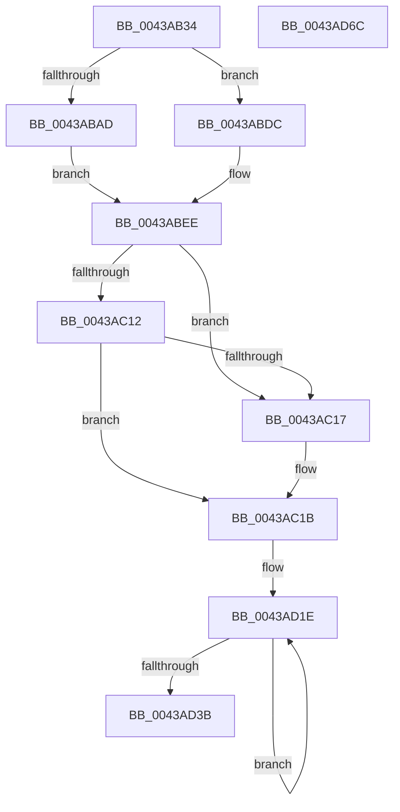

# PopDiagTraceCsResiliencyExit

- RVA: `0x0043AB34`–`0x0043AD6D` (길이 `569` bytes)
- VA: `0x000000014043AB34`
- 실행 섹션: `.text`
- PDB 이름 있음: `예`; PDB Function 태그: `아니요`
- unwind 정보 RVA: `0x0005D7BC`
- 디코드: `130`개 명령, `569/569` bytes 표시
- 미해석 바이트: `0` (있으면 어셈블리에 `.byte`로 보존)

> 이 문서는 커널 이미지의 기계어와 PDB 기호를 분석해 생성했습니다. 4번과 5번은 함수 원형과 자료형을 바이너리 사용 방식에서 추정한 C 해석이며 원본 소스 복구 결과는 아닙니다.

## 1. Dependencies

- 직접 호출 지점: **7**; 고유 호출 대상: **4**
- 직접 호출자로 확인된 함수: **1**
- RIP 상대 이미지 참조: **25**

### Outgoing calls
- `0x0043AB6A` → [KeAcquireSpinLockRaiseToDpc](../20/KeAcquireSpinLockRaiseToDpc_function_00208470.md) (function, `0x00208470`)
- `0x0043ABB6` → [PopBatteryGetEnergyDrainFromDischage](PopBatteryGetEnergyDrainFromDischage_function_0043B680.md) (function, `0x0043B680`)
- `0x0043ACAD` → [PpmConvertTimeTo](PpmConvertTimeTo_function_0043B3CC.md) (function, `0x0043B3CC`)
- `0x0043ACBF` → [PpmConvertTimeTo](PpmConvertTimeTo_function_0043B3CC.md) (function, `0x0043B3CC`)
- `0x0043ACD4` → [PpmConvertTimeTo](PpmConvertTimeTo_function_0043B3CC.md) (function, `0x0043B3CC`)
- `0x0043AD24` → [PpmConvertTimeTo](PpmConvertTimeTo_function_0043B3CC.md) (function, `0x0043B3CC`)
- `0x0043AD4C` → [KeReleaseSpinLock](../39/KeReleaseSpinLock_function_00392BA0.md) (function, `0x00392BA0`)

### Direct callers
- [PopSleepstudyCaptureResiliencyStatistics](../../page/AD/PopSleepstudyCaptureResiliencyStatistics_function_00AD6B74.md) at `0x00AD6CD2`

### Static image references
- `0x0043AB56` → RVA `0x00F0CA58` (`.data`; read)
- `0x0043AB77` → RVA `0x00F0C748` (`.data`; read)
- `0x0043AB82` → RVA `0x00F0C788` (`.data`; read)
- `0x0043AB8E` → RVA `0x00F0C798` (`.data`; read)
- `0x0043ABA0` → RVA `0x00F0C7A8` (`.data`; write)
- `0x0043ABB0` → RVA `0x00F0C744` (`.data`; read)
- `0x0043ABC0` → RVA `0x00F0C750` (`.data`; read)
- `0x0043ABCA` → RVA `0x00F0C758` (`.data`; read)
- `0x0043ABEE` → RVA `0x00F0C742` (`.data`; read)
- `0x0043AC02` → RVA `0x00F0C741` (`.data`; read)
- `0x0043AC1B` → RVA `0x00F0C76C` (`.data`; read)
- `0x0043AC31` → RVA `0x00F0C743` (`.data`; read)
- `0x0043AC41` → RVA `0x00F0C771` (`.data`; read)
- `0x0043AC50` → RVA `0x00F0C770` (`.data`; read)
- `0x0043AC5A` → RVA `0x00F0C768` (`.data`; read)
- `0x0043AC66` → RVA `0x00F0C760` (`.data`; read)
- `0x0043AC6F` → RVA `0x00F0C764` (`.data`; read)
- `0x0043AC78` → RVA `0x00F0C780` (`.data`; read)
- `0x0043ACA6` → RVA `0x00F0C7C0` (`.data`; read)
- `0x0043ACB8` → RVA `0x00F0C7C8` (`.data`; read)
- `0x0043ACCD` → RVA `0x00F0C7D0` (`.data`; read)
- `0x0043ACE0` → RVA `0x00F0C838` (`.data`; read)
- `0x0043ACE7` → RVA `0x00F0C7D8` (`.data`; read)
- `0x0043AD0E` → RVA `0x00F0C7A8` (`.data`; read)
- `0x0043AD3E` → RVA `0x00F0C740` (`.data`; write)

## 2. Other-region calls and transfers

- 다른 실행 섹션으로 향하는 call: **0**
- 별도 외부 분기/꼬리 이동을 확인하지 못했습니다.

## 3. Assembly (complete function range)

```asm
0043AB34  48 8B C4                        mov rax, rsp
0043AB37  48 89 58 08                     mov qword ptr [rax + 8], rbx
0043AB3B  48 89 68 10                     mov qword ptr [rax + 0x10], rbp
0043AB3F  48 89 70 18                     mov qword ptr [rax + 0x18], rsi
0043AB43  48 89 78 20                     mov qword ptr [rax + 0x20], rdi
0043AB47  41 56                           push r14
0043AB49  48 83 EC 30                     sub rsp, 0x30
0043AB4D  33 C0                           xor eax, eax
0043AB4F  48 8B F9                        mov rdi, rcx
0043AB52  89 44 24 24                     mov dword ptr [rsp + 0x24], eax
0043AB56  48 8D 0D FB 1E AD 00            lea rcx, [rip + 0xad1efb]
0043AB5D  21 44 24 24                     and dword ptr [rsp + 0x24], eax
0043AB61  49 8B D9                        mov rbx, r9
0043AB64  41 8A F0                        mov sil, r8b
0043AB67  48 8B EA                        mov rbp, rdx
0043AB6A  E8 01 D9 DC FF                  call 0x140208470
0043AB6F  4C 8B 54 24 78                  mov r10, qword ptr [rsp + 0x78]
0043AB74  44 8A F0                        mov r14b, al
0043AB77  44 8A 1D CA 1B AD 00            mov r11b, byte ptr [rip + 0xad1bca]
0043AB7E  41 0F 28 02                     movaps xmm0, xmmword ptr [r10]
0043AB82  0F 11 05 FF 1B AD 00            movups xmmword ptr [rip + 0xad1bff], xmm0
0043AB89  41 0F 28 4A 10                  movaps xmm1, xmmword ptr [r10 + 0x10]
0043AB8E  0F 11 0D 03 1C AD 00            movups xmmword ptr [rip + 0xad1c03], xmm1
0043AB95  F2 41 0F 10 42 20               movsd xmm0, qword ptr [r10 + 0x20]
0043AB9B  4C 8B 54 24 60                  mov r10, qword ptr [rsp + 0x60]
0043ABA0  F2 0F 11 05 00 1C AD 00         movsd qword ptr [rip + 0xad1c00], xmm0
0043ABA8  4D 85 D2                        test r10, r10
0043ABAB  74 2F                           je 0x14043abdc
0043ABAD  8B 55 0C                        mov edx, dword ptr [rbp + 0xc]
0043ABB0  8B 0D 8E 1B AD 00               mov ecx, dword ptr [rip + 0xad1b8e]
0043ABB6  E8 C5 0A 00 00                  call 0x14043b680
0043ABBB  8B 0B                           mov ecx, dword ptr [rbx]
0043ABBD  44 8B C8                        mov r9d, eax
0043ABC0  0B 0D 8A 1B AD 00               or ecx, dword ptr [rip + 0xad1b8a]
0043ABC6  89 4C 24 20                     mov dword ptr [rsp + 0x20], ecx
0043ABCA  48 8B 0D 87 1B AD 00            mov rcx, qword ptr [rip + 0xad1b87]
0043ABD1  48 2B 4B 08                     sub rcx, qword ptr [rbx + 8]
0043ABD5  48 89 4C 24 28                  mov qword ptr [rsp + 0x28], rcx
0043ABDA  EB 12                           jmp 0x14043abee
0043ABDC  8B 05 6E 1B AD 00               mov eax, dword ptr [rip + 0xad1b6e]
0043ABE2  45 33 C9                        xor r9d, r9d
0043ABE5  4C 21 4C 24 28                  and qword ptr [rsp + 0x28], r9
0043ABEA  89 44 24 20                     mov dword ptr [rsp + 0x20], eax
0043ABEE  8A 05 4E 1B AD 00               mov al, byte ptr [rip + 0xad1b4e]
0043ABF4  F6 D8                           neg al
0043ABF6  1B C9                           sbb ecx, ecx
0043ABF8  83 E1 02                        and ecx, 2
0043ABFB  44 8B C1                        mov r8d, ecx
0043ABFE  41 83 C8 01                     or r8d, 1
0043AC02  80 3D 38 1B AD 00 00            cmp byte ptr [rip + 0xad1b38], 0
0043AC09  44 0F 44 C1                     cmove r8d, ecx
0043AC0D  45 84 DB                        test r11b, r11b
0043AC10  74 05                           je 0x14043ac17
0043AC12  40 84 F6                        test sil, sil
0043AC15  75 04                           jne 0x14043ac1b
0043AC17  41 83 C8 04                     or r8d, 4
0043AC1B  8B 05 4B 1B AD 00               mov eax, dword ptr [rip + 0xad1b4b]
0043AC21  41 8B D0                        mov edx, r8d
0043AC24  0F 10 44 24 20                  movups xmm0, xmmword ptr [rsp + 0x20]
0043AC29  83 CA 08                        or edx, 8
0043AC2C  BD 40 42 0F 00                  mov ebp, 0xf4240
0043AC31  80 3D 0B 1B AD 00 00            cmp byte ptr [rip + 0xad1b0b], 0
0043AC38  41 0F 44 D0                     cmove edx, r8d
0043AC3C  8B CA                           mov ecx, edx
0043AC3E  83 C9 10                        or ecx, 0x10
0043AC41  80 3D 29 1B AD 00 00            cmp byte ptr [rip + 0xad1b29], 0
0043AC48  0F 44 CA                        cmove ecx, edx
0043AC4B  8B D1                           mov edx, ecx
0043AC4D  83 CA 20                        or edx, 0x20
0043AC50  80 3D 19 1B AD 00 00            cmp byte ptr [rip + 0xad1b19], 0
0043AC57  89 47 44                        mov dword ptr [rdi + 0x44], eax
0043AC5A  8B 05 08 1B AD 00               mov eax, dword ptr [rip + 0xad1b08]
0043AC60  0F 44 D1                        cmove edx, ecx
0043AC63  89 47 40                        mov dword ptr [rdi + 0x40], eax
0043AC66  8B 05 F4 1A AD 00               mov eax, dword ptr [rip + 0xad1af4]
0043AC6C  89 47 38                        mov dword ptr [rdi + 0x38], eax
0043AC6F  8B 05 EF 1A AD 00               mov eax, dword ptr [rip + 0xad1aef]
0043AC75  89 47 3C                        mov dword ptr [rdi + 0x3c], eax
0043AC78  48 8B 05 01 1B AD 00            mov rax, qword ptr [rip + 0xad1b01]
0043AC7F  48 89 47 48                     mov qword ptr [rdi + 0x48], rax
0043AC83  48 8B 44 24 68                  mov rax, qword ptr [rsp + 0x68]
0043AC88  48 89 47 10                     mov qword ptr [rdi + 0x10], rax
0043AC8C  48 8B 44 24 70                  mov rax, qword ptr [rsp + 0x70]
0043AC91  89 17                           mov dword ptr [rdi], edx
0043AC93  8B D5                           mov edx, ebp
0043AC95  48 89 47 18                     mov qword ptr [rdi + 0x18], rax
0043AC99  4C 89 57 08                     mov qword ptr [rdi + 8], r10
0043AC9D  44 89 4F 20                     mov dword ptr [rdi + 0x20], r9d
0043ACA1  F3 0F 7F 47 28                  movdqu xmmword ptr [rdi + 0x28], xmm0
0043ACA6  48 8B 0D 13 1B AD 00            mov rcx, qword ptr [rip + 0xad1b13]
0043ACAD  E8 1A 07 00 00                  call 0x14043b3cc
0043ACB2  48 89 47 78                     mov qword ptr [rdi + 0x78], rax
0043ACB6  8B D5                           mov edx, ebp
0043ACB8  48 8B 0D 09 1B AD 00            mov rcx, qword ptr [rip + 0xad1b09]
0043ACBF  E8 08 07 00 00                  call 0x14043b3cc
0043ACC4  48 89 87 80 00 00 00            mov qword ptr [rdi + 0x80], rax
0043ACCB  8B D5                           mov edx, ebp
0043ACCD  48 8B 0D FC 1A AD 00            mov rcx, qword ptr [rip + 0xad1afc]
0043ACD4  E8 F3 06 00 00                  call 0x14043b3cc
0043ACD9  48 89 87 88 00 00 00            mov qword ptr [rdi + 0x88], rax
0043ACE0  48 8D 1D 51 1B AD 00            lea rbx, [rip + 0xad1b51]
0043ACE7  8B 05 EB 1A AD 00               mov eax, dword ptr [rip + 0xad1aeb]
0043ACED  BE 0B 00 00 00                  mov esi, 0xb
0043ACF2  89 87 90 00 00 00               mov dword ptr [rdi + 0x90], eax
0043ACF8  0F 10 05 89 1A AD 00            movups xmm0, xmmword ptr [rip + 0xad1a89]
0043ACFF  0F 11 47 50                     movups xmmword ptr [rdi + 0x50], xmm0
0043AD03  0F 10 0D 8E 1A AD 00            movups xmm1, xmmword ptr [rip + 0xad1a8e]
0043AD0A  0F 11 4F 60                     movups xmmword ptr [rdi + 0x60], xmm1
0043AD0E  F2 0F 10 05 92 1A AD 00         movsd xmm0, qword ptr [rip + 0xad1a92]
0043AD16  F2 0F 11 47 70                  movsd qword ptr [rdi + 0x70], xmm0
0043AD1B  48 2B FB                        sub rdi, rbx
0043AD1E  48 8B 0B                        mov rcx, qword ptr [rbx]
0043AD21  48 8B D5                        mov rdx, rbp
0043AD24  E8 A3 06 00 00                  call 0x14043b3cc
0043AD29  48 89 84 1F 98 00 00 00         mov qword ptr [rdi + rbx + 0x98], rax
0043AD31  48 8D 5B 08                     lea rbx, [rbx + 8]
0043AD35  48 83 EE 01                     sub rsi, 1
0043AD39  75 E3                           jne 0x14043ad1e
0043AD3B  41 8A D6                        mov dl, r14b
0043AD3E  40 88 35 FB 19 AD 00            mov byte ptr [rip + 0xad19fb], sil
0043AD45  48 8D 0D 0C 1D AD 00            lea rcx, [rip + 0xad1d0c]
0043AD4C  E8 4F 7E F5 FF                  call 0x140392ba0
0043AD51  48 8B 5C 24 40                  mov rbx, qword ptr [rsp + 0x40]
0043AD56  48 8B 6C 24 48                  mov rbp, qword ptr [rsp + 0x48]
0043AD5B  48 8B 74 24 50                  mov rsi, qword ptr [rsp + 0x50]
0043AD60  48 8B 7C 24 58                  mov rdi, qword ptr [rsp + 0x58]
0043AD65  48 83 C4 30                     add rsp, 0x30
0043AD69  41 5E                           pop r14
0043AD6B  C3                              ret
0043AD6C  CC                              int3
```

## 4. C-style interpretation (structured pseudocode)

```c
__int64 __fastcall PopDiagTraceCsResiliencyExit(__int64 a1, __int64 a2, unsigned __int8 a3, __int64 a4, __int64 a5, __int64 a6, __int64 a7, __int64 a8)
{
    __int64 result;
    __int64 v_rdi;
    __int64 v_rsi;
    __int64 v_rsp;
    unsigned __int64 v_stack_m10;
    unsigned int v_stack_m14;
    unsigned int v_stack_m18;
    unsigned __int64 v_stack_p10;
    unsigned __int64 v_stack_p18;
    unsigned __int64 v_stack_p20;
    unsigned __int64 v_stack_p8;

    *(unsigned __int64 *)(v_rsp + 8) = v_rbx;
    *(unsigned __int64 *)(v_rsp + 16) = v_rbp;
    *(unsigned __int64 *)(v_rsp + 24) = v_rsi;
    *(unsigned __int64 *)(v_rsp + 32) = v_rdi;
    v_rsp = (v_rsp) - (48);
    result = 0;
    v_stack_m14 = 0;
    result = KeAcquireSpinLockRaiseToDpc(v_rip + 11345659, a2, a3, a4);
    *(unsigned __int64 *)(v_rip + 11344895) = v_xmm0;
    *(unsigned __int64 *)(v_rip + 11344899) = v_xmm1;
    *(unsigned __int64 *)(v_rip + 11344896) = v_xmm0;
    if (a5 == 0) goto loc_0043ABDC;
    result = PopBatteryGetEnergyDrainFromDischage((unsigned int)(*(unsigned int *)(v_rip + 11344782)), (unsigned int)(*(unsigned int *)(a2 + 12)), a3, a4);
    a1 = (unsigned int)(((unsigned int)(*(unsigned int *)(a4))) | (*(unsigned int *)(v_rip + 11344778)));
    v_stack_m18 = (unsigned int)(a1);
    a1 = (*(unsigned __int64 *)(v_rip + 11344775)) - (*(unsigned __int64 *)(a4 + 8));
    v_stack_m10 = a1;
    goto loc_0043ABEE;
loc_0043ABDC:
    a4 = 0;
    v_stack_m18 = (unsigned int)((unsigned int)(*(unsigned int *)(v_rip + 11344750)));
loc_0043ABEE:
    result = (unsigned __int8)(-(*(unsigned __int8 *)(v_rip + 11344718)));
    a1 = (unsigned int)((a1) & (2));
    a3 = (unsigned int)(((unsigned int)((unsigned int)(a1))) | (1));
    if ((*(unsigned __int8 *)(v_rip + 11344696)) == 0) { a3 = (unsigned int)(a1); }
    if ((unsigned __int8)(*(unsigned __int8 *)(v_rip + 11344842)) == 0) goto loc_0043AC17;
    if (a3 == 0) {
        a3 = (unsigned int)((a3) | (4));
    }
    a2 = (unsigned int)(((unsigned int)(a3)) | (8));
    if ((*(unsigned __int8 *)(v_rip + 11344651)) == 0) { a2 = a3; }
    a1 = (unsigned int)(((unsigned int)((unsigned int)(a2))) | (16));
    if ((*(unsigned __int8 *)(v_rip + 11344681)) == 0) { a1 = (unsigned int)(a2); }
    a2 = (unsigned int)(((unsigned int)((unsigned int)(a1))) | (32));
    *(unsigned int *)(a1 + 68) = (unsigned int)((unsigned int)(*(unsigned int *)(v_rip + 11344715)));
    if ((*(unsigned __int8 *)(v_rip + 11344665)) == 0) { a2 = (unsigned int)(a1); }
    *(unsigned int *)(a1 + 64) = (unsigned int)((unsigned int)(*(unsigned int *)(v_rip + 11344648)));
    *(unsigned int *)(a1 + 56) = (unsigned int)((unsigned int)(*(unsigned int *)(v_rip + 11344628)));
    *(unsigned int *)(a1 + 60) = (unsigned int)((unsigned int)(*(unsigned int *)(v_rip + 11344623)));
    *(unsigned __int64 *)(a1 + 72) = *(unsigned __int64 *)(v_rip + 11344641);
    *(unsigned __int64 *)(a1 + 16) = a6;
    *(unsigned int *)(a1) = (unsigned int)(a2);
    *(unsigned __int64 *)(a1 + 24) = a7;
    *(unsigned __int64 *)(a1 + 8) = a5;
    *(unsigned int *)(a1 + 32) = 0;
    *(unsigned __int64 *)(a1 + 40) = v_xmm0;
    result = PpmConvertTimeTo(*(unsigned __int64 *)(v_rip + 11344659), (unsigned int)((unsigned int)((unsigned int)(0xF4240ULL))), a3, a4);
    *(unsigned __int64 *)(a1 + 120) = result;
    result = PpmConvertTimeTo(*(unsigned __int64 *)(v_rip + 11344649), (unsigned int)((unsigned int)((unsigned int)(0xF4240ULL))), a3, a4);
    *(unsigned __int64 *)(a1 + 128) = result;
    result = PpmConvertTimeTo(*(unsigned __int64 *)(v_rip + 11344636), (unsigned int)((unsigned int)((unsigned int)(0xF4240ULL))), a3, a4);
    *(unsigned __int64 *)(a1 + 136) = result;
    *(unsigned int *)(a1 + 144) = (unsigned int)((unsigned int)(*(unsigned int *)(v_rip + 11344619)));
    *(unsigned __int64 *)(a1 + 80) = v_xmm0;
    *(unsigned __int64 *)(a1 + 96) = v_xmm1;
    *(unsigned __int64 *)(a1 + 112) = v_xmm0;
    v_rdi = (a1) - (v_rip + 11344721);
loc_0043AD1E:
    result = PpmConvertTimeTo(*(unsigned __int64 *)(v_rip + 11344721), (unsigned int)(0xF4240ULL), a3, a4);
    *(unsigned __int64 *)(v_rdi + v_rip + 11344721 * 1 + 152) = result;
    v_rsi = (11) - (1);
    if (condition_is_not_equal) goto loc_0043AD1E;
    *(unsigned __int8 *)(v_rip + 11344379) = (unsigned __int8)(v_rsi);
    result = KeReleaseSpinLock(v_rip + 11345164, (unsigned __int8)((unsigned __int8)(result)), a3, a4);
    v_rsp = (v_rsp) + (48);
    return result;
}
```

## 5. (Beta) C Style

```c
int64_t PopDiagTraceCsResiliencyExit(void *Arg1, void *Arg2, uint8_t Arg3, void *Arg4, int64_t Arg5, int64_t Arg6, int64_t Arg7, void *Arg8)
{
    uint8_t *arg1 = (uint8_t *)Arg1;
    uint8_t *arg2 = (uint8_t *)Arg2;
    uint8_t *arg4 = (uint8_t *)Arg4;
    uint8_t *arg8 = (uint8_t *)Arg8;

    int64_t result;
    int64_t local_rdi;
    int64_t local_rsi;
    int64_t local_rsp;
    uint64_t v_stack_m10;
    uint32_t v_stack_m14;
    uint32_t v_stack_m18;
    uint64_t v_stack_p10;
    uint64_t v_stack_p18;
    uint64_t v_stack_p20;
    uint64_t v_stack_p8;

    *(uint64_t *)(local_rsp + 0x8) = local_rbx;
    *(uint64_t *)(local_rsp + 0x10) = local_rbp;
    *(uint64_t *)(local_rsp + 0x18) = local_rsi;
    *(uint64_t *)(local_rsp + 0x20) = local_rdi;
    local_rsp = (local_rsp) - (48);
    result = 0;
    v_stack_m14 = 0;
    result = KeAcquireSpinLockRaiseToDpc(v_rip + 11345659, Arg2, Arg3, Arg4);
    *(uint64_t *)(v_rip + 0xAD1BFF) = v_xmm0;
    *(uint64_t *)(v_rip + 0xAD1C03) = v_xmm1;
    *(uint64_t *)(v_rip + 0xAD1C00) = v_xmm0;
    if (Arg5 == 0) goto loc_0043ABDC;
    result = PopBatteryGetEnergyDrainFromDischage((uint32_t)(*(uint32_t *)(v_rip + 0xAD1B8E)), (uint32_t)(*(uint32_t *)(arg2 + 0xC)), Arg3, Arg4);
    Arg1 = (uint32_t)(((uint32_t)(*(uint32_t *)(arg4))) | (*(uint32_t *)(v_rip + 0xAD1B8A)));
    v_stack_m18 = (uint32_t)(Arg1);
    Arg1 = (*(uint64_t *)(v_rip + 0xAD1B87)) - (*(uint64_t *)(arg4 + 0x8));
    v_stack_m10 = Arg1;
    goto loc_0043ABEE;
loc_0043ABDC:
    Arg4 = 0;
    v_stack_m18 = (uint32_t)((uint32_t)(*(uint32_t *)(v_rip + 0xAD1B6E)));
loc_0043ABEE:
    result = (uint8_t)(-(*(uint8_t *)(v_rip + 0xAD1B4E)));
    Arg1 = (uint32_t)((Arg1) & (2));
    Arg3 = (uint32_t)(((uint32_t)((uint32_t)(Arg1))) | (1));
    if ((*(uint8_t *)(v_rip + 0xAD1B38)) == 0) { Arg3 = (uint32_t)(Arg1); }
    if ((uint8_t)(*(uint8_t *)(v_rip + 0xAD1BCA)) == 0) goto loc_0043AC17;
    if (Arg3 == 0) {
        Arg3 = (uint32_t)((Arg3) | (4));
    }
    Arg2 = (uint32_t)(((uint32_t)(Arg3)) | (8));
    if ((*(uint8_t *)(v_rip + 0xAD1B0B)) == 0) { Arg2 = Arg3; }
    Arg1 = (uint32_t)(((uint32_t)((uint32_t)(Arg2))) | (16));
    if ((*(uint8_t *)(v_rip + 0xAD1B29)) == 0) { Arg1 = (uint32_t)(Arg2); }
    Arg2 = (uint32_t)(((uint32_t)((uint32_t)(Arg1))) | (32));
    *(uint32_t *)(arg1 + 0x44) = (uint32_t)((uint32_t)(*(uint32_t *)(v_rip + 0xAD1B4B)));
    if ((*(uint8_t *)(v_rip + 0xAD1B19)) == 0) { Arg2 = (uint32_t)(Arg1); }
    *(uint32_t *)(arg1 + 0x40) = (uint32_t)((uint32_t)(*(uint32_t *)(v_rip + 0xAD1B08)));
    *(uint32_t *)(arg1 + 0x38) = (uint32_t)((uint32_t)(*(uint32_t *)(v_rip + 0xAD1AF4)));
    *(uint32_t *)(arg1 + 0x3C) = (uint32_t)((uint32_t)(*(uint32_t *)(v_rip + 0xAD1AEF)));
    *(uint64_t *)(arg1 + 0x48) = *(uint64_t *)(v_rip + 0xAD1B01);
    *(uint64_t *)(arg1 + 0x10) = Arg6;
    *(uint32_t *)(arg1) = (uint32_t)(Arg2);
    *(uint64_t *)(arg1 + 0x18) = Arg7;
    *(uint64_t *)(arg1 + 0x8) = Arg5;
    *(uint32_t *)(arg1 + 0x20) = 0;
    *(uint64_t *)(arg1 + 0x28) = v_xmm0;
    result = PpmConvertTimeTo(*(uint64_t *)(v_rip + 0xAD1B13), (uint32_t)((uint32_t)((uint32_t)(0xF4240ULL))), Arg3, Arg4);
    *(uint64_t *)(arg1 + 0x78) = result;
    result = PpmConvertTimeTo(*(uint64_t *)(v_rip + 0xAD1B09), (uint32_t)((uint32_t)((uint32_t)(0xF4240ULL))), Arg3, Arg4);
    *(uint64_t *)(arg1 + 0x80) = result;
    result = PpmConvertTimeTo(*(uint64_t *)(v_rip + 0xAD1AFC), (uint32_t)((uint32_t)((uint32_t)(0xF4240ULL))), Arg3, Arg4);
    *(uint64_t *)(arg1 + 0x88) = result;
    *(uint32_t *)(arg1 + 0x90) = (uint32_t)((uint32_t)(*(uint32_t *)(v_rip + 0xAD1AEB)));
    *(uint64_t *)(arg1 + 0x50) = v_xmm0;
    *(uint64_t *)(arg1 + 0x60) = v_xmm1;
    *(uint64_t *)(arg1 + 0x70) = v_xmm0;
    local_rdi = (Arg1) - (v_rip + 11344721);
loc_0043AD1E:
    result = PpmConvertTimeTo(*(uint64_t *)(v_rip + 0xAD1B51), (uint32_t)(0xF4240ULL), Arg3, Arg4);
    *(uint64_t *)(local_rdi + v_rip + 0xAD1B51 * 1 + 0x98) = result;
    local_rsi = (11) - (1);
    if (condition_is_not_equal) goto loc_0043AD1E;
    *(uint8_t *)(v_rip + 0xAD19FB) = (uint8_t)(local_rsi);
    result = KeReleaseSpinLock(v_rip + 11345164, (uint8_t)((uint8_t)(result)), Arg3, Arg4);
    local_rsp = (local_rsp) + (48);
    return result;
}
```

### 관측된 메모리 오프셋

구조체 형식이 확인되지 않은 접근은 인자 기준의 오프셋으로만 기록했습니다.

| 기준 인자 | 오프셋 표현 | 폭 (bit) | 접근 |
|---|---:|---:|---|
| `Arg1` | `+ 0x0` | `32` | `W` |
| `Arg1` | `+ 0x8` | `64` | `W` |
| `Arg1` | `+ 0x10` | `64` | `W` |
| `Arg1` | `+ 0x18` | `64` | `W` |
| `Arg1` | `+ 0x20` | `32` | `W` |
| `Arg1` | `+ 0x28` | `128` | `W` |
| `Arg1` | `+ 0x38` | `32` | `W` |
| `Arg1` | `+ 0x3C` | `32` | `W` |
| `Arg1` | `+ 0x40` | `32` | `W` |
| `Arg1` | `+ 0x44` | `32` | `W` |
| `Arg1` | `+ 0x48` | `64` | `W` |
| `Arg1` | `+ 0x50` | `128` | `R` |
| `Arg1` | `+ 0x60` | `128` | `R` |
| `Arg1` | `+ 0x70` | `64` | `W` |
| `Arg1` | `+ 0x78` | `64` | `W` |
| `Arg1` | `+ 0x80` | `64` | `W` |
| `Arg1` | `+ 0x88` | `64` | `W` |
| `Arg1` | `+ 0x90` | `32` | `W` |
| `Arg1` | `+ 0x98 + rbx*1` | `64` | `W` |
| `Arg2` | `+ 0xC` | `32` | `R` |
| `Arg4` | `+ 0x0` | `32` | `R` |
| `Arg4` | `+ 0x8` | `64` | `R` |
| `Arg8` | `+ 0x0` | `128` | `R` |
| `Arg8` | `+ 0x10` | `128` | `R` |
| `Arg8` | `+ 0x20` | `64` | `R` |

## 6. Execution-region graph

[열기: 2D/3D 그래프와 함수 탐색 컨트롤 패널](../../../control-panel.html?section=text&rva=0x0043AB34&view=graph)

- 2D 그래프는 위에서 아래로 흐르고, 3D 그래프는 빈 공간을 드래그해 회전합니다. Shift+드래그는 이동, 휠은 확대·축소, 함수 노드 선택은 대상 보고서 이동입니다.

### Static fallback


