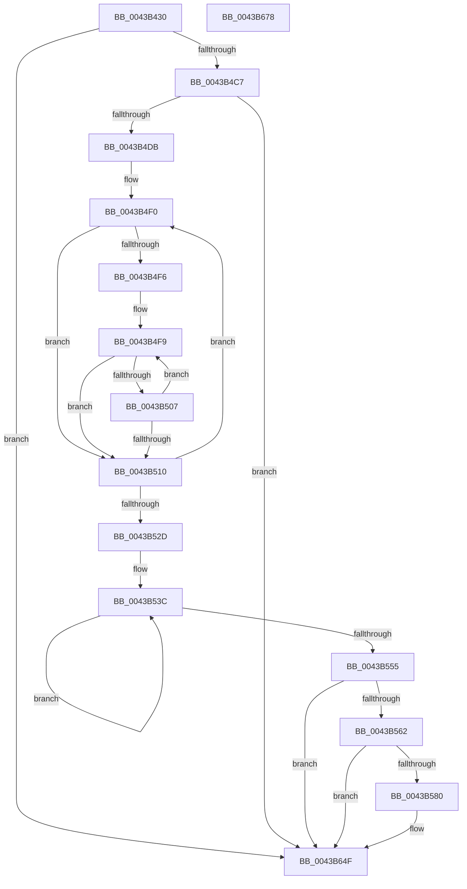

# PopDiagTraceDripsHistogram

- RVA: `0x0043B430`–`0x0043B679` (길이 `585` bytes)
- VA: `0x000000014043B430`
- 실행 섹션: `.text`
- PDB 이름 있음: `예`; PDB Function 태그: `아니요`
- unwind 정보 RVA: `0x000A43FC`
- 디코드: `133`개 명령, `585/585` bytes 표시
- 미해석 바이트: `0` (있으면 어셈블리에 `.byte`로 보존)

> 이 문서는 커널 이미지의 기계어와 PDB 기호를 분석해 생성했습니다. 4번과 5번은 함수 원형과 자료형을 바이너리 사용 방식에서 추정한 C 해석이며 원본 소스 복구 결과는 아닙니다.

## 1. Dependencies

- 직접 호출 지점: **3**; 고유 호출 대상: **3**
- 직접 호출자로 확인된 함수: **1**
- RIP 상대 이미지 참조: **4**

### Outgoing calls
- `0x0043B573` → [tlgKeywordOn](../42/tlgKeywordOn_function_0042EAA0.md) (function, `0x0042EAA0`)
- `0x0043B64A` → [tlgWriteTransfer_EtwWriteTransfer](../42/tlgWriteTransfer_EtwWriteTransfer_function_004260E0.md) (function, `0x004260E0`)
- `0x0043B656` → [_security_check_cookie](../6A/_security_check_cookie_function_006AC640.md) (function, `0x006AC640`)

### Direct callers
- [PpmSnapDripsAccountingSnapshot](PpmSnapDripsAccountingSnapshot_function_0043B11C.md) at `0x0043B1C6`

### Static image references
- `0x0043B44F` → RVA `0x00E0A740` (`.data`; read)
- `0x0043B4E2` → RVA `0x00FC5738` (`ALMOSTRO`; read)
- `0x0043B555` → RVA `0x00E07748` (`.data`; read)
- `0x0043B58E` → RVA `0x0004A8AB` (`.rdata`; read)

## 2. Other-region calls and transfers

- 다른 실행 섹션으로 향하는 call: **0**
- 별도 외부 분기/꼬리 이동을 확인하지 못했습니다.

## 3. Assembly (complete function range)

```asm
0043B430  48 8B C4                        mov rax, rsp
0043B433  48 89 58 08                     mov qword ptr [rax + 8], rbx
0043B437  48 89 70 10                     mov qword ptr [rax + 0x10], rsi
0043B43B  48 89 78 18                     mov qword ptr [rax + 0x18], rdi
0043B43F  55                              push rbp
0043B440  41 56                           push r14
0043B442  41 57                           push r15
0043B444  48 8D 68 98                     lea rbp, [rax - 0x68]
0043B448  48 81 EC 50 01 00 00            sub rsp, 0x150
0043B44F  48 8B 05 EA F2 9C 00            mov rax, qword ptr [rip + 0x9cf2ea]
0043B456  48 33 C4                        xor rax, rsp
0043B459  48 89 45 40                     mov qword ptr [rbp + 0x40], rax
0043B45D  48 83 4D 98 FF                  or qword ptr [rbp - 0x68], 0xffffffffffffffff
0043B462  45 33 FF                        xor r15d, r15d
0043B465  48 B8 A7 BE D7 05 C2 9E 10 E5   movabs rax, 0xe5109ec205d7bea7
0043B46F  48 C7 44 24 50 00 2D 31 01      mov qword ptr [rsp + 0x50], 0x1312d00
0043B478  4C 8B CA                        mov r9, rdx
0043B47B  4C 89 7C 24 58                  mov qword ptr [rsp + 0x58], r15
0043B480  48 F7 E2                        mul rdx
0043B483  4C 8B F1                        mov r14, rcx
0043B486  44 88 7C 24 60                  mov byte ptr [rsp + 0x60], r15b
0043B48B  4C 8B D2                        mov r10, rdx
0043B48E  48 C7 44 24 68 00 68 89 09      mov qword ptr [rsp + 0x68], 0x9896800
0043B497  49 C1 EA 1D                     shr r10, 0x1d
0043B49B  4C 89 7C 24 70                  mov qword ptr [rsp + 0x70], r15
0043B4A0  44 88 7C 24 78                  mov byte ptr [rsp + 0x78], r15b
0043B4A5  48 C7 45 80 00 46 C3 23         mov qword ptr [rbp - 0x80], 0x23c34600
0043B4AD  4C 89 7D 88                     mov qword ptr [rbp - 0x78], r15
0043B4B1  44 88 7D 90                     mov byte ptr [rbp - 0x70], r15b
0043B4B5  4C 89 7D A0                     mov qword ptr [rbp - 0x60], r15
0043B4B9  44 88 7D A8                     mov byte ptr [rbp - 0x58], r15b
0043B4BD  66 45 85 D2                     test r10w, r10w
0043B4C1  0F 84 88 01 00 00               je 0x14043b64f
0043B4C7  49 6B C0 64                     imul rax, r8, 0x64
0043B4CB  33 D2                           xor edx, edx
0043B4CD  49 F7 F1                        div r9
0043B4D0  48 8B F0                        mov rsi, rax
0043B4D3  84 C0                           test al, al
0043B4D5  0F 84 74 01 00 00               je 0x14043b64f
0043B4DB  4C 8B 9D 90 00 00 00            mov r11, qword ptr [rbp + 0x90]
0043B4E2  48 8D 15 4F A2 B8 00            lea rdx, [rip + 0xb8a24f]
0043B4E9  45 8B C7                        mov r8d, r15d
0043B4EC  41 8D 5F 1A                     lea ebx, [r15 + 0x1a]
0043B4F0  41 83 F8 03                     cmp r8d, 3
0043B4F4  73 1A                           jae 0x14043b510
0043B4F6  48 8B 3A                        mov rdi, qword ptr [rdx]
0043B4F9  41 8B C0                        mov eax, r8d
0043B4FC  48 8D 0C 40                     lea rcx, [rax + rax*2]
0043B500  48 3B 7C CC 50                  cmp rdi, qword ptr [rsp + rcx*8 + 0x50]
0043B505  76 09                           jbe 0x14043b510
0043B507  41 FF C0                        inc r8d
0043B50A  41 83 F8 03                     cmp r8d, 3
0043B50E  72 E9                           jb 0x14043b4f9
0043B510  41 8B C0                        mov eax, r8d
0043B513  48 83 C2 18                     add rdx, 0x18
0043B517  48 8D 0C 40                     lea rcx, [rax + rax*2]
0043B51B  49 8B 03                        mov rax, qword ptr [r11]
0043B51E  48 01 44 CC 58                  add qword ptr [rsp + rcx*8 + 0x58], rax
0043B523  49 83 C3 08                     add r11, 8
0043B527  48 83 EB 01                     sub rbx, 1
0043B52B  75 C3                           jne 0x14043b4f0
0043B52D  4D 8B C1                        mov r8, r9
0043B530  48 8D 4C 24 60                  lea rcx, [rsp + 0x60]
0043B535  49 D1 E8                        shr r8, 1
0043B538  44 8D 5B 04                     lea r11d, [rbx + 4]
0043B53C  48 6B 41 F8 64                  imul rax, qword ptr [rcx - 8], 0x64
0043B541  33 D2                           xor edx, edx
0043B543  49 03 C0                        add rax, r8
0043B546  49 F7 F1                        div r9
0043B549  88 01                           mov byte ptr [rcx], al
0043B54B  48 8D 49 18                     lea rcx, [rcx + 0x18]
0043B54F  49 83 EB 01                     sub r11, 1
0043B553  75 E7                           jne 0x14043b53c
0043B555  83 3D EC C1 9C 00 05            cmp dword ptr [rip + 0x9cc1ec], 5
0043B55C  0F 86 ED 00 00 00               jbe 0x14043b64f
0043B562  48 BA 00 00 00 00 00 40 00 00   movabs rdx, 0x400000000000
0043B56C  48 8D 0D D5 C1 9C 00            lea rcx, [rip + 0x9cc1d5]
0043B573  E8 28 35 FF FF                  call 0x14042eaa0
0043B578  84 C0                           test al, al
0043B57A  0F 84 CF 00 00 00               je 0x14043b64f
0043B580  48 8D 44 24 40                  lea rax, [rsp + 0x40]
0043B585  4C 89 74 24 40                  mov qword ptr [rsp + 0x40], r14
0043B58A  48 89 45 D0                     mov qword ptr [rbp - 0x30], rax
0043B58E  48 8D 15 16 F3 C0 FF            lea rdx, [rip - 0x3f0cea]
0043B595  48 8D 44 24 38                  lea rax, [rsp + 0x38]
0043B59A  48 C7 45 D8 08 00 00 00         mov qword ptr [rbp - 0x28], 8
0043B5A2  48 89 45 E0                     mov qword ptr [rbp - 0x20], rax
0043B5A6  48 8D 0D 9B C1 9C 00            lea rcx, [rip + 0x9cc19b]
0043B5AD  48 8D 44 24 30                  lea rax, [rsp + 0x30]
0043B5B2  66 44 89 54 24 38               mov word ptr [rsp + 0x38], r10w
0043B5B8  48 89 45 F0                     mov qword ptr [rbp - 0x10], rax
0043B5BC  45 33 C9                        xor r9d, r9d
0043B5BF  8A 44 24 60                     mov al, byte ptr [rsp + 0x60]
0043B5C3  45 33 C0                        xor r8d, r8d
0043B5C6  88 44 24 31                     mov byte ptr [rsp + 0x31], al
0043B5CA  48 8D 44 24 31                  lea rax, [rsp + 0x31]
0043B5CF  48 89 45 00                     mov qword ptr [rbp], rax
0043B5D3  8A 44 24 78                     mov al, byte ptr [rsp + 0x78]
0043B5D7  88 44 24 32                     mov byte ptr [rsp + 0x32], al
0043B5DB  48 8D 44 24 32                  lea rax, [rsp + 0x32]
0043B5E0  48 89 45 10                     mov qword ptr [rbp + 0x10], rax
0043B5E4  8A 45 90                        mov al, byte ptr [rbp - 0x70]
0043B5E7  88 44 24 33                     mov byte ptr [rsp + 0x33], al
0043B5EB  48 8D 44 24 33                  lea rax, [rsp + 0x33]
0043B5F0  48 89 45 20                     mov qword ptr [rbp + 0x20], rax
0043B5F4  8A 45 A8                        mov al, byte ptr [rbp - 0x58]
0043B5F7  88 44 24 34                     mov byte ptr [rsp + 0x34], al
0043B5FB  48 8D 44 24 34                  lea rax, [rsp + 0x34]
0043B600  48 89 45 30                     mov qword ptr [rbp + 0x30], rax
0043B604  48 8D 45 B0                     lea rax, [rbp - 0x50]
0043B608  48 89 44 24 28                  mov qword ptr [rsp + 0x28], rax
0043B60D  C7 44 24 20 09 00 00 00         mov dword ptr [rsp + 0x20], 9
0043B615  48 C7 45 E8 02 00 00 00         mov qword ptr [rbp - 0x18], 2
0043B61D  40 88 74 24 30                  mov byte ptr [rsp + 0x30], sil
0043B622  48 C7 45 F8 01 00 00 00         mov qword ptr [rbp - 8], 1
0043B62A  48 C7 45 08 01 00 00 00         mov qword ptr [rbp + 8], 1
0043B632  48 C7 45 18 01 00 00 00         mov qword ptr [rbp + 0x18], 1
0043B63A  48 C7 45 28 01 00 00 00         mov qword ptr [rbp + 0x28], 1
0043B642  48 C7 45 38 01 00 00 00         mov qword ptr [rbp + 0x38], 1
0043B64A  E8 91 AA FE FF                  call 0x1404260e0
0043B64F  48 8B 4D 40                     mov rcx, qword ptr [rbp + 0x40]
0043B653  48 33 CC                        xor rcx, rsp
0043B656  E8 E5 0F 27 00                  call 0x1406ac640
0043B65B  4C 8D 9C 24 50 01 00 00         lea r11, [rsp + 0x150]
0043B663  49 8B 5B 20                     mov rbx, qword ptr [r11 + 0x20]
0043B667  49 8B 73 28                     mov rsi, qword ptr [r11 + 0x28]
0043B66B  49 8B 7B 30                     mov rdi, qword ptr [r11 + 0x30]
0043B66F  49 8B E3                        mov rsp, r11
0043B672  41 5F                           pop r15
0043B674  41 5E                           pop r14
0043B676  5D                              pop rbp
0043B677  C3                              ret
0043B678  CC                              int3
```

## 4. C-style interpretation (structured pseudocode)

```c
__int64 __fastcall PopDiagTraceDripsHistogram(__int64 a1, __int64 a2, __int64 a3)
{
    __int64 result;
    __int64 v_r10;
    __int64 v_r11;
    __int64 v_r15;
    __int64 v_rbx;
    __int64 v_rsp;
    unsigned __int64 v_stack_m100;
    unsigned __int8 v_stack_m108;
    unsigned __int64 v_stack_m110;
    unsigned __int64 v_stack_m118;
    unsigned __int64 v_stack_m128;
    unsigned __int64 v_stack_m130;
    unsigned __int8 v_stack_m134;
    unsigned __int8 v_stack_m135;
    unsigned __int8 v_stack_m136;
    unsigned __int8 v_stack_m137;
    unsigned __int64 v_stack_m138;
    unsigned __int64 v_stack_m140;
    unsigned int v_stack_m148;
    unsigned __int64 v_stack_m18;
    unsigned __int8 v_stack_mF0;
    unsigned __int64 v_stack_mF8;

    *(unsigned __int64 *)(v_rsp + 8) = v_rbx;
    *(unsigned __int64 *)(v_rsp + 16) = v_rsi;
    *(unsigned __int64 *)(v_rsp + 24) = v_rdi;
    v_rsp = (v_rsp) - (336);
    result = (*(unsigned __int64 *)(v_rip + 10285802)) ^ (v_rsp);
    *(unsigned __int64 *)(v_rsp - 104 + 64) = result;
    v_r15 = 0;
    v_stack_m118 = 0x1312D00ULL;
    v_stack_m110 = 0;
    v_stack_m108 = 0;
    v_stack_m100 = 0x9896800ULL;
    v_r10 = (a2) >> (29);
    v_stack_mF8 = 0;
    v_stack_mF0 = 0;
    *(unsigned __int64 *)(v_rsp - 104 - 128) = 0x23C34600ULL;
    *(unsigned __int64 *)(v_rsp - 104 - 120) = 0;
    *(unsigned __int8 *)(v_rsp - 104 - 112) = 0;
    *(unsigned __int64 *)(v_rsp - 104 - 96) = 0;
    *(unsigned __int8 *)(v_rsp - 104 - 88) = 0;
    if ((unsigned __int16)(v_r10) == 0) goto loc_0043B64F;
    result = (result) * (a3);
    a2 = 0;
    if ((unsigned __int8)(result) == 0) goto loc_0043B64F;
loc_0043B4F0:
    if (0 >= 3) goto loc_0043B510;
loc_0043B4F9:
    if ((*(unsigned __int64 *)(v_rip + 12100175)) <= (*(unsigned __int64 *)(v_rsp + 0 + 0 * 2 * 8 + 80))) goto loc_0043B510;
    a3 = (unsigned int)((0) + 1);
    if (((unsigned int)(a3)) < 3) goto loc_0043B4F9;
loc_0043B510:
    a2 = (v_rip + 12100175) + (24);
    v_r11 = (*(unsigned __int64 *)(v_rsp - 104 + 144)) + (8);
    v_rbx = (v_r15 + 26) - (1);
    if (condition_is_not_equal) goto loc_0043B4F0;
    a3 = (a2) >> (1);
loc_0043B53C:
    result = (*(unsigned __int64 *)(*(unsigned __int64 *)(v_rsp - 104 + 144))) * (*(unsigned __int64 *)(v_stack_m108 - 8));
    a2 = 0;
    result = (result) + (a3);
    *(unsigned __int8 *)(v_stack_m108) = (unsigned __int8)(result);
    v_r11 = (v_rbx + 4) - (1);
    if (condition_is_not_equal) goto loc_0043B53C;
    if ((*(unsigned int *)(v_rip + 10273260)) <= 5) goto loc_0043B64F;
    result = tlgKeywordOn(v_rip + 10273237, a2, a3, a2);
    if ((unsigned __int8)(result) != 0) {
        result = v_stack_m128;
        v_stack_m128 = a1;
        *(unsigned __int64 *)(v_rsp - 104 - 48) = result;
        a2 = v_rip - 4132074;
        result = v_stack_m130;
        *(unsigned __int64 *)(v_rsp - 104 - 40) = 8;
        *(unsigned __int64 *)(v_rsp - 104 - 32) = result;
        a1 = v_rip + 10273179;
        result = v_stack_m138;
        v_stack_m130 = (unsigned __int16)(v_r10);
        *(unsigned __int64 *)(v_rsp - 104 - 16) = result;
        a4 = 0;
        result = v_stack_m108;
        a3 = 0;
        v_stack_m137 = (unsigned __int8)(result);
        result = v_stack_m137;
        *(unsigned __int64 *)(v_rsp - 104) = result;
        result = v_stack_mF0;
        v_stack_m136 = (unsigned __int8)(result);
        result = v_stack_m136;
        *(unsigned __int64 *)(v_rsp - 104 + 16) = result;
        result = *(unsigned __int8 *)(v_rsp - 104 - 112);
        v_stack_m135 = (unsigned __int8)(result);
        result = v_stack_m135;
        *(unsigned __int64 *)(v_rsp - 104 + 32) = result;
        result = *(unsigned __int8 *)(v_rsp - 104 - 88);
        v_stack_m134 = (unsigned __int8)(result);
        result = v_stack_m134;
        *(unsigned __int64 *)(v_rsp - 104 + 48) = result;
        result = v_rsp - 104 - 80;
        v_stack_m140 = result;
        v_stack_m148 = 9;
        *(unsigned __int64 *)(v_rsp - 104 - 24) = 2;
        v_stack_m138 = (unsigned __int8)(result);
        *(unsigned __int64 *)(v_rsp - 104 - 8) = 1;
        *(unsigned __int64 *)(v_rsp - 104 + 8) = 1;
        *(unsigned __int64 *)(v_rsp - 104 + 24) = 1;
        *(unsigned __int64 *)(v_rsp - 104 + 40) = 1;
        *(unsigned __int64 *)(v_rsp - 104 + 56) = 1;
        result = tlgWriteTransfer_EtwWriteTransfer(a1, a2, a3, a4);
    }
    a1 = (*(unsigned __int64 *)(v_rsp - 104 + 64)) ^ (v_rsp);
    result = _security_check_cookie(a1, a2, a3, a4);
    return result;
}
```

## 5. (Beta) C Style

```c
int64_t PopDiagTraceDripsHistogram(int64_t Arg1, int64_t Arg2, int64_t Arg3)
{
    int64_t result;
    int64_t local_r10;
    int64_t local_r11;
    int64_t local_r15;
    int64_t local_rbx;
    int64_t local_rsp;
    uint64_t v_stack_m100;
    uint8_t v_stack_m108;
    uint64_t v_stack_m110;
    uint64_t v_stack_m118;
    uint64_t v_stack_m128;
    uint64_t v_stack_m130;
    uint8_t v_stack_m134;
    uint8_t v_stack_m135;
    uint8_t v_stack_m136;
    uint8_t v_stack_m137;
    uint64_t v_stack_m138;
    uint64_t v_stack_m140;
    uint32_t v_stack_m148;
    uint64_t v_stack_m18;
    uint8_t v_stack_mF0;
    uint64_t v_stack_mF8;

    *(uint64_t *)(local_rsp + 0x8) = local_rbx;
    *(uint64_t *)(local_rsp + 0x10) = local_rsi;
    *(uint64_t *)(local_rsp + 0x18) = local_rdi;
    local_rsp = (local_rsp) - (336);
    result = (*(uint64_t *)(v_rip + 0x9CF2EA)) ^ (local_rsp);
    *(uint64_t *)(local_rsp - 0x68 + 0x40) = result;
    local_r15 = 0;
    v_stack_m118 = 0x1312D00ULL;
    v_stack_m110 = 0;
    v_stack_m108 = 0;
    v_stack_m100 = 0x9896800ULL;
    local_r10 = (Arg2) >> (29);
    v_stack_mF8 = 0;
    v_stack_mF0 = 0;
    *(uint64_t *)(local_rsp - 0x68 - 0x80) = 0x23C34600ULL;
    *(uint64_t *)(local_rsp - 0x68 - 0x78) = 0;
    *(uint8_t *)(local_rsp - 0x68 - 0x70) = 0;
    *(uint64_t *)(local_rsp - 0x68 - 0x60) = 0;
    *(uint8_t *)(local_rsp - 0x68 - 0x58) = 0;
    if ((uint16_t)(local_r10) == 0) goto loc_0043B64F;
    result = (result) * (Arg3);
    Arg2 = 0;
    if ((uint8_t)(result) == 0) goto loc_0043B64F;
loc_0043B4F0:
    if (0 >= 3) goto loc_0043B510;
loc_0043B4F9:
    if ((*(uint64_t *)(v_rip + 0xB8A24F)) <= (*(uint64_t *)(local_rsp + 0x0 + 0x0 * 2 * 8 + 0x50))) goto loc_0043B510;
    Arg3 = (uint32_t)((0) + 1);
    if (((uint32_t)(Arg3)) < 3) goto loc_0043B4F9;
loc_0043B510:
    Arg2 = (v_rip + 12100175) + (24);
    local_r11 = (*(uint64_t *)(local_rsp - 0x68 + 0x90)) + (8);
    local_rbx = (local_r15 + 26) - (1);
    if (condition_is_not_equal) goto loc_0043B4F0;
    Arg3 = (Arg2) >> (1);
loc_0043B53C:
    result = (*(uint64_t *)(*(uint64_t *)(local_rsp - 0x68 + 0x90))) * (*(uint64_t *)(v_stack_m108 - 0x8));
    Arg2 = 0;
    result = (result) + (Arg3);
    *(uint8_t *)(v_stack_m108) = (uint8_t)(result);
    local_r11 = (local_rbx + 4) - (1);
    if (condition_is_not_equal) goto loc_0043B53C;
    if ((*(uint32_t *)(v_rip + 0x9CC1EC)) <= 5) goto loc_0043B64F;
    result = tlgKeywordOn(v_rip + 10273237, Arg2, Arg3, Arg2);
    if ((uint8_t)(result) != 0) {
        result = v_stack_m128;
        v_stack_m128 = Arg1;
        *(uint64_t *)(local_rsp - 0x68 - 0x30) = result;
        Arg2 = v_rip - 4132074;
        result = v_stack_m130;
        *(uint64_t *)(local_rsp - 0x68 - 0x28) = 8;
        *(uint64_t *)(local_rsp - 0x68 - 0x20) = result;
        Arg1 = v_rip + 10273179;
        result = v_stack_m138;
        v_stack_m130 = (uint16_t)(local_r10);
        *(uint64_t *)(local_rsp - 0x68 - 0x10) = result;
        a4 = 0;
        result = v_stack_m108;
        Arg3 = 0;
        v_stack_m137 = (uint8_t)(result);
        result = v_stack_m137;
        *(uint64_t *)(local_rsp - 0x68) = result;
        result = v_stack_mF0;
        v_stack_m136 = (uint8_t)(result);
        result = v_stack_m136;
        *(uint64_t *)(local_rsp - 0x68 + 0x10) = result;
        result = *(uint8_t *)(local_rsp - 0x68 - 0x70);
        v_stack_m135 = (uint8_t)(result);
        result = v_stack_m135;
        *(uint64_t *)(local_rsp - 0x68 + 0x20) = result;
        result = *(uint8_t *)(local_rsp - 0x68 - 0x58);
        v_stack_m134 = (uint8_t)(result);
        result = v_stack_m134;
        *(uint64_t *)(local_rsp - 0x68 + 0x30) = result;
        result = local_rsp - 104 - 80;
        v_stack_m140 = result;
        v_stack_m148 = 9;
        *(uint64_t *)(local_rsp - 0x68 - 0x18) = 2;
        v_stack_m138 = (uint8_t)(result);
        *(uint64_t *)(local_rsp - 0x68 - 0x8) = 1;
        *(uint64_t *)(local_rsp - 0x68 + 0x8) = 1;
        *(uint64_t *)(local_rsp - 0x68 + 0x18) = 1;
        *(uint64_t *)(local_rsp - 0x68 + 0x28) = 1;
        *(uint64_t *)(local_rsp - 0x68 + 0x38) = 1;
        result = tlgWriteTransfer_EtwWriteTransfer(Arg1, Arg2, Arg3, a4);
    }
    Arg1 = (*(uint64_t *)(local_rsp - 0x68 + 0x40)) ^ (local_rsp);
    result = _security_check_cookie(Arg1, Arg2, Arg3, a4);
    return result;
}
```

## 6. Execution-region graph

[열기: 2D/3D 그래프와 함수 탐색 컨트롤 패널](../../../control-panel.html?section=text&rva=0x0043B430&view=graph)

- 2D 그래프는 위에서 아래로 흐르고, 3D 그래프는 빈 공간을 드래그해 회전합니다. Shift+드래그는 이동, 휠은 확대·축소, 함수 노드 선택은 대상 보고서 이동입니다.

### Static fallback


