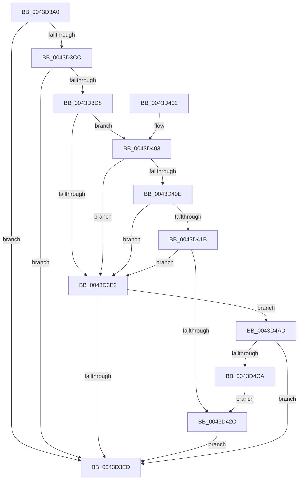

# PopDiagTraceFxComponentLogicalCondition

- RVA: `0x0043D3A0`–`0x0043D4CF` (길이 `303` bytes)
- VA: `0x000000014043D3A0`
- 실행 섹션: `.text`
- PDB 이름 있음: `예`; PDB Function 태그: `아니요`
- unwind 정보 RVA: `0x000A4840`
- 디코드: `66`개 명령, `303/303` bytes 표시
- 미해석 바이트: `0` (있으면 어셈블리에 `.byte`로 보존)

> 이 문서는 커널 이미지의 기계어와 PDB 기호를 분석해 생성했습니다. 4번과 5번은 함수 원형과 자료형을 바이너리 사용 방식에서 추정한 C 해석이며 원본 소스 복구 결과는 아닙니다.

## 1. Dependencies

- 직접 호출 지점: **3**; 고유 호출 대상: **3**
- 직접 호출자로 확인된 함수: **1**
- RIP 상대 이미지 참조: **4**

### Outgoing calls
- `0x0043D3F5` → [_security_check_cookie](../6A/_security_check_cookie_function_006AC640.md) (function, `0x006AC640`)
- `0x0043D4A3` → [EtwWriteEx](../25/EtwWriteEx_function_0025F0D0.md) (function, `0x0025F0D0`)
- `0x0043D4BD` → [EtwpLevelKeywordEnabled](../2F/EtwpLevelKeywordEnabled_function_002FD110.md) (function, `0x002FD110`)

### Direct callers
- [PopFxIdleWorkerTail](PopFxIdleWorkerTail_function_0043CDA0.md) at `0x0043CE11`
- [PopFxIdleWorkerTail](PopFxIdleWorkerTail_function_0043CDA0.md) at `0x0043CF00`

### Static image references
- `0x0043D3B0` → RVA `0x00E0A740` (`.data`; read)
- `0x0043D3BF` → RVA `0x00E67858` (`.data`; read)
- `0x0043D3CC` → RVA `0x00F0B408` (`.data`; read)
- `0x0043D449` → RVA `0x00014700` (`.rdata`; read)

## 2. Other-region calls and transfers

- 다른 실행 섹션으로 향하는 call: **0**
- 별도 외부 분기/꼬리 이동을 확인하지 못했습니다.

## 3. Assembly (complete function range)

```asm
0043D3A0  89 54 24 10                     mov dword ptr [rsp + 0x10], edx
0043D3A4  48 89 4C 24 08                  mov qword ptr [rsp + 8], rcx
0043D3A9  48 81 EC 88 00 00 00            sub rsp, 0x88
0043D3B0  48 8B 05 89 D3 9C 00            mov rax, qword ptr [rip + 0x9cd389]
0043D3B7  48 33 C4                        xor rax, rsp
0043D3BA  48 89 44 24 78                  mov qword ptr [rsp + 0x78], rax
0043D3BF  80 3D 92 A4 A2 00 00            cmp byte ptr [rip + 0xa2a492], 0
0043D3C6  45 0F B6 C8                     movzx r9d, r8b
0043D3CA  74 21                           je 0x14043d3ed
0043D3CC  48 8B 15 35 E0 AC 00            mov rdx, qword ptr [rip + 0xace035]
0043D3D3  48 85 D2                        test rdx, rdx
0043D3D6  74 15                           je 0x14043d3ed
0043D3D8  48 8B 42 20                     mov rax, qword ptr [rdx + 0x20]
0043D3DC  83 78 60 00                     cmp dword ptr [rax + 0x60], 0
0043D3E0  75 21                           jne 0x14043d403
0043D3E2  66 83 7A 66 00                  cmp word ptr [rdx + 0x66], 0
0043D3E7  0F 85 C0 00 00 00               jne 0x14043d4ad
0043D3ED  48 8B 4C 24 78                  mov rcx, qword ptr [rsp + 0x78]
0043D3F2  48 33 CC                        xor rcx, rsp
0043D3F5  E8 46 F2 26 00                  call 0x1406ac640
0043D3FA  48 81 C4 88 00 00 00            add rsp, 0x88
0043D401  C3                              ret
0043D402  CC                              int3
0043D403  0F B6 48 64                     movzx ecx, byte ptr [rax + 0x64]
0043D407  FE C9                           dec cl
0043D409  80 F9 02                        cmp cl, 2
0043D40C  76 D4                           jbe 0x14043d3e2
0043D40E  8B 48 68                        mov ecx, dword ptr [rax + 0x68]
0043D411  8B 48 70                        mov ecx, dword ptr [rax + 0x70]
0043D414  48 0F BA E1 08                  bt rcx, 8
0043D419  73 C7                           jae 0x14043d3e2
0043D41B  48 8B 48 78                     mov rcx, qword ptr [rax + 0x78]
0043D41F  48 8B C1                        mov rax, rcx
0043D422  25 00 01 00 00                  and eax, 0x100
0043D427  48 3B C1                        cmp rax, rcx
0043D42A  75 B6                           jne 0x14043d3e2
0043D42C  33 C9                           xor ecx, ecx
0043D42E  44 89 4C 24 40                  mov dword ptr [rsp + 0x40], r9d
0043D433  48 8D 84 24 90 00 00 00         lea rax, [rsp + 0x90]
0043D43B  48 C7 44 24 50 08 00 00 00      mov qword ptr [rsp + 0x50], 8
0043D444  48 89 44 24 48                  mov qword ptr [rsp + 0x48], rax
0043D449  48 8D 15 B0 72 BD FF            lea rdx, [rip - 0x428d50]
0043D450  48 8D 84 24 98 00 00 00         lea rax, [rsp + 0x98]
0043D458  48 C7 44 24 60 04 00 00 00      mov qword ptr [rsp + 0x60], 4
0043D461  48 89 44 24 58                  mov qword ptr [rsp + 0x58], rax
0043D466  44 8D 49 01                     lea r9d, [rcx + 1]
0043D46A  48 8D 44 24 40                  lea rax, [rsp + 0x40]
0043D46F  48 C7 44 24 70 04 00 00 00      mov qword ptr [rsp + 0x70], 4
0043D478  48 89 44 24 68                  mov qword ptr [rsp + 0x68], rax
0043D47D  45 33 C0                        xor r8d, r8d
0043D480  48 8D 44 24 48                  lea rax, [rsp + 0x48]
0043D485  48 89 44 24 38                  mov qword ptr [rsp + 0x38], rax
0043D48A  C7 44 24 30 03 00 00 00         mov dword ptr [rsp + 0x30], 3
0043D492  48 89 4C 24 28                  mov qword ptr [rsp + 0x28], rcx
0043D497  48 89 4C 24 20                  mov qword ptr [rsp + 0x20], rcx
0043D49C  48 8B 0D 65 DF AC 00            mov rcx, qword ptr [rip + 0xacdf65]
0043D4A3  E8 28 1C E2 FF                  call 0x14025f0d0
0043D4A8  E9 40 FF FF FF                  jmp 0x14043d3ed
0043D4AD  48 8B 4A 28                     mov rcx, qword ptr [rdx + 0x28]
0043D4B1  41 B8 00 01 00 00               mov r8d, 0x100
0043D4B7  48 83 C1 60                     add rcx, 0x60
0043D4BB  B2 04                           mov dl, 4
0043D4BD  E8 4E FC EB FF                  call 0x1402fd110
0043D4C2  84 C0                           test al, al
0043D4C4  0F 84 23 FF FF FF               je 0x14043d3ed
0043D4CA  E9 5D FF FF FF                  jmp 0x14043d42c
```

## 4. C-style interpretation (structured pseudocode)

```c
__int64 __fastcall PopDiagTraceFxComponentLogicalCondition(__int64 a1, int a2, int a3)
{
    __int64 result;
    __int64 v_rsp;
    unsigned __int64 v_stack_m10;
    unsigned int v_stack_p10;
    unsigned __int64 v_stack_p20;
    unsigned __int64 v_stack_p28;
    unsigned int v_stack_p30;
    unsigned __int64 v_stack_p38;
    unsigned int v_stack_p40;
    unsigned __int64 v_stack_p48;
    unsigned __int64 v_stack_p50;
    unsigned __int64 v_stack_p58;
    unsigned __int64 v_stack_p60;
    unsigned __int64 v_stack_p68;
    unsigned __int64 v_stack_p70;
    unsigned __int64 v_stack_p8;
    unsigned __int64 v_stack_p90;
    unsigned __int64 v_stack_p98;

    v_stack_p10 = a2;
    v_stack_p8 = a1;
    v_rsp = (v_rsp) - (136);
    result = (*(unsigned __int64 *)(v_rip + 10277769)) ^ (v_rsp);
    v_stack_m10 = result;
    if ((*(unsigned __int8 *)(v_rip + 10658962)) == 0) goto loc_0043D3ED;
    if (*(unsigned __int64 *)(v_rip + 11329589) == 0) goto loc_0043D3ED;
    if ((*(unsigned int *)(*(unsigned __int64 *)(*(unsigned __int64 *)(v_rip + 11329589) + 32) + 96)) != 0) goto loc_0043D403;
loc_0043D3E2:
    if ((*(unsigned __int16 *)(*(unsigned __int64 *)(v_rip + 11329589) + 102)) != 0) goto loc_0043D4AD;
loc_0043D3ED:
    a1 = (v_stack_m10) ^ (v_rsp);
    result = _security_check_cookie(a1, *(unsigned __int64 *)(v_rip + 11329589), a3, (unsigned __int8)(a3));
    v_rsp = (v_rsp) + (136);
    return result;
loc_0043D403:
    a1 = (unsigned __int8)((*(unsigned __int8 *)(result + 100)) - 1);
    if (((unsigned __int8)(a1)) <= 2) goto loc_0043D3E2;
    if (((unsigned __int8)(a1)) >= 2) goto loc_0043D3E2;
    result = (unsigned int)((*(unsigned __int64 *)(result + 120)) & (256));
    if (result != (*(unsigned __int64 *)(result + 120))) goto loc_0043D3E2;
loc_0043D42C:
    a1 = 0;
    v_stack_p40 = (unsigned int)((unsigned __int8)(a3));
    v_stack_p50 = 8;
    v_stack_p48 = v_stack_p90;
    v_stack_p60 = 4;
    v_stack_p58 = v_stack_p98;
    v_stack_p70 = 4;
    v_stack_p68 = v_stack_p40;
    a3 = 0;
    v_stack_p38 = v_stack_p48;
    v_stack_p30 = 3;
    v_stack_p28 = 0;
    v_stack_p20 = 0;
    result = EtwWriteEx(*(unsigned __int64 *)(v_rip + 11329381), v_rip - 4361552, a3, a1 + 1);
    goto loc_0043D3ED;
loc_0043D4AD:
    a1 = (*(unsigned __int64 *)(v_rip - 4361552 + 40)) + (96);
    result = EtwpLevelKeywordEnabled(a1, 4, 256, a1 + 1);
    if ((unsigned __int8)(result) == 0) goto loc_0043D3ED;
    goto loc_0043D42C;
}
```

## 5. (Beta) C Style

```c
int64_t PopDiagTraceFxComponentLogicalCondition(int64_t Arg1, int32_t Arg2, int32_t Arg3)
{
    int64_t result;
    int64_t local_rsp;
    uint64_t v_stack_m10;
    uint32_t v_stack_p10;
    uint64_t v_stack_p20;
    uint64_t v_stack_p28;
    uint32_t v_stack_p30;
    uint64_t v_stack_p38;
    uint32_t v_stack_p40;
    uint64_t v_stack_p48;
    uint64_t v_stack_p50;
    uint64_t v_stack_p58;
    uint64_t v_stack_p60;
    uint64_t v_stack_p68;
    uint64_t v_stack_p70;
    uint64_t v_stack_p8;
    uint64_t v_stack_p90;
    uint64_t v_stack_p98;

    v_stack_p10 = Arg2;
    v_stack_p8 = Arg1;
    local_rsp = (local_rsp) - (136);
    result = (*(uint64_t *)(v_rip + 0x9CD389)) ^ (local_rsp);
    v_stack_m10 = result;
    if ((*(uint8_t *)(v_rip + 0xA2A492)) == 0) goto loc_0043D3ED;
    if (*(uint64_t *)(v_rip + 0xACE035) == 0) goto loc_0043D3ED;
    if ((*(uint32_t *)(*(uint64_t *)(*(uint64_t *)(v_rip + 0xACE035) + 0x20) + 0x60)) != 0) goto loc_0043D403;
loc_0043D3E2:
    if ((*(uint16_t *)(*(uint64_t *)(v_rip + 0xACE035) + 0x66)) != 0) goto loc_0043D4AD;
loc_0043D3ED:
    Arg1 = (v_stack_m10) ^ (local_rsp);
    result = _security_check_cookie(Arg1, *(uint64_t *)(v_rip + 0xACE035), Arg3, (uint8_t)(Arg3));
    local_rsp = (local_rsp) + (136);
    return result;
loc_0043D403:
    Arg1 = (uint8_t)((*(uint8_t *)(result + 0x64)) - 1);
    if (((uint8_t)(Arg1)) <= 2) goto loc_0043D3E2;
    if (((uint8_t)(Arg1)) >= 2) goto loc_0043D3E2;
    result = (uint32_t)((*(uint64_t *)(result + 0x78)) & (256));
    if (result != (*(uint64_t *)(result + 0x78))) goto loc_0043D3E2;
loc_0043D42C:
    Arg1 = 0;
    v_stack_p40 = (uint32_t)((uint8_t)(Arg3));
    v_stack_p50 = 8;
    v_stack_p48 = v_stack_p90;
    v_stack_p60 = 4;
    v_stack_p58 = v_stack_p98;
    v_stack_p70 = 4;
    v_stack_p68 = v_stack_p40;
    Arg3 = 0;
    v_stack_p38 = v_stack_p48;
    v_stack_p30 = 3;
    v_stack_p28 = 0;
    v_stack_p20 = 0;
    result = EtwWriteEx(*(uint64_t *)(v_rip + 0xACDF65), v_rip - 4361552, Arg3, Arg1 + 1);
    goto loc_0043D3ED;
loc_0043D4AD:
    Arg1 = (*(uint64_t *)(v_rip - 0x428D50 + 0x28)) + (96);
    result = EtwpLevelKeywordEnabled(Arg1, 4, 256, Arg1 + 1);
    if ((uint8_t)(result) == 0) goto loc_0043D3ED;
    goto loc_0043D42C;
}
```

## 6. Execution-region graph

[열기: 2D/3D 그래프와 함수 탐색 컨트롤 패널](../../../control-panel.html?section=text&rva=0x0043D3A0&view=graph)

- 2D 그래프는 위에서 아래로 흐르고, 3D 그래프는 빈 공간을 드래그해 회전합니다. Shift+드래그는 이동, 휠은 확대·축소, 함수 노드 선택은 대상 보고서 이동입니다.

### Static fallback


