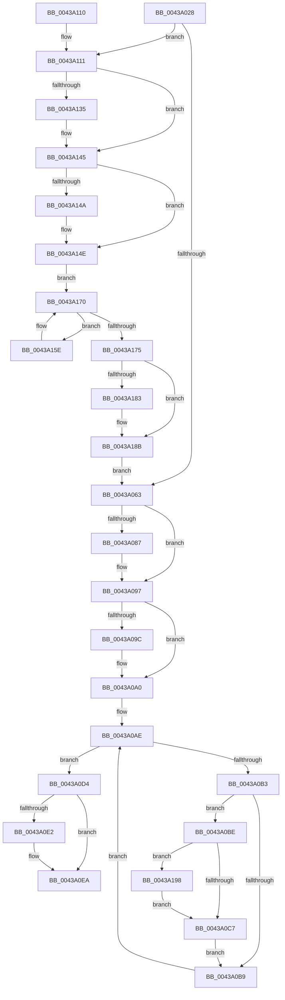

# PopDiagTraceFxRundown

- RVA: `0x0043A028`–`0x0043A1A7` (길이 `383` bytes)
- VA: `0x000000014043A028`
- 실행 섹션: `.text`
- PDB 이름 있음: `예`; PDB Function 태그: `아니요`
- unwind 정보 RVA: `0x000A42F8`
- 디코드: `102`개 명령, `383/383` bytes 표시
- 미해석 바이트: `0` (있으면 어셈블리에 `.byte`로 보존)

> 이 문서는 커널 이미지의 기계어와 PDB 기호를 분석해 생성했습니다. 4번과 5번은 함수 원형과 자료형을 바이너리 사용 방식에서 추정한 C 해석이며 원본 소스 복구 결과는 아닙니다.

## 1. Dependencies

- 직접 호출 지점: **12**; 고유 호출 대상: **8**
- 직접 호출자로 확인된 함수: **2**
- RIP 상대 이미지 참조: **4**

### Outgoing calls
- `0x0043A072` → [KeAbPreAcquire](../21/KeAbPreAcquire_function_00210230.md) (function, `0x00210230`)
- `0x0043A092` → [ExfAcquirePushLockSharedEx](../21/ExfAcquirePushLockSharedEx_function_0021044C.md) (function, `0x0021044C`)
- `0x0043A0CD` → [PopDiagTraceDeviceVerboseRundown](../../page/A5/PopDiagTraceDeviceVerboseRundown_function_00A559E4.md) (function, `0x00A559E4`)
- `0x0043A0E5` → [ExfReleasePushLockShared](../26/ExfReleasePushLockShared_function_00263440.md) (function, `0x00263440`)
- `0x0043A0ED` → [KeAbPostRelease](../2E/KeAbPostRelease_function_002E1600.md) (function, `0x002E1600`)
- `0x0043A0F2` → [KeLeaveCriticalRegion](../25/KeLeaveCriticalRegion_function_0025D8B0.md) (function, `0x0025D8B0`)
- `0x0043A120` → [KeAbPreAcquire](../21/KeAbPreAcquire_function_00210230.md) (function, `0x00210230`)
- `0x0043A140` → [ExfAcquirePushLockSharedEx](../21/ExfAcquirePushLockSharedEx_function_0021044C.md) (function, `0x0021044C`)
- `0x0043A168` → [PopDiagTraceFxPluginRegistration](../../page/AA/PopDiagTraceFxPluginRegistration_function_00AAE10C.md) (function, `0x00AAE10C`)
- `0x0043A186` → [ExfReleasePushLockShared](../26/ExfReleasePushLockShared_function_00263440.md) (function, `0x00263440`)
- `0x0043A18E` → [KeAbPostRelease](../2E/KeAbPostRelease_function_002E1600.md) (function, `0x002E1600`)
- `0x0043A19D` → [PopFxTraceDeviceRegistration](../../page/A6/PopFxTraceDeviceRegistration_function_00A6F888.md) (function, `0x00A6F888`)

### Direct callers
- [PopCaptureSleepStudyStatistics](PopCaptureSleepStudyStatistics_function_004399F4.md) at `0x00439F0A`
- [PopDiagTraceControlCallback](../../page/A3/PopDiagTraceControlCallback_function_00A38CB0.md) at `0x00A38ED9`

### Static image references
- `0x0043A063` → RVA `0x00F0E408` (`.data`; read)
- `0x0043A0A0` → RVA `0x00F0E3F0` (`.data`; read)
- `0x0043A111` → RVA `0x00F0E428` (`.data`; read)
- `0x0043A14E` → RVA `0x00F0E410` (`.data`; read)

## 2. Other-region calls and transfers

- 다른 실행 섹션으로 향하는 call: **3**
  - `0x0043A0CD` → [PopDiagTraceDeviceVerboseRundown](../../page/A5/PopDiagTraceDeviceVerboseRundown_function_00A559E4.md) (`.text` → `PAGE`)
  - `0x0043A168` → [PopDiagTraceFxPluginRegistration](../../page/AA/PopDiagTraceFxPluginRegistration_function_00AAE10C.md) (`.text` → `PAGE`)
  - `0x0043A19D` → [PopFxTraceDeviceRegistration](../../page/A6/PopFxTraceDeviceRegistration_function_00A6F888.md) (`.text` → `PAGE`)
- 별도 외부 분기/꼬리 이동을 확인하지 못했습니다.

## 3. Assembly (complete function range)

```asm
0043A028  48 89 5C 24 10                  mov qword ptr [rsp + 0x10], rbx
0043A02D  48 89 6C 24 18                  mov qword ptr [rsp + 0x18], rbp
0043A032  48 89 74 24 20                  mov qword ptr [rsp + 0x20], rsi
0043A037  57                              push rdi
0043A038  41 56                           push r14
0043A03A  41 57                           push r15
0043A03C  48 83 EC 20                     sub rsp, 0x20
0043A040  65 48 8B 04 25 88 01 00 00      mov rax, qword ptr gs:[0x188]
0043A049  33 F6                           xor esi, esi
0043A04B  48 8B F9                        mov rdi, rcx
0043A04E  66 FF 88 E4 01 00 00            dec word ptr [rax + 0x1e4]
0043A055  44 8D 7E 11                     lea r15d, [rsi + 0x11]
0043A059  90                              nop
0043A05A  48 85 C9                        test rcx, rcx
0043A05D  0F 84 AE 00 00 00               je 0x14043a111
0043A063  48 8D 2D 9E 43 AD 00            lea rbp, [rip + 0xad439e]
0043A06A  45 33 C0                        xor r8d, r8d
0043A06D  48 8B CD                        mov rcx, rbp
0043A070  33 D2                           xor edx, edx
0043A072  E8 B9 61 DD FF                  call 0x140210230
0043A077  48 8B D8                        mov rbx, rax
0043A07A  33 C0                           xor eax, eax
0043A07C  F0 4C 0F B1 3D 83 43 AD 00      lock cmpxchg qword ptr [rip + 0xad4383], r15
0043A085  74 10                           je 0x14043a097
0043A087  4C 8B CD                        mov r9, rbp
0043A08A  4C 8B C3                        mov r8, rbx
0043A08D  33 D2                           xor edx, edx
0043A08F  48 8B CD                        mov rcx, rbp
0043A092  E8 B5 63 DD FF                  call 0x14021044c
0043A097  48 85 DB                        test rbx, rbx
0043A09A  74 04                           je 0x14043a0a0
0043A09C  C6 43 0A 01                     mov byte ptr [rbx + 0xa], 1
0043A0A0  48 8B 1D 49 43 AD 00            mov rbx, qword ptr [rip + 0xad4349]
0043A0A7  4C 8D 35 42 43 AD 00            lea r14, [rip + 0xad4342]
0043A0AE  49 3B DE                        cmp rbx, r14
0043A0B1  74 21                           je 0x14043a0d4
0043A0B3  48 39 73 30                     cmp qword ptr [rbx + 0x30], rsi
0043A0B7  75 05                           jne 0x14043a0be
0043A0B9  48 8B 1B                        mov rbx, qword ptr [rbx]
0043A0BC  EB F0                           jmp 0x14043a0ae
0043A0BE  48 85 FF                        test rdi, rdi
0043A0C1  0F 84 D1 00 00 00               je 0x14043a198
0043A0C7  48 8B D7                        mov rdx, rdi
0043A0CA  48 8B CB                        mov rcx, rbx
0043A0CD  E8 12 B9 61 00                  call 0x140a559e4
0043A0D2  EB E5                           jmp 0x14043a0b9
0043A0D4  49 8B C7                        mov rax, r15
0043A0D7  F0 48 0F B1 35 28 43 AD 00      lock cmpxchg qword ptr [rip + 0xad4328], rsi
0043A0E0  74 08                           je 0x14043a0ea
0043A0E2  48 8B CD                        mov rcx, rbp
0043A0E5  E8 56 93 E2 FF                  call 0x140263440
0043A0EA  48 8B CD                        mov rcx, rbp
0043A0ED  E8 0E 75 EA FF                  call 0x1402e1600
0043A0F2  E8 B9 37 E2 FF                  call 0x14025d8b0
0043A0F7  48 8B 5C 24 48                  mov rbx, qword ptr [rsp + 0x48]
0043A0FC  48 8B 6C 24 50                  mov rbp, qword ptr [rsp + 0x50]
0043A101  48 8B 74 24 58                  mov rsi, qword ptr [rsp + 0x58]
0043A106  48 83 C4 20                     add rsp, 0x20
0043A10A  41 5F                           pop r15
0043A10C  41 5E                           pop r14
0043A10E  5F                              pop rdi
0043A10F  C3                              ret
0043A110  CC                              int3
0043A111  48 8D 2D 10 43 AD 00            lea rbp, [rip + 0xad4310]
0043A118  45 33 C0                        xor r8d, r8d
0043A11B  48 8B CD                        mov rcx, rbp
0043A11E  33 D2                           xor edx, edx
0043A120  E8 0B 61 DD FF                  call 0x140210230
0043A125  48 8B D8                        mov rbx, rax
0043A128  33 C0                           xor eax, eax
0043A12A  F0 4C 0F B1 3D F5 42 AD 00      lock cmpxchg qword ptr [rip + 0xad42f5], r15
0043A133  74 10                           je 0x14043a145
0043A135  4C 8B CD                        mov r9, rbp
0043A138  4C 8B C3                        mov r8, rbx
0043A13B  33 D2                           xor edx, edx
0043A13D  48 8B CD                        mov rcx, rbp
0043A140  E8 07 63 DD FF                  call 0x14021044c
0043A145  48 85 DB                        test rbx, rbx
0043A148  74 04                           je 0x14043a14e
0043A14A  C6 43 0A 01                     mov byte ptr [rbx + 0xa], 1
0043A14E  48 8B 1D BB 42 AD 00            mov rbx, qword ptr [rip + 0xad42bb]
0043A155  4C 8D 35 B4 42 AD 00            lea r14, [rip + 0xad42b4]
0043A15C  EB 12                           jmp 0x14043a170
0043A15E  48 8B 53 18                     mov rdx, qword ptr [rbx + 0x18]
0043A162  41 B0 01                        mov r8b, 1
0043A165  48 8B CB                        mov rcx, rbx
0043A168  E8 9F 3F 67 00                  call 0x140aae10c
0043A16D  48 8B 1B                        mov rbx, qword ptr [rbx]
0043A170  49 3B DE                        cmp rbx, r14
0043A173  75 E9                           jne 0x14043a15e
0043A175  49 8B C7                        mov rax, r15
0043A178  F0 48 0F B1 35 A7 42 AD 00      lock cmpxchg qword ptr [rip + 0xad42a7], rsi
0043A181  74 08                           je 0x14043a18b
0043A183  48 8B CD                        mov rcx, rbp
0043A186  E8 B5 92 E2 FF                  call 0x140263440
0043A18B  48 8B CD                        mov rcx, rbp
0043A18E  E8 6D 74 EA FF                  call 0x1402e1600
0043A193  E9 CB FE FF FF                  jmp 0x14043a063
0043A198  B2 01                           mov dl, 1
0043A19A  48 8B CB                        mov rcx, rbx
0043A19D  E8 E6 56 63 00                  call 0x140a6f888
0043A1A2  E9 20 FF FF FF                  jmp 0x14043a0c7
```

## 4. C-style interpretation (structured pseudocode)

```c
__int64 __fastcall PopDiagTraceFxRundown(__int64 a1, int a2, int a3)
{
    __int64 result;
    __int64 v_rsi;
    __int64 v_rsp;
    unsigned __int64 v_stack_p10;
    unsigned __int64 v_stack_p18;
    unsigned __int64 v_stack_p20;

    v_stack_p10 = v_rbx;
    v_stack_p18 = v_rbp;
    v_stack_p20 = v_rsi;
    v_rsp = (v_rsp) - (32);
    v_rsi = 0;
    if (a1 == 0) goto loc_0043A111;
loc_0043A063:
    a3 = 0;
    a2 = 0;
    result = KeAbPreAcquire(v_rip + 11355038, a2, a3, a4);
    result = 0;
    if (!(condition_is_equal)) {
        a4 = v_rip + 11355038;
        a3 = 0;
        a2 = 0;
        a1 = v_rip + 11355038;
        result = ExfAcquirePushLockSharedEx(a1, a2, a3, a4);
    }
    if (result != 0) {
        *(unsigned __int8 *)(result + 10) = 1;
    }
loc_0043A0AE:
    if ((*(unsigned __int64 *)(v_rip + 11354953)) == (v_rip + 11354946)) goto loc_0043A0D4;
    if ((*(unsigned __int64 *)(*(unsigned __int64 *)(v_rip + 11354953) + 48)) != 0) goto loc_0043A0BE;
loc_0043A0B9:
    goto loc_0043A0AE;
loc_0043A0BE:
    if (a1 == 0) goto loc_0043A198;
loc_0043A0C7:
    result = PopDiagTraceDeviceVerboseRundown(*(unsigned __int64 *)(*(unsigned __int64 *)(v_rip + 11354953)), a1, a3, a4);
    goto loc_0043A0B9;
loc_0043A0D4:
    result = v_rsi + 17;
    if (a1 != 0) {
        a1 = v_rip + 11355038;
        result = ExfReleasePushLockShared(a1, a1, a3, a4);
    }
    result = KeAbPostRelease(v_rip + 11355038, a1, a3, a4);
    result = KeLeaveCriticalRegion(v_rip + 11355038, a1, a3, a4);
    v_rsp = (v_rsp) + (32);
    return result;
loc_0043A111:
    a3 = 0;
    a2 = 0;
    result = KeAbPreAcquire(v_rip + 11354896, a2, a3, a4);
    result = 0;
    if (!(condition_is_equal)) {
        a4 = v_rip + 11354896;
        a3 = 0;
        a2 = 0;
        a1 = v_rip + 11354896;
        result = ExfAcquirePushLockSharedEx(a1, a2, a3, a4);
    }
    if (result != 0) {
        *(unsigned __int8 *)(result + 10) = 1;
    }
    goto loc_0043A170;
loc_0043A15E:
    result = PopDiagTraceFxPluginRegistration(*(unsigned __int64 *)(v_rip + 11354811), *(unsigned __int64 *)(*(unsigned __int64 *)(v_rip + 11354811) + 24), 1, a4);
loc_0043A170:
    if ((*(unsigned __int64 *)(*(unsigned __int64 *)(v_rip + 11354811))) != (v_rip + 11354804)) goto loc_0043A15E;
    result = v_rsi + 17;
    if ((*(unsigned __int64 *)(*(unsigned __int64 *)(v_rip + 11354811))) != (v_rip + 11354804)) {
        a1 = v_rip + 11354896;
        result = ExfReleasePushLockShared(a1, *(unsigned __int64 *)(*(unsigned __int64 *)(v_rip + 11354811) + 24), 1, a4);
    }
    result = KeAbPostRelease(v_rip + 11354896, *(unsigned __int64 *)(*(unsigned __int64 *)(v_rip + 11354811) + 24), 1, a4);
    goto loc_0043A063;
loc_0043A198:
    result = PopFxTraceDeviceRegistration(*(unsigned __int64 *)(*(unsigned __int64 *)(v_rip + 11354811)), 1, 1, a4);
    goto loc_0043A0C7;
}
```

## 5. (Beta) C Style

```c
int64_t PopDiagTraceFxRundown(int64_t Arg1, int32_t Arg2, int32_t Arg3)
{
    int64_t result;
    int64_t local_rsi;
    int64_t local_rsp;
    uint64_t v_stack_p10;
    uint64_t v_stack_p18;
    uint64_t v_stack_p20;

    v_stack_p10 = local_rbx;
    v_stack_p18 = local_rbp;
    v_stack_p20 = local_rsi;
    local_rsp = (local_rsp) - (32);
    local_rsi = 0;
    if (Arg1 == 0) goto loc_0043A111;
loc_0043A063:
    Arg3 = 0;
    Arg2 = 0;
    result = KeAbPreAcquire(v_rip + 11355038, Arg2, Arg3, a4);
    result = 0;
    if (!(condition_is_equal)) {
        a4 = v_rip + 11355038;
        Arg3 = 0;
        Arg2 = 0;
        Arg1 = v_rip + 11355038;
        result = ExfAcquirePushLockSharedEx(Arg1, Arg2, Arg3, a4);
    }
    if (result != 0) {
        *(uint8_t *)(result + 0xA) = 1;
    }
loc_0043A0AE:
    if ((*(uint64_t *)(v_rip + 0xAD4349)) == (v_rip + 11354946)) goto loc_0043A0D4;
    if ((*(uint64_t *)(*(uint64_t *)(v_rip + 0xAD4349) + 0x30)) != 0) goto loc_0043A0BE;
loc_0043A0B9:
    goto loc_0043A0AE;
loc_0043A0BE:
    if (Arg1 == 0) goto loc_0043A198;
loc_0043A0C7:
    result = PopDiagTraceDeviceVerboseRundown(*(uint64_t *)(*(uint64_t *)(v_rip + 0xAD4349)), Arg1, Arg3, a4);
    goto loc_0043A0B9;
loc_0043A0D4:
    result = local_rsi + 17;
    if (Arg1 != 0) {
        Arg1 = v_rip + 11355038;
        result = ExfReleasePushLockShared(Arg1, Arg1, Arg3, a4);
    }
    result = KeAbPostRelease(v_rip + 11355038, Arg1, Arg3, a4);
    result = KeLeaveCriticalRegion(v_rip + 11355038, Arg1, Arg3, a4);
    local_rsp = (local_rsp) + (32);
    return result;
loc_0043A111:
    Arg3 = 0;
    Arg2 = 0;
    result = KeAbPreAcquire(v_rip + 11354896, Arg2, Arg3, a4);
    result = 0;
    if (!(condition_is_equal)) {
        a4 = v_rip + 11354896;
        Arg3 = 0;
        Arg2 = 0;
        Arg1 = v_rip + 11354896;
        result = ExfAcquirePushLockSharedEx(Arg1, Arg2, Arg3, a4);
    }
    if (result != 0) {
        *(uint8_t *)(result + 0xA) = 1;
    }
    goto loc_0043A170;
loc_0043A15E:
    result = PopDiagTraceFxPluginRegistration(*(uint64_t *)(v_rip + 0xAD42BB), *(uint64_t *)(*(uint64_t *)(v_rip + 0xAD42BB) + 0x18), 1, a4);
loc_0043A170:
    if ((*(uint64_t *)(*(uint64_t *)(v_rip + 0xAD42BB))) != (v_rip + 11354804)) goto loc_0043A15E;
    result = local_rsi + 17;
    if ((*(uint64_t *)(*(uint64_t *)(v_rip + 0xAD42BB))) != (v_rip + 11354804)) {
        Arg1 = v_rip + 11354896;
        result = ExfReleasePushLockShared(Arg1, *(uint64_t *)(*(uint64_t *)(v_rip + 0xAD42BB) + 0x18), 1, a4);
    }
    result = KeAbPostRelease(v_rip + 11354896, *(uint64_t *)(*(uint64_t *)(v_rip + 0xAD42BB) + 0x18), 1, a4);
    goto loc_0043A063;
loc_0043A198:
    result = PopFxTraceDeviceRegistration(*(uint64_t *)(*(uint64_t *)(v_rip + 0xAD42BB)), 1, 1, a4);
    goto loc_0043A0C7;
}
```

## 6. Execution-region graph

[열기: 2D/3D 그래프와 함수 탐색 컨트롤 패널](../../../control-panel.html?section=text&rva=0x0043A028&view=graph)

- 2D 그래프는 위에서 아래로 흐르고, 3D 그래프는 빈 공간을 드래그해 회전합니다. Shift+드래그는 이동, 휠은 확대·축소, 함수 노드 선택은 대상 보고서 이동입니다.

### Static fallback


