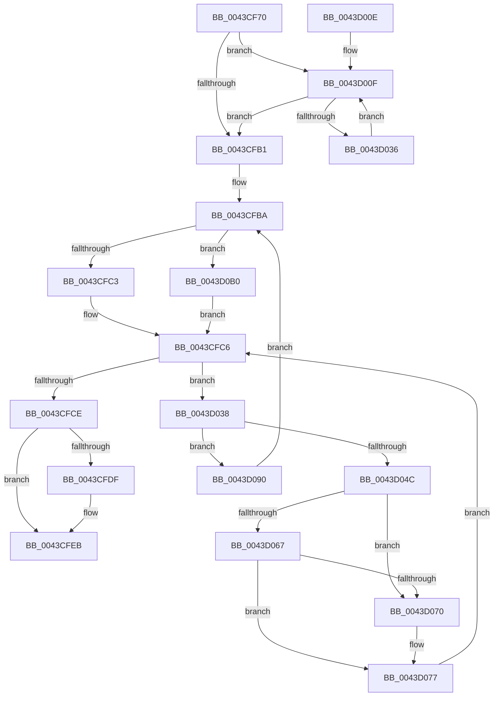

# PopFxDeactivateComponentDependencies

- RVA: `0x0043CF70`–`0x0043D0C2` (길이 `338` bytes)
- VA: `0x000000014043CF70`
- 실행 섹션: `.text`
- PDB 이름 있음: `예`; PDB Function 태그: `아니요`
- unwind 정보 RVA: `0x000A4804`
- 디코드: `90`개 명령, `338/338` bytes 표시
- 미해석 바이트: `0` (있으면 어셈블리에 `.byte`로 보존)

> 이 문서는 커널 이미지의 기계어와 PDB 기호를 분석해 생성했습니다. 4번과 5번은 함수 원형과 자료형을 바이너리 사용 방식에서 추정한 C 해석이며 원본 소스 복구 결과는 아닙니다.

## 1. Dependencies

- 직접 호출 지점: **9**; 고유 호출 대상: **6**
- 직접 호출자로 확인된 함수: **1**
- RIP 상대 이미지 참조: **1**

### Outgoing calls
- `0x0043CF9A` → [KeAcquireSpinLockRaiseToDpc](../20/KeAcquireSpinLockRaiseToDpc_function_00208470.md) (function, `0x00208470`)
- `0x0043CFD1` → [KxReleaseSpinLock](../20/KxReleaseSpinLock_function_00206670.md) (function, `0x00206670`)
- `0x0043CFE6` → [KiLowerIrqlProcessIrqlFlags](../4F/KiLowerIrqlProcessIrqlFlags_function_004F5698.md) (function, `0x004F5698`)
- `0x0043D023` → [PopFxIdleComponent](../2C/PopFxIdleComponent_function_002C01D8.md) (function, `0x002C01D8`)
- `0x0043D040` → [KeAcquireSpinLockAtDpcLevel](../20/KeAcquireSpinLockAtDpcLevel_function_00208430.md) (function, `0x00208430`)
- `0x0043D050` → [KxReleaseSpinLock](../20/KxReleaseSpinLock_function_00206670.md) (function, `0x00206670`)
- `0x0043D086` → [ExFreePoolWithTag](../../poolcode/B8/ExFreePoolWithTag_function_00B82870.md) (function, `0x00B82870`)
- `0x0043D0A2` → [PopFxIdleComponent](../2C/PopFxIdleComponent_function_002C01D8.md) (function, `0x002C01D8`)
- `0x0043D0B4` → [KxReleaseSpinLock](../20/KxReleaseSpinLock_function_00206670.md) (function, `0x00206670`)

### Direct callers
- [PopFxIdleWorkerTail](PopFxIdleWorkerTail_function_0043CDA0.md) at `0x0043CE6B`

### Static image references
- `0x0043CFD6` → RVA `0x00FC6D20` (`ALMOSTRO`; read)

## 2. Other-region calls and transfers

- 다른 실행 섹션으로 향하는 call: **1**
  - `0x0043D086` → [ExFreePoolWithTag](../../poolcode/B8/ExFreePoolWithTag_function_00B82870.md) (`.text` → `POOLCODE`)
- 별도 외부 분기/꼬리 이동을 확인하지 못했습니다.

## 3. Assembly (complete function range)

```asm
0043CF70  48 8B C4                        mov rax, rsp
0043CF73  48 89 58 08                     mov qword ptr [rax + 8], rbx
0043CF77  48 89 68 10                     mov qword ptr [rax + 0x10], rbp
0043CF7B  48 89 70 18                     mov qword ptr [rax + 0x18], rsi
0043CF7F  48 89 78 20                     mov qword ptr [rax + 0x20], rdi
0043CF83  41 54                           push r12
0043CF85  41 56                           push r14
0043CF87  41 57                           push r15
0043CF89  48 83 EC 20                     sub rsp, 0x20
0043CF8D  4C 8D A1 80 00 00 00            lea r12, [rcx + 0x80]
0043CF94  48 8B F9                        mov rdi, rcx
0043CF97  49 8B CC                        mov rcx, r12
0043CF9A  E8 D1 B4 DC FF                  call 0x140208470
0043CF9F  48 8B 77 50                     mov rsi, qword ptr [rdi + 0x50]
0043CFA3  33 DB                           xor ebx, ebx
0043CFA5  44 0F B6 F0                     movzx r14d, al
0043CFA9  39 9F AC 00 00 00               cmp dword ptr [rdi + 0xac], ebx
0043CFAF  77 5E                           ja 0x14043d00f
0043CFB1  33 DB                           xor ebx, ebx
0043CFB3  48 8D AF C8 01 00 00            lea rbp, [rdi + 0x1c8]
0043CFBA  48 85 DB                        test rbx, rbx
0043CFBD  0F 85 ED 00 00 00               jne 0x14043d0b0
0043CFC3  48 8B F5                        mov rsi, rbp
0043CFC6  48 8B 3E                        mov rdi, qword ptr [rsi]
0043CFC9  48 3B FD                        cmp rdi, rbp
0043CFCC  75 6A                           jne 0x14043d038
0043CFCE  49 8B CC                        mov rcx, r12
0043CFD1  E8 9A 96 DC FF                  call 0x140206670
0043CFD6  83 3D 43 9D B8 00 00            cmp dword ptr [rip + 0xb89d43], 0
0043CFDD  74 0C                           je 0x14043cfeb
0043CFDF  44 0F 20 C1                     mov rcx, cr8
0043CFE3  41 8A D6                        mov dl, r14b
0043CFE6  E8 AD 86 0B 00                  call 0x1404f5698
0043CFEB  45 0F 22 C6                     mov cr8, r14
0043CFEF  48 8B 5C 24 40                  mov rbx, qword ptr [rsp + 0x40]
0043CFF4  48 8B 6C 24 48                  mov rbp, qword ptr [rsp + 0x48]
0043CFF9  48 8B 74 24 50                  mov rsi, qword ptr [rsp + 0x50]
0043CFFE  48 8B 7C 24 58                  mov rdi, qword ptr [rsp + 0x58]
0043D003  48 83 C4 20                     add rsp, 0x20
0043D007  41 5F                           pop r15
0043D009  41 5E                           pop r14
0043D00B  41 5C                           pop r12
0043D00D  C3                              ret
0043D00E  CC                              int3
0043D00F  48 8B 97 B0 00 00 00            mov rdx, qword ptr [rdi + 0xb0]
0043D016  45 33 C9                        xor r9d, r9d
0043D019  48 8B CE                        mov rcx, rsi
0043D01C  8B 14 DA                        mov edx, dword ptr [rdx + rbx*8]
0043D01F  45 8D 41 02                     lea r8d, [r9 + 2]
0043D023  E8 B0 31 E8 FF                  call 0x1402c01d8
0043D028  FF C3                           inc ebx
0043D02A  3B 9F AC 00 00 00               cmp ebx, dword ptr [rdi + 0xac]
0043D030  0F 83 7B FF FF FF               jae 0x14043cfb1
0043D036  EB D7                           jmp 0x14043d00f
0043D038  48 8D 5F C8                     lea rbx, [rdi - 0x38]
0043D03C  48 8D 4B 08                     lea rcx, [rbx + 8]
0043D040  E8 EB B3 DC FF                  call 0x140208430
0043D045  8B 43 10                        mov eax, dword ptr [rbx + 0x10]
0043D048  A8 04                           test al, 4
0043D04A  75 44                           jne 0x14043d090
0043D04C  48 8D 4B 08                     lea rcx, [rbx + 8]
0043D050  E8 1B 96 DC FF                  call 0x140206670
0043D055  83 63 10 F7                     and dword ptr [rbx + 0x10], 0xfffffff7
0043D059  48 83 63 30 00                  and qword ptr [rbx + 0x30], 0
0043D05E  48 8B 0F                        mov rcx, qword ptr [rdi]
0043D061  48 39 79 08                     cmp qword ptr [rcx + 8], rdi
0043D065  75 09                           jne 0x14043d070
0043D067  48 8B 47 08                     mov rax, qword ptr [rdi + 8]
0043D06B  48 39 38                        cmp qword ptr [rax], rdi
0043D06E  74 07                           je 0x14043d077
0043D070  B9 03 00 00 00                  mov ecx, 3
0043D075  CD 29                           int 0x29
0043D077  48 89 08                        mov qword ptr [rax], rcx
0043D07A  BA 50 46 58 4D                  mov edx, 0x4d584650
0043D07F  48 89 41 08                     mov qword ptr [rcx + 8], rax
0043D083  48 8B CB                        mov rcx, rbx
0043D086  E8 E5 57 74 00                  call 0x140b82870
0043D08B  E9 36 FF FF FF                  jmp 0x14043cfc6
0043D090  48 8B 4B 18                     mov rcx, qword ptr [rbx + 0x18]
0043D094  45 33 C9                        xor r9d, r9d
0043D097  8B 51 10                        mov edx, dword ptr [rcx + 0x10]
0043D09A  45 8D 41 02                     lea r8d, [r9 + 2]
0043D09E  48 8B 49 50                     mov rcx, qword ptr [rcx + 0x50]
0043D0A2  E8 31 31 E8 FF                  call 0x1402c01d8
0043D0A7  83 63 10 FD                     and dword ptr [rbx + 0x10], 0xfffffffd
0043D0AB  E9 0A FF FF FF                  jmp 0x14043cfba
0043D0B0  48 8D 4B 08                     lea rcx, [rbx + 8]
0043D0B4  E8 B7 95 DC FF                  call 0x140206670
0043D0B9  48 8D 73 38                     lea rsi, [rbx + 0x38]
0043D0BD  E9 04 FF FF FF                  jmp 0x14043cfc6
```

## 4. C-style interpretation (structured pseudocode)

```c
__int64 __fastcall PopFxDeactivateComponentDependencies(__int64 a1, __int64 a2, __int64 a3, int a4)
{
    __int64 result;
    __int64 v_rbx;
    __int64 v_rsp;
    unsigned __int64 v_stack_p10;
    unsigned __int64 v_stack_p18;
    unsigned __int64 v_stack_p20;
    unsigned __int64 v_stack_p8;

    *(unsigned __int64 *)(v_rsp + 8) = v_rbx;
    *(unsigned __int64 *)(v_rsp + 16) = v_rbp;
    *(unsigned __int64 *)(v_rsp + 24) = v_rsi;
    *(unsigned __int64 *)(v_rsp + 32) = v_rdi;
    v_rsp = (v_rsp) - (32);
    result = KeAcquireSpinLockRaiseToDpc(a1 + 128, a2, a3, a4);
    v_rbx = 0;
    if ((*(unsigned int *)(a1 + 172)) > 0) goto loc_0043D00F;
loc_0043CFB1:
    v_rbx = 0;
loc_0043CFBA:
    if (0 != 0) goto loc_0043D0B0;
loc_0043CFC6:
    if ((*(unsigned __int64 *)(a1 + 456)) != (a1 + 456)) goto loc_0043D038;
    result = KxReleaseSpinLock(a1 + 128, a2, a3, a4);
    if ((*(unsigned int *)(v_rip + 12098883)) != 0) {
        a1 = v_cr8;
        a2 = (unsigned __int8)((unsigned __int8)(result));
        result = KiLowerIrqlProcessIrqlFlags(a1, a2, a3, a4);
    }
    v_rsp = (v_rsp) + (32);
    return result;
loc_0043D00F:
    a4 = 0;
    result = PopFxIdleComponent(v_stack_p18, (unsigned int)(*(unsigned int *)(*(unsigned __int64 *)(v_stack_p20 + 176) + v_stack_p8 * 8)), a4 + 2, a4);
    v_rbx = (unsigned int)((v_stack_p8) + 1);
    if (((unsigned int)(v_rbx)) >= (*(unsigned int *)(v_stack_p20 + 172))) goto loc_0043CFB1;
    goto loc_0043D00F;
loc_0043D038:
    result = KeAcquireSpinLockAtDpcLevel(v_stack_p20 - 56 + 8, (unsigned int)(*(unsigned int *)(*(unsigned __int64 *)(v_stack_p20 + 176) + v_stack_p8 * 8)), a4 + 2, a4);
    if ((((unsigned __int8)((unsigned int)(*(unsigned int *)(v_stack_p20 - 56 + 16)))) & (4)) != 0) goto loc_0043D090;
    result = KxReleaseSpinLock(v_stack_p20 - 56 + 8, (unsigned int)(*(unsigned int *)(*(unsigned __int64 *)(v_stack_p20 + 176) + v_stack_p8 * 8)), a4 + 2, a4);
    if ((*(unsigned __int64 *)(*(unsigned __int64 *)(v_stack_p20) + 8)) != v_stack_p20) goto loc_0043D070;
    if ((*(unsigned __int64 *)(*(unsigned __int64 *)(v_stack_p20 + 8))) != v_stack_p20) {
        a1 = 3;
    }
    *(unsigned __int64 *)(*(unsigned __int64 *)(v_stack_p20 + 8)) = a1;
    *(unsigned __int64 *)(a1 + 8) = *(unsigned __int64 *)(v_stack_p20 + 8);
    result = ExFreePoolWithTag(v_stack_p20 - 56, (unsigned int)(0x4D584650ULL), a4 + 2, a4);
    goto loc_0043CFC6;
loc_0043D090:
    a4 = 0;
    result = PopFxIdleComponent(*(unsigned __int64 *)(*(unsigned __int64 *)(v_stack_p20 - 56 + 24) + 80), (unsigned int)(*(unsigned int *)(*(unsigned __int64 *)(v_stack_p20 - 56 + 24) + 16)), a4 + 2, a4);
    goto loc_0043CFBA;
loc_0043D0B0:
    result = KxReleaseSpinLock(v_stack_p20 - 56 + 8, (unsigned int)(*(unsigned int *)(*(unsigned __int64 *)(v_stack_p20 - 56 + 24) + 16)), a4 + 2, a4);
    goto loc_0043CFC6;
}
```

## 5. (Beta) C Style

```c
int64_t PopFxDeactivateComponentDependencies(void *Arg1, int64_t Arg2, int64_t Arg3, int32_t Arg4)
{
    uint8_t *arg1 = (uint8_t *)Arg1;

    int64_t result;
    int64_t local_rbx;
    int64_t local_rsp;
    uint64_t v_stack_p10;
    uint64_t v_stack_p18;
    uint64_t v_stack_p20;
    uint64_t v_stack_p8;

    *(uint64_t *)(local_rsp + 0x8) = local_rbx;
    *(uint64_t *)(local_rsp + 0x10) = local_rbp;
    *(uint64_t *)(local_rsp + 0x18) = local_rsi;
    *(uint64_t *)(local_rsp + 0x20) = local_rdi;
    local_rsp = (local_rsp) - (32);
    result = KeAcquireSpinLockRaiseToDpc(Arg1 + 128, Arg2, Arg3, Arg4);
    local_rbx = 0;
    if ((*(uint32_t *)(arg1 + 0xAC)) > 0) goto loc_0043D00F;
loc_0043CFB1:
    local_rbx = 0;
loc_0043CFBA:
    if (0 != 0) goto loc_0043D0B0;
loc_0043CFC6:
    if ((*(uint64_t *)(arg1 + 0x1C8)) != (Arg1 + 456)) goto loc_0043D038;
    result = KxReleaseSpinLock(Arg1 + 128, Arg2, Arg3, Arg4);
    if ((*(uint32_t *)(v_rip + 0xB89D43)) != 0) {
        Arg1 = v_cr8;
        Arg2 = (uint8_t)((uint8_t)(result));
        result = KiLowerIrqlProcessIrqlFlags(Arg1, Arg2, Arg3, Arg4);
    }
    local_rsp = (local_rsp) + (32);
    return result;
loc_0043D00F:
    Arg4 = 0;
    result = PopFxIdleComponent(v_stack_p18, (uint32_t)(*(uint32_t *)(*(uint64_t *)(v_stack_p20 + 0xB0) + v_stack_p8 * 8)), Arg4 + 2, Arg4);
    local_rbx = (uint32_t)((v_stack_p8) + 1);
    if (((uint32_t)(local_rbx)) >= (*(uint32_t *)(v_stack_p20 + 0xAC))) goto loc_0043CFB1;
    goto loc_0043D00F;
loc_0043D038:
    result = KeAcquireSpinLockAtDpcLevel(v_stack_p20 - 56 + 8, (uint32_t)(*(uint32_t *)(*(uint64_t *)(v_stack_p20 + 0xB0) + v_stack_p8 * 8)), Arg4 + 2, Arg4);
    if ((((uint8_t)((uint32_t)(*(uint32_t *)(v_stack_p20 - 0x38 + 0x10)))) & (4)) != 0) goto loc_0043D090;
    result = KxReleaseSpinLock(v_stack_p20 - 56 + 8, (uint32_t)(*(uint32_t *)(*(uint64_t *)(v_stack_p20 + 0xB0) + v_stack_p8 * 8)), Arg4 + 2, Arg4);
    if ((*(uint64_t *)(*(uint64_t *)(v_stack_p20) + 0x8)) != v_stack_p20) goto loc_0043D070;
    if ((*(uint64_t *)(*(uint64_t *)(v_stack_p20 + 0x8))) != v_stack_p20) {
        Arg1 = 3;
    }
    *(void **)(*(uint64_t *)(v_stack_p20 + 0x8)) = Arg1;
    *(uint64_t *)(arg1 + 0x8) = *(uint64_t *)(v_stack_p20 + 0x8);
    result = ExFreePoolWithTag(v_stack_p20 - 56, (uint32_t)(0x4D584650ULL), Arg4 + 2, Arg4);
    goto loc_0043CFC6;
loc_0043D090:
    Arg4 = 0;
    result = PopFxIdleComponent(*(uint64_t *)(*(uint64_t *)(v_stack_p20 - 0x38 + 0x18) + 0x50), (uint32_t)(*(uint32_t *)(*(uint64_t *)(v_stack_p20 - 0x38 + 0x18) + 0x10)), Arg4 + 2, Arg4);
    goto loc_0043CFBA;
loc_0043D0B0:
    result = KxReleaseSpinLock(v_stack_p20 - 56 + 8, (uint32_t)(*(uint32_t *)(*(uint64_t *)(v_stack_p20 - 0x38 + 0x18) + 0x10)), Arg4 + 2, Arg4);
    goto loc_0043CFC6;
}
```

### 관측된 메모리 오프셋

구조체 형식이 확인되지 않은 접근은 인자 기준의 오프셋으로만 기록했습니다.

| 기준 인자 | 오프셋 표현 | 폭 (bit) | 접근 |
|---|---:|---:|---|
| `Arg1` | `+ 0x50` | `64` | `R` |
| `Arg1` | `+ 0x80` | `64` | `R` |
| `Arg1` | `+ 0xAC` | `32` | `R` |
| `Arg1` | `+ 0xB0` | `64` | `R` |
| `Arg1` | `+ 0x1C8` | `64` | `R` |

## 6. Execution-region graph

[열기: 2D/3D 그래프와 함수 탐색 컨트롤 패널](../../../control-panel.html?section=text&rva=0x0043CF70&view=graph)

- 2D 그래프는 위에서 아래로 흐르고, 3D 그래프는 빈 공간을 드래그해 회전합니다. Shift+드래그는 이동, 휠은 확대·축소, 함수 노드 선택은 대상 보고서 이동입니다.

### Static fallback


