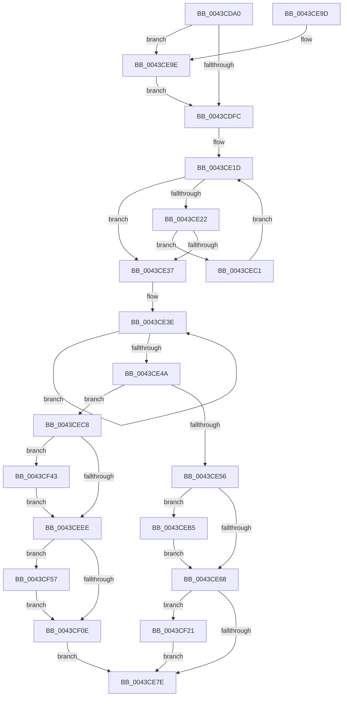

# PopFxIdleWorkerTail

- RVA: `0x0043CDA0`–`0x0043CF68` (길이 `456` bytes)
- VA: `0x000000014043CDA0`
- 실행 섹션: `.text`
- PDB 이름 있음: `예`; PDB Function 태그: `아니요`
- unwind 정보 RVA: `0x000A47E8`
- 디코드: `121`개 명령, `456/456` bytes 표시
- 미해석 바이트: `0` (있으면 어셈블리에 `.byte`로 보존)

> 이 문서는 커널 이미지의 기계어와 PDB 기호를 분석해 생성했습니다. 4번과 5번은 함수 원형과 자료형을 바이너리 사용 방식에서 추정한 C 해석이며 원본 소스 복구 결과는 아닙니다.

## 1. Dependencies

- 직접 호출 지점: **16**; 고유 호출 대상: **13**
- 직접 호출자로 확인된 함수: **2**
- RIP 상대 이미지 참조: **0**

### Outgoing calls
- `0x0043CDD1` → [PopFxDeviceCriticalRegionEnter](../4F/PopFxDeviceCriticalRegionEnter_function_004F09A0.md) (function, `0x004F09A0`)
- `0x0043CDE7` → [KeAcquireSpinLockRaiseToDpc](../20/KeAcquireSpinLockRaiseToDpc_function_00208470.md) (function, `0x00208470`)
- `0x0043CE02` → [KeReleaseSpinLock](../39/KeReleaseSpinLock_function_00392BA0.md) (function, `0x00392BA0`)
- `0x0043CE11` → [PopDiagTraceFxComponentLogicalCondition](PopDiagTraceFxComponentLogicalCondition_function_0043D3A0.md) (function, `0x0043D3A0`)
- `0x0043CE5F` → [PopPluginComponentActive](../24/PopPluginComponentActive_function_0024B800.md) (function, `0x0024B800`)
- `0x0043CE6B` → [PopFxDeactivateComponentDependencies](PopFxDeactivateComponentDependencies_function_0043CF70.md) (function, `0x0043CF70`)
- `0x0043CE81` → [PopFxDeviceCriticalRegionLeave](../4F/PopFxDeviceCriticalRegionLeave_function_004F1330.md) (function, `0x004F1330`)
- `0x0043CEA7` → [PopFxUpdateAccountingActiveTime](PopFxUpdateAccountingActiveTime_function_0043D2EC.md) (function, `0x0043D2EC`)
- `0x0043CEBA` → [PopFxProcessWork](../2B/PopFxProcessWork_function_002BD3E0.md) (function, `0x002BD3E0`)
- `0x0043CECD` → [PopFxReferenceDevice](../2B/PopFxReferenceDevice_function_002BFD9C.md) (function, `0x002BFD9C`)
- `0x0043CEE1` → [KeAcquireSpinLockRaiseToDpc](../20/KeAcquireSpinLockRaiseToDpc_function_00208470.md) (function, `0x00208470`)
- `0x0043CEF1` → [KeReleaseSpinLock](../39/KeReleaseSpinLock_function_00392BA0.md) (function, `0x00392BA0`)
- `0x0043CF00` → [PopDiagTraceFxComponentLogicalCondition](PopDiagTraceFxComponentLogicalCondition_function_0043D3A0.md) (function, `0x0043D3A0`)
- `0x0043CF17` → [PopFxCompleteComponentActivation](../2B/PopFxCompleteComponentActivation_function_002BDDE4.md) (function, `0x002BDDE4`)
- `0x0043CF39` → [PopFxActivateComponentWorker](../2D/PopFxActivateComponentWorker_function_002D9F60.md) (function, `0x002D9F60`)
- `0x0043CF61` → [guard_dispatch_icall](../6B/guard_dispatch_icall_function_006BAAD0.md) (function, `0x006BAAD0`)

### Direct callers
- [PopFxIdleWorker](../2C/PopFxIdleWorker_function_002C04A0.md) at `0x002C0577`
- [PoFxCompleteIdleCondition](../46/PoFxCompleteIdleCondition_function_00461CC0.md) at `0x00461D18`

### Static image references
- 디코드된 RIP-relative 메모리 참조가 없습니다.

## 2. Other-region calls and transfers

- 다른 실행 섹션으로 향하는 call: **0**
- 별도 외부 분기/꼬리 이동을 확인하지 못했습니다.

## 3. Assembly (complete function range)

```asm
0043CDA0  48 89 5C 24 08                  mov qword ptr [rsp + 8], rbx
0043CDA5  48 89 6C 24 18                  mov qword ptr [rsp + 0x18], rbp
0043CDAA  56                              push rsi
0043CDAB  57                              push rdi
0043CDAC  41 54                           push r12
0043CDAE  41 56                           push r14
0043CDB0  41 57                           push r15
0043CDB2  48 83 EC 20                     sub rsp, 0x20
0043CDB6  48 8B 81 68 03 00 00            mov rax, qword ptr [rcx + 0x368]
0043CDBD  4D 8B F8                        mov r15, r8
0043CDC0  44 8B F2                        mov r14d, edx
0043CDC3  48 8B F9                        mov rdi, rcx
0043CDC6  4A 8B 1C F0                     mov rbx, qword ptr [rax + r14*8]
0043CDCA  48 8D B3 C8 00 00 00            lea rsi, [rbx + 0xc8]
0043CDD1  E8 CA 3B 0B 00                  call 0x1404f09a0
0043CDD6  48 BD 08 00 00 00 80 F7 FF FF   movabs rbp, 0xfffff78000000008
0043CDE0  48 8B CE                        mov rcx, rsi
0043CDE3  48 8B 6D 00                     mov rbp, qword ptr [rbp]
0043CDE7  E8 84 B6 DC FF                  call 0x140208470
0043CDEC  45 33 E4                        xor r12d, r12d
0043CDEF  44 8A D8                        mov r11b, al
0043CDF2  83 7E 10 01                     cmp dword ptr [rsi + 0x10], 1
0043CDF6  0F 84 A2 00 00 00               je 0x14043ce9e
0043CDFC  41 8A D3                        mov dl, r11b
0043CDFF  48 8B CE                        mov rcx, rsi
0043CE02  E8 99 5D F5 FF                  call 0x140392ba0
0043CE07  48 8B 4F 30                     mov rcx, qword ptr [rdi + 0x30]
0043CE0B  45 33 C0                        xor r8d, r8d
0043CE0E  41 8B D6                        mov edx, r14d
0043CE11  E8 8A 05 00 00                  call 0x14043d3a0
0043CE16  48 8B 87 20 02 00 00            mov rax, qword ptr [rdi + 0x220]
0043CE1D  48 3B C5                        cmp rax, rbp
0043CE20  73 15                           jae 0x14043ce37
0043CE22  48 8B C8                        mov rcx, rax
0043CE25  F0 48 0F B1 AF 20 02 00 00      lock cmpxchg qword ptr [rdi + 0x220], rbp
0043CE2E  48 3B C8                        cmp rcx, rax
0043CE31  0F 85 8A 00 00 00               jne 0x14043cec1
0043CE37  0F 0D 4B 58                     prefetchw byte ptr [rbx + 0x58]
0043CE3B  8B 43 58                        mov eax, dword ptr [rbx + 0x58]
0043CE3E  8B C8                           mov ecx, eax
0043CE40  41 0B CC                        or ecx, r12d
0043CE43  F0 0F B1 4B 58                  lock cmpxchg dword ptr [rbx + 0x58], ecx
0043CE48  75 F4                           jne 0x14043ce3e
0043CE4A  BD 00 00 00 40                  mov ebp, 0x40000000
0043CE4F  48 8B CF                        mov rcx, rdi
0043CE52  3B C5                           cmp eax, ebp
0043CE54  75 72                           jne 0x14043cec8
0043CE56  4D 8B CF                        mov r9, r15
0043CE59  45 33 C0                        xor r8d, r8d
0043CE5C  41 8B D6                        mov edx, r14d
0043CE5F  E8 9C E9 E0 FF                  call 0x14024b800
0043CE64  3C 01                           cmp al, 1
0043CE66  74 4D                           je 0x14043ceb5
0043CE68  48 8B CB                        mov rcx, rbx
0043CE6B  E8 00 01 00 00                  call 0x14043cf70
0043CE70  8B C5                           mov eax, ebp
0043CE72  F0 44 0F B1 63 58               lock cmpxchg dword ptr [rbx + 0x58], r12d
0043CE78  0F 85 A3 00 00 00               jne 0x14043cf21
0043CE7E  48 8B CF                        mov rcx, rdi
0043CE81  E8 AA 44 0B 00                  call 0x1404f1330
0043CE86  48 8B 5C 24 50                  mov rbx, qword ptr [rsp + 0x50]
0043CE8B  48 8B 6C 24 60                  mov rbp, qword ptr [rsp + 0x60]
0043CE90  48 83 C4 20                     add rsp, 0x20
0043CE94  41 5F                           pop r15
0043CE96  41 5E                           pop r14
0043CE98  41 5C                           pop r12
0043CE9A  5F                              pop rdi
0043CE9B  5E                              pop rsi
0043CE9C  C3                              ret
0043CE9D  CC                              int3
0043CE9E  45 33 C0                        xor r8d, r8d
0043CEA1  48 8B D5                        mov rdx, rbp
0043CEA4  48 8B CE                        mov rcx, rsi
0043CEA7  E8 40 04 00 00                  call 0x14043d2ec
0043CEAC  44 88 66 08                     mov byte ptr [rsi + 8], r12b
0043CEB0  E9 47 FF FF FF                  jmp 0x14043cdfc
0043CEB5  49 8B D7                        mov rdx, r15
0043CEB8  33 C9                           xor ecx, ecx
0043CEBA  E8 21 05 E8 FF                  call 0x1402bd3e0
0043CEBF  EB A7                           jmp 0x14043ce68
0043CEC1  F3 90                           pause
0043CEC3  E9 55 FF FF FF                  jmp 0x14043ce1d
0043CEC8  BA 08 00 00 00                  mov edx, 8
0043CECD  E8 CA 2E E8 FF                  call 0x1402bfd9c
0043CED2  F0 FF 43 58                     lock inc dword ptr [rbx + 0x58]
0043CED6  F0 81 63 58 FF FF FF BF         lock and dword ptr [rbx + 0x58], 0xbfffffff
0043CEDE  48 8B CE                        mov rcx, rsi
0043CEE1  E8 8A B5 DC FF                  call 0x140208470
0043CEE6  83 7E 10 01                     cmp dword ptr [rsi + 0x10], 1
0043CEEA  8A D0                           mov dl, al
0043CEEC  74 55                           je 0x14043cf43
0043CEEE  48 8B CE                        mov rcx, rsi
0043CEF1  E8 AA 5C F5 FF                  call 0x140392ba0
0043CEF6  48 8B 4F 30                     mov rcx, qword ptr [rdi + 0x30]
0043CEFA  41 B0 01                        mov r8b, 1
0043CEFD  41 8B D6                        mov edx, r14d
0043CF00  E8 9B 04 00 00                  call 0x14043d3a0
0043CF05  48 8B 47 70                     mov rax, qword ptr [rdi + 0x70]
0043CF09  48 85 C0                        test rax, rax
0043CF0C  75 49                           jne 0x14043cf57
0043CF0E  41 B0 01                        mov r8b, 1
0043CF11  48 8B D3                        mov rdx, rbx
0043CF14  48 8B CF                        mov rcx, rdi
0043CF17  E8 C8 0E E8 FF                  call 0x1402bdde4
0043CF1C  E9 5D FF FF FF                  jmp 0x14043ce7e
0043CF21  F0 FF 43 58                     lock inc dword ptr [rbx + 0x58]
0043CF25  F0 81 63 58 FF FF FF BF         lock and dword ptr [rbx + 0x58], 0xbfffffff
0043CF2D  45 33 C9                        xor r9d, r9d
0043CF30  45 33 C0                        xor r8d, r8d
0043CF33  48 8B D3                        mov rdx, rbx
0043CF36  48 8B CF                        mov rcx, rdi
0043CF39  E8 22 D0 E9 FF                  call 0x1402d9f60
0043CF3E  E9 3B FF FF FF                  jmp 0x14043ce7e
0043CF43  48 A1 08 00 00 00 80 F7 FF FF   movabs rax, qword ptr [0xfffff78000000008]
0043CF4D  48 89 46 18                     mov qword ptr [rsi + 0x18], rax
0043CF51  C6 46 08 01                     mov byte ptr [rsi + 8], 1
0043CF55  EB 97                           jmp 0x14043ceee
0043CF57  48 8B 8F C0 00 00 00            mov rcx, qword ptr [rdi + 0xc0]
0043CF5E  41 8B D6                        mov edx, r14d
0043CF61  E8 6A DB 27 00                  call 0x1406baad0
0043CF66  EB A6                           jmp 0x14043cf0e
```

## 4. C-style interpretation (structured pseudocode)

```c
__int64 __fastcall PopFxIdleWorkerTail(__int64 a1, int a2, __int64 a3)
{
    __int64 result;
    __int64 v_r12;
    __int64 v_rsp;
    unsigned __int64 v_stack_p18;
    unsigned __int64 v_stack_p8;

    v_stack_p8 = v_rbx;
    v_stack_p18 = v_rbp;
    v_rsp = (v_rsp) - (32);
    result = PopFxDeviceCriticalRegionEnter(a1, a2, a3, a4);
    result = KeAcquireSpinLockRaiseToDpc(*(unsigned __int64 *)(*(unsigned __int64 *)(a1 + 872) + (unsigned int)(a2) * 8) + 200, a2, a3, a4);
    v_r12 = 0;
    if ((*(unsigned int *)(*(unsigned __int64 *)(*(unsigned __int64 *)(a1 + 872) + (unsigned int)(a2) * 8) + 200 + 16)) == 1) goto loc_0043CE9E;
loc_0043CDFC:
    result = KeReleaseSpinLock(*(unsigned __int64 *)(*(unsigned __int64 *)(a1 + 872) + (unsigned int)(a2) * 8) + 200, (unsigned __int8)((unsigned __int8)(result)), a3, a4);
    a3 = 0;
    result = PopDiagTraceFxComponentLogicalCondition(*(unsigned __int64 *)(a1 + 48), (unsigned int)((unsigned int)((unsigned int)(a2))), a3, a4);
loc_0043CE1D:
    if ((*(unsigned __int64 *)(a1 + 544)) >= (*(unsigned __int64 *)(v_rbp))) goto loc_0043CE37;
    if ((*(unsigned __int64 *)(a1 + 544)) != (*(unsigned __int64 *)(a1 + 544))) goto loc_0043CEC1;
loc_0043CE37:
loc_0043CE3E:
    a1 = (unsigned int)(((unsigned int)((unsigned int)((unsigned int)(*(unsigned int *)(*(unsigned __int64 *)(*(unsigned __int64 *)(a1 + 872) + (unsigned int)(a2) * 8) + 88))))) | (0));
    if (condition_is_not_equal) goto loc_0043CE3E;
    if (((unsigned int)((unsigned int)(*(unsigned int *)(*(unsigned __int64 *)(*(unsigned __int64 *)(a1 + 872) + (unsigned int)(a2) * 8) + 88)))) != ((unsigned int)((unsigned int)(0x40000000ULL)))) goto loc_0043CEC8;
    a3 = 0;
    result = PopPluginComponentActive(a1, (unsigned int)((unsigned int)((unsigned int)(a2))), a3, 0);
    if (((unsigned __int8)(result)) == 1) goto loc_0043CEB5;
loc_0043CE68:
    result = PopFxDeactivateComponentDependencies(*(unsigned __int64 *)(*(unsigned __int64 *)(a1 + 872) + (unsigned int)(a2) * 8), (unsigned int)((unsigned int)((unsigned int)(a2))), a3, 0);
    if (((unsigned __int8)(result)) != 1) goto loc_0043CF21;
loc_0043CE7E:
    result = PopFxDeviceCriticalRegionLeave(a1, (unsigned int)((unsigned int)((unsigned int)(a2))), a3, 0);
    v_rsp = (v_rsp) + (32);
    return result;
loc_0043CE9E:
    a3 = 0;
    result = PopFxUpdateAccountingActiveTime(*(unsigned __int64 *)(*(unsigned __int64 *)(a1 + 872) + (unsigned int)(a2) * 8) + 200, v_stack_p18, a3, 0);
    *(unsigned __int8 *)(*(unsigned __int64 *)(*(unsigned __int64 *)(a1 + 872) + (unsigned int)(a2) * 8) + 200 + 8) = 0;
    goto loc_0043CDFC;
loc_0043CEB5:
    a1 = 0;
    result = PopFxProcessWork(a1, 0, a3, 0);
    goto loc_0043CE68;
loc_0043CEC1:
    goto loc_0043CE1D;
loc_0043CEC8:
    result = PopFxReferenceDevice(a1, 8, a3, 0);
    result = KeAcquireSpinLockRaiseToDpc(*(unsigned __int64 *)(*(unsigned __int64 *)(a1 + 872) + (unsigned int)(a2) * 8) + 200, 8, a3, 0);
    if ((*(unsigned int *)(*(unsigned __int64 *)(*(unsigned __int64 *)(a1 + 872) + (unsigned int)(a2) * 8) + 200 + 16)) == 1) goto loc_0043CF43;
loc_0043CEEE:
    result = KeReleaseSpinLock(*(unsigned __int64 *)(*(unsigned __int64 *)(a1 + 872) + (unsigned int)(a2) * 8) + 200, (unsigned __int8)(result), a3, 0);
    result = PopDiagTraceFxComponentLogicalCondition(*(unsigned __int64 *)(a1 + 48), (unsigned int)((unsigned int)((unsigned int)(a2))), 1, 0);
    if (*(unsigned __int64 *)(a1 + 112) != 0) goto loc_0043CF57;
loc_0043CF0E:
    result = PopFxCompleteComponentActivation(0, v_stack_p8, 1, 0);
    goto loc_0043CE7E;
loc_0043CF21:
    a4 = 0;
    a3 = 0;
    result = PopFxActivateComponentWorker(0, v_stack_p8, a3, a4);
    goto loc_0043CE7E;
loc_0043CF43:
    *(unsigned __int64 *)(*(unsigned __int64 *)(*(unsigned __int64 *)(a1 + 872) + (unsigned int)(a2) * 8) + 200 + 24) = result;
    *(unsigned __int8 *)(*(unsigned __int64 *)(*(unsigned __int64 *)(a1 + 872) + (unsigned int)(a2) * 8) + 200 + 8) = 1;
    goto loc_0043CEEE;
loc_0043CF57:
    result = guard_dispatch_icall(*(unsigned __int64 *)(a1 + 192), (unsigned int)((unsigned int)((unsigned int)(a2))), a3, a4);
    goto loc_0043CF0E;
}
```

## 5. (Beta) C Style

```c
int64_t PopFxIdleWorkerTail(void *Arg1, int32_t Arg2, int64_t Arg3)
{
    uint8_t *arg1 = (uint8_t *)Arg1;

    int64_t result;
    int64_t local_r12;
    int64_t local_rsp;
    uint64_t v_stack_p18;
    uint64_t v_stack_p8;

    v_stack_p8 = local_rbx;
    v_stack_p18 = local_rbp;
    local_rsp = (local_rsp) - (32);
    result = PopFxDeviceCriticalRegionEnter(Arg1, Arg2, Arg3, a4);
    result = KeAcquireSpinLockRaiseToDpc(*(uint64_t *)(*(uint64_t *)(arg1 + 0x368) + (uint32_t)(Arg2) * 8) + 200, Arg2, Arg3, a4);
    local_r12 = 0;
    if ((*(uint32_t *)(*(uint64_t *)(*(uint64_t *)(arg1 + 0x368) + (uint32_t)(Arg2) * 8) + 0xC8 + 0x10)) == 1) goto loc_0043CE9E;
loc_0043CDFC:
    result = KeReleaseSpinLock(*(uint64_t *)(*(uint64_t *)(arg1 + 0x368) + (uint32_t)(Arg2) * 8) + 200, (uint8_t)((uint8_t)(result)), Arg3, a4);
    Arg3 = 0;
    result = PopDiagTraceFxComponentLogicalCondition(*(uint64_t *)(arg1 + 0x30), (uint32_t)((uint32_t)((uint32_t)(Arg2))), Arg3, a4);
loc_0043CE1D:
    if ((*(uint64_t *)(arg1 + 0x220)) >= (*(uint64_t *)(local_rbp))) goto loc_0043CE37;
    if ((*(uint64_t *)(arg1 + 0x220)) != (*(uint64_t *)(arg1 + 0x220))) goto loc_0043CEC1;
loc_0043CE37:
loc_0043CE3E:
    Arg1 = (uint32_t)(((uint32_t)((uint32_t)((uint32_t)(*(uint32_t *)(*(uint64_t *)(*(uint64_t *)(arg1 + 0x368) + (uint32_t)(Arg2) * 8) + 0x58))))) | (0));
    if (condition_is_not_equal) goto loc_0043CE3E;
    if (((uint32_t)((uint32_t)(*(uint32_t *)(*(uint64_t *)(*(uint64_t *)(arg1 + 0x368) + (uint32_t)(Arg2) * 8) + 0x58)))) != ((uint32_t)((uint32_t)(0x40000000ULL)))) goto loc_0043CEC8;
    Arg3 = 0;
    result = PopPluginComponentActive(Arg1, (uint32_t)((uint32_t)((uint32_t)(Arg2))), Arg3, 0);
    if (((uint8_t)(result)) == 1) goto loc_0043CEB5;
loc_0043CE68:
    result = PopFxDeactivateComponentDependencies(*(uint64_t *)(*(uint64_t *)(arg1 + 0x368) + (uint32_t)(Arg2) * 8), (uint32_t)((uint32_t)((uint32_t)(Arg2))), Arg3, 0);
    if (((uint8_t)(result)) != 1) goto loc_0043CF21;
loc_0043CE7E:
    result = PopFxDeviceCriticalRegionLeave(Arg1, (uint32_t)((uint32_t)((uint32_t)(Arg2))), Arg3, 0);
    local_rsp = (local_rsp) + (32);
    return result;
loc_0043CE9E:
    Arg3 = 0;
    result = PopFxUpdateAccountingActiveTime(*(uint64_t *)(*(uint64_t *)(arg1 + 0x368) + (uint32_t)(Arg2) * 8) + 200, v_stack_p18, Arg3, 0);
    *(uint8_t *)(*(uint64_t *)(*(uint64_t *)(arg1 + 0x368) + (uint32_t)(Arg2) * 8) + 0xC8 + 0x8) = 0;
    goto loc_0043CDFC;
loc_0043CEB5:
    Arg1 = 0;
    result = PopFxProcessWork(Arg1, 0, Arg3, 0);
    goto loc_0043CE68;
loc_0043CEC1:
    goto loc_0043CE1D;
loc_0043CEC8:
    result = PopFxReferenceDevice(Arg1, 8, Arg3, 0);
    result = KeAcquireSpinLockRaiseToDpc(*(uint64_t *)(*(uint64_t *)(arg1 + 0x368) + (uint32_t)(Arg2) * 8) + 200, 8, Arg3, 0);
    if ((*(uint32_t *)(*(uint64_t *)(*(uint64_t *)(arg1 + 0x368) + (uint32_t)(Arg2) * 8) + 0xC8 + 0x10)) == 1) goto loc_0043CF43;
loc_0043CEEE:
    result = KeReleaseSpinLock(*(uint64_t *)(*(uint64_t *)(arg1 + 0x368) + (uint32_t)(Arg2) * 8) + 200, (uint8_t)(result), Arg3, 0);
    result = PopDiagTraceFxComponentLogicalCondition(*(uint64_t *)(arg1 + 0x30), (uint32_t)((uint32_t)((uint32_t)(Arg2))), 1, 0);
    if (*(uint64_t *)(arg1 + 0x70) != 0) goto loc_0043CF57;
loc_0043CF0E:
    result = PopFxCompleteComponentActivation(0, v_stack_p8, 1, 0);
    goto loc_0043CE7E;
loc_0043CF21:
    a4 = 0;
    Arg3 = 0;
    result = PopFxActivateComponentWorker(0, v_stack_p8, Arg3, a4);
    goto loc_0043CE7E;
loc_0043CF43:
    *(uint64_t *)(*(uint64_t *)(*(uint64_t *)(arg1 + 0x368) + (uint32_t)(Arg2) * 8) + 0xC8 + 0x18) = result;
    *(uint8_t *)(*(uint64_t *)(*(uint64_t *)(arg1 + 0x368) + (uint32_t)(Arg2) * 8) + 0xC8 + 0x8) = 1;
    goto loc_0043CEEE;
loc_0043CF57:
    result = guard_dispatch_icall(*(uint64_t *)(arg1 + 0xC0), (uint32_t)((uint32_t)((uint32_t)(Arg2))), Arg3, a4);
    goto loc_0043CF0E;
}
```

### 관측된 메모리 오프셋

구조체 형식이 확인되지 않은 접근은 인자 기준의 오프셋으로만 기록했습니다.

| 기준 인자 | 오프셋 표현 | 폭 (bit) | 접근 |
|---|---:|---:|---|
| `Arg1` | `+ 0x30` | `64` | `R` |
| `Arg1` | `+ 0x70` | `64` | `R` |
| `Arg1` | `+ 0xC0` | `64` | `R` |
| `Arg1` | `+ 0x220` | `64` | `R` |
| `Arg1` | `+ 0x368` | `64` | `R` |

## 6. Execution-region graph

[열기: 2D/3D 그래프와 함수 탐색 컨트롤 패널](../../../control-panel.html?section=text&rva=0x0043CDA0&view=graph)

- 2D 그래프는 위에서 아래로 흐르고, 3D 그래프는 빈 공간을 드래그해 회전합니다. Shift+드래그는 이동, 휠은 확대·축소, 함수 노드 선택은 대상 보고서 이동입니다.

### Static fallback


