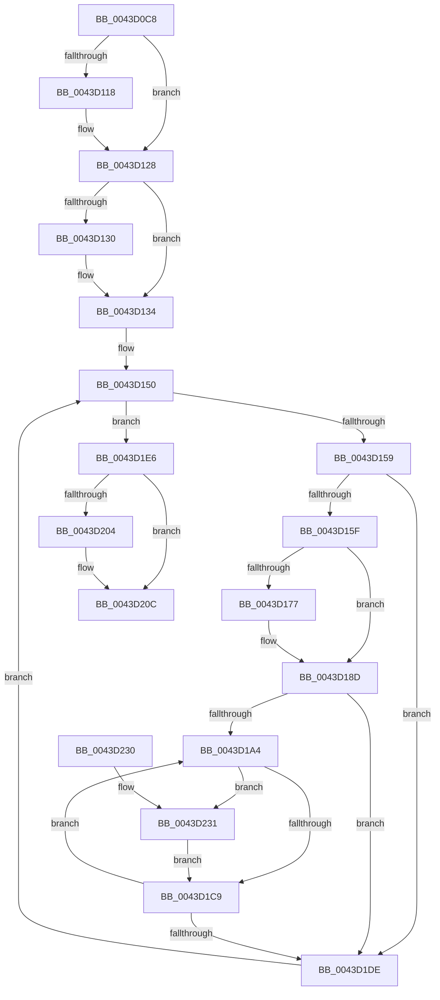

# PopFxPauseDeviceAccounting

- RVA: `0x0043D0C8`–`0x0043D249` (길이 `385` bytes)
- VA: `0x000000014043D0C8`
- 실행 섹션: `.text`
- PDB 이름 있음: `예`; PDB Function 태그: `아니요`
- unwind 정보 RVA: `0x000A4824`
- 디코드: `99`개 명령, `385/385` bytes 표시
- 미해석 바이트: `0` (있으면 어셈블리에 `.byte`로 보존)

> 이 문서는 커널 이미지의 기계어와 PDB 기호를 분석해 생성했습니다. 4번과 5번은 함수 원형과 자료형을 바이너리 사용 방식에서 추정한 C 해석이며 원본 소스 복구 결과는 아닙니다.

## 1. Dependencies

- 직접 호출 지점: **14**; 고유 호출 대상: **10**
- 직접 호출자로 확인된 함수: **3**
- RIP 상대 이미지 참조: **3**

### Outgoing calls
- `0x0043D0FE` → [KeAbPreAcquire](../21/KeAbPreAcquire_function_00210230.md) (function, `0x00210230`)
- `0x0043D123` → [ExfAcquirePushLockSharedEx](../21/ExfAcquirePushLockSharedEx_function_0021044C.md) (function, `0x0021044C`)
- `0x0043D169` → [KeAcquireSpinLockRaiseToDpc](../20/KeAcquireSpinLockRaiseToDpc_function_00208470.md) (function, `0x00208470`)
- `0x0043D183` → [PopFxUpdateAccountingActiveTime](PopFxUpdateAccountingActiveTime_function_0043D2EC.md) (function, `0x0043D2EC`)
- `0x0043D188` → [PopFxMergeActiveTimeAccounting](PopFxMergeActiveTimeAccounting_function_0043D350.md) (function, `0x0043D350`)
- `0x0043D193` → [KeReleaseSpinLock](../39/KeReleaseSpinLock_function_00392BA0.md) (function, `0x00392BA0`)
- `0x0043D1BB` → [KeAcquireSpinLockRaiseToDpc](../20/KeAcquireSpinLockRaiseToDpc_function_00208470.md) (function, `0x00208470`)
- `0x0043D1CF` → [KeReleaseSpinLock](../39/KeReleaseSpinLock_function_00392BA0.md) (function, `0x00392BA0`)
- `0x0043D1E8` → [PopFxSetGlobalDeviceAccountingEnabled](PopFxSetGlobalDeviceAccountingEnabled_function_0043D678.md) (function, `0x0043D678`)
- `0x0043D207` → [ExfReleasePushLockShared](../26/ExfReleasePushLockShared_function_00263440.md) (function, `0x00263440`)
- `0x0043D20F` → [KeAbPostRelease](../2E/KeAbPostRelease_function_002E1600.md) (function, `0x002E1600`)
- `0x0043D214` → [KeLeaveCriticalRegion](../25/KeLeaveCriticalRegion_function_0025D8B0.md) (function, `0x0025D8B0`)
- `0x0043D23D` → [PopFxUpdateAccountingActiveTime](PopFxUpdateAccountingActiveTime_function_0043D2EC.md) (function, `0x0043D2EC`)
- `0x0043D242` → [PopFxMergeActiveTimeAccounting](PopFxMergeActiveTimeAccounting_function_0043D350.md) (function, `0x0043D350`)

### Direct callers
- [PopFxStopDeviceAccounting](../42/PopFxStopDeviceAccounting_function_004261D8.md) at `0x00426601`
- [PdcPoCurrentPdcPhase](../5D/PdcPoCurrentPdcPhase_function_005D9E70.md) at `0x005D9F2C`
- [PopPdcIdleResiliencyCallback](../../page/A3/PopPdcIdleResiliencyCallback_function_00A31518.md) at `0x00A31644`

### Static image references
- `0x0043D0E7` → RVA `0x00F0E408` (`.data`; read)
- `0x0043D13E` → RVA `0x00F0E3F0` (`.data`; read)
- `0x0043D1F2` → RVA `0x00E0B3DC` (`.data`; write)

## 2. Other-region calls and transfers

- 다른 실행 섹션으로 향하는 call: **0**
- 별도 외부 분기/꼬리 이동을 확인하지 못했습니다.

## 3. Assembly (complete function range)

```asm
0043D0C8  48 89 5C 24 10                  mov qword ptr [rsp + 0x10], rbx
0043D0CD  48 89 6C 24 18                  mov qword ptr [rsp + 0x18], rbp
0043D0D2  56                              push rsi
0043D0D3  57                              push rdi
0043D0D4  41 54                           push r12
0043D0D6  41 56                           push r14
0043D0D8  41 57                           push r15
0043D0DA  48 83 EC 20                     sub rsp, 0x20
0043D0DE  65 48 8B 04 25 88 01 00 00      mov rax, qword ptr gs:[0x188]
0043D0E7  4C 8D 3D 1A 13 AD 00            lea r15, [rip + 0xad131a]
0043D0EE  45 33 C0                        xor r8d, r8d
0043D0F1  33 D2                           xor edx, edx
0043D0F3  49 8B CF                        mov rcx, r15
0043D0F6  66 FF 88 E4 01 00 00            dec word ptr [rax + 0x1e4]
0043D0FD  90                              nop
0043D0FE  E8 2D 31 DD FF                  call 0x140210230
0043D103  48 8B D8                        mov rbx, rax
0043D106  B9 11 00 00 00                  mov ecx, 0x11
0043D10B  33 C0                           xor eax, eax
0043D10D  F0 48 0F B1 0D F2 12 AD 00      lock cmpxchg qword ptr [rip + 0xad12f2], rcx
0043D116  74 10                           je 0x14043d128
0043D118  4D 8B CF                        mov r9, r15
0043D11B  4C 8B C3                        mov r8, rbx
0043D11E  33 D2                           xor edx, edx
0043D120  49 8B CF                        mov rcx, r15
0043D123  E8 24 33 DD FF                  call 0x14021044c
0043D128  45 33 F6                        xor r14d, r14d
0043D12B  48 85 DB                        test rbx, rbx
0043D12E  74 04                           je 0x14043d134
0043D130  C6 43 0A 01                     mov byte ptr [rbx + 0xa], 1
0043D134  48 BD 08 00 00 00 80 F7 FF FF   movabs rbp, 0xfffff78000000008
0043D13E  4C 8D 25 AB 12 AD 00            lea r12, [rip + 0xad12ab]
0043D145  48 8B 6D 00                     mov rbp, qword ptr [rbp]
0043D149  48 8B 1D A0 12 AD 00            mov rbx, qword ptr [rip + 0xad12a0]
0043D150  49 3B DC                        cmp rbx, r12
0043D153  0F 84 8D 00 00 00               je 0x14043d1e6
0043D159  4C 39 73 30                     cmp qword ptr [rbx + 0x30], r14
0043D15D  74 7F                           je 0x14043d1de
0043D15F  48 8D BB 80 02 00 00            lea rdi, [rbx + 0x280]
0043D166  48 8B CF                        mov rcx, rdi
0043D169  E8 02 B3 DC FF                  call 0x140208470
0043D16E  44 8A D8                        mov r11b, al
0043D171  44 39 77 10                     cmp dword ptr [rdi + 0x10], r14d
0043D175  74 16                           je 0x14043d18d
0043D177  41 B8 00 8C 86 47               mov r8d, 0x47868c00
0043D17D  48 8B D5                        mov rdx, rbp
0043D180  48 8B CF                        mov rcx, rdi
0043D183  E8 64 01 00 00                  call 0x14043d2ec
0043D188  E8 C3 01 00 00                  call 0x14043d350
0043D18D  41 8A D3                        mov dl, r11b
0043D190  48 8B CF                        mov rcx, rdi
0043D193  E8 08 5A F5 FF                  call 0x140392ba0
0043D198  41 8B F6                        mov esi, r14d
0043D19B  44 39 B3 64 03 00 00            cmp dword ptr [rbx + 0x364], r14d
0043D1A2  76 3A                           jbe 0x14043d1de
0043D1A4  48 8B 83 68 03 00 00            mov rax, qword ptr [rbx + 0x368]
0043D1AB  8B CE                           mov ecx, esi
0043D1AD  48 8B 3C C8                     mov rdi, qword ptr [rax + rcx*8]
0043D1B1  48 81 C7 C8 00 00 00            add rdi, 0xc8
0043D1B8  48 8B CF                        mov rcx, rdi
0043D1BB  E8 B0 B2 DC FF                  call 0x140208470
0043D1C0  44 8A D8                        mov r11b, al
0043D1C3  44 39 77 10                     cmp dword ptr [rdi + 0x10], r14d
0043D1C7  75 68                           jne 0x14043d231
0043D1C9  41 8A D3                        mov dl, r11b
0043D1CC  48 8B CF                        mov rcx, rdi
0043D1CF  E8 CC 59 F5 FF                  call 0x140392ba0
0043D1D4  FF C6                           inc esi
0043D1D6  3B B3 64 03 00 00               cmp esi, dword ptr [rbx + 0x364]
0043D1DC  72 C6                           jb 0x14043d1a4
0043D1DE  48 8B 1B                        mov rbx, qword ptr [rbx]
0043D1E1  E9 6A FF FF FF                  jmp 0x14043d150
0043D1E6  33 C9                           xor ecx, ecx
0043D1E8  E8 8B 04 00 00                  call 0x14043d678
0043D1ED  B8 11 00 00 00                  mov eax, 0x11
0043D1F2  C6 05 E3 E1 9C 00 01            mov byte ptr [rip + 0x9ce1e3], 1
0043D1F9  F0 4C 0F B1 35 06 12 AD 00      lock cmpxchg qword ptr [rip + 0xad1206], r14
0043D202  74 08                           je 0x14043d20c
0043D204  49 8B CF                        mov rcx, r15
0043D207  E8 34 62 E2 FF                  call 0x140263440
0043D20C  49 8B CF                        mov rcx, r15
0043D20F  E8 EC 43 EA FF                  call 0x1402e1600
0043D214  E8 97 06 E2 FF                  call 0x14025d8b0
0043D219  48 8B 5C 24 58                  mov rbx, qword ptr [rsp + 0x58]
0043D21E  48 8B 6C 24 60                  mov rbp, qword ptr [rsp + 0x60]
0043D223  48 83 C4 20                     add rsp, 0x20
0043D227  41 5F                           pop r15
0043D229  41 5E                           pop r14
0043D22B  41 5C                           pop r12
0043D22D  5F                              pop rdi
0043D22E  5E                              pop rsi
0043D22F  C3                              ret
0043D230  CC                              int3
0043D231  41 B8 00 8C 86 47               mov r8d, 0x47868c00
0043D237  48 8B D5                        mov rdx, rbp
0043D23A  48 8B CF                        mov rcx, rdi
0043D23D  E8 AA 00 00 00                  call 0x14043d2ec
0043D242  E8 09 01 00 00                  call 0x14043d350
0043D247  EB 80                           jmp 0x14043d1c9
```

## 4. C-style interpretation (structured pseudocode)

```c
__int64 __fastcall PopFxPauseDeviceAccounting(__int64 a1, int a2, int a3)
{
    __int64 result;
    __int64 v_r14;
    __int64 v_rdi;
    __int64 v_rsi;
    __int64 v_rsp;
    unsigned __int64 v_stack_p10;
    unsigned __int64 v_stack_p18;

    v_stack_p10 = v_rbx;
    v_stack_p18 = v_rbp;
    v_rsp = (v_rsp) - (32);
    a3 = 0;
    a2 = 0;
    result = KeAbPreAcquire(v_rip + 11342618, a2, a3, a4);
    result = 0;
    if (!(condition_is_equal)) {
        a4 = v_rip + 11342618;
        a3 = 0;
        a2 = 0;
        a1 = v_rip + 11342618;
        result = ExfAcquirePushLockSharedEx(a1, a2, a3, a4);
    }
    v_r14 = 0;
    if (result != 0) {
        *(unsigned __int8 *)(result + 10) = 1;
    }
loc_0043D150:
    if ((*(unsigned __int64 *)(v_rip + 11342496)) == (v_rip + 11342507)) goto loc_0043D1E6;
    if ((*(unsigned __int64 *)(*(unsigned __int64 *)(v_rip + 11342496) + 48)) == 0) goto loc_0043D1DE;
    result = KeAcquireSpinLockRaiseToDpc(*(unsigned __int64 *)(v_rip + 11342496) + 640, a2, a3, a4);
    if ((*(unsigned int *)(*(unsigned __int64 *)(v_rip + 11342496) + 640 + 16)) != 0) {
        a3 = 0x47868C00ULL;
        a2 = *(unsigned __int64 *)(v_rbp);
        a1 = *(unsigned __int64 *)(v_rip + 11342496) + 640;
        result = PopFxUpdateAccountingActiveTime(a1, a2, a3, a4);
        result = PopFxMergeActiveTimeAccounting(a1, a2, a3, a4);
    }
    result = KeReleaseSpinLock(*(unsigned __int64 *)(v_rip + 11342496) + 640, (unsigned __int8)((unsigned __int8)(result)), a3, a4);
    if ((*(unsigned int *)(*(unsigned __int64 *)(v_rip + 11342496) + 868)) <= 0) goto loc_0043D1DE;
loc_0043D1A4:
    v_rdi = (*(unsigned __int64 *)(*(unsigned __int64 *)(*(unsigned __int64 *)(v_rip + 11342496) + 872) + 0 * 8)) + (200);
    result = KeAcquireSpinLockRaiseToDpc(v_rdi, (unsigned __int8)((unsigned __int8)(result)), a3, a4);
    if ((*(unsigned int *)(v_rdi + 16)) != 0) goto loc_0043D231;
loc_0043D1C9:
    result = KeReleaseSpinLock(v_rdi, (unsigned __int8)((unsigned __int8)(result)), a3, a4);
    v_rsi = (unsigned int)((0) + 1);
    if (((unsigned int)(v_rsi)) < (*(unsigned int *)(*(unsigned __int64 *)(v_rip + 11342496) + 868))) goto loc_0043D1A4;
loc_0043D1DE:
    goto loc_0043D150;
loc_0043D1E6:
    a1 = 0;
    result = PopFxSetGlobalDeviceAccountingEnabled(a1, (unsigned __int8)((unsigned __int8)(result)), a3, a4);
    *(unsigned __int8 *)(v_rip + 10281443) = 1;
    result = 17;
    if (!(condition_is_equal)) {
        a1 = v_rip + 11342618;
        result = ExfReleasePushLockShared(a1, (unsigned __int8)((unsigned __int8)(result)), a3, a4);
    }
    result = KeAbPostRelease(v_rip + 11342618, (unsigned __int8)((unsigned __int8)(result)), a3, a4);
    result = KeLeaveCriticalRegion(v_rip + 11342618, (unsigned __int8)((unsigned __int8)(result)), a3, a4);
    v_rsp = (v_rsp) + (32);
    return result;
loc_0043D231:
    result = PopFxUpdateAccountingActiveTime(v_rdi, v_stack_p18, (unsigned int)(0x47868C00ULL), a4);
    result = PopFxMergeActiveTimeAccounting(v_rdi, v_stack_p18, (unsigned int)(0x47868C00ULL), a4);
    goto loc_0043D1C9;
}
```

## 5. (Beta) C Style

```c
int64_t PopFxPauseDeviceAccounting(int64_t Arg1, int32_t Arg2, int32_t Arg3)
{
    int64_t result;
    int64_t local_r14;
    int64_t local_rdi;
    int64_t local_rsi;
    int64_t local_rsp;
    uint64_t v_stack_p10;
    uint64_t v_stack_p18;

    v_stack_p10 = local_rbx;
    v_stack_p18 = local_rbp;
    local_rsp = (local_rsp) - (32);
    Arg3 = 0;
    Arg2 = 0;
    result = KeAbPreAcquire(v_rip + 11342618, Arg2, Arg3, a4);
    result = 0;
    if (!(condition_is_equal)) {
        a4 = v_rip + 11342618;
        Arg3 = 0;
        Arg2 = 0;
        Arg1 = v_rip + 11342618;
        result = ExfAcquirePushLockSharedEx(Arg1, Arg2, Arg3, a4);
    }
    local_r14 = 0;
    if (result != 0) {
        *(uint8_t *)(result + 0xA) = 1;
    }
loc_0043D150:
    if ((*(uint64_t *)(v_rip + 0xAD12A0)) == (v_rip + 11342507)) goto loc_0043D1E6;
    if ((*(uint64_t *)(*(uint64_t *)(v_rip + 0xAD12A0) + 0x30)) == 0) goto loc_0043D1DE;
    result = KeAcquireSpinLockRaiseToDpc(*(uint64_t *)(v_rip + 0xAD12A0) + 640, Arg2, Arg3, a4);
    if ((*(uint32_t *)(*(uint64_t *)(v_rip + 0xAD12A0) + 0x280 + 0x10)) != 0) {
        Arg3 = 0x47868C00ULL;
        Arg2 = *(uint64_t *)(local_rbp);
        Arg1 = *(uint64_t *)(v_rip + 0xAD12A0) + 640;
        result = PopFxUpdateAccountingActiveTime(Arg1, Arg2, Arg3, a4);
        result = PopFxMergeActiveTimeAccounting(Arg1, Arg2, Arg3, a4);
    }
    result = KeReleaseSpinLock(*(uint64_t *)(v_rip + 0xAD12A0) + 640, (uint8_t)((uint8_t)(result)), Arg3, a4);
    if ((*(uint32_t *)(*(uint64_t *)(v_rip + 0xAD12A0) + 0x364)) <= 0) goto loc_0043D1DE;
loc_0043D1A4:
    local_rdi = (*(uint64_t *)(*(uint64_t *)(*(uint64_t *)(v_rip + 0xAD12A0) + 0x368) + 0x0 * 8)) + (200);
    result = KeAcquireSpinLockRaiseToDpc(local_rdi, (uint8_t)((uint8_t)(result)), Arg3, a4);
    if ((*(uint32_t *)(local_rdi + 0x10)) != 0) goto loc_0043D231;
loc_0043D1C9:
    result = KeReleaseSpinLock(local_rdi, (uint8_t)((uint8_t)(result)), Arg3, a4);
    local_rsi = (uint32_t)((0) + 1);
    if (((uint32_t)(local_rsi)) < (*(uint32_t *)(*(uint64_t *)(v_rip + 0xAD12A0) + 0x364))) goto loc_0043D1A4;
loc_0043D1DE:
    goto loc_0043D150;
loc_0043D1E6:
    Arg1 = 0;
    result = PopFxSetGlobalDeviceAccountingEnabled(Arg1, (uint8_t)((uint8_t)(result)), Arg3, a4);
    *(uint8_t *)(v_rip + 0x9CE1E3) = 1;
    result = 17;
    if (!(condition_is_equal)) {
        Arg1 = v_rip + 11342618;
        result = ExfReleasePushLockShared(Arg1, (uint8_t)((uint8_t)(result)), Arg3, a4);
    }
    result = KeAbPostRelease(v_rip + 11342618, (uint8_t)((uint8_t)(result)), Arg3, a4);
    result = KeLeaveCriticalRegion(v_rip + 11342618, (uint8_t)((uint8_t)(result)), Arg3, a4);
    local_rsp = (local_rsp) + (32);
    return result;
loc_0043D231:
    result = PopFxUpdateAccountingActiveTime(local_rdi, v_stack_p18, (uint32_t)(0x47868C00ULL), a4);
    result = PopFxMergeActiveTimeAccounting(local_rdi, v_stack_p18, (uint32_t)(0x47868C00ULL), a4);
    goto loc_0043D1C9;
}
```

## 6. Execution-region graph

[열기: 2D/3D 그래프와 함수 탐색 컨트롤 패널](../../../control-panel.html?section=text&rva=0x0043D0C8&view=graph)

- 2D 그래프는 위에서 아래로 흐르고, 3D 그래프는 빈 공간을 드래그해 회전합니다. Shift+드래그는 이동, 휠은 확대·축소, 함수 노드 선택은 대상 보고서 이동입니다.

### Static fallback


