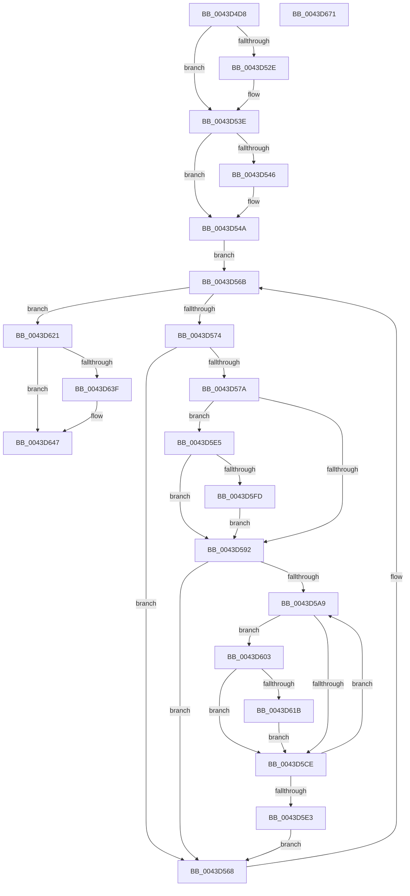

# PopFxResumeDeviceAccounting

- RVA: `0x0043D4D8`–`0x0043D672` (길이 `410` bytes)
- VA: `0x000000014043D4D8`
- 실행 섹션: `.text`
- PDB 이름 있음: `예`; PDB Function 태그: `아니요`
- unwind 정보 RVA: `0x0005D79C`
- 디코드: `107`개 명령, `410/410` bytes 표시
- 미해석 바이트: `0` (있으면 어셈블리에 `.byte`로 보존)

> 이 문서는 커널 이미지의 기계어와 PDB 기호를 분석해 생성했습니다. 4번과 5번은 함수 원형과 자료형을 바이너리 사용 방식에서 추정한 C 해석이며 원본 소스 복구 결과는 아닙니다.

## 1. Dependencies

- 직접 호출 지점: **12**; 고유 호출 대상: **9**
- 직접 호출자로 확인된 함수: **3**
- RIP 상대 이미지 참조: **3**

### Outgoing calls
- `0x0043D514` → [KeAbPreAcquire](../21/KeAbPreAcquire_function_00210230.md) (function, `0x00210230`)
- `0x0043D539` → [ExfAcquirePushLockSharedEx](../21/ExfAcquirePushLockSharedEx_function_0021044C.md) (function, `0x0021044C`)
- `0x0043D584` → [KeAcquireSpinLockRaiseToDpc](../20/KeAcquireSpinLockRaiseToDpc_function_00208470.md) (function, `0x00208470`)
- `0x0043D598` → [KeReleaseSpinLock](../39/KeReleaseSpinLock_function_00392BA0.md) (function, `0x00392BA0`)
- `0x0043D5C0` → [KeAcquireSpinLockRaiseToDpc](../20/KeAcquireSpinLockRaiseToDpc_function_00208470.md) (function, `0x00208470`)
- `0x0043D5D4` → [KeReleaseSpinLock](../39/KeReleaseSpinLock_function_00392BA0.md) (function, `0x00392BA0`)
- `0x0043D5F2` → [memset](../6C/memset_function_006C6C40.md) (function, `0x006C6C40`)
- `0x0043D610` → [memset](../6C/memset_function_006C6C40.md) (function, `0x006C6C40`)
- `0x0043D623` → [PopFxSetGlobalDeviceAccountingEnabled](PopFxSetGlobalDeviceAccountingEnabled_function_0043D678.md) (function, `0x0043D678`)
- `0x0043D642` → [ExfReleasePushLockShared](../26/ExfReleasePushLockShared_function_00263440.md) (function, `0x00263440`)
- `0x0043D64A` → [KeAbPostRelease](../2E/KeAbPostRelease_function_002E1600.md) (function, `0x002E1600`)
- `0x0043D64F` → [KeLeaveCriticalRegion](../25/KeLeaveCriticalRegion_function_0025D8B0.md) (function, `0x0025D8B0`)

### Direct callers
- [PopFxStartDeviceAccounting](../4A/PopFxStartDeviceAccounting_function_004A384C.md) at `0x004A3A88`
- [PdcPoCurrentPdcPhase](../5D/PdcPoCurrentPdcPhase_function_005D9E70.md) at `0x005D9F0E`
- [PopPdcIdleResiliencyCallback](../../page/A3/PopPdcIdleResiliencyCallback_function_00A31518.md) at `0x00A3163D`

### Static image references
- `0x0043D4FD` → RVA `0x00F0E408` (`.data`; read)
- `0x0043D554` → RVA `0x00F0E3F0` (`.data`; read)
- `0x0043D62D` → RVA `0x00E0B3DC` (`.data`; write)

## 2. Other-region calls and transfers

- 다른 실행 섹션으로 향하는 call: **0**
- 별도 외부 분기/꼬리 이동을 확인하지 못했습니다.

## 3. Assembly (complete function range)

```asm
0043D4D8  48 89 5C 24 10                  mov qword ptr [rsp + 0x10], rbx
0043D4DD  48 89 6C 24 18                  mov qword ptr [rsp + 0x18], rbp
0043D4E2  48 89 74 24 20                  mov qword ptr [rsp + 0x20], rsi
0043D4E7  57                              push rdi
0043D4E8  41 54                           push r12
0043D4EA  41 55                           push r13
0043D4EC  41 56                           push r14
0043D4EE  41 57                           push r15
0043D4F0  48 83 EC 20                     sub rsp, 0x20
0043D4F4  65 48 8B 04 25 88 01 00 00      mov rax, qword ptr gs:[0x188]
0043D4FD  4C 8D 25 04 0F AD 00            lea r12, [rip + 0xad0f04]
0043D504  45 33 C0                        xor r8d, r8d
0043D507  33 D2                           xor edx, edx
0043D509  49 8B CC                        mov rcx, r12
0043D50C  66 FF 88 E4 01 00 00            dec word ptr [rax + 0x1e4]
0043D513  90                              nop
0043D514  E8 17 2D DD FF                  call 0x140210230
0043D519  48 8B D8                        mov rbx, rax
0043D51C  B9 11 00 00 00                  mov ecx, 0x11
0043D521  33 C0                           xor eax, eax
0043D523  F0 48 0F B1 0D DC 0E AD 00      lock cmpxchg qword ptr [rip + 0xad0edc], rcx
0043D52C  74 10                           je 0x14043d53e
0043D52E  4D 8B CC                        mov r9, r12
0043D531  4C 8B C3                        mov r8, rbx
0043D534  33 D2                           xor edx, edx
0043D536  49 8B CC                        mov rcx, r12
0043D539  E8 0E 2F DD FF                  call 0x14021044c
0043D53E  45 33 FF                        xor r15d, r15d
0043D541  48 85 DB                        test rbx, rbx
0043D544  74 04                           je 0x14043d54a
0043D546  C6 43 0A 01                     mov byte ptr [rbx + 0xa], 1
0043D54A  48 BD 08 00 00 00 80 F7 FF FF   movabs rbp, 0xfffff78000000008
0043D554  4C 8D 2D 95 0E AD 00            lea r13, [rip + 0xad0e95]
0043D55B  48 8B 6D 00                     mov rbp, qword ptr [rbp]
0043D55F  48 8B 1D 8A 0E AD 00            mov rbx, qword ptr [rip + 0xad0e8a]
0043D566  EB 03                           jmp 0x14043d56b
0043D568  48 8B 1B                        mov rbx, qword ptr [rbx]
0043D56B  49 3B DD                        cmp rbx, r13
0043D56E  0F 84 AD 00 00 00               je 0x14043d621
0043D574  4C 39 7B 30                     cmp qword ptr [rbx + 0x30], r15
0043D578  74 EE                           je 0x14043d568
0043D57A  48 8D BB 80 02 00 00            lea rdi, [rbx + 0x280]
0043D581  48 8B CF                        mov rcx, rdi
0043D584  E8 E7 AE DC FF                  call 0x140208470
0043D589  40 8A F0                        mov sil, al
0043D58C  44 39 7F 10                     cmp dword ptr [rdi + 0x10], r15d
0043D590  75 53                           jne 0x14043d5e5
0043D592  40 8A D6                        mov dl, sil
0043D595  48 8B CF                        mov rcx, rdi
0043D598  E8 03 56 F5 FF                  call 0x140392ba0
0043D59D  41 8B F7                        mov esi, r15d
0043D5A0  44 39 BB 64 03 00 00            cmp dword ptr [rbx + 0x364], r15d
0043D5A7  76 BF                           jbe 0x14043d568
0043D5A9  48 8B 83 68 03 00 00            mov rax, qword ptr [rbx + 0x368]
0043D5B0  8B CE                           mov ecx, esi
0043D5B2  48 8B 3C C8                     mov rdi, qword ptr [rax + rcx*8]
0043D5B6  48 81 C7 C8 00 00 00            add rdi, 0xc8
0043D5BD  48 8B CF                        mov rcx, rdi
0043D5C0  E8 AB AE DC FF                  call 0x140208470
0043D5C5  44 8A F0                        mov r14b, al
0043D5C8  44 39 7F 10                     cmp dword ptr [rdi + 0x10], r15d
0043D5CC  75 35                           jne 0x14043d603
0043D5CE  41 8A D6                        mov dl, r14b
0043D5D1  48 8B CF                        mov rcx, rdi
0043D5D4  E8 C7 55 F5 FF                  call 0x140392ba0
0043D5D9  FF C6                           inc esi
0043D5DB  3B B3 64 03 00 00               cmp esi, dword ptr [rbx + 0x364]
0043D5E1  72 C6                           jb 0x14043d5a9
0043D5E3  EB 83                           jmp 0x14043d568
0043D5E5  33 D2                           xor edx, edx
0043D5E7  48 8D 8F 80 00 00 00            lea rcx, [rdi + 0x80]
0043D5EE  44 8D 42 60                     lea r8d, [rdx + 0x60]
0043D5F2  E8 49 96 28 00                  call 0x1406c6c40
0043D5F7  44 38 7F 08                     cmp byte ptr [rdi + 8], r15b
0043D5FB  74 95                           je 0x14043d592
0043D5FD  48 89 6F 18                     mov qword ptr [rdi + 0x18], rbp
0043D601  EB 8F                           jmp 0x14043d592
0043D603  33 D2                           xor edx, edx
0043D605  48 8D 8F 80 00 00 00            lea rcx, [rdi + 0x80]
0043D60C  44 8D 42 60                     lea r8d, [rdx + 0x60]
0043D610  E8 2B 96 28 00                  call 0x1406c6c40
0043D615  44 38 7F 08                     cmp byte ptr [rdi + 8], r15b
0043D619  74 B3                           je 0x14043d5ce
0043D61B  48 89 6F 18                     mov qword ptr [rdi + 0x18], rbp
0043D61F  EB AD                           jmp 0x14043d5ce
0043D621  B1 01                           mov cl, 1
0043D623  E8 50 00 00 00                  call 0x14043d678
0043D628  B8 11 00 00 00                  mov eax, 0x11
0043D62D  44 88 3D A8 DD 9C 00            mov byte ptr [rip + 0x9cdda8], r15b
0043D634  F0 4C 0F B1 3D CB 0D AD 00      lock cmpxchg qword ptr [rip + 0xad0dcb], r15
0043D63D  74 08                           je 0x14043d647
0043D63F  49 8B CC                        mov rcx, r12
0043D642  E8 F9 5D E2 FF                  call 0x140263440
0043D647  49 8B CC                        mov rcx, r12
0043D64A  E8 B1 3F EA FF                  call 0x1402e1600
0043D64F  E8 5C 02 E2 FF                  call 0x14025d8b0
0043D654  48 8B 5C 24 58                  mov rbx, qword ptr [rsp + 0x58]
0043D659  48 8B 6C 24 60                  mov rbp, qword ptr [rsp + 0x60]
0043D65E  48 8B 74 24 68                  mov rsi, qword ptr [rsp + 0x68]
0043D663  48 83 C4 20                     add rsp, 0x20
0043D667  41 5F                           pop r15
0043D669  41 5E                           pop r14
0043D66B  41 5D                           pop r13
0043D66D  41 5C                           pop r12
0043D66F  5F                              pop rdi
0043D670  C3                              ret
0043D671  CC                              int3
```

## 4. C-style interpretation (structured pseudocode)

```c
__int64 __fastcall PopFxResumeDeviceAccounting(__int64 a1, int a2, int a3)
{
    __int64 result;
    __int64 v_r15;
    __int64 v_rdi;
    __int64 v_rsi;
    __int64 v_rsp;
    unsigned __int64 v_stack_p10;
    unsigned __int64 v_stack_p18;
    unsigned __int64 v_stack_p20;

    v_stack_p10 = v_rbx;
    v_stack_p18 = v_rbp;
    v_stack_p20 = v_rsi;
    v_rsp = (v_rsp) - (32);
    a3 = 0;
    a2 = 0;
    result = KeAbPreAcquire(v_rip + 11341572, a2, a3, a4);
    result = 0;
    if (!(condition_is_equal)) {
        a4 = v_rip + 11341572;
        a3 = 0;
        a2 = 0;
        a1 = v_rip + 11341572;
        result = ExfAcquirePushLockSharedEx(a1, a2, a3, a4);
    }
    v_r15 = 0;
    if (result != 0) {
        *(unsigned __int8 *)(result + 10) = 1;
    }
    goto loc_0043D56B;
loc_0043D568:
loc_0043D56B:
    if ((*(unsigned __int64 *)(*(unsigned __int64 *)(v_rip + 11341450))) == (v_rip + 11341461)) goto loc_0043D621;
    if ((*(unsigned __int64 *)(*(unsigned __int64 *)(*(unsigned __int64 *)(v_rip + 11341450)) + 48)) == 0) goto loc_0043D568;
    result = KeAcquireSpinLockRaiseToDpc(*(unsigned __int64 *)(*(unsigned __int64 *)(v_rip + 11341450)) + 640, a2, a3, a4);
    if ((*(unsigned int *)(*(unsigned __int64 *)(*(unsigned __int64 *)(v_rip + 11341450)) + 640 + 16)) != 0) goto loc_0043D5E5;
loc_0043D592:
    result = KeReleaseSpinLock(*(unsigned __int64 *)(*(unsigned __int64 *)(v_rip + 11341450)) + 640, (unsigned __int8)((unsigned __int8)(result)), a3, a4);
    if ((*(unsigned int *)(*(unsigned __int64 *)(*(unsigned __int64 *)(v_rip + 11341450)) + 868)) <= 0) goto loc_0043D568;
loc_0043D5A9:
    v_rdi = (*(unsigned __int64 *)(*(unsigned __int64 *)(*(unsigned __int64 *)(*(unsigned __int64 *)(v_rip + 11341450)) + 872) + 0 * 8)) + (200);
    result = KeAcquireSpinLockRaiseToDpc(v_rdi, (unsigned __int8)((unsigned __int8)(result)), a3, a4);
    if ((*(unsigned int *)(v_rdi + 16)) != 0) goto loc_0043D603;
loc_0043D5CE:
    result = KeReleaseSpinLock(v_rdi, (unsigned __int8)((unsigned __int8)(result)), a3, a4);
    v_rsi = (unsigned int)((0) + 1);
    if (((unsigned int)(v_rsi)) < (*(unsigned int *)(*(unsigned __int64 *)(*(unsigned __int64 *)(v_rip + 11341450)) + 868))) goto loc_0043D5A9;
    goto loc_0043D568;
loc_0043D5E5:
    a2 = 0;
    result = memset(v_rdi + 128, a2, a2 + 96, a4);
    if ((*(unsigned __int8 *)(v_rdi + 8)) == 0) goto loc_0043D592;
    *(unsigned __int64 *)(v_rdi + 24) = *(unsigned __int64 *)(v_rbp);
    goto loc_0043D592;
loc_0043D603:
    a2 = 0;
    result = memset(v_rdi + 128, a2, a2 + 96, a4);
    if ((*(unsigned __int8 *)(v_rdi + 8)) == 0) goto loc_0043D5CE;
    *(unsigned __int64 *)(v_rdi + 24) = *(unsigned __int64 *)(v_rbp);
    goto loc_0043D5CE;
loc_0043D621:
    result = PopFxSetGlobalDeviceAccountingEnabled(1, a2, a2 + 96, a4);
    *(unsigned __int8 *)(v_rip + 10280360) = 0;
    result = 17;
    if ((*(unsigned __int8 *)(v_rdi + 8)) != 0) {
        a1 = v_rip + 11341572;
        result = ExfReleasePushLockShared(a1, a2, a2 + 96, a4);
    }
    result = KeAbPostRelease(v_rip + 11341572, a2, a2 + 96, a4);
    result = KeLeaveCriticalRegion(v_rip + 11341572, a2, a2 + 96, a4);
    v_rsp = (v_rsp) + (32);
    return result;
}
```

## 5. (Beta) C Style

```c
int64_t PopFxResumeDeviceAccounting(int64_t Arg1, int32_t Arg2, int32_t Arg3)
{
    int64_t result;
    int64_t local_r15;
    int64_t local_rdi;
    int64_t local_rsi;
    int64_t local_rsp;
    uint64_t v_stack_p10;
    uint64_t v_stack_p18;
    uint64_t v_stack_p20;

    v_stack_p10 = local_rbx;
    v_stack_p18 = local_rbp;
    v_stack_p20 = local_rsi;
    local_rsp = (local_rsp) - (32);
    Arg3 = 0;
    Arg2 = 0;
    result = KeAbPreAcquire(v_rip + 11341572, Arg2, Arg3, a4);
    result = 0;
    if (!(condition_is_equal)) {
        a4 = v_rip + 11341572;
        Arg3 = 0;
        Arg2 = 0;
        Arg1 = v_rip + 11341572;
        result = ExfAcquirePushLockSharedEx(Arg1, Arg2, Arg3, a4);
    }
    local_r15 = 0;
    if (result != 0) {
        *(uint8_t *)(result + 0xA) = 1;
    }
    goto loc_0043D56B;
loc_0043D568:
loc_0043D56B:
    if ((*(uint64_t *)(*(uint64_t *)(v_rip + 0xAD0E8A))) == (v_rip + 11341461)) goto loc_0043D621;
    if ((*(uint64_t *)(*(uint64_t *)(*(uint64_t *)(v_rip + 0xAD0E8A)) + 0x30)) == 0) goto loc_0043D568;
    result = KeAcquireSpinLockRaiseToDpc(*(uint64_t *)(*(uint64_t *)(v_rip + 0xAD0E8A)) + 640, Arg2, Arg3, a4);
    if ((*(uint32_t *)(*(uint64_t *)(*(uint64_t *)(v_rip + 0xAD0E8A)) + 0x280 + 0x10)) != 0) goto loc_0043D5E5;
loc_0043D592:
    result = KeReleaseSpinLock(*(uint64_t *)(*(uint64_t *)(v_rip + 0xAD0E8A)) + 640, (uint8_t)((uint8_t)(result)), Arg3, a4);
    if ((*(uint32_t *)(*(uint64_t *)(*(uint64_t *)(v_rip + 0xAD0E8A)) + 0x364)) <= 0) goto loc_0043D568;
loc_0043D5A9:
    local_rdi = (*(uint64_t *)(*(uint64_t *)(*(uint64_t *)(*(uint64_t *)(v_rip + 0xAD0E8A)) + 0x368) + 0x0 * 8)) + (200);
    result = KeAcquireSpinLockRaiseToDpc(local_rdi, (uint8_t)((uint8_t)(result)), Arg3, a4);
    if ((*(uint32_t *)(local_rdi + 0x10)) != 0) goto loc_0043D603;
loc_0043D5CE:
    result = KeReleaseSpinLock(local_rdi, (uint8_t)((uint8_t)(result)), Arg3, a4);
    local_rsi = (uint32_t)((0) + 1);
    if (((uint32_t)(local_rsi)) < (*(uint32_t *)(*(uint64_t *)(*(uint64_t *)(v_rip + 0xAD0E8A)) + 0x364))) goto loc_0043D5A9;
    goto loc_0043D568;
loc_0043D5E5:
    Arg2 = 0;
    result = memset(local_rdi + 128, Arg2, Arg2 + 96, a4);
    if ((*(uint8_t *)(local_rdi + 0x8)) == 0) goto loc_0043D592;
    *(uint64_t *)(local_rdi + 0x18) = *(uint64_t *)(local_rbp);
    goto loc_0043D592;
loc_0043D603:
    Arg2 = 0;
    result = memset(local_rdi + 128, Arg2, Arg2 + 96, a4);
    if ((*(uint8_t *)(local_rdi + 0x8)) == 0) goto loc_0043D5CE;
    *(uint64_t *)(local_rdi + 0x18) = *(uint64_t *)(local_rbp);
    goto loc_0043D5CE;
loc_0043D621:
    result = PopFxSetGlobalDeviceAccountingEnabled(1, Arg2, Arg2 + 96, a4);
    *(uint8_t *)(v_rip + 0x9CDDA8) = 0;
    result = 17;
    if ((*(uint8_t *)(local_rdi + 0x8)) != 0) {
        Arg1 = v_rip + 11341572;
        result = ExfReleasePushLockShared(Arg1, Arg2, Arg2 + 96, a4);
    }
    result = KeAbPostRelease(v_rip + 11341572, Arg2, Arg2 + 96, a4);
    result = KeLeaveCriticalRegion(v_rip + 11341572, Arg2, Arg2 + 96, a4);
    local_rsp = (local_rsp) + (32);
    return result;
}
```

## 6. Execution-region graph

[열기: 2D/3D 그래프와 함수 탐색 컨트롤 패널](../../../control-panel.html?section=text&rva=0x0043D4D8&view=graph)

- 2D 그래프는 위에서 아래로 흐르고, 3D 그래프는 빈 공간을 드래그해 회전합니다. Shift+드래그는 이동, 휠은 확대·축소, 함수 노드 선택은 대상 보고서 이동입니다.

### Static fallback


