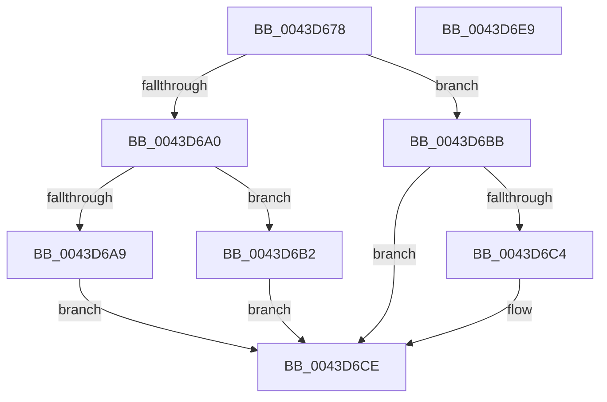

# PopFxSetGlobalDeviceAccountingEnabled

- RVA: `0x0043D678`–`0x0043D6EA` (길이 `114` bytes)
- VA: `0x000000014043D678`
- 실행 섹션: `.text`
- PDB 이름 있음: `예`; PDB Function 태그: `아니요`
- unwind 정보 RVA: `0x0005CF00`
- 디코드: `28`개 명령, `114/114` bytes 표시
- 미해석 바이트: `0` (있으면 어셈블리에 `.byte`로 보존)

> 이 문서는 커널 이미지의 기계어와 PDB 기호를 분석해 생성했습니다. 4번과 5번은 함수 원형과 자료형을 바이너리 사용 방식에서 추정한 C 해석이며 원본 소스 복구 결과는 아닙니다.

## 1. Dependencies

- 직접 호출 지점: **3**; 고유 호출 대상: **3**
- 직접 호출자로 확인된 함수: **2**
- RIP 상대 이미지 참조: **5**

### Outgoing calls
- `0x0043D687` → [KeAcquireSpinLockRaiseToDpc](../20/KeAcquireSpinLockRaiseToDpc_function_00208470.md) (function, `0x00208470`)
- `0x0043D6C9` → [PopFxUpdateGlobalDeviceAccountingInfo](../4B/PopFxUpdateGlobalDeviceAccountingInfo_function_004B9FBC.md) (function, `0x004B9FBC`)
- `0x0043D6DE` → [KeReleaseSpinLock](../39/KeReleaseSpinLock_function_00392BA0.md) (function, `0x00392BA0`)

### Direct callers
- [PopFxPauseDeviceAccounting](PopFxPauseDeviceAccounting_function_0043D0C8.md) at `0x0043D1E8`
- [PopFxResumeDeviceAccounting](PopFxResumeDeviceAccounting_function_0043D4D8.md) at `0x0043D623`

### Static image references
- `0x0043D680` → RVA `0x00F0E570` (`.data`; read)
- `0x0043D6A0` → RVA `0x00F0E6C0` (`.data`; read)
- `0x0043D6A9` → RVA `0x00F0E6C8` (`.data`; write)
- `0x0043D6B2` → RVA `0x00F0E6E0` (`.data`; read/write)
- `0x0043D6D1` → RVA `0x00F0E6C1` (`.data`; write)

## 2. Other-region calls and transfers

- 다른 실행 섹션으로 향하는 call: **0**
- 별도 외부 분기/꼬리 이동을 확인하지 못했습니다.

## 3. Assembly (complete function range)

```asm
0043D678  40 53                           push rbx
0043D67A  48 83 EC 20                     sub rsp, 0x20
0043D67E  8A D9                           mov bl, cl
0043D680  48 8D 0D E9 0E AD 00            lea rcx, [rip + 0xad0ee9]
0043D687  E8 E4 AD DC FF                  call 0x140208470
0043D68C  48 B9 08 00 00 00 80 F7 FF FF   movabs rcx, 0xfffff78000000008
0043D696  44 8A D0                        mov r10b, al
0043D699  48 8B 09                        mov rcx, qword ptr [rcx]
0043D69C  84 DB                           test bl, bl
0043D69E  74 1B                           je 0x14043d6bb
0043D6A0  80 3D 19 10 AD 00 00            cmp byte ptr [rip + 0xad1019], 0
0043D6A7  74 09                           je 0x14043d6b2
0043D6A9  48 89 0D 18 10 AD 00            mov qword ptr [rip + 0xad1018], rcx
0043D6B0  EB 1C                           jmp 0x14043d6ce
0043D6B2  48 FF 05 27 10 AD 00            inc qword ptr [rip + 0xad1027]
0043D6B9  EB 13                           jmp 0x14043d6ce
0043D6BB  80 3D FE 0F AD 00 00            cmp byte ptr [rip + 0xad0ffe], 0
0043D6C2  74 0A                           je 0x14043d6ce
0043D6C4  BA 00 8C 86 47                  mov edx, 0x47868c00
0043D6C9  E8 EE C8 07 00                  call 0x1404b9fbc
0043D6CE  41 8A D2                        mov dl, r10b
0043D6D1  88 1D EA 0F AD 00               mov byte ptr [rip + 0xad0fea], bl
0043D6D7  48 8D 0D 92 0E AD 00            lea rcx, [rip + 0xad0e92]
0043D6DE  E8 BD 54 F5 FF                  call 0x140392ba0
0043D6E3  48 83 C4 20                     add rsp, 0x20
0043D6E7  5B                              pop rbx
0043D6E8  C3                              ret
0043D6E9  CC                              int3
```

## 4. C-style interpretation (structured pseudocode)

```c
__int64 __fastcall PopFxSetGlobalDeviceAccountingEnabled(unsigned __int8 a1)
{
    __int64 result;
    __int64 v_rsp;

    v_rsp = (v_rsp) - (32);
    result = KeAcquireSpinLockRaiseToDpc(v_rip + 11341545, a2, a3, a4);
    if (a1 == 0) goto loc_0043D6BB;
    if ((*(unsigned __int8 *)(v_rip + 11341849)) == 0) goto loc_0043D6B2;
    *(unsigned __int64 *)(v_rip + 11341848) = *(unsigned __int64 *)(v_rip + 11341545);
    goto loc_0043D6CE;
loc_0043D6B2:
    goto loc_0043D6CE;
loc_0043D6BB:
    if ((*(unsigned __int8 *)(v_rip + 11341822)) != 0) {
        a2 = 0x47868C00ULL;
        result = PopFxUpdateGlobalDeviceAccountingInfo(*(unsigned __int64 *)(v_rip + 11341545), a2, a3, a4);
    }
    *(unsigned __int8 *)(v_rip + 11341802) = a1;
    result = KeReleaseSpinLock(v_rip + 11341458, (unsigned __int8)((unsigned __int8)(result)), a3, a4);
    v_rsp = (v_rsp) + (32);
    return result;
}
```

## 5. (Beta) C Style

```c
int64_t PopFxSetGlobalDeviceAccountingEnabled(uint8_t Arg1)
{
    int64_t result;
    int64_t local_rsp;

    local_rsp = (local_rsp) - (32);
    result = KeAcquireSpinLockRaiseToDpc(v_rip + 11341545, a2, a3, a4);
    if (Arg1 == 0) goto loc_0043D6BB;
    if ((*(uint8_t *)(v_rip + 0xAD1019)) == 0) goto loc_0043D6B2;
    *(uint64_t *)(v_rip + 0xAD1018) = *(uint64_t *)(v_rip + 0xAD0EE9);
    goto loc_0043D6CE;
loc_0043D6B2:
    goto loc_0043D6CE;
loc_0043D6BB:
    if ((*(uint8_t *)(v_rip + 0xAD0FFE)) != 0) {
        a2 = 0x47868C00ULL;
        result = PopFxUpdateGlobalDeviceAccountingInfo(*(uint64_t *)(v_rip + 0xAD0EE9), a2, a3, a4);
    }
    *(uint8_t *)(v_rip + 0xAD0FEA) = Arg1;
    result = KeReleaseSpinLock(v_rip + 11341458, (uint8_t)((uint8_t)(result)), a3, a4);
    local_rsp = (local_rsp) + (32);
    return result;
}
```

## 6. Execution-region graph

[열기: 2D/3D 그래프와 함수 탐색 컨트롤 패널](../../../control-panel.html?section=text&rva=0x0043D678&view=graph)

- 2D 그래프는 위에서 아래로 흐르고, 3D 그래프는 빈 공간을 드래그해 회전합니다. Shift+드래그는 이동, 휠은 확대·축소, 함수 노드 선택은 대상 보고서 이동입니다.

### Static fallback


