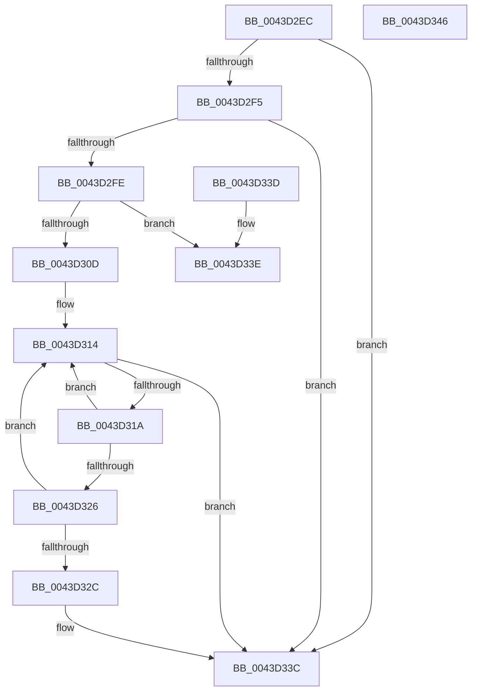

# PopFxUpdateAccountingActiveTime

- RVA: `0x0043D2EC`–`0x0043D347` (길이 `91` bytes)
- VA: `0x000000014043D2EC`
- 실행 섹션: `.text`
- PDB 이름 있음: `예`; PDB Function 태그: `아니요`
- unwind 정보 RVA: `0x000DB714`
- 디코드: `26`개 명령, `91/91` bytes 표시
- 미해석 바이트: `0` (있으면 어셈블리에 `.byte`로 보존)

> 이 문서는 커널 이미지의 기계어와 PDB 기호를 분석해 생성했습니다. 4번과 5번은 함수 원형과 자료형을 바이너리 사용 방식에서 추정한 C 해석이며 원본 소스 복구 결과는 아닙니다.

## 1. Dependencies

- 직접 호출 지점: **0**; 고유 호출 대상: **0**
- 직접 호출자로 확인된 함수: **5**
- RIP 상대 이미지 참조: **1**

### Outgoing calls
- 직접 디코드된 call 명령이 없습니다.

### Direct callers
- [PopFxUpdateComponentAccountingEnhanced](../2B/PopFxUpdateComponentAccountingEnhanced_function_002BE924.md) at `0x002BE9BD`
- [PopPepCompleteComponentIdleStateChangeActivity](../2B/PopPepCompleteComponentIdleStateChangeActivity_function_002BF1B0.md) at `0x002BF36D`
- [PopFxIdleWorkerTail](PopFxIdleWorkerTail_function_0043CDA0.md) at `0x0043CEA7`
- [PopFxPauseDeviceAccounting](PopFxPauseDeviceAccounting_function_0043D0C8.md) at `0x0043D183`
- [PopFxPauseDeviceAccounting](PopFxPauseDeviceAccounting_function_0043D0C8.md) at `0x0043D23D`
- [PopFxUpdateDeviceAccountingEnhanced](PopFxUpdateDeviceAccountingEnhanced_function_0043D250.md) at `0x0043D2BB`

### Static image references
- `0x0043D30D` → RVA `0x000294D8` (`.rdata`; read)

## 2. Other-region calls and transfers

- 다른 실행 섹션으로 향하는 call: **0**
- 별도 외부 분기/꼬리 이동을 확인하지 못했습니다.

## 3. Assembly (complete function range)

```asm
0043D2EC  45 33 C9                        xor r9d, r9d
0043D2EF  44 38 49 08                     cmp byte ptr [rcx + 8], r9b
0043D2F3  74 47                           je 0x14043d33c
0043D2F5  48 8B 41 18                     mov rax, qword ptr [rcx + 0x18]
0043D2F9  48 3B D0                        cmp rdx, rax
0043D2FC  76 3E                           jbe 0x14043d33c
0043D2FE  48 2B D0                        sub rdx, rax
0043D301  48 01 91 80 00 00 00            add qword ptr [rcx + 0x80], rdx
0043D308  49 3B D0                        cmp rdx, r8
0043D30B  72 31                           jb 0x14043d33e
0043D30D  4C 8D 15 C4 C1 BE FF            lea r10, [rip - 0x413e3c]
0043D314  41 83 F9 05                     cmp r9d, 5
0043D318  73 22                           jae 0x14043d33c
0043D31A  45 8B C1                        mov r8d, r9d
0043D31D  41 FF C1                        inc r9d
0043D320  4B 3B 14 C2                     cmp rdx, qword ptr [r10 + r8*8]
0043D324  72 EE                           jb 0x14043d314
0043D326  4B 3B 14 CA                     cmp rdx, qword ptr [r10 + r9*8]
0043D32A  73 E8                           jae 0x14043d314
0043D32C  4A FF 84 C1 90 00 00 00         inc qword ptr [rcx + r8*8 + 0x90]
0043D334  4A 01 94 C1 B8 00 00 00         add qword ptr [rcx + r8*8 + 0xb8], rdx
0043D33C  C3                              ret
0043D33D  CC                              int3
0043D33E  48 01 91 88 00 00 00            add qword ptr [rcx + 0x88], rdx
0043D345  C3                              ret
0043D346  CC                              int3
```

## 4. C-style interpretation (structured pseudocode)

```c
__int64 __fastcall PopFxUpdateAccountingActiveTime(__int64 a1, __int64 a2, __int64 a3, int a4)
{
    a4 = 0;
    if ((*(unsigned __int8 *)(a1 + 8)) == 0) goto loc_0043D33C;
    if (a2 <= (*(unsigned __int64 *)(a1 + 24))) goto loc_0043D33C;
    a2 = (a2) - (*(unsigned __int64 *)(a1 + 24));
    if (a2 < a3) goto loc_0043D33E;
loc_0043D314:
    if (0 >= 5) goto loc_0043D33C;
    a4 = (unsigned int)((a4) + 1);
    if (a2 < (*(unsigned __int64 *)(v_rip - 4275772 + 0 * 8))) goto loc_0043D314;
    if (a2 >= (*(unsigned __int64 *)(v_rip - 4275772 + a4 * 8))) goto loc_0043D314;
loc_0043D33C:
    return *(unsigned __int64 *)(a1 + 24);
loc_0043D33E:
    return *(unsigned __int64 *)(a1 + 24);
}
```

## 5. (Beta) C Style

```c
int64_t PopFxUpdateAccountingActiveTime(void *Arg1, int64_t Arg2, int64_t Arg3, int32_t Arg4)
{
    uint8_t *arg1 = (uint8_t *)Arg1;

    Arg4 = 0;
    if ((*(uint8_t *)(arg1 + 0x8)) == 0) goto loc_0043D33C;
    if (Arg2 <= (*(uint64_t *)(arg1 + 0x18))) goto loc_0043D33C;
    Arg2 = (Arg2) - (*(uint64_t *)(arg1 + 0x18));
    if (Arg2 < Arg3) goto loc_0043D33E;
loc_0043D314:
    if (0 >= 5) goto loc_0043D33C;
    Arg4 = (uint32_t)((Arg4) + 1);
    if (Arg2 < (*(uint64_t *)(v_rip - 0x413E3C + 0x0 * 8))) goto loc_0043D314;
    if (Arg2 >= (*(uint64_t *)(v_rip - 0x413E3C + Arg4 * 8))) goto loc_0043D314;
loc_0043D33C:
    return *(uint64_t *)(arg1 + 0x18);
loc_0043D33E:
    return *(uint64_t *)(arg1 + 0x18);
}
```

### 관측된 메모리 오프셋

구조체 형식이 확인되지 않은 접근은 인자 기준의 오프셋으로만 기록했습니다.

| 기준 인자 | 오프셋 표현 | 폭 (bit) | 접근 |
|---|---:|---:|---|
| `Arg1` | `+ 0x8` | `8` | `R` |
| `Arg1` | `+ 0x18` | `64` | `R` |
| `Arg1` | `+ 0x80` | `64` | `R/W` |
| `Arg1` | `+ 0x88` | `64` | `R/W` |
| `Arg1` | `+ 0x90 + r8*8` | `64` | `R/W` |
| `Arg1` | `+ 0xB8 + r8*8` | `64` | `R/W` |

## 6. Execution-region graph

[열기: 2D/3D 그래프와 함수 탐색 컨트롤 패널](../../../control-panel.html?section=text&rva=0x0043D2EC&view=graph)

- 2D 그래프는 위에서 아래로 흐르고, 3D 그래프는 빈 공간을 드래그해 회전합니다. Shift+드래그는 이동, 휠은 확대·축소, 함수 노드 선택은 대상 보고서 이동입니다.

### Static fallback


