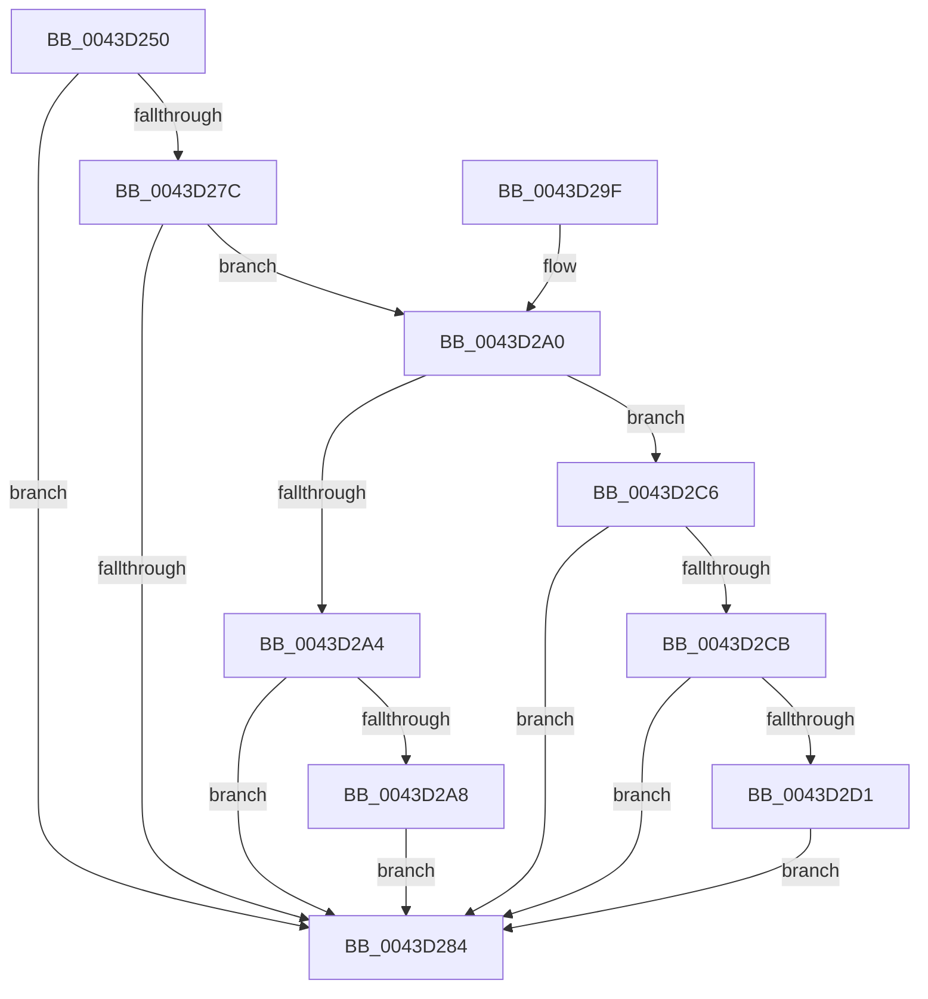

# PopFxUpdateDeviceAccountingEnhanced

- RVA: `0x0043D250`–`0x0043D2E5` (길이 `149` bytes)
- VA: `0x000000014043D250`
- 실행 섹션: `.text`
- PDB 이름 있음: `예`; PDB Function 태그: `아니요`
- unwind 정보 RVA: `0x00083254`
- 디코드: `43`개 명령, `149/149` bytes 표시
- 미해석 바이트: `0` (있으면 어셈블리에 `.byte`로 보존)

> 이 문서는 커널 이미지의 기계어와 PDB 기호를 분석해 생성했습니다. 4번과 5번은 함수 원형과 자료형을 바이너리 사용 방식에서 추정한 C 해석이며 원본 소스 복구 결과는 아닙니다.

## 1. Dependencies

- 직접 호출 지점: **3**; 고유 호출 대상: **3**
- 직접 호출자로 확인된 함수: **1**
- RIP 상대 이미지 참조: **0**

### Outgoing calls
- `0x0043D26E` → [KeAcquireSpinLockRaiseToDpc](../20/KeAcquireSpinLockRaiseToDpc_function_00208470.md) (function, `0x00208470`)
- `0x0043D28A` → [KeReleaseSpinLock](../39/KeReleaseSpinLock_function_00392BA0.md) (function, `0x00392BA0`)
- `0x0043D2BB` → [PopFxUpdateAccountingActiveTime](PopFxUpdateAccountingActiveTime_function_0043D2EC.md) (function, `0x0043D2EC`)

### Direct callers
- [PopPepDeviceDState](../2B/PopPepDeviceDState_function_002BFE70.md) at `0x002BFFDF`
- [PopPepDeviceDState](../2B/PopPepDeviceDState_function_002BFE70.md) at `0x002C005F`

### Static image references
- 디코드된 RIP-relative 메모리 참조가 없습니다.

## 2. Other-region calls and transfers

- 다른 실행 섹션으로 향하는 call: **0**
- 별도 외부 분기/꼬리 이동을 확인하지 못했습니다.

## 3. Assembly (complete function range)

```asm
0043D250  48 89 5C 24 08                  mov qword ptr [rsp + 8], rbx
0043D255  48 89 74 24 10                  mov qword ptr [rsp + 0x10], rsi
0043D25A  57                              push rdi
0043D25B  48 83 EC 20                     sub rsp, 0x20
0043D25F  48 8D 99 80 02 00 00            lea rbx, [rcx + 0x280]
0043D266  41 8B F0                        mov esi, r8d
0043D269  48 8B CB                        mov rcx, rbx
0043D26C  8B FA                           mov edi, edx
0043D26E  E8 FD B1 DC FF                  call 0x140208470
0043D273  83 7B 10 02                     cmp dword ptr [rbx + 0x10], 2
0043D277  44 8A D8                        mov r11b, al
0043D27A  75 08                           jne 0x14043d284
0043D27C  8B 4B 0C                        mov ecx, dword ptr [rbx + 0xc]
0043D27F  83 F9 05                        cmp ecx, 5
0043D282  75 1C                           jne 0x14043d2a0
0043D284  41 8A D3                        mov dl, r11b
0043D287  48 8B CB                        mov rcx, rbx
0043D28A  E8 11 59 F5 FF                  call 0x140392ba0
0043D28F  48 8B 5C 24 30                  mov rbx, qword ptr [rsp + 0x30]
0043D294  48 8B 74 24 38                  mov rsi, qword ptr [rsp + 0x38]
0043D299  48 83 C4 20                     add rsp, 0x20
0043D29D  5F                              pop rdi
0043D29E  C3                              ret
0043D29F  CC                              int3
0043D2A0  85 F6                           test esi, esi
0043D2A2  74 22                           je 0x14043d2c6
0043D2A4  3B F9                           cmp edi, ecx
0043D2A6  72 DC                           jb 0x14043d284
0043D2A8  48 BA 08 00 00 00 80 F7 FF FF   movabs rdx, 0xfffff78000000008
0043D2B2  45 33 C0                        xor r8d, r8d
0043D2B5  48 8B CB                        mov rcx, rbx
0043D2B8  48 8B 12                        mov rdx, qword ptr [rdx]
0043D2BB  E8 2C 00 00 00                  call 0x14043d2ec
0043D2C0  C6 43 08 00                     mov byte ptr [rbx + 8], 0
0043D2C4  EB BE                           jmp 0x14043d284
0043D2C6  83 FF 01                        cmp edi, 1
0043D2C9  75 B9                           jne 0x14043d284
0043D2CB  80 7B 08 00                     cmp byte ptr [rbx + 8], 0
0043D2CF  75 B3                           jne 0x14043d284
0043D2D1  48 A1 08 00 00 00 80 F7 FF FF   movabs rax, qword ptr [0xfffff78000000008]
0043D2DB  48 89 43 18                     mov qword ptr [rbx + 0x18], rax
0043D2DF  40 88 7B 08                     mov byte ptr [rbx + 8], dil
0043D2E3  EB 9F                           jmp 0x14043d284
```

## 4. C-style interpretation (structured pseudocode)

```c
__int64 __fastcall PopFxUpdateDeviceAccountingEnhanced(__int64 a1, int a2, int a3)
{
    __int64 result;
    __int64 v_rsp;
    unsigned __int64 v_stack_p10;
    unsigned __int64 v_stack_p8;

    v_stack_p8 = v_rbx;
    v_stack_p10 = v_rsi;
    v_rsp = (v_rsp) - (32);
    result = KeAcquireSpinLockRaiseToDpc(a1 + 640, a2, a3, a4);
    if ((*(unsigned int *)(a1 + 640 + 16)) != 2) goto loc_0043D284;
    if (((unsigned int)((unsigned int)(*(unsigned int *)(a1 + 640 + 12)))) != 5) goto loc_0043D2A0;
loc_0043D284:
    result = KeReleaseSpinLock(a1 + 640, (unsigned __int8)((unsigned __int8)(result)), a3, a4);
    v_rsp = (v_rsp) + (32);
    return result;
loc_0043D2A0:
    if ((unsigned int)(v_stack_p10) == 0) goto loc_0043D2C6;
    if (((unsigned int)((unsigned int)(a2))) < ((unsigned int)(a1 + 640))) goto loc_0043D284;
    a3 = 0;
    result = PopFxUpdateAccountingActiveTime(v_stack_p8, *(unsigned __int64 *)((unsigned __int8)((unsigned __int8)(result))), a3, a4);
    *(unsigned __int8 *)(v_stack_p8 + 8) = 0;
    goto loc_0043D284;
loc_0043D2C6:
    if (((unsigned int)((unsigned int)(a2))) != 1) goto loc_0043D284;
    if ((*(unsigned __int8 *)(v_stack_p8 + 8)) != 0) goto loc_0043D284;
    *(unsigned __int64 *)(v_stack_p8 + 24) = result;
    *(unsigned __int8 *)(v_stack_p8 + 8) = (unsigned __int8)((unsigned int)(a2));
    goto loc_0043D284;
}
```

## 5. (Beta) C Style

```c
int64_t PopFxUpdateDeviceAccountingEnhanced(void *Arg1, int32_t Arg2, int32_t Arg3)
{
    uint8_t *arg1 = (uint8_t *)Arg1;

    int64_t result;
    int64_t local_rsp;
    uint64_t v_stack_p10;
    uint64_t v_stack_p8;

    v_stack_p8 = local_rbx;
    v_stack_p10 = local_rsi;
    local_rsp = (local_rsp) - (32);
    result = KeAcquireSpinLockRaiseToDpc(Arg1 + 640, Arg2, Arg3, a4);
    if ((*(uint32_t *)(arg1 + 0x280 + 0x10)) != 2) goto loc_0043D284;
    if (((uint32_t)((uint32_t)(*(uint32_t *)(arg1 + 0x280 + 0xC)))) != 5) goto loc_0043D2A0;
loc_0043D284:
    result = KeReleaseSpinLock(Arg1 + 640, (uint8_t)((uint8_t)(result)), Arg3, a4);
    local_rsp = (local_rsp) + (32);
    return result;
loc_0043D2A0:
    if ((uint32_t)(v_stack_p10) == 0) goto loc_0043D2C6;
    if (((uint32_t)((uint32_t)(Arg2))) < ((uint32_t)(Arg1 + 640))) goto loc_0043D284;
    Arg3 = 0;
    result = PopFxUpdateAccountingActiveTime(v_stack_p8, *(uint64_t *)((uint8_t)((uint8_t)(result))), Arg3, a4);
    *(uint8_t *)(v_stack_p8 + 0x8) = 0;
    goto loc_0043D284;
loc_0043D2C6:
    if (((uint32_t)((uint32_t)(Arg2))) != 1) goto loc_0043D284;
    if ((*(uint8_t *)(v_stack_p8 + 0x8)) != 0) goto loc_0043D284;
    *(uint64_t *)(v_stack_p8 + 0x18) = result;
    *(uint8_t *)(v_stack_p8 + 0x8) = (uint8_t)((uint32_t)(Arg2));
    goto loc_0043D284;
}
```

### 관측된 메모리 오프셋

구조체 형식이 확인되지 않은 접근은 인자 기준의 오프셋으로만 기록했습니다.

| 기준 인자 | 오프셋 표현 | 폭 (bit) | 접근 |
|---|---:|---:|---|
| `Arg1` | `+ 0x8` | `8` | `R` |
| `Arg1` | `+ 0x8` | `8` | `W` |
| `Arg1` | `+ 0xC` | `32` | `R` |
| `Arg1` | `+ 0x10` | `32` | `R` |
| `Arg1` | `+ 0x18` | `64` | `W` |
| `Arg1` | `+ 0x280` | `64` | `R` |

## 6. Execution-region graph

[열기: 2D/3D 그래프와 함수 탐색 컨트롤 패널](../../../control-panel.html?section=text&rva=0x0043D250&view=graph)

- 2D 그래프는 위에서 아래로 흐르고, 3D 그래프는 빈 공간을 드래그해 회전합니다. Shift+드래그는 이동, 휠은 확대·축소, 함수 노드 선택은 대상 보고서 이동입니다.

### Static fallback


