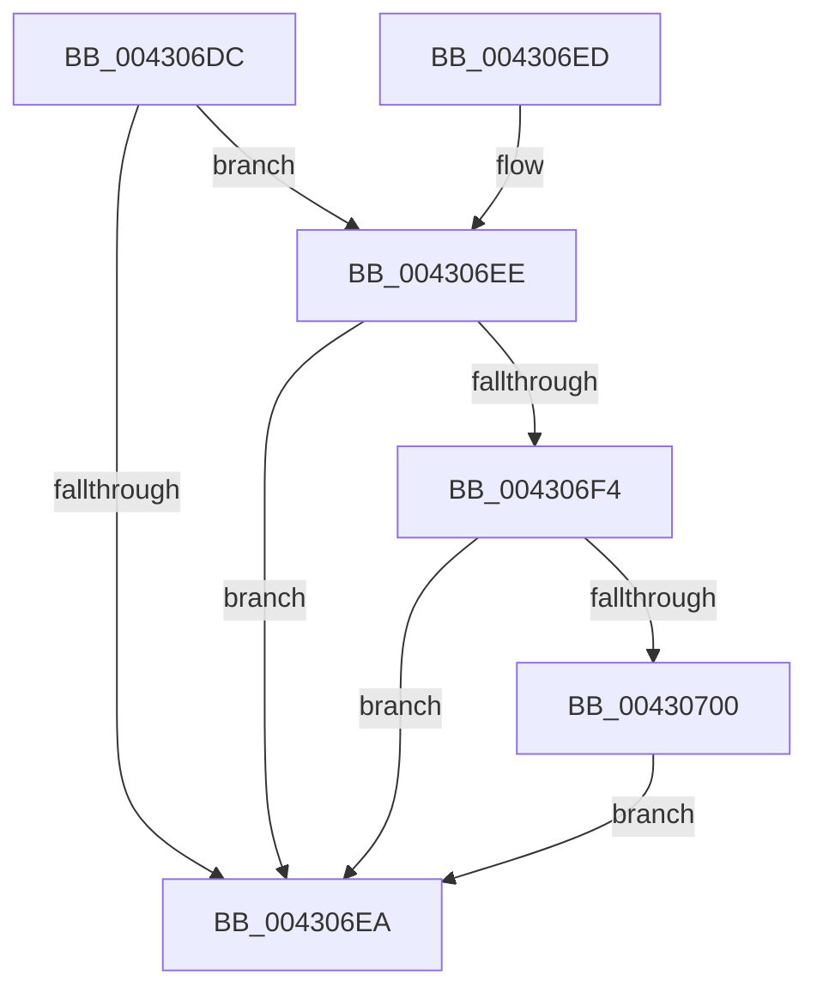

# PopIsNotifyForDirectedPowerTransition

- RVA: `0x004306DC`–`0x00430717` (길이 `59` bytes)
- VA: `0x00000001404306DC`
- 실행 섹션: `.text`
- PDB 이름 있음: `예`; PDB Function 태그: `아니요`
- unwind 정보 RVA: `0x000DB714`
- 디코드: `17`개 명령, `59/59` bytes 표시
- 미해석 바이트: `0` (있으면 어셈블리에 `.byte`로 보존)

> 이 문서는 커널 이미지의 기계어와 PDB 기호를 분석해 생성했습니다. 4번과 5번은 함수 원형과 자료형을 바이너리 사용 방식에서 추정한 C 해석이며 원본 소스 복구 결과는 아닙니다.

## 1. Dependencies

- 직접 호출 지점: **0**; 고유 호출 대상: **0**
- 직접 호출자로 확인된 함수: **2**
- RIP 상대 이미지 참조: **1**

### Outgoing calls
- 직접 디코드된 call 명령이 없습니다.

### Direct callers
- [PopWakeDeviceList](PopWakeDeviceList_function_00430238.md) at `0x004303C9`
- [PopSleepDeviceList](PopSleepDeviceList_function_00430460.md) at `0x00430694`

### Static image references
- `0x004306DE` → RVA `0x00F0BCC4` (`.data`; read)

## 2. Other-region calls and transfers

- 다른 실행 섹션으로 향하는 call: **0**
- 별도 외부 분기/꼬리 이동을 확인하지 못했습니다.

## 3. Assembly (complete function range)

```asm
004306DC  33 D2                           xor edx, edx
004306DE  F7 05 DC B5 AD 00 00 00 80 00   test dword ptr [rip + 0xadb5dc], 0x800000
004306E8  75 04                           jne 0x1404306ee
004306EA  8A C2                           mov al, dl
004306EC  C3                              ret
004306ED  CC                              int3
004306EE  48 39 51 B0                     cmp qword ptr [rcx - 0x50], rdx
004306F2  74 F6                           je 0x1404306ea
004306F4  8B 81 58 02 00 00               mov eax, dword ptr [rcx + 0x258]
004306FA  0F BA E0 10                     bt eax, 0x10
004306FE  73 EA                           jae 0x1404306ea
00430700  8B 81 58 02 00 00               mov eax, dword ptr [rcx + 0x258]
00430706  0F BA E0 11                     bt eax, 0x11
0043070A  0F B6 D2                        movzx edx, dl
0043070D  B9 01 00 00 00                  mov ecx, 1
00430712  0F 43 D1                        cmovae edx, ecx
00430715  EB D3                           jmp 0x1404306ea
```

## 4. C-style interpretation (structured pseudocode)

```c
__int64 __fastcall PopIsNotifyForDirectedPowerTransition(__int64 a1, int a2)
{
    a2 = 0;
    if (((*(unsigned int *)(v_rip + 11384284)) & (0x800000ULL)) != 0) goto loc_004306EE;
loc_004306EA:
    return 0;
loc_004306EE:
    if ((*(unsigned __int64 *)(a1 - 80)) == 0) goto loc_004306EA;
    if ((*(unsigned __int64 *)(a1 - 80)) >= 0) goto loc_004306EA;
    a2 = 0;
    if ((*(unsigned __int64 *)(a1 - 80)) >= 0) { a2 = 1; }
    goto loc_004306EA;
}
```

## 5. (Beta) C Style

```c
int64_t PopIsNotifyForDirectedPowerTransition(void *Arg1, int32_t Arg2)
{
    uint8_t *arg1 = (uint8_t *)Arg1;

    Arg2 = 0;
    if (((*(uint32_t *)(v_rip + 0xADB5DC)) & (0x800000ULL)) != 0) goto loc_004306EE;
loc_004306EA:
    return 0;
loc_004306EE:
    if ((*(uint64_t *)(arg1 - 0x50)) == 0) goto loc_004306EA;
    if ((*(uint64_t *)(arg1 - 0x50)) >= 0) goto loc_004306EA;
    Arg2 = 0;
    if ((*(uint64_t *)(arg1 - 0x50)) >= 0) { Arg2 = 1; }
    goto loc_004306EA;
}
```

### 관측된 메모리 오프셋

구조체 형식이 확인되지 않은 접근은 인자 기준의 오프셋으로만 기록했습니다.

| 기준 인자 | 오프셋 표현 | 폭 (bit) | 접근 |
|---|---:|---:|---|
| `Arg1` | `- 0x50` | `64` | `R` |
| `Arg1` | `+ 0x258` | `32` | `R` |

## 6. Execution-region graph

[열기: 2D/3D 그래프와 함수 탐색 컨트롤 패널](../../../control-panel.html?section=text&rva=0x004306DC&view=graph)

- 2D 그래프는 위에서 아래로 흐르고, 3D 그래프는 빈 공간을 드래그해 회전합니다. Shift+드래그는 이동, 휠은 확대·축소, 함수 노드 선택은 대상 보고서 이동입니다.

### Static fallback


