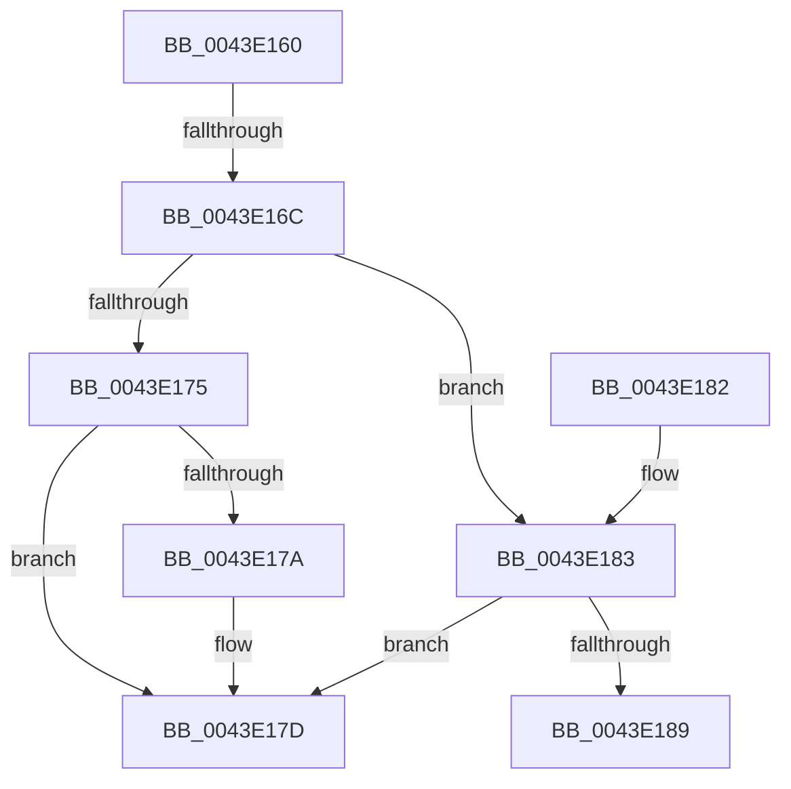

# PopPepCountReadyActivities

- RVA: `0x0043E160`–`0x0043E18C` (길이 `44` bytes)
- VA: `0x000000014043E160`
- 실행 섹션: `.text`
- PDB 이름 있음: `예`; PDB Function 태그: `아니요`
- unwind 정보 RVA: `0x000A4A6C`
- 디코드: `16`개 명령, `44/44` bytes 표시
- 미해석 바이트: `0` (있으면 어셈블리에 `.byte`로 보존)

> 이 문서는 커널 이미지의 기계어와 PDB 기호를 분석해 생성했습니다. 4번과 5번은 함수 원형과 자료형을 바이너리 사용 방식에서 추정한 C 해석이며 원본 소스 복구 결과는 아닙니다.

## 1. Dependencies

- 직접 호출 지점: **0**; 고유 호출 대상: **0**
- 직접 호출자로 확인된 함수: **2**
- RIP 상대 이미지 참조: **0**

### Outgoing calls
- 직접 디코드된 call 명령이 없습니다.

### Direct callers
- [PopPepComponentSetResidency](../5D/PopPepComponentSetResidency_function_005DC9A4.md) at `0x005DCA34`
- [PopPepComponentSetResidency](../5D/PopPepComponentSetResidency_function_005DC9A4.md) at `0x005DCA60`
- [PopPepComponentSetWakeHint](../5D/PopPepComponentSetWakeHint_function_005DCAA0.md) at `0x005DCB27`
- [PopPepComponentSetWakeHint](../5D/PopPepComponentSetWakeHint_function_005DCAA0.md) at `0x005DCB53`

### Static image references
- 디코드된 RIP-relative 메모리 참조가 없습니다.

## 2. Other-region calls and transfers

- 다른 실행 섹션으로 향하는 call: **0**
- call이 아닌 외부 분기/꼬리 이동: **1**
  - `0x0043E16A` → [sub_0043E1E1](Unknown_function_0043E1E1.md) (`tail-transfer`)

## 3. Assembly (complete function range)

```asm
0043E160  48 83 EC 08                     sub rsp, 8
0043E164  4C 8B C9                        mov r9, rcx
0043E167  45 85 C0                        test r8d, r8d
0043E16A  74 75                           je 0x14043e1e1
0043E16C  8B 41 78                        mov eax, dword ptr [rcx + 0x78]
0043E16F  41 83 F8 02                     cmp r8d, 2
0043E173  75 0E                           jne 0x14043e183
0043E175  48 85 D2                        test rdx, rdx
0043E178  74 03                           je 0x14043e17d
0043E17A  03 42 68                        add eax, dword ptr [rdx + 0x68]
0043E17D  48 83 C4 08                     add rsp, 8
0043E181  C3                              ret
0043E182  CC                              int3
0043E183  41 83 F8 03                     cmp r8d, 3
0043E187  75 F4                           jne 0x14043e17d
0043E189  45 33 C0                        xor r8d, r8d
```

## 4. C-style interpretation (structured pseudocode)

```c
__int64 __fastcall PopPepCountReadyActivities(__int64 a1, __int64 a2, int a3)
{
    __int64 result;
    __int64 v_rsp;

    v_rsp = (v_rsp) - (8);
    if (a3 != 2) goto loc_0043E183;
    result = (unsigned int)(*(unsigned int *)(a1 + 120));
    if (a2 != 0) {
        result = (unsigned int)(((unsigned int)(*(unsigned int *)(a1 + 120))) + (*(unsigned int *)(a2 + 104)));
    }
    v_rsp = (v_rsp) + (8);
    return result;
loc_0043E183:
    if (a3 != 3) goto loc_0043E17D;
    a3 = 0;
    return result;
}
```

## 5. (Beta) C Style

```c
int64_t PopPepCountReadyActivities(void *Arg1, int64_t Arg2, int32_t Arg3)
{
    uint8_t *arg1 = (uint8_t *)Arg1;

    int64_t result;
    int64_t local_rsp;

    local_rsp = (local_rsp) - (8);
    if (Arg3 != 2) goto loc_0043E183;
    result = (uint32_t)(*(uint32_t *)(arg1 + 0x78));
    if (Arg2 != 0) {
        result = (uint32_t)(((uint32_t)(*(uint32_t *)(arg1 + 0x78))) + (*(uint32_t *)(Arg2 + 0x68)));
    }
    local_rsp = (local_rsp) + (8);
    return result;
loc_0043E183:
    if (Arg3 != 3) goto loc_0043E17D;
    Arg3 = 0;
    return result;
}
```

### 관측된 메모리 오프셋

구조체 형식이 확인되지 않은 접근은 인자 기준의 오프셋으로만 기록했습니다.

| 기준 인자 | 오프셋 표현 | 폭 (bit) | 접근 |
|---|---:|---:|---|
| `Arg1` | `+ 0x78` | `32` | `R` |

## 6. Execution-region graph

[열기: 2D/3D 그래프와 함수 탐색 컨트롤 패널](../../../control-panel.html?section=text&rva=0x0043E160&view=graph)

- 2D 그래프는 위에서 아래로 흐르고, 3D 그래프는 빈 공간을 드래그해 회전합니다. Shift+드래그는 이동, 휠은 확대·축소, 함수 노드 선택은 대상 보고서 이동입니다.

### Static fallback


