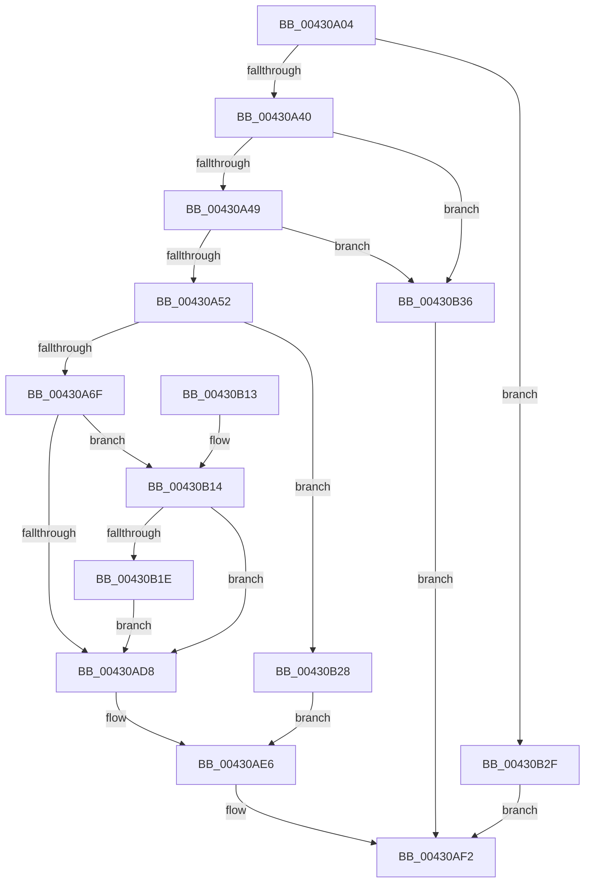

# PopPushPowerStateTransitionRecordWithCallback

- RVA: `0x00430A04`–`0x00430B3D` (길이 `313` bytes)
- VA: `0x0000000140430A04`
- 실행 섹션: `.text`
- PDB 이름 있음: `예`; PDB Function 태그: `아니요`
- unwind 정보 RVA: `0x000A20F8`
- 디코드: `81`개 명령, `313/313` bytes 표시
- 미해석 바이트: `0` (있으면 어셈블리에 `.byte`로 보존)

> 이 문서는 커널 이미지의 기계어와 PDB 기호를 분석해 생성했습니다. 4번과 5번은 함수 원형과 자료형을 바이너리 사용 방식에서 추정한 C 해석이며 원본 소스 복구 결과는 아닙니다.

## 1. Dependencies

- 직접 호출 지점: **7**; 고유 호출 대상: **5**
- 직접 호출자로 확인된 함수: **8**
- RIP 상대 이미지 참조: **5**

### Outgoing calls
- `0x00430A59` → [PopAcquireRwLockExclusive](PopAcquireRwLockExclusive_function_00430B44.md) (function, `0x00430B44`)
- `0x00430A82` → [ObpTraceObjectReferenceIfActive](../21/ObpTraceObjectReferenceIfActive_function_00210780.md) (function, `0x00210780`)
- `0x00430A8B` → [ObpIncrPointerCount](ObpIncrPointerCount_function_00430BB0.md) (function, `0x00430BB0`)
- `0x00430A9D` → [ObpTraceObjectReferenceIfActive](../21/ObpTraceObjectReferenceIfActive_function_00210780.md) (function, `0x00210780`)
- `0x00430AA6` → [ObpIncrPointerCount](ObpIncrPointerCount_function_00430BB0.md) (function, `0x00430BB0`)
- `0x00430ADD` → [RtlGetInterruptTimePrecise](../20/RtlGetInterruptTimePrecise_function_0020A4C0.md) (function, `0x0020A4C0`)
- `0x00430AED` → [PopReleaseRwLock](../2D/PopReleaseRwLock_function_002DFBBC.md) (function, `0x002DFBBC`)

### Direct callers
- [PopWakeDeviceList](PopWakeDeviceList_function_00430238.md) at `0x004302C5`
- [PopSleepDeviceList](PopSleepDeviceList_function_00430460.md) at `0x004304FB`
- [PopManageTransitionRecordRequest](../../page/A6/PopManageTransitionRecordRequest_function_00A63B34.md) at `0x00A63C50`
- [PopUnlockAfterSleepWorker](../../pagelk/B7/PopUnlockAfterSleepWorker_function_00B782A0.md) at `0x00B782EC`
- [PopAcquireTransitionLockAfterSleep](../../pagelk/B7/PopAcquireTransitionLockAfterSleep_function_00B7C61C.md) at `0x00B7C69B`
- [PopPushPowerStateTransitionRecord](../../pagelk/B7/PopPushPowerStateTransitionRecord_function_00B7CC90.md) at `0x00B7CCA0`
- [PopTransitionSystemPowerStateEx](../../pagelk/B7/PopTransitionSystemPowerStateEx_function_00B7E8C0.md) at `0x00B7F6C4`
- [sub_00B80E6E](../../pagelk/B8/Unknown_function_00B80E6E.md) at `0x00B8100C`

### Static image references
- `0x00430A21` → RVA `0x00F0BEF4` (`.data`; read)
- `0x00430A52` → RVA `0x00F0DD88` (`.data`; read)
- `0x00430A5E` → RVA `0x00F0DD80` (`.data`; read)
- `0x00430A72` → RVA `0x00F0DD80` (`.data`; write)
- `0x00430AAB` → RVA `0x00F0D180` (`.data`; read)

## 2. Other-region calls and transfers

- 다른 실행 섹션으로 향하는 call: **0**
- 별도 외부 분기/꼬리 이동을 확인하지 못했습니다.

## 3. Assembly (complete function range)

```asm
00430A04  48 8B C4                        mov rax, rsp
00430A07  48 89 58 08                     mov qword ptr [rax + 8], rbx
00430A0B  48 89 68 10                     mov qword ptr [rax + 0x10], rbp
00430A0F  48 89 70 18                     mov qword ptr [rax + 0x18], rsi
00430A13  48 89 78 20                     mov qword ptr [rax + 0x20], rdi
00430A17  41 54                           push r12
00430A19  41 56                           push r14
00430A1B  41 57                           push r15
00430A1D  48 83 EC 30                     sub rsp, 0x30
00430A21  8B 05 CD B4 AD 00               mov eax, dword ptr [rip + 0xadb4cd]
00430A27  33 FF                           xor edi, edi
00430A29  FF C8                           dec eax
00430A2B  45 8B F9                        mov r15d, r9d
00430A2E  4D 8B E0                        mov r12, r8
00430A31  48 8B EA                        mov rbp, rdx
00430A34  4C 8B F1                        mov r14, rcx
00430A37  83 F8 01                        cmp eax, 1
00430A3A  0F 87 EF 00 00 00               ja 0x140430b2f
00430A40  48 85 C9                        test rcx, rcx
00430A43  0F 84 ED 00 00 00               je 0x140430b36
00430A49  48 85 D2                        test rdx, rdx
00430A4C  0F 84 E4 00 00 00               je 0x140430b36
00430A52  48 8D 0D 2F D3 AD 00            lea rcx, [rip + 0xadd32f]
00430A59  E8 E6 00 00 00                  call 0x140430b44
00430A5E  8B 35 1C D3 AD 00               mov esi, dword ptr [rip + 0xadd31c]
00430A64  FF C6                           inc esi
00430A66  83 FE 40                        cmp esi, 0x40
00430A69  0F 83 B9 00 00 00               jae 0x140430b28
00430A6F  8D 57 01                        lea edx, [rdi + 1]
00430A72  89 35 08 D3 AD 00               mov dword ptr [rip + 0xadd308], esi
00430A78  41 B8 44 66 6C 74               mov r8d, 0x746c6644
00430A7E  49 8D 4E D0                     lea rcx, [r14 - 0x30]
00430A82  E8 F9 FC DD FF                  call 0x140210780
00430A87  49 8D 4E D0                     lea rcx, [r14 - 0x30]
00430A8B  E8 20 01 00 00                  call 0x140430bb0
00430A90  8D 57 01                        lea edx, [rdi + 1]
00430A93  41 B8 44 66 6C 74               mov r8d, 0x746c6644
00430A99  48 8D 4D D0                     lea rcx, [rbp - 0x30]
00430A9D  E8 DE FC DD FF                  call 0x140210780
00430AA2  48 8D 4D D0                     lea rcx, [rbp - 0x30]
00430AA6  E8 05 01 00 00                  call 0x140430bb0
00430AAB  48 8D 05 CE C6 AD 00            lea rax, [rip + 0xadc6ce]
00430AB2  48 8D 1C 76                     lea rbx, [rsi + rsi*2]
00430AB6  48 C1 E3 04                     shl rbx, 4
00430ABA  48 03 D8                        add rbx, rax
00430ABD  41 8D 47 FF                     lea eax, [r15 - 1]
00430AC1  4C 89 73 08                     mov qword ptr [rbx + 8], r14
00430AC5  48 89 2B                        mov qword ptr [rbx], rbp
00430AC8  4C 89 63 18                     mov qword ptr [rbx + 0x18], r12
00430ACC  48 89 7B 28                     mov qword ptr [rbx + 0x28], rdi
00430AD0  89 7B 20                        mov dword ptr [rbx + 0x20], edi
00430AD3  83 F8 01                        cmp eax, 1
00430AD6  76 3C                           jbe 0x140430b14
00430AD8  48 8D 4C 24 20                  lea rcx, [rsp + 0x20]
00430ADD  E8 DE 99 DD FF                  call 0x14020a4c0
00430AE2  48 89 43 10                     mov qword ptr [rbx + 0x10], rax
00430AE6  48 8D 0D 9B D2 AD 00            lea rcx, [rip + 0xadd29b]
00430AED  E8 CA F0 EA FF                  call 0x1402dfbbc
00430AF2  48 8B 5C 24 50                  mov rbx, qword ptr [rsp + 0x50]
00430AF7  8B C7                           mov eax, edi
00430AF9  48 8B 7C 24 68                  mov rdi, qword ptr [rsp + 0x68]
00430AFE  48 8B 6C 24 58                  mov rbp, qword ptr [rsp + 0x58]
00430B03  48 8B 74 24 60                  mov rsi, qword ptr [rsp + 0x60]
00430B08  48 83 C4 30                     add rsp, 0x30
00430B0C  41 5F                           pop r15
00430B0E  41 5E                           pop r14
00430B10  41 5C                           pop r12
00430B12  C3                              ret
00430B13  CC                              int3
00430B14  48 8B 44 24 70                  mov rax, qword ptr [rsp + 0x70]
00430B19  48 85 C0                        test rax, rax
00430B1C  74 BA                           je 0x140430ad8
00430B1E  48 89 43 28                     mov qword ptr [rbx + 0x28], rax
00430B22  44 89 7B 20                     mov dword ptr [rbx + 0x20], r15d
00430B26  EB B0                           jmp 0x140430ad8
00430B28  BF 17 00 00 C0                  mov edi, 0xc0000017
00430B2D  EB B7                           jmp 0x140430ae6
00430B2F  BF D3 02 00 C0                  mov edi, 0xc00002d3
00430B34  EB BC                           jmp 0x140430af2
00430B36  BF 0D 00 00 C0                  mov edi, 0xc000000d
00430B3B  EB B5                           jmp 0x140430af2
```

## 4. C-style interpretation (structured pseudocode)

```c
__int64 __fastcall PopPushPowerStateTransitionRecordWithCallback(__int64 a1, __int64 a2, __int64 a3, int a4, __int64 a5)
{
    __int64 result;
    __int64 v_rbx;
    __int64 v_rdi;
    __int64 v_rsi;
    __int64 v_rsp;
    unsigned __int64 v_stack_m28;
    unsigned __int64 v_stack_p10;
    unsigned __int64 v_stack_p18;
    unsigned __int64 v_stack_p20;
    unsigned __int64 v_stack_p8;

    *(unsigned __int64 *)(v_rsp + 8) = v_rbx;
    *(unsigned __int64 *)(v_rsp + 16) = v_rbp;
    *(unsigned __int64 *)(v_rsp + 24) = v_rsi;
    *(unsigned __int64 *)(v_rsp + 32) = v_rdi;
    v_rsp = (v_rsp) - (48);
    v_rdi = 0;
    result = (unsigned int)(((unsigned int)(*(unsigned int *)(v_rip + 11384013))) - 1);
    if (((unsigned int)(result)) > 1) goto loc_00430B2F;
    if (a1 == 0) goto loc_00430B36;
    if (a2 == 0) goto loc_00430B36;
    result = PopAcquireRwLockExclusive(v_rip + 11391791, a2, a3, a4);
    v_rsi = (unsigned int)(((unsigned int)(*(unsigned int *)(v_rip + 11391772))) + 1);
    if (((unsigned int)(v_rsi)) >= 64) goto loc_00430B28;
    *(unsigned int *)(v_rip + 11391752) = (unsigned int)(v_rsi);
    result = ObpTraceObjectReferenceIfActive(a1 - 48, v_rdi + 1, (unsigned int)(0x746C6644ULL), a4);
    result = ObpIncrPointerCount(a1 - 48, v_rdi + 1, (unsigned int)(0x746C6644ULL), a4);
    result = ObpTraceObjectReferenceIfActive(a2 - 48, v_rdi + 1, (unsigned int)(0x746C6644ULL), a4);
    result = ObpIncrPointerCount(a2 - 48, v_rdi + 1, (unsigned int)(0x746C6644ULL), a4);
    v_rbx = (v_rsi + v_rsi * 2) << (4);
    v_rbx = (v_rbx) + (v_rip + 11388622);
    *(unsigned __int64 *)(v_rbx + 8) = a1;
    *(unsigned __int64 *)(v_rbx) = a2;
    *(unsigned __int64 *)(v_rbx + 24) = a3;
    *(unsigned __int64 *)(v_rbx + 40) = 0;
    *(unsigned int *)(v_rbx + 32) = 0;
    if (((unsigned int)((unsigned int)(a4) - 1)) <= 1) goto loc_00430B14;
loc_00430AD8:
    result = RtlGetInterruptTimePrecise(v_stack_m28, v_rdi + 1, (unsigned int)(0x746C6644ULL), a4);
    *(unsigned __int64 *)(v_rbx + 16) = result;
loc_00430AE6:
    result = PopReleaseRwLock(v_rip + 11391643, v_rdi + 1, (unsigned int)(0x746C6644ULL), a4);
loc_00430AF2:
    v_rsp = (v_rsp) + (48);
    return 0;
loc_00430B14:
    if (a5 == 0) goto loc_00430AD8;
    *(unsigned __int64 *)(v_stack_p8 + 40) = a5;
    *(unsigned int *)(v_stack_p8 + 32) = (unsigned int)((unsigned int)(a4));
    goto loc_00430AD8;
loc_00430B28:
    goto loc_00430AE6;
loc_00430B2F:
    goto loc_00430AF2;
loc_00430B36:
    goto loc_00430AF2;
}
```

## 5. (Beta) C Style

```c
int64_t PopPushPowerStateTransitionRecordWithCallback(void *Arg1, void *Arg2, int64_t Arg3, void *Arg4, int64_t Arg5)
{
    uint8_t *arg1 = (uint8_t *)Arg1;
    uint8_t *arg2 = (uint8_t *)Arg2;
    uint8_t *arg4 = (uint8_t *)Arg4;

    int64_t result;
    int64_t local_rbx;
    int64_t local_rdi;
    int64_t local_rsi;
    int64_t local_rsp;
    uint64_t v_stack_m28;
    uint64_t v_stack_p10;
    uint64_t v_stack_p18;
    uint64_t v_stack_p20;
    uint64_t v_stack_p8;

    *(uint64_t *)(local_rsp + 0x8) = local_rbx;
    *(uint64_t *)(local_rsp + 0x10) = local_rbp;
    *(uint64_t *)(local_rsp + 0x18) = local_rsi;
    *(uint64_t *)(local_rsp + 0x20) = local_rdi;
    local_rsp = (local_rsp) - (48);
    local_rdi = 0;
    result = (uint32_t)(((uint32_t)(*(uint32_t *)(v_rip + 0xADB4CD))) - 1);
    if (((uint32_t)(result)) > 1) goto loc_00430B2F;
    if (Arg1 == NULL) goto loc_00430B36;
    if (Arg2 == NULL) goto loc_00430B36;
    result = PopAcquireRwLockExclusive(v_rip + 11391791, Arg2, Arg3, Arg4);
    local_rsi = (uint32_t)(((uint32_t)(*(uint32_t *)(v_rip + 0xADD31C))) + 1);
    if (((uint32_t)(local_rsi)) >= 64) goto loc_00430B28;
    *(uint32_t *)(v_rip + 0xADD308) = (uint32_t)(local_rsi);
    result = ObpTraceObjectReferenceIfActive(Arg1 - 48, local_rdi + 1, (uint32_t)(0x746C6644ULL), Arg4);
    result = ObpIncrPointerCount(Arg1 - 48, local_rdi + 1, (uint32_t)(0x746C6644ULL), Arg4);
    result = ObpTraceObjectReferenceIfActive(Arg2 - 48, local_rdi + 1, (uint32_t)(0x746C6644ULL), Arg4);
    result = ObpIncrPointerCount(Arg2 - 48, local_rdi + 1, (uint32_t)(0x746C6644ULL), Arg4);
    local_rbx = (local_rsi + local_rsi * 2) << (4);
    local_rbx = (local_rbx) + (v_rip + 11388622);
    *(void **)(local_rbx + 0x8) = Arg1;
    *(void **)(local_rbx) = Arg2;
    *(uint64_t *)(local_rbx + 0x18) = Arg3;
    *(uint64_t *)(local_rbx + 0x28) = 0;
    *(uint32_t *)(local_rbx + 0x20) = 0;
    if (((uint32_t)((uint32_t)(Arg4) - 1)) <= 1) goto loc_00430B14;
loc_00430AD8:
    result = RtlGetInterruptTimePrecise(v_stack_m28, local_rdi + 1, (uint32_t)(0x746C6644ULL), Arg4);
    *(uint64_t *)(local_rbx + 0x10) = result;
loc_00430AE6:
    result = PopReleaseRwLock(v_rip + 11391643, local_rdi + 1, (uint32_t)(0x746C6644ULL), Arg4);
loc_00430AF2:
    local_rsp = (local_rsp) + (48);
    return 0;
loc_00430B14:
    if (Arg5 == 0) goto loc_00430AD8;
    *(uint64_t *)(v_stack_p8 + 0x28) = Arg5;
    *(uint32_t *)(v_stack_p8 + 0x20) = (uint32_t)((uint32_t)(Arg4));
    goto loc_00430AD8;
loc_00430B28:
    goto loc_00430AE6;
loc_00430B2F:
    goto loc_00430AF2;
loc_00430B36:
    goto loc_00430AF2;
}
```

### 관측된 메모리 오프셋

구조체 형식이 확인되지 않은 접근은 인자 기준의 오프셋으로만 기록했습니다.

| 기준 인자 | 오프셋 표현 | 폭 (bit) | 접근 |
|---|---:|---:|---|
| `Arg1` | `- 0x30` | `64` | `R` |
| `Arg2` | `- 0x30` | `64` | `R` |
| `Arg4` | `- 0x1` | `32` | `R` |

## 6. Execution-region graph

[열기: 2D/3D 그래프와 함수 탐색 컨트롤 패널](../../../control-panel.html?section=text&rva=0x00430A04&view=graph)

- 2D 그래프는 위에서 아래로 흐르고, 3D 그래프는 빈 공간을 드래그해 회전합니다. Shift+드래그는 이동, 휠은 확대·축소, 함수 노드 선택은 대상 보고서 이동입니다.

### Static fallback


