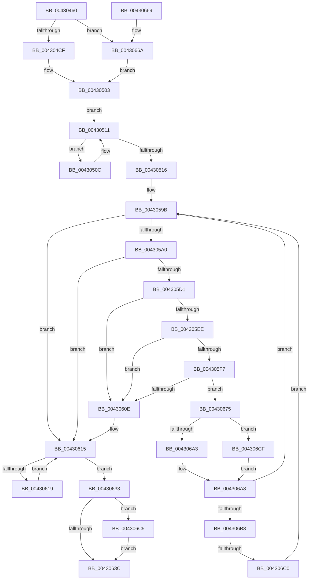

# PopSleepDeviceList

- RVA: `0x00430460`–`0x004306D6` (길이 `630` bytes)
- VA: `0x0000000140430460`
- 실행 섹션: `.text`
- PDB 이름 있음: `예`; PDB Function 태그: `예`
- unwind 정보 RVA: `0x000A208C`
- 디코드: `163`개 명령, `630/630` bytes 표시
- 미해석 바이트: `0` (있으면 어셈블리에 `.byte`로 보존)

> 이 문서는 커널 이미지의 기계어와 PDB 기호를 분석해 생성했습니다. 4번과 5번은 함수 원형과 자료형을 바이너리 사용 방식에서 추정한 C 해석이며 원본 소스 복구 결과는 아닙니다.

## 1. Dependencies

- 직접 호출 지점: **9**; 고유 호출 대상: **9**
- 직접 호출자로 확인된 함수: **1**
- RIP 상대 이미지 참조: **4**

### Outgoing calls
- `0x004304FB` → [PopPushPowerStateTransitionRecordWithCallback](PopPushPowerStateTransitionRecordWithCallback_function_00430A04.md) (function, `0x00430A04`)
- `0x004305C3` → [KeWaitForMultipleObjects](../20/KeWaitForMultipleObjects_function_0020D110.md) (function, `0x0020D110`)
- `0x004305E0` → [KeAcquireInStackQueuedSpinLock](../27/KeAcquireInStackQueuedSpinLock_function_002757A0.md) (function, `0x002757A0`)
- `0x0043062A` → [KeWaitForSingleObject](../20/KeWaitForSingleObject_function_0020E6B0.md) (function, `0x0020E6B0`)
- `0x00430687` → [KeReleaseInStackQueuedSpinLock](../34/KeReleaseInStackQueuedSpinLock_function_00342CE0.md) (function, `0x00342CE0`)
- `0x00430694` → [PopIsNotifyForDirectedPowerTransition](PopIsNotifyForDirectedPowerTransition_function_004306DC.md) (function, `0x004306DC`)
- `0x004306A3` → [PopIssueDirectedPowerTransition](../../page/AD/PopIssueDirectedPowerTransition_function_00AD158C.md) (function, `0x00AD158C`)
- `0x004306C5` → [PoDelistPowerStateTransitionBlocker](../../pagelk/B7/PoDelistPowerStateTransitionBlocker_function_00B795D4.md) (function, `0x00B795D4`)
- `0x004306CF` → [PopNotifyDevice](../../pagelk/B7/PopNotifyDevice_function_00B7DAAC.md) (function, `0x00B7DAAC`)

### Direct callers
- [PoBroadcastSystemState](../../pagelk/B7/PoBroadcastSystemState_function_00B761B0.md) at `0x00B76564`

### Static image references
- `0x00430490` → RVA `0x00F0BCC4` (`.data`; read)
- `0x004304EF` → RVA `0x00B70B40` (`PopBroadcastBlameBugcheckCallback`; read)
- `0x004305D1` → RVA `0x00F0BCD0` (`.data`; read)
- `0x004306A8` → RVA `0x00F0CF0C` (`.data`; read)

## 2. Other-region calls and transfers

- 다른 실행 섹션으로 향하는 call: **3**
  - `0x004306A3` → [PopIssueDirectedPowerTransition](../../page/AD/PopIssueDirectedPowerTransition_function_00AD158C.md) (`.text` → `PAGE`)
  - `0x004306C5` → [PoDelistPowerStateTransitionBlocker](../../pagelk/B7/PoDelistPowerStateTransitionBlocker_function_00B795D4.md) (`.text` → `PAGELK`)
  - `0x004306CF` → [PopNotifyDevice](../../pagelk/B7/PopNotifyDevice_function_00B7DAAC.md) (`.text` → `PAGELK`)
- call이 아닌 외부 분기/꼬리 이동: **1**
  - `0x004306BA` → [sub_006EE846](../6E/Unknown_function_006EE846.md) (`tail-transfer`)

## 3. Assembly (complete function range)

```asm
00430460  48 8B C4                        mov rax, rsp
00430463  48 89 58 08                     mov qword ptr [rax + 8], rbx
00430467  48 89 70 10                     mov qword ptr [rax + 0x10], rsi
0043046B  48 89 78 18                     mov qword ptr [rax + 0x18], rdi
0043046F  55                              push rbp
00430470  41 54                           push r12
00430472  41 55                           push r13
00430474  41 56                           push r14
00430476  41 57                           push r15
00430478  48 8D 68 A1                     lea rbp, [rax - 0x5f]
0043047C  48 81 EC C0 00 00 00            sub rsp, 0xc0
00430483  44 8B 7A 04                     mov r15d, dword ptr [rdx + 4]
00430487  45 33 ED                        xor r13d, r13d
0043048A  33 C0                           xor eax, eax
0043048C  44 88 6D BA                     mov byte ptr [rbp - 0x46], r13b
00430490  F7 05 2A B8 AD 00 00 00 80 00   test dword ptr [rip + 0xadb82a], 0x800000
0043049A  0F 57 C0                        xorps xmm0, xmm0
0043049D  4C 8B F2                        mov r14, rdx
004304A0  44 88 6D D0                     mov byte ptr [rbp - 0x30], r13b
004304A4  48 8B F9                        mov rdi, rcx
004304A7  44 88 6D D2                     mov byte ptr [rbp - 0x2e], r13b
004304AB  44 89 6D EB                     mov dword ptr [rbp - 0x15], r13d
004304AF  41 8B DD                        mov ebx, r13d
004304B2  0F 11 45 1F                     movups xmmword ptr [rbp + 0x1f], xmm0
004304B6  48 89 45 2F                     mov qword ptr [rbp + 0x2f], rax
004304BA  41 8B F5                        mov esi, r13d
004304BD  44 88 6D F0                     mov byte ptr [rbp - 0x10], r13b
004304C1  44 88 6D F2                     mov byte ptr [rbp - 0xe], r13b
004304C5  44 89 6D 0B                     mov dword ptr [rbp + 0xb], r13d
004304C9  0F 85 9B 01 00 00               jne 0x14043066a
004304CF  65 48 8B 14 25 88 01 00 00      mov rdx, qword ptr gs:[0x188]
004304D8  45 8D 4D 02                     lea r9d, [r13 + 2]
004304DC  65 48 8B 04 25 88 01 00 00      mov rax, qword ptr gs:[0x188]
004304E5  4C 8B C7                        mov r8, rdi
004304E8  48 8B 88 B8 00 00 00            mov rcx, qword ptr [rax + 0xb8]
004304EF  48 8D 05 4A 06 74 00            lea rax, [rip + 0x74064a]
004304F6  48 89 44 24 20                  mov qword ptr [rsp + 0x20], rax
004304FB  E8 04 05 00 00                  call 0x140430a04
00430500  44 8B E0                        mov r12d, eax
00430503  49 83 C6 18                     add r14, 0x18
00430507  49 8B 06                        mov rax, qword ptr [r14]
0043050A  EB 05                           jmp 0x140430511
0043050C  48 8B 00                        mov rax, qword ptr [rax]
0043050F  FF C6                           inc esi
00430511  49 3B C6                        cmp rax, r14
00430514  75 F6                           jne 0x14043050c
00430516  48 8D 45 BF                     lea rax, [rbp - 0x41]
0043051A  66 C7 45 B7 01 00               mov word ptr [rbp - 0x49], 1
00430520  48 89 45 C7                     mov qword ptr [rbp - 0x39], rax
00430524  48 8D 45 BF                     lea rax, [rbp - 0x41]
00430528  48 89 45 BF                     mov qword ptr [rbp - 0x41], rax
0043052C  48 8D 45 F7                     lea rax, [rbp - 9]
00430530  48 89 45 FF                     mov qword ptr [rbp - 1], rax
00430534  48 8D 45 F7                     lea rax, [rbp - 9]
00430538  48 89 45 F7                     mov qword ptr [rbp - 9], rax
0043053C  48 8D 45 D7                     lea rax, [rbp - 0x29]
00430540  48 89 45 DF                     mov qword ptr [rbp - 0x21], rax
00430544  48 8D 45 D7                     lea rax, [rbp - 0x29]
00430548  48 89 45 D7                     mov qword ptr [rbp - 0x29], rax
0043054C  48 8D 45 B7                     lea rax, [rbp - 0x49]
00430550  48 89 47 18                     mov qword ptr [rdi + 0x18], rax
00430554  48 8D 45 EF                     lea rax, [rbp - 0x11]
00430558  48 89 47 20                     mov qword ptr [rdi + 0x20], rax
0043055C  48 8D 45 CF                     lea rax, [rbp - 0x31]
00430560  48 89 47 28                     mov qword ptr [rdi + 0x28], rax
00430564  48 8D 45 B7                     lea rax, [rbp - 0x49]
00430568  48 89 45 0F                     mov qword ptr [rbp + 0xf], rax
0043056C  48 8D 45 EF                     lea rax, [rbp - 0x11]
00430570  48 89 45 17                     mov qword ptr [rbp + 0x17], rax
00430574  C6 45 B9 06                     mov byte ptr [rbp - 0x47], 6
00430578  44 89 6D BB                     mov dword ptr [rbp - 0x45], r13d
0043057C  C6 45 EF 05                     mov byte ptr [rbp - 0x11], 5
00430580  C6 45 F1 08                     mov byte ptr [rbp - 0xf], 8
00430584  89 75 F3                        mov dword ptr [rbp - 0xd], esi
00430587  44 89 7D 07                     mov dword ptr [rbp + 7], r15d
0043058B  C6 45 CF 05                     mov byte ptr [rbp - 0x31], 5
0043058F  C6 45 D1 08                     mov byte ptr [rbp - 0x2f], 8
00430593  44 89 6D D3                     mov dword ptr [rbp - 0x2d], r13d
00430597  44 89 7D E7                     mov dword ptr [rbp - 0x19], r15d
0043059B  45 85 FF                        test r15d, r15d
0043059E  7E 75                           jle 0x140430615
004305A0  45 33 C9                        xor r9d, r9d
004305A3  4C 89 6C 24 38                  mov qword ptr [rsp + 0x38], r13
004305A8  4C 89 6C 24 30                  mov qword ptr [rsp + 0x30], r13
004305AD  48 8D 55 0F                     lea rdx, [rbp + 0xf]
004305B1  44 88 6C 24 28                  mov byte ptr [rsp + 0x28], r13b
004305B6  44 88 6C 24 20                  mov byte ptr [rsp + 0x20], r13b
004305BB  45 8D 41 01                     lea r8d, [r9 + 1]
004305BF  41 8D 49 02                     lea ecx, [r9 + 2]
004305C3  E8 48 CB DD FF                  call 0x14020d110
004305C8  44 39 AF C0 01 00 00            cmp dword ptr [rdi + 0x1c0], r13d
004305CF  7C 44                           jl 0x140430615
004305D1  48 8B 0D F8 B6 AD 00            mov rcx, qword ptr [rip + 0xadb6f8]
004305D8  48 8D 55 1F                     lea rdx, [rbp + 0x1f]
004305DC  48 83 C1 08                     add rcx, 8
004305E0  E8 BB 51 E4 FF                  call 0x1402757a0
004305E5  49 8B 36                        mov rsi, qword ptr [r14]
004305E8  4C 39 76 08                     cmp qword ptr [rsi + 8], r14
004305EC  75 20                           jne 0x14043060e
004305EE  48 8B 06                        mov rax, qword ptr [rsi]
004305F1  48 39 70 08                     cmp qword ptr [rax + 8], rsi
004305F5  75 17                           jne 0x14043060e
004305F7  49 89 06                        mov qword ptr [r14], rax
004305FA  4C 89 70 08                     mov qword ptr [rax + 8], r14
004305FE  48 8D 87 B0 01 00 00            lea rax, [rdi + 0x1b0]
00430605  48 8B 48 08                     mov rcx, qword ptr [rax + 8]
00430609  48 39 01                        cmp qword ptr [rcx], rax
0043060C  74 67                           je 0x140430675
0043060E  B9 03 00 00 00                  mov ecx, 3
00430613  CD 29                           int 0x29
00430615  85 DB                           test ebx, ebx
00430617  7E 1A                           jle 0x140430633
00430619  45 33 C9                        xor r9d, r9d
0043061C  4C 89 6C 24 20                  mov qword ptr [rsp + 0x20], r13
00430621  45 33 C0                        xor r8d, r8d
00430624  48 8D 4D CF                     lea rcx, [rbp - 0x31]
00430628  33 D2                           xor edx, edx
0043062A  E8 81 E0 DD FF                  call 0x14020e6b0
0043062F  FF CB                           dec ebx
00430631  EB E2                           jmp 0x140430615
00430633  45 85 E4                        test r12d, r12d
00430636  0F 89 89 00 00 00               jns 0x1404306c5
0043063C  4C 8D 9C 24 C0 00 00 00         lea r11, [rsp + 0xc0]
00430644  4C 89 6F 18                     mov qword ptr [rdi + 0x18], r13
00430648  49 8B 5B 30                     mov rbx, qword ptr [r11 + 0x30]
0043064C  49 8B 73 38                     mov rsi, qword ptr [r11 + 0x38]
00430650  4C 89 6F 20                     mov qword ptr [rdi + 0x20], r13
00430654  4C 89 6F 28                     mov qword ptr [rdi + 0x28], r13
00430658  49 8B 7B 40                     mov rdi, qword ptr [r11 + 0x40]
0043065C  49 8B E3                        mov rsp, r11
0043065F  41 5F                           pop r15
00430661  41 5E                           pop r14
00430663  41 5D                           pop r13
00430665  41 5C                           pop r12
00430667  5D                              pop rbp
00430668  C3                              ret
00430669  CC                              int3
0043066A  41 BC 2D 00 00 C0               mov r12d, 0xc000002d
00430670  E9 8E FE FF FF                  jmp 0x140430503
00430675  48 89 4E 08                     mov qword ptr [rsi + 8], rcx
00430679  48 89 06                        mov qword ptr [rsi], rax
0043067C  48 89 31                        mov qword ptr [rcx], rsi
0043067F  48 8D 4D 1F                     lea rcx, [rbp + 0x1f]
00430683  48 89 70 08                     mov qword ptr [rax + 8], rsi
00430687  E8 54 26 F1 FF                  call 0x140342ce0
0043068C  48 8B CE                        mov rcx, rsi
0043068F  41 FF CF                        dec r15d
00430692  FF C3                           inc ebx
00430694  E8 43 00 00 00                  call 0x1404306dc
00430699  48 8B D6                        mov rdx, rsi
0043069C  48 8B CF                        mov rcx, rdi
0043069F  84 C0                           test al, al
004306A1  74 2C                           je 0x1404306cf
004306A3  E8 E4 0E 6A 00                  call 0x140ad158c
004306A8  F7 05 5A C8 AD 00 00 00 08 00   test dword ptr [rip + 0xadc85a], 0x80000
004306B2  0F 84 E3 FE FF FF               je 0x14043059b
004306B8  85 DB                           test ebx, ebx
004306BA  0F 8F 86 E1 2B 00               jg 0x1406ee846
004306C0  E9 D6 FE FF FF                  jmp 0x14043059b
004306C5  E8 0A 8F 74 00                  call 0x140b795d4
004306CA  E9 6D FF FF FF                  jmp 0x14043063c
004306CF  E8 D8 D3 74 00                  call 0x140b7daac
004306D4  EB D2                           jmp 0x1404306a8
```

## 4. C-style interpretation (structured pseudocode)

```c
__int64 __fastcall PopSleepDeviceList(__int64 a1, __int64 a2)
{
    __int64 result;
    __int64 v_r13;
    __int64 v_r14;
    __int64 v_r15;
    __int64 v_rbx;
    __int64 v_rsi;
    __int64 v_rsp;
    unsigned __int64 v_stack_m28;
    unsigned __int64 v_stack_mB0;
    unsigned __int64 v_stack_mB8;
    unsigned __int8 v_stack_mC0;
    unsigned __int64 v_stack_mC8;

    *(unsigned __int64 *)(v_rsp + 8) = v_rbx;
    *(unsigned __int64 *)(v_rsp + 16) = v_rsi;
    *(unsigned __int64 *)(v_rsp + 24) = v_rdi;
    v_rsp = (v_rsp) - (192);
    v_r13 = 0;
    result = 0;
    *(unsigned __int8 *)(v_rsp - 95 - 70) = 0;
    *(unsigned __int8 *)(v_rsp - 95 - 48) = 0;
    *(unsigned __int8 *)(v_rsp - 95 - 46) = 0;
    *(unsigned int *)(v_rsp - 95 - 21) = 0;
    *(unsigned __int64 *)(v_rsp - 95 + 31) = v_xmm0;
    *(unsigned __int64 *)(v_rsp - 95 + 47) = 0;
    *(unsigned __int8 *)(v_rsp - 95 - 16) = 0;
    *(unsigned __int8 *)(v_rsp - 95 - 14) = 0;
    *(unsigned int *)(v_rsp - 95 + 11) = 0;
    if (((*(unsigned int *)(v_rip + 11384874)) & (0x800000ULL)) != 0) goto loc_0043066A;
    v_stack_mC8 = v_rip + 7603786;
    result = PopPushPowerStateTransitionRecordWithCallback(*(unsigned __int64 *)(*(unsigned __int64 *)(gs_base + (0 + 392)) + 184), *(unsigned __int64 *)(gs_base + (0 + 392)), a1, v_r13 + 2);
loc_00430503:
    v_r14 = (a2) + (24);
    goto loc_00430511;
loc_0043050C:
    v_rsi = (unsigned int)((0) + 1);
loc_00430511:
    if ((*(unsigned __int64 *)(*(unsigned __int64 *)(v_r14))) != v_r14) goto loc_0043050C;
    *(unsigned __int16 *)(v_rsp - 95 - 73) = 1;
    *(unsigned __int64 *)(v_rsp - 95 - 57) = v_rsp - 95 - 65;
    *(unsigned __int64 *)(v_rsp - 95 - 65) = v_rsp - 95 - 65;
    *(unsigned __int64 *)(v_rsp - 95 - 1) = v_rsp - 95 - 9;
    *(unsigned __int64 *)(v_rsp - 95 - 9) = v_rsp - 95 - 9;
    *(unsigned __int64 *)(v_rsp - 95 - 33) = v_rsp - 95 - 41;
    *(unsigned __int64 *)(v_rsp - 95 - 41) = v_rsp - 95 - 41;
    *(unsigned __int64 *)(a1 + 24) = v_rsp - 95 - 73;
    *(unsigned __int64 *)(a1 + 32) = v_rsp - 95 - 17;
    *(unsigned __int64 *)(a1 + 40) = v_rsp - 95 - 49;
    *(unsigned __int64 *)(v_rsp - 95 + 15) = v_rsp - 95 - 73;
    *(unsigned __int64 *)(v_rsp - 95 + 23) = v_rsp - 95 - 17;
    *(unsigned __int8 *)(v_rsp - 95 - 71) = 6;
    *(unsigned int *)(v_rsp - 95 - 69) = 0;
    *(unsigned __int8 *)(v_rsp - 95 - 17) = 5;
    *(unsigned __int8 *)(v_rsp - 95 - 15) = 8;
    *(unsigned int *)(v_rsp - 95 - 13) = (unsigned int)(v_rsi);
    *(unsigned int *)(v_rsp - 95 + 7) = (unsigned int)((unsigned int)(*(unsigned int *)(a2 + 4)));
    *(unsigned __int8 *)(v_rsp - 95 - 49) = 5;
    *(unsigned __int8 *)(v_rsp - 95 - 47) = 8;
    *(unsigned int *)(v_rsp - 95 - 45) = 0;
    *(unsigned int *)(v_rsp - 95 - 25) = (unsigned int)((unsigned int)(*(unsigned int *)(a2 + 4)));
loc_0043059B:
    if (condition_is_less_or_equal) goto loc_00430615;
    a4 = 0;
    v_stack_mB0 = 0;
    v_stack_mB8 = 0;
    v_stack_mC0 = 0;
    v_stack_mC8 = 0;
    result = KeWaitForMultipleObjects(a4 + 2, v_rsp - 95 + 15, a4 + 1, a4);
    if ((*(unsigned int *)(a1 + 448)) < 0) goto loc_00430615;
    a1 = (*(unsigned __int64 *)(v_rip + 11384568)) + (8);
    result = KeAcquireInStackQueuedSpinLock(a1, v_rsp - 95 + 31, a4 + 1, a4);
    if ((*(unsigned __int64 *)(*(unsigned __int64 *)(v_r14) + 8)) != v_r14) goto loc_0043060E;
    if ((*(unsigned __int64 *)(*(unsigned __int64 *)(*(unsigned __int64 *)(v_r14)) + 8)) != (*(unsigned __int64 *)(v_r14))) goto loc_0043060E;
    *(unsigned __int64 *)(v_r14) = *(unsigned __int64 *)(*(unsigned __int64 *)(v_r14));
    *(unsigned __int64 *)(*(unsigned __int64 *)(*(unsigned __int64 *)(v_r14)) + 8) = v_r14;
    if ((*(unsigned __int64 *)(*(unsigned __int64 *)(a1 + 432 + 8))) == (a1 + 432)) goto loc_00430675;
loc_0043060E:
loc_00430615:
    if (condition_is_less_or_equal) goto loc_00430633;
    a4 = 0;
    v_stack_mC8 = 0;
    a3 = 0;
    a2 = 0;
    result = KeWaitForSingleObject(v_rsp - 95 - 49, a2, a3, a4);
    v_rbx = (unsigned int)((0) - 1);
    goto loc_00430615;
loc_00430633:
    if (!sign_flag) goto loc_004306C5;
loc_0043063C:
    *(unsigned __int64 *)(a1 + 24) = 0;
    *(unsigned __int64 *)(a1 + 32) = 0;
    *(unsigned __int64 *)(a1 + 40) = 0;
    return result;
loc_0043066A:
    goto loc_00430503;
loc_00430675:
    *(unsigned __int64 *)(*(unsigned __int64 *)(v_stack_m28 + 56) + 8) = v_rsp - 95 - 49;
    *(unsigned __int64 *)(*(unsigned __int64 *)(v_stack_m28 + 56)) = result;
    *(unsigned __int64 *)(v_rsp - 95 - 49) = *(unsigned __int64 *)(v_stack_m28 + 56);
    *(unsigned __int64 *)(result + 8) = *(unsigned __int64 *)(v_stack_m28 + 56);
    result = KeReleaseInStackQueuedSpinLock(v_rsp - 95 + 31, a2, a3, a4);
    v_r15 = (unsigned int)(((unsigned int)(*(unsigned int *)(a2 + 4))) - 1);
    v_rbx = (unsigned int)((*(unsigned __int64 *)(v_stack_m28 + 48)) + 1);
    result = PopIsNotifyForDirectedPowerTransition(*(unsigned __int64 *)(v_stack_m28 + 56), a2, a3, a4);
    if ((unsigned __int8)(result) == 0) goto loc_004306CF;
    result = PopIssueDirectedPowerTransition(*(unsigned __int64 *)(v_stack_m28 + 64), *(unsigned __int64 *)(v_stack_m28 + 56), a3, a4);
loc_004306A8:
    if (((*(unsigned int *)(v_rip + 11389018)) & (0x80000ULL)) == 0) goto loc_0043059B;
    goto loc_0043059B;
loc_004306C5:
    result = PoDelistPowerStateTransitionBlocker(*(unsigned __int64 *)(v_stack_m28 + 64), *(unsigned __int64 *)(v_stack_m28 + 56), a3, a4);
    goto loc_0043063C;
loc_004306CF:
    result = PopNotifyDevice(*(unsigned __int64 *)(v_stack_m28 + 64), *(unsigned __int64 *)(v_stack_m28 + 56), a3, a4);
    goto loc_004306A8;
}
```

## 5. (Beta) C Style

```c
int64_t PopSleepDeviceList(void *Arg1, void *Arg2)
{
    uint8_t *arg1 = (uint8_t *)Arg1;
    uint8_t *arg2 = (uint8_t *)Arg2;

    int64_t result;
    int64_t local_r13;
    int64_t local_r14;
    int64_t local_r15;
    int64_t local_rbx;
    int64_t local_rsi;
    int64_t local_rsp;
    uint64_t v_stack_m28;
    uint64_t v_stack_mB0;
    uint64_t v_stack_mB8;
    uint8_t v_stack_mC0;
    uint64_t v_stack_mC8;

    *(uint64_t *)(local_rsp + 0x8) = local_rbx;
    *(uint64_t *)(local_rsp + 0x10) = local_rsi;
    *(uint64_t *)(local_rsp + 0x18) = local_rdi;
    local_rsp = (local_rsp) - (192);
    local_r13 = 0;
    result = 0;
    *(uint8_t *)(local_rsp - 0x5F - 0x46) = 0;
    *(uint8_t *)(local_rsp - 0x5F - 0x30) = 0;
    *(uint8_t *)(local_rsp - 0x5F - 0x2E) = 0;
    *(uint32_t *)(local_rsp - 0x5F - 0x15) = 0;
    *(uint64_t *)(local_rsp - 0x5F + 0x1F) = v_xmm0;
    *(uint64_t *)(local_rsp - 0x5F + 0x2F) = 0;
    *(uint8_t *)(local_rsp - 0x5F - 0x10) = 0;
    *(uint8_t *)(local_rsp - 0x5F - 0xE) = 0;
    *(uint32_t *)(local_rsp - 0x5F + 0xB) = 0;
    if (((*(uint32_t *)(v_rip + 0xADB82A)) & (0x800000ULL)) != 0) goto loc_0043066A;
    v_stack_mC8 = v_rip + 7603786;
    result = PopPushPowerStateTransitionRecordWithCallback(*(uint64_t *)(*(uint64_t *)(gs_base + (0 + 0x188)) + 0xB8), *(uint64_t *)(gs_base + (0 + 0x188)), Arg1, local_r13 + 2);
loc_00430503:
    local_r14 = (Arg2) + (24);
    goto loc_00430511;
loc_0043050C:
    local_rsi = (uint32_t)((0) + 1);
loc_00430511:
    if ((*(uint64_t *)(*(uint64_t *)(local_r14))) != local_r14) goto loc_0043050C;
    *(uint16_t *)(local_rsp - 0x5F - 0x49) = 1;
    *(uint64_t *)(local_rsp - 0x5F - 0x39) = local_rsp - 95 - 65;
    *(uint64_t *)(local_rsp - 0x5F - 0x41) = local_rsp - 95 - 65;
    *(uint64_t *)(local_rsp - 0x5F - 0x1) = local_rsp - 95 - 9;
    *(uint64_t *)(local_rsp - 0x5F - 0x9) = local_rsp - 95 - 9;
    *(uint64_t *)(local_rsp - 0x5F - 0x21) = local_rsp - 95 - 41;
    *(uint64_t *)(local_rsp - 0x5F - 0x29) = local_rsp - 95 - 41;
    *(uint64_t *)(arg1 + 0x18) = local_rsp - 95 - 73;
    *(uint64_t *)(arg1 + 0x20) = local_rsp - 95 - 17;
    *(uint64_t *)(arg1 + 0x28) = local_rsp - 95 - 49;
    *(uint64_t *)(local_rsp - 0x5F + 0xF) = local_rsp - 95 - 73;
    *(uint64_t *)(local_rsp - 0x5F + 0x17) = local_rsp - 95 - 17;
    *(uint8_t *)(local_rsp - 0x5F - 0x47) = 6;
    *(uint32_t *)(local_rsp - 0x5F - 0x45) = 0;
    *(uint8_t *)(local_rsp - 0x5F - 0x11) = 5;
    *(uint8_t *)(local_rsp - 0x5F - 0xF) = 8;
    *(uint32_t *)(local_rsp - 0x5F - 0xD) = (uint32_t)(local_rsi);
    *(uint32_t *)(local_rsp - 0x5F + 0x7) = (uint32_t)((uint32_t)(*(uint32_t *)(arg2 + 0x4)));
    *(uint8_t *)(local_rsp - 0x5F - 0x31) = 5;
    *(uint8_t *)(local_rsp - 0x5F - 0x2F) = 8;
    *(uint32_t *)(local_rsp - 0x5F - 0x2D) = 0;
    *(uint32_t *)(local_rsp - 0x5F - 0x19) = (uint32_t)((uint32_t)(*(uint32_t *)(arg2 + 0x4)));
loc_0043059B:
    if (condition_is_less_or_equal) goto loc_00430615;
    a4 = 0;
    v_stack_mB0 = 0;
    v_stack_mB8 = 0;
    v_stack_mC0 = 0;
    v_stack_mC8 = 0;
    result = KeWaitForMultipleObjects(a4 + 2, local_rsp - 95 + 15, a4 + 1, a4);
    if ((*(uint32_t *)(arg1 + 0x1C0)) < 0) goto loc_00430615;
    Arg1 = (*(uint64_t *)(v_rip + 0xADB6F8)) + (8);
    result = KeAcquireInStackQueuedSpinLock(Arg1, local_rsp - 95 + 31, a4 + 1, a4);
    if ((*(uint64_t *)(*(uint64_t *)(local_r14) + 0x8)) != local_r14) goto loc_0043060E;
    if ((*(uint64_t *)(*(uint64_t *)(*(uint64_t *)(local_r14)) + 0x8)) != (*(uint64_t *)(local_r14))) goto loc_0043060E;
    *(uint64_t *)(local_r14) = *(uint64_t *)(*(uint64_t *)(local_r14));
    *(uint64_t *)(*(uint64_t *)(*(uint64_t *)(local_r14)) + 0x8) = local_r14;
    if ((*(uint64_t *)(*(uint64_t *)(arg1 + 0x1B0 + 0x8))) == (Arg1 + 432)) goto loc_00430675;
loc_0043060E:
loc_00430615:
    if (condition_is_less_or_equal) goto loc_00430633;
    a4 = 0;
    v_stack_mC8 = 0;
    a3 = 0;
    Arg2 = 0;
    result = KeWaitForSingleObject(local_rsp - 95 - 49, Arg2, a3, a4);
    local_rbx = (uint32_t)((0) - 1);
    goto loc_00430615;
loc_00430633:
    if (!sign_flag) goto loc_004306C5;
loc_0043063C:
    *(uint64_t *)(arg1 + 0x18) = 0;
    *(uint64_t *)(arg1 + 0x20) = 0;
    *(uint64_t *)(arg1 + 0x28) = 0;
    return result;
loc_0043066A:
    goto loc_00430503;
loc_00430675:
    *(uint64_t *)(*(uint64_t *)(v_stack_m28 + 0x38) + 0x8) = local_rsp - 95 - 49;
    *(uint64_t *)(*(uint64_t *)(v_stack_m28 + 0x38)) = result;
    *(uint64_t *)(local_rsp - 0x5F - 0x31) = *(uint64_t *)(v_stack_m28 + 0x38);
    *(uint64_t *)(result + 0x8) = *(uint64_t *)(v_stack_m28 + 0x38);
    result = KeReleaseInStackQueuedSpinLock(local_rsp - 95 + 31, Arg2, a3, a4);
    local_r15 = (uint32_t)(((uint32_t)(*(uint32_t *)(arg2 + 0x4))) - 1);
    local_rbx = (uint32_t)((*(uint64_t *)(v_stack_m28 + 0x30)) + 1);
    result = PopIsNotifyForDirectedPowerTransition(*(uint64_t *)(v_stack_m28 + 0x38), Arg2, a3, a4);
    if ((uint8_t)(result) == 0) goto loc_004306CF;
    result = PopIssueDirectedPowerTransition(*(uint64_t *)(v_stack_m28 + 0x40), *(uint64_t *)(v_stack_m28 + 0x38), a3, a4);
loc_004306A8:
    if (((*(uint32_t *)(v_rip + 0xADC85A)) & (0x80000ULL)) == 0) goto loc_0043059B;
    goto loc_0043059B;
loc_004306C5:
    result = PoDelistPowerStateTransitionBlocker(*(uint64_t *)(v_stack_m28 + 0x40), *(uint64_t *)(v_stack_m28 + 0x38), a3, a4);
    goto loc_0043063C;
loc_004306CF:
    result = PopNotifyDevice(*(uint64_t *)(v_stack_m28 + 0x40), *(uint64_t *)(v_stack_m28 + 0x38), a3, a4);
    goto loc_004306A8;
}
```

### 관측된 메모리 오프셋

구조체 형식이 확인되지 않은 접근은 인자 기준의 오프셋으로만 기록했습니다.

| 기준 인자 | 오프셋 표현 | 폭 (bit) | 접근 |
|---|---:|---:|---|
| `Arg1` | `+ 0x8` | `64` | `R` |
| `Arg1` | `+ 0x8` | `64` | `W` |
| `Arg1` | `+ 0x18` | `64` | `W` |
| `Arg1` | `+ 0x20` | `64` | `W` |
| `Arg1` | `+ 0x28` | `64` | `W` |
| `Arg1` | `+ 0x1B0` | `64` | `R` |
| `Arg1` | `+ 0x1C0` | `32` | `R` |
| `Arg2` | `+ 0x0` | `64` | `R` |
| `Arg2` | `+ 0x0` | `64` | `W` |
| `Arg2` | `+ 0x4` | `32` | `R` |

## 6. Execution-region graph

[열기: 2D/3D 그래프와 함수 탐색 컨트롤 패널](../../../control-panel.html?section=text&rva=0x00430460&view=graph)

- 2D 그래프는 위에서 아래로 흐르고, 3D 그래프는 빈 공간을 드래그해 회전합니다. Shift+드래그는 이동, 휠은 확대·축소, 함수 노드 선택은 대상 보고서 이동입니다.

### Static fallback


