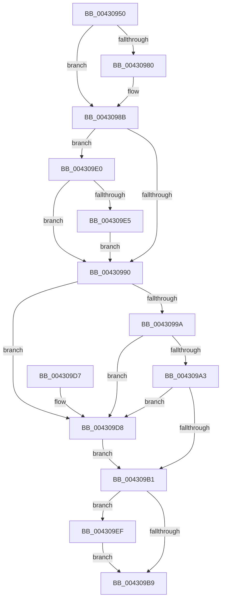

# PopThermalCoolingPowerSettingCallback

- RVA: `0x00430950`–`0x004309FC` (길이 `172` bytes)
- VA: `0x0000000140430950`
- 실행 섹션: `.text`
- PDB 이름 있음: `예`; PDB Function 태그: `아니요`
- unwind 정보 RVA: `0x0008D44C`
- 디코드: `45`개 명령, `172/172` bytes 표시
- 미해석 바이트: `0` (있으면 어셈블리에 `.byte`로 보존)

> 이 문서는 커널 이미지의 기계어와 PDB 기호를 분석해 생성했습니다. 4번과 5번은 함수 원형과 자료형을 바이너리 사용 방식에서 추정한 C 해석이며 원본 소스 복구 결과는 아닙니다.

## 1. Dependencies

- 직접 호출 지점: **3**; 고유 호출 대상: **3**
- 직접 호출자로 확인된 함수: **0**
- RIP 상대 이미지 참조: **10**

### Outgoing calls
- `0x0043096F` → [PopAcquireRwLockExclusive](PopAcquireRwLockExclusive_function_00430B44.md) (function, `0x00430B44`)
- `0x004309C0` → [PopReleaseRwLock](../2D/PopReleaseRwLock_function_002DFBBC.md) (function, `0x002DFBBC`)
- `0x004309F5` → [PopThermalZoneUpdateCoolingPolicy](../../page/AB/PopThermalZoneUpdateCoolingPolicy_function_00AB1584.md) (function, `0x00AB1584`)

### Direct callers
- 이 함수 시작 RVA로 연결되는 직접 call은 확인되지 않았습니다. 간접 호출은 완전히 역산할 수 없습니다.

### Static image references
- `0x00430965` → RVA `0x00F0C710` (`.data`; read)
- `0x00430974` → RVA `0x00014598` (`.rdata`; read)
- `0x00430980` → RVA `0x000145A0` (`.rdata`; read)
- `0x00430990` → RVA `0x00E673A0` (`.data`; read)
- `0x0043099A` → RVA `0x00E6739C` (`.data`; read)
- `0x004309A3` → RVA `0x00E67A50` (`.data`; read)
- `0x004309B1` → RVA `0x00E67848` (`.data`; read)
- `0x004309D8` → RVA `0x00F0CE48` (`.data`; read)
- `0x004309E7` → RVA `0x00F0CE48` (`.data`; write)
- `0x004309EF` → RVA `0x00E67848` (`.data`; write)

## 2. Other-region calls and transfers

- 다른 실행 섹션으로 향하는 call: **1**
  - `0x004309F5` → [PopThermalZoneUpdateCoolingPolicy](../../page/AB/PopThermalZoneUpdateCoolingPolicy_function_00AB1584.md) (`.text` → `PAGE`)
- 별도 외부 분기/꼬리 이동을 확인하지 못했습니다.

## 3. Assembly (complete function range)

```asm
00430950  48 89 5C 24 08                  mov qword ptr [rsp + 8], rbx
00430955  48 89 74 24 10                  mov qword ptr [rsp + 0x10], rsi
0043095A  57                              push rdi
0043095B  48 83 EC 20                     sub rsp, 0x20
0043095F  48 8B D9                        mov rbx, rcx
00430962  41 8B F8                        mov edi, r8d
00430965  48 8D 0D A4 BD AD 00            lea rcx, [rip + 0xadbda4]
0043096C  48 8B F2                        mov rsi, rdx
0043096F  E8 D0 01 00 00                  call 0x140430b44
00430974  4C 8B 0D 1D 3C BE FF            mov r9, qword ptr [rip - 0x41c3e3]
0043097B  4C 2B 0B                        sub r9, qword ptr [rbx]
0043097E  75 0B                           jne 0x14043098b
00430980  4C 8B 0D 19 3C BE FF            mov r9, qword ptr [rip - 0x41c3e7]
00430987  4C 2B 4B 08                     sub r9, qword ptr [rbx + 8]
0043098B  4D 85 C9                        test r9, r9
0043098E  74 50                           je 0x1404309e0
00430990  8B 05 0A 6A A3 00               mov eax, dword ptr [rip + 0xa36a0a]
00430996  85 C0                           test eax, eax
00430998  74 3E                           je 0x1404309d8
0043099A  80 3D FB 69 A3 00 00            cmp byte ptr [rip + 0xa369fb], 0
004309A1  74 35                           je 0x1404309d8
004309A3  83 3D A6 70 A3 00 00            cmp dword ptr [rip + 0xa370a6], 0
004309AA  B8 01 00 00 00                  mov eax, 1
004309AF  75 27                           jne 0x1404309d8
004309B1  3B 05 91 6E A3 00               cmp eax, dword ptr [rip + 0xa36e91]
004309B7  75 36                           jne 0x1404309ef
004309B9  48 8D 0D 50 BD AD 00            lea rcx, [rip + 0xadbd50]
004309C0  E8 F7 F1 EA FF                  call 0x1402dfbbc
004309C5  48 8B 5C 24 30                  mov rbx, qword ptr [rsp + 0x30]
004309CA  33 C0                           xor eax, eax
004309CC  48 8B 74 24 38                  mov rsi, qword ptr [rsp + 0x38]
004309D1  48 83 C4 20                     add rsp, 0x20
004309D5  5F                              pop rdi
004309D6  C3                              ret
004309D7  CC                              int3
004309D8  8B 05 6A C4 AD 00               mov eax, dword ptr [rip + 0xadc46a]
004309DE  EB D1                           jmp 0x1404309b1
004309E0  83 FF 04                        cmp edi, 4
004309E3  75 AB                           jne 0x140430990
004309E5  8B 06                           mov eax, dword ptr [rsi]
004309E7  89 05 5B C4 AD 00               mov dword ptr [rip + 0xadc45b], eax
004309ED  EB A1                           jmp 0x140430990
004309EF  89 05 53 6E A3 00               mov dword ptr [rip + 0xa36e53], eax
004309F5  E8 8A 0B 68 00                  call 0x140ab1584
004309FA  EB BD                           jmp 0x1404309b9
```

## 4. C-style interpretation (structured pseudocode)

```c
__int64 __fastcall PopThermalCoolingPowerSettingCallback(__int64 a1, __int64 a2, int a3)
{
    __int64 result;
    __int64 v_rsp;
    unsigned __int64 v_stack_p10;
    unsigned __int64 v_stack_p8;

    v_stack_p8 = v_rbx;
    v_stack_p10 = v_rsi;
    v_rsp = (v_rsp) - (32);
    result = PopAcquireRwLockExclusive(v_rip + 11386276, a2, a3, a4);
    a4 = (*(unsigned __int64 *)(v_rip - 4309987)) - (*(unsigned __int64 *)(a1));
    if (!(condition_is_not_equal)) {
        a4 = *(unsigned __int64 *)(v_rip - 4309991);
        a4 = (a4) - (*(unsigned __int64 *)(a1 + 8));
    }
    if (a4 == 0) goto loc_004309E0;
loc_00430990:
    if ((unsigned int)((unsigned int)(*(unsigned int *)(v_rip + 10709514))) == 0) goto loc_004309D8;
    if ((*(unsigned __int8 *)(v_rip + 10709499)) == 0) goto loc_004309D8;
    if ((*(unsigned int *)(v_rip + 10711206)) != 0) goto loc_004309D8;
loc_004309B1:
    if (1 != (*(unsigned int *)(v_rip + 10710673))) goto loc_004309EF;
loc_004309B9:
    result = PopReleaseRwLock(v_rip + 11386192, a2, a3, a4);
    result = 0;
    v_rsp = (v_rsp) + (32);
    return result;
loc_004309D8:
    goto loc_004309B1;
loc_004309E0:
    if (((unsigned int)((unsigned int)(a3))) != 4) goto loc_00430990;
    *(unsigned int *)(v_rip + 11387995) = (unsigned int)((unsigned int)(*(unsigned int *)(v_stack_p10)));
    goto loc_00430990;
loc_004309EF:
    *(unsigned int *)(v_rip + 10710611) = (unsigned int)((unsigned int)(*(unsigned int *)(v_stack_p10)));
    result = PopThermalZoneUpdateCoolingPolicy(v_rip + 11386192, a2, a3, a4);
    goto loc_004309B9;
}
```

## 5. (Beta) C Style

```c
int64_t PopThermalCoolingPowerSettingCallback(void *Arg1, void *Arg2, int32_t Arg3)
{
    uint8_t *arg1 = (uint8_t *)Arg1;
    uint8_t *arg2 = (uint8_t *)Arg2;

    int64_t result;
    int64_t local_rsp;
    uint64_t v_stack_p10;
    uint64_t v_stack_p8;

    v_stack_p8 = local_rbx;
    v_stack_p10 = local_rsi;
    local_rsp = (local_rsp) - (32);
    result = PopAcquireRwLockExclusive(v_rip + 11386276, Arg2, Arg3, a4);
    a4 = (*(uint64_t *)(v_rip - 0x41C3E3)) - (*(uint64_t *)(arg1));
    if (!(condition_is_not_equal)) {
        a4 = *(uint64_t *)(v_rip - 0x41C3E7);
        a4 = (a4) - (*(uint64_t *)(arg1 + 0x8));
    }
    if (a4 == 0) goto loc_004309E0;
loc_00430990:
    if ((uint32_t)((uint32_t)(*(uint32_t *)(v_rip + 0xA36A0A))) == 0) goto loc_004309D8;
    if ((*(uint8_t *)(v_rip + 0xA369FB)) == 0) goto loc_004309D8;
    if ((*(uint32_t *)(v_rip + 0xA370A6)) != 0) goto loc_004309D8;
loc_004309B1:
    if (1 != (*(uint32_t *)(v_rip + 0xA36E91))) goto loc_004309EF;
loc_004309B9:
    result = PopReleaseRwLock(v_rip + 11386192, Arg2, Arg3, a4);
    result = 0;
    local_rsp = (local_rsp) + (32);
    return result;
loc_004309D8:
    goto loc_004309B1;
loc_004309E0:
    if (((uint32_t)((uint32_t)(Arg3))) != 4) goto loc_00430990;
    *(uint32_t *)(v_rip + 0xADC45B) = (uint32_t)((uint32_t)(*(uint32_t *)(v_stack_p10)));
    goto loc_00430990;
loc_004309EF:
    *(uint32_t *)(v_rip + 0xA36E53) = (uint32_t)((uint32_t)(*(uint32_t *)(v_stack_p10)));
    result = PopThermalZoneUpdateCoolingPolicy(v_rip + 11386192, Arg2, Arg3, a4);
    goto loc_004309B9;
}
```

### 관측된 메모리 오프셋

구조체 형식이 확인되지 않은 접근은 인자 기준의 오프셋으로만 기록했습니다.

| 기준 인자 | 오프셋 표현 | 폭 (bit) | 접근 |
|---|---:|---:|---|
| `Arg1` | `+ 0x0` | `64` | `R` |
| `Arg1` | `+ 0x8` | `64` | `R` |
| `Arg2` | `+ 0x0` | `32` | `R` |

## 6. Execution-region graph

[열기: 2D/3D 그래프와 함수 탐색 컨트롤 패널](../../../control-panel.html?section=text&rva=0x00430950&view=graph)

- 2D 그래프는 위에서 아래로 흐르고, 3D 그래프는 빈 공간을 드래그해 회전합니다. Shift+드래그는 이동, 휠은 확대·축소, 함수 노드 선택은 대상 보고서 이동입니다.

### Static fallback


