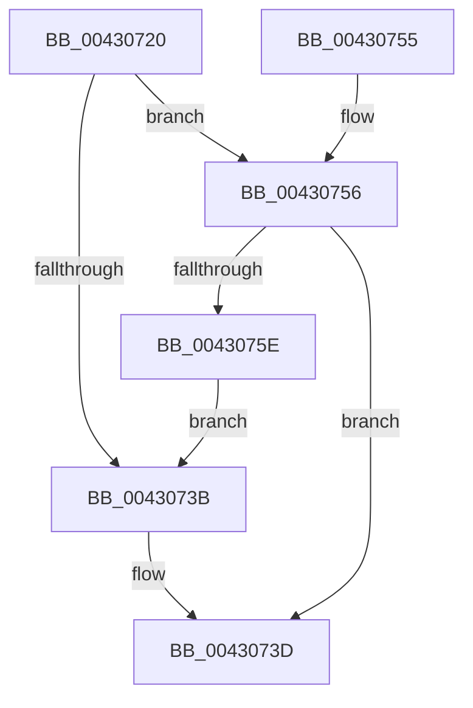

# PopThermalPollingPowerSettingCallback

- RVA: `0x00430720`–`0x00430760` (길이 `64` bytes)
- VA: `0x0000000140430720`
- 실행 섹션: `.text`
- PDB 이름 있음: `예`; PDB Function 태그: `아니요`
- unwind 정보 RVA: `0x0005F758`
- 디코드: `17`개 명령, `64/64` bytes 표시
- 미해석 바이트: `0` (있으면 어셈블리에 `.byte`로 보존)

> 이 문서는 커널 이미지의 기계어와 PDB 기호를 분석해 생성했습니다. 4번과 5번은 함수 원형과 자료형을 바이너리 사용 방식에서 추정한 C 해석이며 원본 소스 복구 결과는 아닙니다.

## 1. Dependencies

- 직접 호출 지점: **3**; 고유 호출 대상: **3**
- 직접 호출자로 확인된 함수: **0**
- RIP 상대 이미지 참조: **3**

### Outgoing calls
- `0x0043072B` → [PopAcquireRwLockExclusive](PopAcquireRwLockExclusive_function_00430B44.md) (function, `0x00430B44`)
- `0x0043073D` → [PopThermalUpdateTimerPolicy](PopThermalUpdateTimerPolicy_function_00430BEC.md) (function, `0x00430BEC`)
- `0x00430749` → [PopReleaseRwLock](../2D/PopReleaseRwLock_function_002DFBBC.md) (function, `0x002DFBBC`)

### Direct callers
- 이 함수 시작 RVA로 연결되는 직접 call은 확인되지 않았습니다. 간접 호출은 완전히 역산할 수 없습니다.

### Static image references
- `0x00430724` → RVA `0x00F0C710` (`.data`; read)
- `0x00430732` → RVA `0x00F0CE0C` (`.data`; read)
- `0x00430756` → RVA `0x00F0C720` (`.data`; read)

## 2. Other-region calls and transfers

- 다른 실행 섹션으로 향하는 call: **0**
- 별도 외부 분기/꼬리 이동을 확인하지 못했습니다.

## 3. Assembly (complete function range)

```asm
00430720  48 83 EC 28                     sub rsp, 0x28
00430724  48 8D 0D E5 BF AD 00            lea rcx, [rip + 0xadbfe5]
0043072B  E8 14 04 00 00                  call 0x140430b44
00430730  32 C9                           xor cl, cl
00430732  83 3D D3 C6 AD 00 01            cmp dword ptr [rip + 0xadc6d3], 1
00430739  74 1B                           je 0x140430756
0043073B  B1 01                           mov cl, 1
0043073D  E8 AA 04 00 00                  call 0x140430bec
00430742  48 8D 0D C7 BF AD 00            lea rcx, [rip + 0xadbfc7]
00430749  E8 6E F4 EA FF                  call 0x1402dfbbc
0043074E  33 C0                           xor eax, eax
00430750  48 83 C4 28                     add rsp, 0x28
00430754  C3                              ret
00430755  CC                              int3
00430756  38 0D C4 BF AD 00               cmp byte ptr [rip + 0xadbfc4], cl
0043075C  75 DF                           jne 0x14043073d
0043075E  EB DB                           jmp 0x14043073b
```

## 4. C-style interpretation (structured pseudocode)

```c
__int64 __fastcall PopThermalPollingPowerSettingCallback(void)
{
    __int64 result;
    __int64 v_rsp;

    v_rsp = (v_rsp) - (40);
    result = PopAcquireRwLockExclusive(v_rip + 11386853, a2, a3, a4);
    a1 = 0;
    if ((*(unsigned int *)(v_rip + 11388627)) == 1) goto loc_00430756;
loc_0043073B:
loc_0043073D:
    result = PopThermalUpdateTimerPolicy(1, a2, a3, a4);
    result = PopReleaseRwLock(v_rip + 11386823, a2, a3, a4);
    result = 0;
    v_rsp = (v_rsp) + (40);
    return result;
loc_00430756:
    if ((*(unsigned __int8 *)(v_rip + 11386820)) != ((unsigned __int8)(v_rip + 11386823))) goto loc_0043073D;
    goto loc_0043073B;
}
```

## 5. (Beta) C Style

```c
void PopThermalPollingPowerSettingCallback(void)
{
    int64_t result;
    int64_t local_rsp;

    local_rsp = (local_rsp) - (40);
    result = PopAcquireRwLockExclusive(v_rip + 11386853, a2, a3, a4);
    a1 = 0;
    if ((*(uint32_t *)(v_rip + 0xADC6D3)) == 1) goto loc_00430756;
loc_0043073B:
loc_0043073D:
    result = PopThermalUpdateTimerPolicy(1, a2, a3, a4);
    result = PopReleaseRwLock(v_rip + 11386823, a2, a3, a4);
    result = 0;
    local_rsp = (local_rsp) + (40);
    return result;
loc_00430756:
    if ((*(uint8_t *)(v_rip + 0xADBFC4)) != ((uint8_t)(v_rip + 11386823))) goto loc_0043073D;
    goto loc_0043073B;
}
```

## 6. Execution-region graph

[열기: 2D/3D 그래프와 함수 탐색 컨트롤 패널](../../../control-panel.html?section=text&rva=0x00430720&view=graph)

- 2D 그래프는 위에서 아래로 흐르고, 3D 그래프는 빈 공간을 드래그해 회전합니다. Shift+드래그는 이동, 휠은 확대·축소, 함수 노드 선택은 대상 보고서 이동입니다.

### Static fallback


