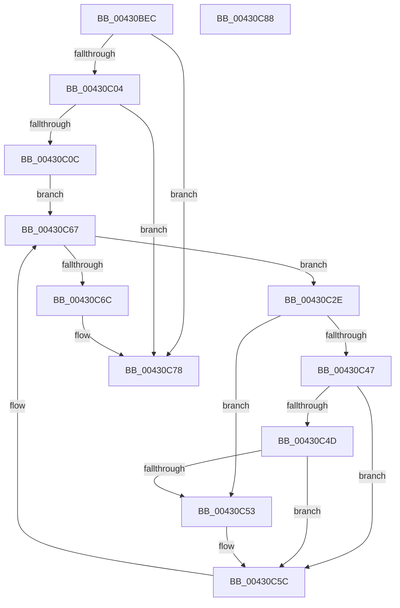

# PopThermalUpdateTimerPolicy

- RVA: `0x00430BEC`–`0x00430C89` (길이 `157` bytes)
- VA: `0x0000000140430BEC`
- 실행 섹션: `.text`
- PDB 이름 있음: `예`; PDB Function 태그: `아니요`
- unwind 정보 RVA: `0x000927D0`
- 디코드: `38`개 명령, `157/157` bytes 표시
- 미해석 바이트: `0` (있으면 어셈블리에 `.byte`로 보존)

> 이 문서는 커널 이미지의 기계어와 PDB 기호를 분석해 생성했습니다. 4번과 5번은 함수 원형과 자료형을 바이너리 사용 방식에서 추정한 C 해석이며 원본 소스 복구 결과는 아닙니다.

## 1. Dependencies

- 직접 호출 지점: **5**; 고유 호출 대상: **4**
- 직접 호출자로 확인된 함수: **1**
- RIP 상대 이미지 참조: **5**

### Outgoing calls
- `0x00430C19` → [PopAcquireRwLockShared](../2D/PopAcquireRwLockShared_function_002D9A40.md) (function, `0x002D9A40`)
- `0x00430C38` → [PopAcquireRwLockExclusive](PopAcquireRwLockExclusive_function_00430B44.md) (function, `0x00430B44`)
- `0x00430C57` → [IoCancelIrp](../27/IoCancelIrp_function_002720E0.md) (function, `0x002720E0`)
- `0x00430C5F` → [PopReleaseRwLock](../2D/PopReleaseRwLock_function_002DFBBC.md) (function, `0x002DFBBC`)
- `0x00430C73` → [PopReleaseRwLock](../2D/PopReleaseRwLock_function_002DFBBC.md) (function, `0x002DFBBC`)

### Direct callers
- [PopThermalPollingPowerSettingCallback](PopThermalPollingPowerSettingCallback_function_00430720.md) at `0x0043073D`

### Static image references
- `0x00430BFB` → RVA `0x00F0C960` (`.data`; read)
- `0x00430C04` → RVA `0x00F0C964` (`.data`; read)
- `0x00430C0C` → RVA `0x00F0C964` (`.data`; write)
- `0x00430C12` → RVA `0x00F0C900` (`.data`; read)
- `0x00430C1E` → RVA `0x00F0CE80` (`.data`; read)

## 2. Other-region calls and transfers

- 다른 실행 섹션으로 향하는 call: **0**
- 별도 외부 분기/꼬리 이동을 확인하지 못했습니다.

## 3. Assembly (complete function range)

```asm
00430BEC  48 89 5C 24 08                  mov qword ptr [rsp + 8], rbx
00430BF1  48 89 6C 24 10                  mov qword ptr [rsp + 0x10], rbp
00430BF6  57                              push rdi
00430BF7  48 83 EC 20                     sub rsp, 0x20
00430BFB  83 3D 5E BD AD 00 00            cmp dword ptr [rip + 0xadbd5e], 0
00430C02  74 74                           je 0x140430c78
00430C04  38 0D 5A BD AD 00               cmp byte ptr [rip + 0xadbd5a], cl
00430C0A  74 6C                           je 0x140430c78
00430C0C  88 0D 52 BD AD 00               mov byte ptr [rip + 0xadbd52], cl
00430C12  48 8D 0D E7 BC AD 00            lea rcx, [rip + 0xadbce7]
00430C19  E8 22 8E EA FF                  call 0x1402d9a40
00430C1E  48 8B 1D 5B C2 AD 00            mov rbx, qword ptr [rip + 0xadc25b]
00430C25  48 8D 2D 54 C2 AD 00            lea rbp, [rip + 0xadc254]
00430C2C  EB 39                           jmp 0x140430c67
00430C2E  48 8D BB B0 01 00 00            lea rdi, [rbx + 0x1b0]
00430C35  48 8B CF                        mov rcx, rdi
00430C38  E8 07 FF FF FF                  call 0x140430b44
00430C3D  48 83 BB E8 00 00 00 00         cmp qword ptr [rbx + 0xe8], 0
00430C45  75 0C                           jne 0x140430c53
00430C47  F6 43 41 01                     test byte ptr [rbx + 0x41], 1
00430C4B  74 0F                           je 0x140430c5c
00430C4D  83 7B 68 00                     cmp dword ptr [rbx + 0x68], 0
00430C51  74 09                           je 0x140430c5c
00430C53  48 8B 4B 38                     mov rcx, qword ptr [rbx + 0x38]
00430C57  E8 84 14 E4 FF                  call 0x1402720e0
00430C5C  48 8B CF                        mov rcx, rdi
00430C5F  E8 58 EF EA FF                  call 0x1402dfbbc
00430C64  48 8B 1B                        mov rbx, qword ptr [rbx]
00430C67  48 3B DD                        cmp rbx, rbp
00430C6A  75 C2                           jne 0x140430c2e
00430C6C  48 8D 0D 8D BC AD 00            lea rcx, [rip + 0xadbc8d]
00430C73  E8 44 EF EA FF                  call 0x1402dfbbc
00430C78  48 8B 5C 24 30                  mov rbx, qword ptr [rsp + 0x30]
00430C7D  48 8B 6C 24 38                  mov rbp, qword ptr [rsp + 0x38]
00430C82  48 83 C4 20                     add rsp, 0x20
00430C86  5F                              pop rdi
00430C87  C3                              ret
00430C88  CC                              int3
```

## 4. C-style interpretation (structured pseudocode)

```c
__int64 __fastcall PopThermalUpdateTimerPolicy(unsigned __int8 a1)
{
    __int64 result;
    __int64 v_rsp;
    unsigned __int64 v_stack_p10;
    unsigned __int64 v_stack_p8;

    v_stack_p8 = v_rbx;
    v_stack_p10 = v_rbp;
    v_rsp = (v_rsp) - (32);
    if ((*(unsigned int *)(v_rip + 11386206)) == 0) goto loc_00430C78;
    if ((*(unsigned __int8 *)(v_rip + 11386202)) == a1) goto loc_00430C78;
    *(unsigned __int8 *)(v_rip + 11386194) = a1;
    result = PopAcquireRwLockShared(v_rip + 11386087, a2, a3, a4);
    goto loc_00430C67;
loc_00430C2E:
    result = PopAcquireRwLockExclusive(*(unsigned __int64 *)(v_rip + 11387483) + 432, a2, a3, a4);
    if ((*(unsigned __int64 *)(*(unsigned __int64 *)(v_rip + 11387483) + 232)) != 0) goto loc_00430C53;
    if (((*(unsigned __int8 *)(*(unsigned __int64 *)(v_rip + 11387483) + 65)) & (1)) == 0) goto loc_00430C5C;
    if ((*(unsigned int *)(*(unsigned __int64 *)(v_rip + 11387483) + 104)) != 0) {
        a1 = *(unsigned __int64 *)(*(unsigned __int64 *)(v_rip + 11387483) + 56);
        result = IoCancelIrp(a1, a2, a3, a4);
    }
    result = PopReleaseRwLock(*(unsigned __int64 *)(v_rip + 11387483) + 432, a2, a3, a4);
loc_00430C67:
    if ((*(unsigned __int64 *)(*(unsigned __int64 *)(v_rip + 11387483))) != (v_rip + 11387476)) goto loc_00430C2E;
    result = PopReleaseRwLock(v_rip + 11385997, a2, a3, a4);
loc_00430C78:
    v_rsp = (v_rsp) + (32);
    return result;
}
```

## 5. (Beta) C Style

```c
int64_t PopThermalUpdateTimerPolicy(uint8_t Arg1)
{
    int64_t result;
    int64_t local_rsp;
    uint64_t v_stack_p10;
    uint64_t v_stack_p8;

    v_stack_p8 = local_rbx;
    v_stack_p10 = local_rbp;
    local_rsp = (local_rsp) - (32);
    if ((*(uint32_t *)(v_rip + 0xADBD5E)) == 0) goto loc_00430C78;
    if ((*(uint8_t *)(v_rip + 0xADBD5A)) == Arg1) goto loc_00430C78;
    *(uint8_t *)(v_rip + 0xADBD52) = Arg1;
    result = PopAcquireRwLockShared(v_rip + 11386087, a2, a3, a4);
    goto loc_00430C67;
loc_00430C2E:
    result = PopAcquireRwLockExclusive(*(uint64_t *)(v_rip + 0xADC25B) + 432, a2, a3, a4);
    if ((*(uint64_t *)(*(uint64_t *)(v_rip + 0xADC25B) + 0xE8)) != 0) goto loc_00430C53;
    if (((*(uint8_t *)(*(uint64_t *)(v_rip + 0xADC25B) + 0x41)) & (1)) == 0) goto loc_00430C5C;
    if ((*(uint32_t *)(*(uint64_t *)(v_rip + 0xADC25B) + 0x68)) != 0) {
        Arg1 = *(uint64_t *)(*(uint64_t *)(v_rip + 0xADC25B) + 0x38);
        result = IoCancelIrp(Arg1, a2, a3, a4);
    }
    result = PopReleaseRwLock(*(uint64_t *)(v_rip + 0xADC25B) + 432, a2, a3, a4);
loc_00430C67:
    if ((*(uint64_t *)(*(uint64_t *)(v_rip + 0xADC25B))) != (v_rip + 11387476)) goto loc_00430C2E;
    result = PopReleaseRwLock(v_rip + 11385997, a2, a3, a4);
loc_00430C78:
    local_rsp = (local_rsp) + (32);
    return result;
}
```

## 6. Execution-region graph

[열기: 2D/3D 그래프와 함수 탐색 컨트롤 패널](../../../control-panel.html?section=text&rva=0x00430BEC&view=graph)

- 2D 그래프는 위에서 아래로 흐르고, 3D 그래프는 빈 공간을 드래그해 회전합니다. Shift+드래그는 이동, 휠은 확대·축소, 함수 노드 선택은 대상 보고서 이동입니다.

### Static fallback


