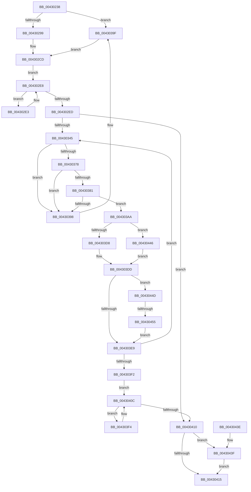

# PopWakeDeviceList

- RVA: `0x00430238`–`0x00430457` (길이 `543` bytes)
- VA: `0x0000000140430238`
- 실행 섹션: `.text`
- PDB 이름 있음: `예`; PDB Function 태그: `예`
- unwind 정보 RVA: `0x000A2058`
- 디코드: `146`개 명령, `543/543` bytes 표시
- 미해석 바이트: `0` (있으면 어셈블리에 `.byte`로 보존)

> 이 문서는 커널 이미지의 기계어와 PDB 기호를 분석해 생성했습니다. 4번과 5번은 함수 원형과 자료형을 바이너리 사용 방식에서 추정한 C 해석이며 원본 소스 복구 결과는 아닙니다.

## 1. Dependencies

- 직접 호출 지점: **9**; 고유 호출 대상: **8**
- 직접 호출자로 확인된 함수: **1**
- RIP 상대 이미지 참조: **4**

### Outgoing calls
- `0x004302C5` → [PopPushPowerStateTransitionRecordWithCallback](PopPushPowerStateTransitionRecordWithCallback_function_00430A04.md) (function, `0x00430A04`)
- `0x00430356` → [KeWaitForSingleObject](../20/KeWaitForSingleObject_function_0020E6B0.md) (function, `0x0020E6B0`)
- `0x0043036A` → [KeAcquireInStackQueuedSpinLock](../27/KeAcquireInStackQueuedSpinLock_function_002757A0.md) (function, `0x002757A0`)
- `0x004303BC` → [KeReleaseInStackQueuedSpinLock](../34/KeReleaseInStackQueuedSpinLock_function_00342CE0.md) (function, `0x00342CE0`)
- `0x004303C9` → [PopIsNotifyForDirectedPowerTransition](PopIsNotifyForDirectedPowerTransition_function_004306DC.md) (function, `0x004306DC`)
- `0x004303D8` → [PopIssueDirectedPowerTransition](../../page/AD/PopIssueDirectedPowerTransition_function_00AD158C.md) (function, `0x00AD158C`)
- `0x00430405` → [KeWaitForSingleObject](../20/KeWaitForSingleObject_function_0020E6B0.md) (function, `0x0020E6B0`)
- `0x0043043F` → [PoDelistPowerStateTransitionBlocker](../../pagelk/B7/PoDelistPowerStateTransitionBlocker_function_00B795D4.md) (function, `0x00B795D4`)
- `0x00430446` → [PopNotifyDevice](../../pagelk/B7/PopNotifyDevice_function_00B7DAAC.md) (function, `0x00B7DAAC`)

### Direct callers
- [PoBroadcastSystemState](../../pagelk/B7/PoBroadcastSystemState_function_00B761B0.md) at `0x00B76752`

### Static image references
- `0x00430260` → RVA `0x00F0BCC4` (`.data`; read)
- `0x004302B9` → RVA `0x00B70B40` (`PopBroadcastBlameBugcheckCallback`; read)
- `0x0043035B` → RVA `0x00F0BCD0` (`.data`; read)
- `0x004303DD` → RVA `0x00F0CF0C` (`.data`; read)

## 2. Other-region calls and transfers

- 다른 실행 섹션으로 향하는 call: **3**
  - `0x004303D8` → [PopIssueDirectedPowerTransition](../../page/AD/PopIssueDirectedPowerTransition_function_00AD158C.md) (`.text` → `PAGE`)
  - `0x0043043F` → [PoDelistPowerStateTransitionBlocker](../../pagelk/B7/PoDelistPowerStateTransitionBlocker_function_00B795D4.md) (`.text` → `PAGELK`)
  - `0x00430446` → [PopNotifyDevice](../../pagelk/B7/PopNotifyDevice_function_00B7DAAC.md) (`.text` → `PAGELK`)
- call이 아닌 외부 분기/꼬리 이동: **1**
  - `0x0043044F` → [sub_006EE828](../6E/Unknown_function_006EE828.md) (`tail-transfer`)

## 3. Assembly (complete function range)

```asm
00430238  48 8B C4                        mov rax, rsp
0043023B  48 89 58 08                     mov qword ptr [rax + 8], rbx
0043023F  48 89 70 10                     mov qword ptr [rax + 0x10], rsi
00430243  48 89 78 18                     mov qword ptr [rax + 0x18], rdi
00430247  55                              push rbp
00430248  41 54                           push r12
0043024A  41 55                           push r13
0043024C  41 56                           push r14
0043024E  41 57                           push r15
00430250  48 8D 68 A1                     lea rbp, [rax - 0x5f]
00430254  48 81 EC 90 00 00 00            sub rsp, 0x90
0043025B  45 33 ED                        xor r13d, r13d
0043025E  33 C0                           xor eax, eax
00430260  F7 05 5A BA AD 00 00 00 80 00   test dword ptr [rip + 0xadba5a], 0x800000
0043026A  0F 57 C0                        xorps xmm0, xmm0
0043026D  4C 8B FA                        mov r15, rdx
00430270  44 88 6D F0                     mov byte ptr [rbp - 0x10], r13b
00430274  48 8B F1                        mov rsi, rcx
00430277  44 88 6D F2                     mov byte ptr [rbp - 0xe], r13b
0043027B  44 89 6D 0B                     mov dword ptr [rbp + 0xb], r13d
0043027F  0F 11 45 D7                     movups xmmword ptr [rbp - 0x29], xmm0
00430283  48 89 45 E7                     mov qword ptr [rbp - 0x19], rax
00430287  44 88 6D 10                     mov byte ptr [rbp + 0x10], r13b
0043028B  44 88 6D 12                     mov byte ptr [rbp + 0x12], r13b
0043028F  44 89 6D 2B                     mov dword ptr [rbp + 0x2b], r13d
00430293  0F 85 06 01 00 00               jne 0x14043039f
00430299  65 48 8B 14 25 88 01 00 00      mov rdx, qword ptr gs:[0x188]
004302A2  45 8D 4D 02                     lea r9d, [r13 + 2]
004302A6  65 48 8B 04 25 88 01 00 00      mov rax, qword ptr gs:[0x188]
004302AF  4C 8B C6                        mov r8, rsi
004302B2  48 8B 88 B8 00 00 00            mov rcx, qword ptr [rax + 0xb8]
004302B9  48 8D 05 80 08 74 00            lea rax, [rip + 0x740880]
004302C0  48 89 44 24 20                  mov qword ptr [rsp + 0x20], rax
004302C5  E8 3A 07 00 00                  call 0x140430a04
004302CA  44 8B E0                        mov r12d, eax
004302CD  45 8B 37                        mov r14d, dword ptr [r15]
004302D0  41 8B CD                        mov ecx, r13d
004302D3  45 2B 77 04                     sub r14d, dword ptr [r15 + 4]
004302D7  41 8B DD                        mov ebx, r13d
004302DA  49 83 C7 28                     add r15, 0x28
004302DE  49 8B 07                        mov rax, qword ptr [r15]
004302E1  EB 05                           jmp 0x1404302e8
004302E3  48 8B 00                        mov rax, qword ptr [rax]
004302E6  FF C1                           inc ecx
004302E8  49 3B C7                        cmp rax, r15
004302EB  75 F6                           jne 0x1404302e3
004302ED  C6 45 0F 05                     mov byte ptr [rbp + 0xf], 5
004302F1  48 8D 45 17                     lea rax, [rbp + 0x17]
004302F5  48 89 45 1F                     mov qword ptr [rbp + 0x1f], rax
004302F9  48 8D 45 17                     lea rax, [rbp + 0x17]
004302FD  48 89 45 17                     mov qword ptr [rbp + 0x17], rax
00430301  48 8D 45 F7                     lea rax, [rbp - 9]
00430305  48 89 45 FF                     mov qword ptr [rbp - 1], rax
00430309  48 8D 45 F7                     lea rax, [rbp - 9]
0043030D  48 89 45 F7                     mov qword ptr [rbp - 9], rax
00430311  48 8D 45 0F                     lea rax, [rbp + 0xf]
00430315  48 89 46 20                     mov qword ptr [rsi + 0x20], rax
00430319  48 8D 45 EF                     lea rax, [rbp - 0x11]
0043031D  48 89 46 28                     mov qword ptr [rsi + 0x28], rax
00430321  C6 45 11 08                     mov byte ptr [rbp + 0x11], 8
00430325  89 4D 13                        mov dword ptr [rbp + 0x13], ecx
00430328  44 89 75 27                     mov dword ptr [rbp + 0x27], r14d
0043032C  C6 45 EF 05                     mov byte ptr [rbp - 0x11], 5
00430330  C6 45 F1 08                     mov byte ptr [rbp - 0xf], 8
00430334  44 89 6D F3                     mov dword ptr [rbp - 0xd], r13d
00430338  44 89 75 07                     mov dword ptr [rbp + 7], r14d
0043033C  45 85 F6                        test r14d, r14d
0043033F  0F 8E CB 00 00 00               jle 0x140430410
00430345  45 33 C9                        xor r9d, r9d
00430348  4C 89 6C 24 20                  mov qword ptr [rsp + 0x20], r13
0043034D  45 33 C0                        xor r8d, r8d
00430350  48 8D 4D 0F                     lea rcx, [rbp + 0xf]
00430354  33 D2                           xor edx, edx
00430356  E8 55 E3 DD FF                  call 0x14020e6b0
0043035B  48 8B 0D 6E B9 AD 00            mov rcx, qword ptr [rip + 0xadb96e]
00430362  48 8D 55 D7                     lea rdx, [rbp - 0x29]
00430366  48 83 C1 08                     add rcx, 8
0043036A  E8 31 54 E4 FF                  call 0x1402757a0
0043036F  49 8B 3F                        mov rdi, qword ptr [r15]
00430372  4C 39 7F 08                     cmp qword ptr [rdi + 8], r15
00430376  75 20                           jne 0x140430398
00430378  48 8B 07                        mov rax, qword ptr [rdi]
0043037B  48 39 78 08                     cmp qword ptr [rax + 8], rdi
0043037F  75 17                           jne 0x140430398
00430381  49 89 07                        mov qword ptr [r15], rax
00430384  4C 89 78 08                     mov qword ptr [rax + 8], r15
00430388  48 8D 86 B0 01 00 00            lea rax, [rsi + 0x1b0]
0043038F  48 8B 48 08                     mov rcx, qword ptr [rax + 8]
00430393  48 39 01                        cmp qword ptr [rcx], rax
00430396  74 12                           je 0x1404303aa
00430398  B9 03 00 00 00                  mov ecx, 3
0043039D  CD 29                           int 0x29
0043039F  41 BC 2D 00 00 C0               mov r12d, 0xc000002d
004303A5  E9 23 FF FF FF                  jmp 0x1404302cd
004303AA  48 89 4F 08                     mov qword ptr [rdi + 8], rcx
004303AE  48 89 07                        mov qword ptr [rdi], rax
004303B1  48 89 39                        mov qword ptr [rcx], rdi
004303B4  48 8D 4D D7                     lea rcx, [rbp - 0x29]
004303B8  48 89 78 08                     mov qword ptr [rax + 8], rdi
004303BC  E8 1F 29 F1 FF                  call 0x140342ce0
004303C1  48 8B CF                        mov rcx, rdi
004303C4  41 FF CE                        dec r14d
004303C7  FF C3                           inc ebx
004303C9  E8 0E 03 00 00                  call 0x1404306dc
004303CE  48 8B D7                        mov rdx, rdi
004303D1  48 8B CE                        mov rcx, rsi
004303D4  84 C0                           test al, al
004303D6  74 6E                           je 0x140430446
004303D8  E8 AF 11 6A 00                  call 0x140ad158c
004303DD  F7 05 25 CB AD 00 00 00 08 00   test dword ptr [rip + 0xadcb25], 0x80000
004303E7  75 64                           jne 0x14043044d
004303E9  45 85 F6                        test r14d, r14d
004303EC  0F 8F 53 FF FF FF               jg 0x140430345
004303F2  EB 18                           jmp 0x14043040c
004303F4  45 33 C9                        xor r9d, r9d
004303F7  4C 89 6C 24 20                  mov qword ptr [rsp + 0x20], r13
004303FC  45 33 C0                        xor r8d, r8d
004303FF  48 8D 4D EF                     lea rcx, [rbp - 0x11]
00430403  33 D2                           xor edx, edx
00430405  E8 A6 E2 DD FF                  call 0x14020e6b0
0043040A  FF CB                           dec ebx
0043040C  85 DB                           test ebx, ebx
0043040E  7F E4                           jg 0x1404303f4
00430410  45 85 E4                        test r12d, r12d
00430413  79 2A                           jns 0x14043043f
00430415  4C 8D 9C 24 90 00 00 00         lea r11, [rsp + 0x90]
0043041D  4C 89 6E 20                     mov qword ptr [rsi + 0x20], r13
00430421  49 8B 5B 30                     mov rbx, qword ptr [r11 + 0x30]
00430425  49 8B 7B 40                     mov rdi, qword ptr [r11 + 0x40]
00430429  4C 89 6E 28                     mov qword ptr [rsi + 0x28], r13
0043042D  49 8B 73 38                     mov rsi, qword ptr [r11 + 0x38]
00430431  49 8B E3                        mov rsp, r11
00430434  41 5F                           pop r15
00430436  41 5E                           pop r14
00430438  41 5D                           pop r13
0043043A  41 5C                           pop r12
0043043C  5D                              pop rbp
0043043D  C3                              ret
0043043E  CC                              int3
0043043F  E8 90 91 74 00                  call 0x140b795d4
00430444  EB CF                           jmp 0x140430415
00430446  E8 61 D6 74 00                  call 0x140b7daac
0043044B  EB 90                           jmp 0x1404303dd
0043044D  85 DB                           test ebx, ebx
0043044F  0F 8F D3 E3 2B 00               jg 0x1406ee828
00430455  EB 92                           jmp 0x1404303e9
```

## 4. C-style interpretation (structured pseudocode)

```c
__int64 __fastcall PopWakeDeviceList(__int64 a1, __int64 a2)
{
    __int64 result;
    __int64 v_r13;
    __int64 v_r14;
    __int64 v_r15;
    __int64 v_rbx;
    __int64 v_rsp;
    unsigned __int64 v_stack_m28;
    unsigned __int64 v_stack_m98;

    *(unsigned __int64 *)(v_rsp + 8) = v_rbx;
    *(unsigned __int64 *)(v_rsp + 16) = v_rsi;
    *(unsigned __int64 *)(v_rsp + 24) = v_rdi;
    v_rsp = (v_rsp) - (144);
    v_r13 = 0;
    result = 0;
    *(unsigned __int8 *)(v_rsp - 95 - 16) = 0;
    *(unsigned __int8 *)(v_rsp - 95 - 14) = 0;
    *(unsigned int *)(v_rsp - 95 + 11) = 0;
    *(unsigned __int64 *)(v_rsp - 95 - 41) = v_xmm0;
    *(unsigned __int64 *)(v_rsp - 95 - 25) = 0;
    *(unsigned __int8 *)(v_rsp - 95 + 16) = 0;
    *(unsigned __int8 *)(v_rsp - 95 + 18) = 0;
    *(unsigned int *)(v_rsp - 95 + 43) = 0;
    if (((*(unsigned int *)(v_rip + 11385434)) & (0x800000ULL)) != 0) goto loc_0043039F;
    v_stack_m98 = v_rip + 7604352;
    result = PopPushPowerStateTransitionRecordWithCallback(*(unsigned __int64 *)(*(unsigned __int64 *)(gs_base + (0 + 392)) + 184), *(unsigned __int64 *)(gs_base + (0 + 392)), a1, v_r13 + 2);
loc_004302CD:
    v_r14 = (unsigned int)(((unsigned int)(*(unsigned int *)(a2))) - (*(unsigned int *)(a2 + 4)));
    v_r15 = (a2) + (40);
    goto loc_004302E8;
loc_004302E3:
    a1 = (unsigned int)((0) + 1);
loc_004302E8:
    if ((*(unsigned __int64 *)(*(unsigned __int64 *)(v_r15))) != v_r15) goto loc_004302E3;
    *(unsigned __int8 *)(v_rsp - 95 + 15) = 5;
    *(unsigned __int64 *)(v_rsp - 95 + 31) = v_rsp - 95 + 23;
    *(unsigned __int64 *)(v_rsp - 95 + 23) = v_rsp - 95 + 23;
    *(unsigned __int64 *)(v_rsp - 95 - 1) = v_rsp - 95 - 9;
    *(unsigned __int64 *)(v_rsp - 95 - 9) = v_rsp - 95 - 9;
    *(unsigned __int64 *)(a1 + 32) = v_rsp - 95 + 15;
    *(unsigned __int64 *)(a1 + 40) = v_rsp - 95 - 17;
    *(unsigned __int8 *)(v_rsp - 95 + 17) = 8;
    *(unsigned int *)(v_rsp - 95 + 19) = (unsigned int)(a1);
    *(unsigned int *)(v_rsp - 95 + 39) = (unsigned int)(v_r14);
    *(unsigned __int8 *)(v_rsp - 95 - 17) = 5;
    *(unsigned __int8 *)(v_rsp - 95 - 15) = 8;
    *(unsigned int *)(v_rsp - 95 - 13) = 0;
    *(unsigned int *)(v_rsp - 95 + 7) = (unsigned int)(v_r14);
    if (condition_is_less_or_equal) goto loc_00430410;
loc_00430345:
    a4 = 0;
    v_stack_m98 = 0;
    a3 = 0;
    a2 = 0;
    result = KeWaitForSingleObject(v_rsp - 95 + 15, a2, a3, a4);
    a1 = (*(unsigned __int64 *)(v_rip + 11385198)) + (8);
    result = KeAcquireInStackQueuedSpinLock(a1, v_rsp - 95 - 41, a3, a4);
    if ((*(unsigned __int64 *)(*(unsigned __int64 *)(v_r15) + 8)) != v_r15) goto loc_00430398;
    if ((*(unsigned __int64 *)(*(unsigned __int64 *)(*(unsigned __int64 *)(v_r15)) + 8)) != (*(unsigned __int64 *)(v_r15))) goto loc_00430398;
    *(unsigned __int64 *)(v_r15) = *(unsigned __int64 *)(*(unsigned __int64 *)(v_r15));
    *(unsigned __int64 *)(*(unsigned __int64 *)(*(unsigned __int64 *)(v_r15)) + 8) = v_r15;
    if ((*(unsigned __int64 *)(*(unsigned __int64 *)(a1 + 432 + 8))) == (a1 + 432)) goto loc_004303AA;
loc_00430398:
loc_0043039F:
    goto loc_004302CD;
loc_004303AA:
    *(unsigned __int64 *)(*(unsigned __int64 *)(v_r15) + 8) = 3;
    *(unsigned __int64 *)(*(unsigned __int64 *)(v_r15)) = a1 + 432;
    *(unsigned __int64 *)(3) = *(unsigned __int64 *)(v_r15);
    *(unsigned __int64 *)(a1 + 432 + 8) = *(unsigned __int64 *)(v_r15);
    result = KeReleaseInStackQueuedSpinLock(v_rsp - 95 - 41, v_rsp - 95 - 41, a3, a4);
    v_r14 = (unsigned int)((v_r14) - 1);
    v_rbx = (unsigned int)((0) + 1);
    result = PopIsNotifyForDirectedPowerTransition(*(unsigned __int64 *)(v_r15), v_rsp - 95 - 41, a3, a4);
    if ((unsigned __int8)(result) == 0) goto loc_00430446;
    result = PopIssueDirectedPowerTransition(a1, *(unsigned __int64 *)(v_r15), a3, a4);
loc_004303DD:
    if (((*(unsigned int *)(v_rip + 11389733)) & (0x80000ULL)) != 0) goto loc_0043044D;
loc_004303E9:
    if (condition_is_greater) goto loc_00430345;
    goto loc_0043040C;
loc_004303F4:
    a4 = 0;
    v_stack_m98 = 0;
    a3 = 0;
    a2 = 0;
    result = KeWaitForSingleObject(v_rsp - 95 - 17, a2, a3, a4);
    v_rbx = (unsigned int)((v_rbx) - 1);
loc_0043040C:
    if (condition_is_greater) goto loc_004303F4;
loc_00430410:
    if (!sign_flag) goto loc_0043043F;
loc_00430415:
    *(unsigned __int64 *)(a1 + 32) = 0;
    *(unsigned __int64 *)(a1 + 40) = 0;
    return result;
loc_0043043F:
    result = PoDelistPowerStateTransitionBlocker(v_rsp - 95 - 17, a2, a3, a4);
    goto loc_00430415;
loc_00430446:
    result = PopNotifyDevice(v_rsp - 95 - 17, a2, a3, a4);
    goto loc_004303DD;
loc_0043044D:
    goto loc_004303E9;
}
```

## 5. (Beta) C Style

```c
int64_t PopWakeDeviceList(void *Arg1, void *Arg2)
{
    uint8_t *arg1 = (uint8_t *)Arg1;
    uint8_t *arg2 = (uint8_t *)Arg2;

    int64_t result;
    int64_t local_r13;
    int64_t local_r14;
    int64_t local_r15;
    int64_t local_rbx;
    int64_t local_rsp;
    uint64_t v_stack_m28;
    uint64_t v_stack_m98;

    *(uint64_t *)(local_rsp + 0x8) = local_rbx;
    *(uint64_t *)(local_rsp + 0x10) = local_rsi;
    *(uint64_t *)(local_rsp + 0x18) = local_rdi;
    local_rsp = (local_rsp) - (144);
    local_r13 = 0;
    result = 0;
    *(uint8_t *)(local_rsp - 0x5F - 0x10) = 0;
    *(uint8_t *)(local_rsp - 0x5F - 0xE) = 0;
    *(uint32_t *)(local_rsp - 0x5F + 0xB) = 0;
    *(uint64_t *)(local_rsp - 0x5F - 0x29) = v_xmm0;
    *(uint64_t *)(local_rsp - 0x5F - 0x19) = 0;
    *(uint8_t *)(local_rsp - 0x5F + 0x10) = 0;
    *(uint8_t *)(local_rsp - 0x5F + 0x12) = 0;
    *(uint32_t *)(local_rsp - 0x5F + 0x2B) = 0;
    if (((*(uint32_t *)(v_rip + 0xADBA5A)) & (0x800000ULL)) != 0) goto loc_0043039F;
    v_stack_m98 = v_rip + 7604352;
    result = PopPushPowerStateTransitionRecordWithCallback(*(uint64_t *)(*(uint64_t *)(gs_base + (0 + 0x188)) + 0xB8), *(uint64_t *)(gs_base + (0 + 0x188)), Arg1, local_r13 + 2);
loc_004302CD:
    local_r14 = (uint32_t)(((uint32_t)(*(uint32_t *)(arg2))) - (*(uint32_t *)(arg2 + 0x4)));
    local_r15 = (Arg2) + (40);
    goto loc_004302E8;
loc_004302E3:
    Arg1 = (uint32_t)((0) + 1);
loc_004302E8:
    if ((*(uint64_t *)(*(uint64_t *)(local_r15))) != local_r15) goto loc_004302E3;
    *(uint8_t *)(local_rsp - 0x5F + 0xF) = 5;
    *(uint64_t *)(local_rsp - 0x5F + 0x1F) = local_rsp - 95 + 23;
    *(uint64_t *)(local_rsp - 0x5F + 0x17) = local_rsp - 95 + 23;
    *(uint64_t *)(local_rsp - 0x5F - 0x1) = local_rsp - 95 - 9;
    *(uint64_t *)(local_rsp - 0x5F - 0x9) = local_rsp - 95 - 9;
    *(uint64_t *)(arg1 + 0x20) = local_rsp - 95 + 15;
    *(uint64_t *)(arg1 + 0x28) = local_rsp - 95 - 17;
    *(uint8_t *)(local_rsp - 0x5F + 0x11) = 8;
    *(uint32_t *)(local_rsp - 0x5F + 0x13) = (uint32_t)(Arg1);
    *(uint32_t *)(local_rsp - 0x5F + 0x27) = (uint32_t)(local_r14);
    *(uint8_t *)(local_rsp - 0x5F - 0x11) = 5;
    *(uint8_t *)(local_rsp - 0x5F - 0xF) = 8;
    *(uint32_t *)(local_rsp - 0x5F - 0xD) = 0;
    *(uint32_t *)(local_rsp - 0x5F + 0x7) = (uint32_t)(local_r14);
    if (condition_is_less_or_equal) goto loc_00430410;
loc_00430345:
    a4 = 0;
    v_stack_m98 = 0;
    a3 = 0;
    Arg2 = 0;
    result = KeWaitForSingleObject(local_rsp - 95 + 15, Arg2, a3, a4);
    Arg1 = (*(uint64_t *)(v_rip + 0xADB96E)) + (8);
    result = KeAcquireInStackQueuedSpinLock(Arg1, local_rsp - 95 - 41, a3, a4);
    if ((*(uint64_t *)(*(uint64_t *)(local_r15) + 0x8)) != local_r15) goto loc_00430398;
    if ((*(uint64_t *)(*(uint64_t *)(*(uint64_t *)(local_r15)) + 0x8)) != (*(uint64_t *)(local_r15))) goto loc_00430398;
    *(uint64_t *)(local_r15) = *(uint64_t *)(*(uint64_t *)(local_r15));
    *(uint64_t *)(*(uint64_t *)(*(uint64_t *)(local_r15)) + 0x8) = local_r15;
    if ((*(uint64_t *)(*(uint64_t *)(arg1 + 0x1B0 + 0x8))) == (Arg1 + 432)) goto loc_004303AA;
loc_00430398:
loc_0043039F:
    goto loc_004302CD;
loc_004303AA:
    *(uint64_t *)(*(uint64_t *)(local_r15) + 0x8) = 3;
    *(void **)(*(uint64_t *)(local_r15)) = Arg1 + 432;
    *(uint64_t *)(3) = *(uint64_t *)(local_r15);
    *(uint64_t *)(arg1 + 0x1B0 + 0x8) = *(uint64_t *)(local_r15);
    result = KeReleaseInStackQueuedSpinLock(local_rsp - 95 - 41, local_rsp - 95 - 41, a3, a4);
    local_r14 = (uint32_t)((local_r14) - 1);
    local_rbx = (uint32_t)((0) + 1);
    result = PopIsNotifyForDirectedPowerTransition(*(uint64_t *)(local_r15), local_rsp - 95 - 41, a3, a4);
    if ((uint8_t)(result) == 0) goto loc_00430446;
    result = PopIssueDirectedPowerTransition(Arg1, *(uint64_t *)(local_r15), a3, a4);
loc_004303DD:
    if (((*(uint32_t *)(v_rip + 0xADCB25)) & (0x80000ULL)) != 0) goto loc_0043044D;
loc_004303E9:
    if (condition_is_greater) goto loc_00430345;
    goto loc_0043040C;
loc_004303F4:
    a4 = 0;
    v_stack_m98 = 0;
    a3 = 0;
    Arg2 = 0;
    result = KeWaitForSingleObject(local_rsp - 95 - 17, Arg2, a3, a4);
    local_rbx = (uint32_t)((local_rbx) - 1);
loc_0043040C:
    if (condition_is_greater) goto loc_004303F4;
loc_00430410:
    if (!sign_flag) goto loc_0043043F;
loc_00430415:
    *(uint64_t *)(arg1 + 0x20) = 0;
    *(uint64_t *)(arg1 + 0x28) = 0;
    return result;
loc_0043043F:
    result = PoDelistPowerStateTransitionBlocker(local_rsp - 95 - 17, Arg2, a3, a4);
    goto loc_00430415;
loc_00430446:
    result = PopNotifyDevice(local_rsp - 95 - 17, Arg2, a3, a4);
    goto loc_004303DD;
loc_0043044D:
    goto loc_004303E9;
}
```

### 관측된 메모리 오프셋

구조체 형식이 확인되지 않은 접근은 인자 기준의 오프셋으로만 기록했습니다.

| 기준 인자 | 오프셋 표현 | 폭 (bit) | 접근 |
|---|---:|---:|---|
| `Arg1` | `+ 0x8` | `64` | `R` |
| `Arg1` | `+ 0x8` | `64` | `W` |
| `Arg1` | `+ 0x20` | `64` | `W` |
| `Arg1` | `+ 0x28` | `64` | `W` |
| `Arg1` | `+ 0x1B0` | `64` | `R` |
| `Arg2` | `+ 0x0` | `32` | `R` |
| `Arg2` | `+ 0x0` | `64` | `R` |
| `Arg2` | `+ 0x0` | `64` | `W` |
| `Arg2` | `+ 0x4` | `32` | `R` |

## 6. Execution-region graph

[열기: 2D/3D 그래프와 함수 탐색 컨트롤 패널](../../../control-panel.html?section=text&rva=0x00430238&view=graph)

- 2D 그래프는 위에서 아래로 흐르고, 3D 그래프는 빈 공간을 드래그해 회전합니다. Shift+드래그는 이동, 휠은 확대·축소, 함수 노드 선택은 대상 보고서 이동입니다.

### Static fallback


