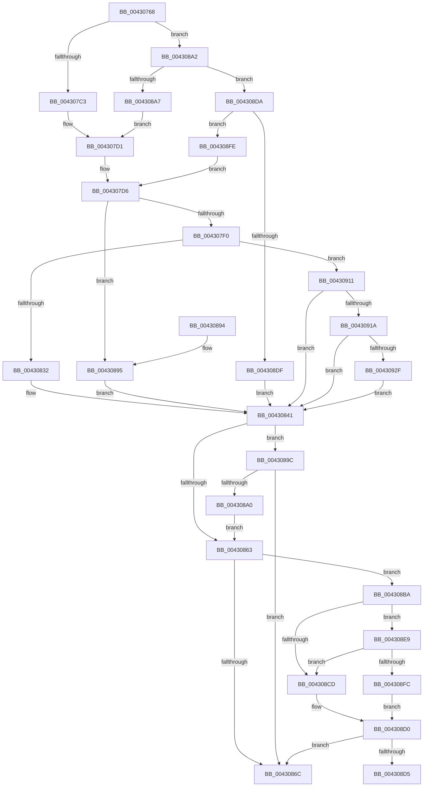

# PopWriteBsdPoInfo

- RVA: `0x00430768`–`0x0043093F` (길이 `471` bytes)
- VA: `0x0000000140430768`
- 실행 섹션: `.text`
- PDB 이름 있음: `예`; PDB Function 태그: `예`
- unwind 정보 RVA: `0x000A20C0`
- 디코드: `117`개 명령, `471/471` bytes 표시
- 미해석 바이트: `0` (있으면 어셈블리에 `.byte`로 보존)

> 이 문서는 커널 이미지의 기계어와 PDB 기호를 분석해 생성했습니다. 4번과 5번은 함수 원형과 자료형을 바이너리 사용 방식에서 추정한 C 해석이며 원본 소스 복구 결과는 아닙니다.

## 1. Dependencies

- 직접 호출 지점: **11**; 고유 호출 대상: **9**
- 직접 호출자로 확인된 함수: **1**
- RIP 상대 이미지 참조: **13**

### Outgoing calls
- `0x004307A4` → [memset](../6C/memset_function_006C6C40.md) (function, `0x006C6C40`)
- `0x004307AB` → [KeQueryPerformanceCounter](../37/KeQueryPerformanceCounter_function_0037E7E0.md) (function, `0x0037E7E0`)
- `0x004307E2` → [RtlCompareMemory](../6B/RtlCompareMemory_function_006BA670.md) (function, `0x006BA670`)
- `0x004307FA` → [memcpy](../6C/memcpy_function_006C6840.md) (function, `0x006C6840`)
- `0x00430806` → [PopReleaseRwLock](../2D/PopReleaseRwLock_function_002DFBBC.md) (function, `0x002DFBBC`)
- `0x00430817` → [RtlSetSystemBootStatus](../../page/A8/RtlSetSystemBootStatus_function_00A83230.md) (function, `0x00A83230`)
- `0x00430825` → [PopAcquireRwLockExclusive](PopAcquireRwLockExclusive_function_00430B44.md) (function, `0x00430B44`)
- `0x0043083C` → [memcpy](../6C/memcpy_function_006C6840.md) (function, `0x006C6840`)
- `0x00430843` → [KeQueryPerformanceCounter](../37/KeQueryPerformanceCounter_function_0037E7E0.md) (function, `0x0037E7E0`)
- `0x00430857` → [PopQpcTimeInMs](../../pagelk/B7/PopQpcTimeInMs_function_00B79780.md) (function, `0x00B79780`)
- `0x00430873` → [_security_check_cookie](../6A/_security_check_cookie_function_006AC640.md) (function, `0x006AC640`)

### Direct callers
- [PopBsdFlush](../../page/A8/PopBsdFlush_function_00A82624.md) at `0x00A8269B`
- [PopBsdFlush](../../page/A8/PopBsdFlush_function_00A82624.md) at `0x00A826AA`
- [PopBsdFlush](../../page/A8/PopBsdFlush_function_00A82624.md) at `0x00A826D1`

### Static image references
- `0x00430786` → RVA `0x00E0A740` (`.data`; read)
- `0x004307C3` → RVA `0x00E67410` (`.data`; read)
- `0x004307CA` → RVA `0x00E67640` (`.data`; read)
- `0x004307FF` → RVA `0x00F0F1E0` (`.data`; read)
- `0x00430863` → RVA `0x00E07748` (`.data`; read)
- `0x004308A7` → RVA `0x00E673F0` (`.data`; read)
- `0x004308AE` → RVA `0x00E67620` (`.data`; read)
- `0x004308C4` → RVA `0x00E07758` (`.data`; read)
- `0x004308E9` → RVA `0x00E07760` (`.data`; read)
- `0x004308FE` → RVA `0x00E673B0` (`.data`; read)
- `0x00430905` → RVA `0x00E675E0` (`.data`; read)
- `0x0043091A` → RVA `0x00E673DE` (`.data`; read)
- `0x00430933` → RVA `0x00E673DE` (`.data`; write)

## 2. Other-region calls and transfers

- 다른 실행 섹션으로 향하는 call: **2**
  - `0x00430817` → [RtlSetSystemBootStatus](../../page/A8/RtlSetSystemBootStatus_function_00A83230.md) (`.text` → `PAGE`)
  - `0x00430857` → [PopQpcTimeInMs](../../pagelk/B7/PopQpcTimeInMs_function_00B79780.md) (`.text` → `PAGELK`)
- call이 아닌 외부 분기/꼬리 이동: **1**
  - `0x004308D5` → [sub_006EE864](../6E/Unknown_function_006EE864.md) (`tail-transfer`)

## 3. Assembly (complete function range)

```asm
00430768  48 89 5C 24 10                  mov qword ptr [rsp + 0x10], rbx
0043076D  48 89 74 24 18                  mov qword ptr [rsp + 0x18], rsi
00430772  55                              push rbp
00430773  57                              push rdi
00430774  41 54                           push r12
00430776  41 56                           push r14
00430778  41 57                           push r15
0043077A  48 8D 6C 24 C9                  lea rbp, [rsp - 0x37]
0043077F  48 81 EC 00 01 00 00            sub rsp, 0x100
00430786  48 8B 05 B3 9F 9D 00            mov rax, qword ptr [rip + 0x9d9fb3]
0043078D  48 33 C4                        xor rax, rsp
00430790  48 89 45 27                     mov qword ptr [rbp + 0x27], rax
00430794  8B F9                           mov edi, ecx
00430796  BB 40 00 00 00                  mov ebx, 0x40
0043079B  44 8B C3                        mov r8d, ebx
0043079E  48 8D 4D 87                     lea rcx, [rbp - 0x79]
004307A2  33 D2                           xor edx, edx
004307A4  E8 97 64 29 00                  call 0x1406c6c40
004307A9  33 C9                           xor ecx, ecx
004307AB  E8 30 E0 F4 FF                  call 0x14037e7e0
004307B0  48 89 44 24 30                  mov qword ptr [rsp + 0x30], rax
004307B5  66 41 BC 01 00                  mov r12w, 1
004307BA  83 FF 07                        cmp edi, 7
004307BD  0F 85 DF 00 00 00               jne 0x1404308a2
004307C3  4C 8D 35 46 6C A3 00            lea r14, [rip + 0xa36c46]
004307CA  48 8D 35 6F 6E A3 00            lea rsi, [rip + 0xa36e6f]
004307D1  BB 20 00 00 00                  mov ebx, 0x20
004307D6  44 8B C3                        mov r8d, ebx
004307D9  48 8B D6                        mov rdx, rsi
004307DC  49 8B CE                        mov rcx, r14
004307DF  44 8B FB                        mov r15d, ebx
004307E2  E8 89 9E 28 00                  call 0x1406ba670
004307E7  49 3B C7                        cmp rax, r15
004307EA  0F 84 A5 00 00 00               je 0x140430895
004307F0  45 8B C7                        mov r8d, r15d
004307F3  48 8D 4D 87                     lea rcx, [rbp - 0x79]
004307F7  49 8B D6                        mov rdx, r14
004307FA  E8 41 60 29 00                  call 0x1406c6840
004307FF  48 8D 0D DA E9 AD 00            lea rcx, [rip + 0xade9da]
00430806  E8 B1 F3 EA FF                  call 0x1402dfbbc
0043080B  45 33 C9                        xor r9d, r9d
0043080E  48 8D 55 87                     lea rdx, [rbp - 0x79]
00430812  44 8B C3                        mov r8d, ebx
00430815  8B CF                           mov ecx, edi
00430817  E8 14 2A 65 00                  call 0x140a83230
0043081C  48 8D 0D BD E9 AD 00            lea rcx, [rip + 0xade9bd]
00430823  8B D8                           mov ebx, eax
00430825  E8 1A 03 00 00                  call 0x140430b44
0043082A  85 DB                           test ebx, ebx
0043082C  0F 88 DF 00 00 00               js 0x140430911
00430832  45 8B C7                        mov r8d, r15d
00430835  48 8D 55 87                     lea rdx, [rbp - 0x79]
00430839  48 8B CE                        mov rcx, rsi
0043083C  E8 FF 5F 29 00                  call 0x1406c6840
00430841  33 C9                           xor ecx, ecx
00430843  E8 98 DF F4 FF                  call 0x14037e7e0
00430848  48 8D 54 24 38                  lea rdx, [rsp + 0x38]
0043084D  48 89 44 24 38                  mov qword ptr [rsp + 0x38], rax
00430852  48 8D 4C 24 30                  lea rcx, [rsp + 0x30]
00430857  E8 24 8F 74 00                  call 0x140b79780
0043085C  44 8B D0                        mov r10d, eax
0043085F  85 DB                           test ebx, ebx
00430861  79 39                           jns 0x14043089c
00430863  83 3D DE 6E 9D 00 05            cmp dword ptr [rip + 0x9d6ede], 5
0043086A  77 4E                           ja 0x1404308ba
0043086C  48 8B 4D 27                     mov rcx, qword ptr [rbp + 0x27]
00430870  48 33 CC                        xor rcx, rsp
00430873  E8 C8 BD 27 00                  call 0x1406ac640
00430878  4C 8D 9C 24 00 01 00 00         lea r11, [rsp + 0x100]
00430880  49 8B 5B 38                     mov rbx, qword ptr [r11 + 0x38]
00430884  49 8B 73 40                     mov rsi, qword ptr [r11 + 0x40]
00430888  49 8B E3                        mov rsp, r11
0043088B  41 5F                           pop r15
0043088D  41 5E                           pop r14
0043088F  41 5C                           pop r12
00430891  5F                              pop rdi
00430892  5D                              pop rbp
00430893  C3                              ret
00430894  CC                              int3
00430895  BB 21 00 00 C0                  mov ebx, 0xc0000021
0043089A  EB A5                           jmp 0x140430841
0043089C  85 C0                           test eax, eax
0043089E  74 CC                           je 0x14043086c
004308A0  EB C1                           jmp 0x140430863
004308A2  83 FF 10                        cmp edi, 0x10
004308A5  75 33                           jne 0x1404308da
004308A7  4C 8D 35 42 6B A3 00            lea r14, [rip + 0xa36b42]
004308AE  48 8D 35 6B 6D A3 00            lea rsi, [rip + 0xa36d6b]
004308B5  E9 17 FF FF FF                  jmp 0x1404307d1
004308BA  48 BA 00 00 00 00 00 20 00 00   movabs rdx, 0x200000000000
004308C4  48 85 15 8D 6E 9D 00            test qword ptr [rip + 0x9d6e8d], rdx
004308CB  75 1C                           jne 0x1404308e9
004308CD  45 32 E4                        xor r12b, r12b
004308D0  45 84 E4                        test r12b, r12b
004308D3  74 97                           je 0x14043086c
004308D5  E9 8A DF 2B 00                  jmp 0x1406ee864
004308DA  83 FF 0E                        cmp edi, 0xe
004308DD  74 1F                           je 0x1404308fe
004308DF  BB 0D 00 00 C0                  mov ebx, 0xc000000d
004308E4  E9 58 FF FF FF                  jmp 0x140430841
004308E9  48 8B 05 70 6E 9D 00            mov rax, qword ptr [rip + 0x9d6e70]
004308F0  48 23 C2                        and rax, rdx
004308F3  48 3B 05 66 6E 9D 00            cmp rax, qword ptr [rip + 0x9d6e66]
004308FA  75 D1                           jne 0x1404308cd
004308FC  EB D2                           jmp 0x1404308d0
004308FE  4C 8D 35 AB 6A A3 00            lea r14, [rip + 0xa36aab]
00430905  48 8D 35 D4 6C A3 00            lea rsi, [rip + 0xa36cd4]
0043090C  E9 C5 FE FF FF                  jmp 0x1404307d6
00430911  83 FF 0E                        cmp edi, 0xe
00430914  0F 85 27 FF FF FF               jne 0x140430841
0043091A  0F B7 05 BD 6A A3 00            movzx eax, word ptr [rip + 0xa36abd]
00430921  B9 FF FF 00 00                  mov ecx, 0xffff
00430926  66 3B C1                        cmp ax, cx
00430929  0F 83 12 FF FF FF               jae 0x140430841
0043092F  66 41 03 C4                     add ax, r12w
00430933  66 89 05 A4 6A A3 00            mov word ptr [rip + 0xa36aa4], ax
0043093A  E9 02 FF FF FF                  jmp 0x140430841
```

## 4. C-style interpretation (structured pseudocode)

```c
__int64 __fastcall PopWriteBsdPoInfo(int a1, int a2, __int64 a3, int a4)
{
    __int64 result;
    __int64 v_r12;
    __int64 v_rsp;
    unsigned __int64 v_stack_m28;
    unsigned __int64 v_stack_m38;
    unsigned __int64 v_stack_m5F;
    unsigned __int64 v_stack_mD8;
    unsigned __int64 v_stack_mF0;
    unsigned __int64 v_stack_mF8;
    unsigned __int64 v_stack_p10;
    unsigned __int64 v_stack_p18;

    v_stack_p10 = v_rbx;
    v_stack_p18 = v_rsi;
    v_rsp = (v_rsp) - (256);
    result = (*(unsigned __int64 *)(v_rip + 10330035)) ^ (v_rsp);
    v_stack_m38 = result;
    a2 = 0;
    result = memset(v_stack_mD8, a2, 64, a4);
    a1 = 0;
    result = KeQueryPerformanceCounter(a1, a2, 64, a4);
    v_stack_mF8 = result;
    if (((unsigned int)((unsigned int)(a1))) != 7) goto loc_004308A2;
loc_004307D1:
loc_004307D6:
    result = RtlCompareMemory(v_rip + 10710086, v_rip + 10710639, 32, a4);
    if (result == 32) goto loc_00430895;
    result = memcpy(v_stack_mD8, v_rip + 10710086, 32, a4);
    result = PopReleaseRwLock(v_rip + 11397594, v_rip + 10710086, 32, a4);
    a4 = 0;
    result = RtlSetSystemBootStatus((unsigned int)((unsigned int)((unsigned int)(a1))), v_stack_mD8, 32, a4);
    result = PopAcquireRwLockExclusive(v_rip + 11397565, v_stack_mD8, 32, a4);
    if (sign_flag) goto loc_00430911;
    result = memcpy(v_rip + 10710639, v_stack_mD8, 32, a4);
loc_00430841:
    a1 = 0;
    result = KeQueryPerformanceCounter(a1, v_stack_mD8, 32, a4);
    v_stack_mF0 = result;
    result = PopQpcTimeInMs(v_stack_mF8, v_stack_mF0, 32, a4);
    if (!sign_flag) goto loc_0043089C;
loc_00430863:
    if ((*(unsigned int *)(v_rip + 10317534)) > 5) goto loc_004308BA;
loc_0043086C:
    a1 = (v_stack_m38) ^ (v_rsp);
    result = _security_check_cookie(a1, v_stack_mF0, 32, a4);
    return result;
loc_00430895:
    goto loc_00430841;
loc_0043089C:
    if ((unsigned int)(result) == 0) goto loc_0043086C;
    goto loc_00430863;
loc_004308A2:
    if (((unsigned int)((unsigned int)(a1))) != 16) goto loc_004308DA;
    goto loc_004307D1;
loc_004308BA:
    if (((*(unsigned __int64 *)(v_rip + 10317453)) & (v_stack_mF0)) != 0) goto loc_004308E9;
loc_004308CD:
    v_r12 = 0;
loc_004308D0:
    if (0 == 0) goto loc_0043086C;
loc_004308DA:
    if (((unsigned int)((unsigned int)(a1))) == 14) goto loc_004308FE;
    goto loc_00430841;
loc_004308E9:
    result = (*(unsigned __int64 *)(v_rip + 10317424)) & (v_stack_mF0);
    if (result != (*(unsigned __int64 *)(v_rip + 10317414))) goto loc_004308CD;
    goto loc_004308D0;
loc_004308FE:
    goto loc_004307D6;
loc_00430911:
    if (((unsigned int)((unsigned int)(a1))) != 14) goto loc_00430841;
    if (((unsigned __int16)(*(unsigned __int16 *)(v_rip + 10709693))) >= ((unsigned __int16)((unsigned int)(0xFFFFULL)))) goto loc_00430841;
    result = (unsigned __int16)((*(unsigned __int16 *)(v_rip + 10709693)) + (0));
    *(unsigned __int16 *)(v_rip + 10709668) = (unsigned __int16)(result);
    goto loc_00430841;
}
```

## 5. (Beta) C Style

```c
int64_t PopWriteBsdPoInfo(int32_t Arg1, int32_t Arg2, int64_t Arg3, int32_t Arg4)
{
    int64_t result;
    int64_t local_r12;
    int64_t local_rsp;
    uint64_t v_stack_m28;
    uint64_t v_stack_m38;
    uint64_t v_stack_m5F;
    uint64_t v_stack_mD8;
    uint64_t v_stack_mF0;
    uint64_t v_stack_mF8;
    uint64_t v_stack_p10;
    uint64_t v_stack_p18;

    v_stack_p10 = local_rbx;
    v_stack_p18 = local_rsi;
    local_rsp = (local_rsp) - (256);
    result = (*(uint64_t *)(v_rip + 0x9D9FB3)) ^ (local_rsp);
    v_stack_m38 = result;
    Arg2 = 0;
    result = memset(v_stack_mD8, Arg2, 64, Arg4);
    Arg1 = 0;
    result = KeQueryPerformanceCounter(Arg1, Arg2, 64, Arg4);
    v_stack_mF8 = result;
    if (((uint32_t)((uint32_t)(Arg1))) != 7) goto loc_004308A2;
loc_004307D1:
loc_004307D6:
    result = RtlCompareMemory(v_rip + 10710086, v_rip + 10710639, 32, Arg4);
    if (result == 32) goto loc_00430895;
    result = memcpy(v_stack_mD8, v_rip + 10710086, 32, Arg4);
    result = PopReleaseRwLock(v_rip + 11397594, v_rip + 10710086, 32, Arg4);
    Arg4 = 0;
    result = RtlSetSystemBootStatus((uint32_t)((uint32_t)((uint32_t)(Arg1))), v_stack_mD8, 32, Arg4);
    result = PopAcquireRwLockExclusive(v_rip + 11397565, v_stack_mD8, 32, Arg4);
    if (sign_flag) goto loc_00430911;
    result = memcpy(v_rip + 10710639, v_stack_mD8, 32, Arg4);
loc_00430841:
    Arg1 = 0;
    result = KeQueryPerformanceCounter(Arg1, v_stack_mD8, 32, Arg4);
    v_stack_mF0 = result;
    result = PopQpcTimeInMs(v_stack_mF8, v_stack_mF0, 32, Arg4);
    if (!sign_flag) goto loc_0043089C;
loc_00430863:
    if ((*(uint32_t *)(v_rip + 0x9D6EDE)) > 5) goto loc_004308BA;
loc_0043086C:
    Arg1 = (v_stack_m38) ^ (local_rsp);
    result = _security_check_cookie(Arg1, v_stack_mF0, 32, Arg4);
    return result;
loc_00430895:
    goto loc_00430841;
loc_0043089C:
    if ((uint32_t)(result) == 0) goto loc_0043086C;
    goto loc_00430863;
loc_004308A2:
    if (((uint32_t)((uint32_t)(Arg1))) != 16) goto loc_004308DA;
    goto loc_004307D1;
loc_004308BA:
    if (((*(uint64_t *)(v_rip + 0x9D6E8D)) & (v_stack_mF0)) != 0) goto loc_004308E9;
loc_004308CD:
    local_r12 = 0;
loc_004308D0:
    if (0 == 0) goto loc_0043086C;
loc_004308DA:
    if (((uint32_t)((uint32_t)(Arg1))) == 14) goto loc_004308FE;
    goto loc_00430841;
loc_004308E9:
    result = (*(uint64_t *)(v_rip + 0x9D6E70)) & (v_stack_mF0);
    if (result != (*(uint64_t *)(v_rip + 0x9D6E66))) goto loc_004308CD;
    goto loc_004308D0;
loc_004308FE:
    goto loc_004307D6;
loc_00430911:
    if (((uint32_t)((uint32_t)(Arg1))) != 14) goto loc_00430841;
    if (((uint16_t)(*(uint16_t *)(v_rip + 0xA36ABD))) >= ((uint16_t)((uint32_t)(0xFFFFULL)))) goto loc_00430841;
    result = (uint16_t)((*(uint16_t *)(v_rip + 0xA36ABD)) + (0));
    *(uint16_t *)(v_rip + 0xA36AA4) = (uint16_t)(result);
    goto loc_00430841;
}
```

## 6. Execution-region graph

[열기: 2D/3D 그래프와 함수 탐색 컨트롤 패널](../../../control-panel.html?section=text&rva=0x00430768&view=graph)

- 2D 그래프는 위에서 아래로 흐르고, 3D 그래프는 빈 공간을 드래그해 회전합니다. Shift+드래그는 이동, 휠은 확대·축소, 함수 노드 선택은 대상 보고서 이동입니다.

### Static fallback


