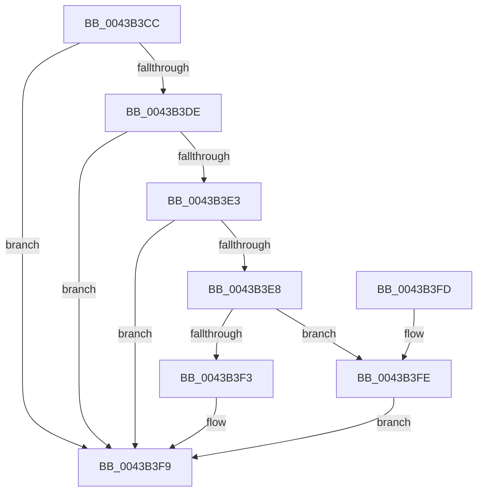

# PpmConvertTimeTo

- RVA: `0x0043B3CC`–`0x0043B429` (길이 `93` bytes)
- VA: `0x000000014043B3CC`
- 실행 섹션: `.text`
- PDB 이름 있음: `예`; PDB Function 태그: `아니요`
- unwind 정보 RVA: `0x000DB714`
- 디코드: `32`개 명령, `93/93` bytes 표시
- 미해석 바이트: `0` (있으면 어셈블리에 `.byte`로 보존)

> 이 문서는 커널 이미지의 기계어와 PDB 기호를 분석해 생성했습니다. 4번과 5번은 함수 원형과 자료형을 바이너리 사용 방식에서 추정한 C 해석이며 원본 소스 복구 결과는 아닙니다.

## 1. Dependencies

- 직접 호출 지점: **0**; 고유 호출 대상: **0**
- 직접 호출자로 확인된 함수: **14**
- RIP 상대 이미지 참조: **1**

### Outgoing calls
- 직접 디코드된 call 명령이 없습니다.

### Direct callers
- [sub_002DF2AD](../2D/Unknown_function_002DF2AD.md) at `0x002DF3D8`
- [PopCalculateCsSummary](PopCalculateCsSummary_function_0043A1B0.md) at `0x0043A338`
- [PopCalculateCsSummary](PopCalculateCsSummary_function_0043A1B0.md) at `0x0043A39D`
- [PopCalculateCsSummary](PopCalculateCsSummary_function_0043A1B0.md) at `0x0043A3AF`
- [PopCalculateCsSummary](PopCalculateCsSummary_function_0043A1B0.md) at `0x0043A3C1`
- [PpmTranslateIdleAccounting](PpmTranslateIdleAccounting_function_0043A924.md) at `0x0043A9CF`
- [PpmTranslateIdleAccounting](PpmTranslateIdleAccounting_function_0043A924.md) at `0x0043A9E2`
- [PpmTranslateIdleAccounting](PpmTranslateIdleAccounting_function_0043A924.md) at `0x0043A9F4`
- [PpmTranslateIdleAccounting](PpmTranslateIdleAccounting_function_0043A924.md) at `0x0043AA15`
- [PpmTranslateIdleAccounting](PpmTranslateIdleAccounting_function_0043A924.md) at `0x0043AA27`
- [PpmTranslateIdleAccounting](PpmTranslateIdleAccounting_function_0043A924.md) at `0x0043AA38`
- [PpmTranslateIdleAccounting](PpmTranslateIdleAccounting_function_0043A924.md) at `0x0043AADC`
- [PpmTranslateIdleAccounting](PpmTranslateIdleAccounting_function_0043A924.md) at `0x0043AAEB`
- [PpmTranslateIdleAccounting](PpmTranslateIdleAccounting_function_0043A924.md) at `0x0043AAFC`
- [PpmTranslateIdleAccounting](PpmTranslateIdleAccounting_function_0043A924.md) at `0x0043AB22`
- [PopDiagTraceCsResiliencyExit](PopDiagTraceCsResiliencyExit_function_0043AB34.md) at `0x0043ACAD`
- [PopDiagTraceCsResiliencyExit](PopDiagTraceCsResiliencyExit_function_0043AB34.md) at `0x0043ACBF`
- [PopDiagTraceCsResiliencyExit](PopDiagTraceCsResiliencyExit_function_0043AB34.md) at `0x0043ACD4`
- [PopDiagTraceCsResiliencyExit](PopDiagTraceCsResiliencyExit_function_0043AB34.md) at `0x0043AD24`
- [PopCalculateIdleInformation](PopCalculateIdleInformation_function_0043ADEC.md) at `0x0043AEA0`
- [PopCalculateIdleInformation](PopCalculateIdleInformation_function_0043ADEC.md) at `0x0043AEBA`
- [PpmTranslatePlatformIdleAccounting](PpmTranslatePlatformIdleAccounting_function_0043AFD8.md) at `0x0043B069`
- [PpmTranslatePlatformIdleAccounting](PpmTranslatePlatformIdleAccounting_function_0043AFD8.md) at `0x0043B079`
- [PpmTranslatePlatformIdleAccounting](PpmTranslatePlatformIdleAccounting_function_0043AFD8.md) at `0x0043B088`
- [PpmTranslatePlatformIdleAccounting](PpmTranslatePlatformIdleAccounting_function_0043AFD8.md) at `0x0043B0AB`
- [PpmTranslatePlatformIdleAccounting](PpmTranslatePlatformIdleAccounting_function_0043AFD8.md) at `0x0043B0BE`
- [PpmTranslatePlatformIdleAccounting](PpmTranslatePlatformIdleAccounting_function_0043AFD8.md) at `0x0043B0D0`
- [PpmSnapDripsAccountingSnapshot](PpmSnapDripsAccountingSnapshot_function_0043B11C.md) at `0x0043B191`
- [PpmEventTraceDeliveredPerfChange](PpmEventTraceDeliveredPerfChange_function_0043B200.md) at `0x0043B2F0`
- [PpmTraceExitLatency](../5D/PpmTraceExitLatency_function_005D0A64.md) at `0x005D0AC8`
- [PopDripsWatchdogUpdateMetrics](../../page/76/PopDripsWatchdogUpdateMetrics_function_0076C830.md) at `0x0076C966`
- [PpmIdleGetPackageIdleIntervalStats](../../page/A7/PpmIdleGetPackageIdleIntervalStats_function_00A7EE4C.md) at `0x00A7EF2C`
- [PopIdleWakeNotifyModernStandbyExitWorker](../../page/AA/PopIdleWakeNotifyModernStandbyExitWorker_function_00AA55E0.md) at `0x00AA5689`
- [PopIdleWakeNotifyModernStandbyExitWorker](../../page/AA/PopIdleWakeNotifyModernStandbyExitWorker_function_00AA55E0.md) at `0x00AA56FF`
- [PopIdleWakeNotifyModernStandbyExitWorker](../../page/AA/PopIdleWakeNotifyModernStandbyExitWorker_function_00AA55E0.md) at `0x00AA5714`
- [PopIdleWakeSourceAccountingBucketsToDiagnosticBuckets](../../page/AC/PopIdleWakeSourceAccountingBucketsToDiagnosticBuckets_function_00AC2410.md) at `0x00AC2444`
- [PopIdleWakeSourceAccountingBucketsToDiagnosticBuckets](../../page/AC/PopIdleWakeSourceAccountingBucketsToDiagnosticBuckets_function_00AC2410.md) at `0x00AC2454`
- [PopIdleWakeSourceAccountingBucketsToDiagnosticBuckets](../../page/AC/PopIdleWakeSourceAccountingBucketsToDiagnosticBuckets_function_00AC2410.md) at `0x00AC2464`
- [PopIdleWakeSourceAccountingBucketsToDiagnosticBuckets](../../page/AC/PopIdleWakeSourceAccountingBucketsToDiagnosticBuckets_function_00AC2410.md) at `0x00AC24AA`
- [PopIdleWakeSourceAccountingBucketsToDiagnosticBuckets](../../page/AC/PopIdleWakeSourceAccountingBucketsToDiagnosticBuckets_function_00AC2410.md) at `0x00AC24E8`
- [PopIdleWakeSourceAccountingBucketsToDiagnosticBuckets](../../page/AC/PopIdleWakeSourceAccountingBucketsToDiagnosticBuckets_function_00AC2410.md) at `0x00AC2504`
- [PopIdleWakeSourceAccountingBucketsToDiagnosticBuckets](../../page/AC/PopIdleWakeSourceAccountingBucketsToDiagnosticBuckets_function_00AC2410.md) at `0x00AC253C`
- [PopIdleWakeSourceAccountingBucketsToDiagnosticBuckets](../../page/AC/PopIdleWakeSourceAccountingBucketsToDiagnosticBuckets_function_00AC2410.md) at `0x00AC2558`
- [PopIdleWakeSourceAccountingBucketsToDiagnosticBuckets](../../page/AC/PopIdleWakeSourceAccountingBucketsToDiagnosticBuckets_function_00AC2410.md) at `0x00AC258D`
- [PopIdleWakeSourceAccountingBucketsToDiagnosticBuckets](../../page/AC/PopIdleWakeSourceAccountingBucketsToDiagnosticBuckets_function_00AC2410.md) at `0x00AC25A9`
- [PopIdleWakeSourceAccountingBucketsToDiagnosticBuckets](../../page/AC/PopIdleWakeSourceAccountingBucketsToDiagnosticBuckets_function_00AC2410.md) at `0x00AC25E4`
- [sub_00B42B88](../../page/B4/Unknown_function_00B42B88.md) at `0x00B42B91`

### Static image references
- `0x0043B3CC` → RVA `0x00FC6BE0` (`ALMOSTRO`; read)

## 2. Other-region calls and transfers

- 다른 실행 섹션으로 향하는 call: **0**
- 별도 외부 분기/꼬리 이동을 확인하지 못했습니다.

## 3. Assembly (complete function range)

```asm
0043B3CC  4C 8B 15 0D B8 B8 00            mov r10, qword ptr [rip + 0xb8b80d]
0043B3D3  4C 8B DA                        mov r11, rdx
0043B3D6  4C 8B C9                        mov r9, rcx
0043B3D9  48 85 C9                        test rcx, rcx
0043B3DC  74 1B                           je 0x14043b3f9
0043B3DE  4D 85 D2                        test r10, r10
0043B3E1  74 16                           je 0x14043b3f9
0043B3E3  4C 3B D2                        cmp r10, rdx
0043B3E6  74 11                           je 0x14043b3f9
0043B3E8  48 8B C2                        mov rax, rdx
0043B3EB  49 F7 E1                        mul r9
0043B3EE  48 85 D2                        test rdx, rdx
0043B3F1  75 0B                           jne 0x14043b3fe
0043B3F3  49 F7 F2                        div r10
0043B3F6  4C 8B C8                        mov r9, rax
0043B3F9  49 8B C1                        mov rax, r9
0043B3FC  C3                              ret
0043B3FD  CC                              int3
0043B3FE  33 D2                           xor edx, edx
0043B400  49 8B C1                        mov rax, r9
0043B403  49 F7 F2                        div r10
0043B406  33 D2                           xor edx, edx
0043B408  48 8B C8                        mov rcx, rax
0043B40B  4C 8B C0                        mov r8, rax
0043B40E  49 0F AF CA                     imul rcx, r10
0043B412  4C 2B C9                        sub r9, rcx
0043B415  4D 0F AF CB                     imul r9, r11
0043B419  49 8B C1                        mov rax, r9
0043B41C  49 F7 F2                        div r10
0043B41F  4D 0F AF C3                     imul r8, r11
0043B423  4D 8D 0C 00                     lea r9, [r8 + rax]
0043B427  EB D0                           jmp 0x14043b3f9
```

## 4. C-style interpretation (structured pseudocode)

```c
__int64 __fastcall PpmConvertTimeTo(__int64 a1, __int64 a2)
{
    if (a1 == 0) goto loc_0043B3F9;
    if (*(unsigned __int64 *)(v_rip + 12105741) == 0) goto loc_0043B3F9;
    if ((*(unsigned __int64 *)(v_rip + 12105741)) == a2) goto loc_0043B3F9;
    if (a2 != 0) goto loc_0043B3FE;
loc_0043B3F9:
    return a2;
loc_0043B3FE:
    a2 = 0;
    a2 = 0;
    a1 = (0) * (*(unsigned __int64 *)(v_rip + 12105741));
    a4 = (a2) - (a1);
    a4 = (a4) * (0);
    a3 = (0) * (0);
    goto loc_0043B3F9;
}
```

## 5. (Beta) C Style

```c
int64_t PpmConvertTimeTo(int64_t Arg1, int64_t Arg2)
{
    if (Arg1 == 0) goto loc_0043B3F9;
    if (*(uint64_t *)(v_rip + 0xB8B80D) == 0) goto loc_0043B3F9;
    if ((*(uint64_t *)(v_rip + 0xB8B80D)) == Arg2) goto loc_0043B3F9;
    if (Arg2 != 0) goto loc_0043B3FE;
loc_0043B3F9:
    return Arg2;
loc_0043B3FE:
    Arg2 = 0;
    Arg2 = 0;
    Arg1 = (0) * (*(uint64_t *)(v_rip + 0xB8B80D));
    a4 = (Arg2) - (Arg1);
    a4 = (a4) * (0);
    a3 = (0) * (0);
    goto loc_0043B3F9;
}
```

## 6. Execution-region graph

[열기: 2D/3D 그래프와 함수 탐색 컨트롤 패널](../../../control-panel.html?section=text&rva=0x0043B3CC&view=graph)

- 2D 그래프는 위에서 아래로 흐르고, 3D 그래프는 빈 공간을 드래그해 회전합니다. Shift+드래그는 이동, 휠은 확대·축소, 함수 노드 선택은 대상 보고서 이동입니다.

### Static fallback


