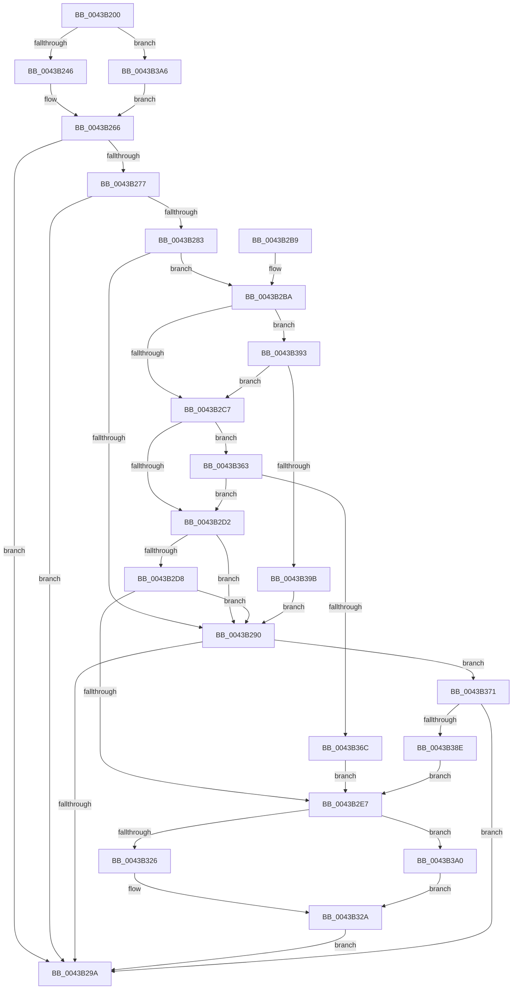

# PpmEventTraceDeliveredPerfChange

- RVA: `0x0043B200`–`0x0043B3C4` (길이 `452` bytes)
- VA: `0x000000014043B200`
- 실행 섹션: `.text`
- PDB 이름 있음: `예`; PDB Function 태그: `아니요`
- unwind 정보 RVA: `0x000A43DC`
- 디코드: `107`개 명령, `452/452` bytes 표시
- 미해석 바이트: `0` (있으면 어셈블리에 `.byte`로 보존)

> 이 문서는 커널 이미지의 기계어와 PDB 기호를 분석해 생성했습니다. 4번과 5번은 함수 원형과 자료형을 바이너리 사용 방식에서 추정한 C 해석이며 원본 소스 복구 결과는 아닙니다.

## 1. Dependencies

- 직접 호출 지점: **4**; 고유 호출 대상: **4**
- 직접 호출자로 확인된 함수: **1**
- RIP 상대 이미지 참조: **5**

### Outgoing calls
- `0x0043B2A1` → [_security_check_cookie](../6A/_security_check_cookie_function_006AC640.md) (function, `0x006AC640`)
- `0x0043B2F0` → [PpmConvertTimeTo](PpmConvertTimeTo_function_0043B3CC.md) (function, `0x0043B3CC`)
- `0x0043B359` → [EtwWriteEx](../25/EtwWriteEx_function_0025F0D0.md) (function, `0x0025F0D0`)
- `0x0043B381` → [EtwpLevelKeywordEnabled](../2F/EtwpLevelKeywordEnabled_function_002FD110.md) (function, `0x002FD110`)

### Direct callers
- [PpmPerfSnapDeliveredPerformance](../2D/PpmPerfSnapDeliveredPerformance_function_002D7F30.md) at `0x002D8080`

### Static image references
- `0x0043B222` → RVA `0x00E0A740` (`.data`; read)
- `0x0043B232` → RVA `0x000146C0` (`.rdata`; read)
- `0x0043B266` → RVA `0x00E67A39` (`.data`; read)
- `0x0043B277` → RVA `0x00F083E8` (`.data`; read)
- `0x0043B3AA` → RVA `0x000146D0` (`.rdata`; read)

## 2. Other-region calls and transfers

- 다른 실행 섹션으로 향하는 call: **0**
- 별도 외부 분기/꼬리 이동을 확인하지 못했습니다.

## 3. Assembly (complete function range)

```asm
0043B200  48 89 5C 24 08                  mov qword ptr [rsp + 8], rbx
0043B205  44 89 4C 24 20                  mov dword ptr [rsp + 0x20], r9d
0043B20A  44 89 44 24 18                  mov dword ptr [rsp + 0x18], r8d
0043B20F  89 54 24 10                     mov dword ptr [rsp + 0x10], edx
0043B213  55                              push rbp
0043B214  56                              push rsi
0043B215  57                              push rdi
0043B216  48 8D 6C 24 C1                  lea rbp, [rsp - 0x3f]
0043B21B  48 81 EC A0 00 00 00            sub rsp, 0xa0
0043B222  48 8B 05 17 F5 9C 00            mov rax, qword ptr [rip + 0x9cf517]
0043B229  48 33 C4                        xor rax, rsp
0043B22C  48 89 45 2F                     mov qword ptr [rbp + 0x2f], rax
0043B230  33 FF                           xor edi, edi
0043B232  48 8D 35 87 94 BD FF            lea rsi, [rip - 0x426b79]
0043B239  89 7D DF                        mov dword ptr [rbp - 0x21], edi
0043B23C  40 38 79 44                     cmp byte ptr [rcx + 0x44], dil
0043B240  0F 84 60 01 00 00               je 0x14043b3a6
0043B246  0F B6 81 20 77 FF FF            movzx eax, byte ptr [rcx - 0x88e0]
0043B24D  48 8B DE                        mov rbx, rsi
0043B250  66 89 45 DF                     mov word ptr [rbp - 0x21], ax
0043B254  0F B6 81 21 77 FF FF            movzx eax, byte ptr [rcx - 0x88df]
0043B25B  88 45 E1                        mov byte ptr [rbp - 0x1f], al
0043B25E  48 C7 45 F7 03 00 00 00         mov qword ptr [rbp - 9], 3
0043B266  40 38 3D CC C7 A2 00            cmp byte ptr [rip + 0xa2c7cc], dil
0043B26D  48 8D 45 DF                     lea rax, [rbp - 0x21]
0043B271  48 89 45 EF                     mov qword ptr [rbp - 0x11], rax
0043B275  74 23                           je 0x14043b29a
0043B277  48 8B 15 6A D1 AC 00            mov rdx, qword ptr [rip + 0xacd16a]
0043B27E  48 85 D2                        test rdx, rdx
0043B281  74 17                           je 0x14043b29a
0043B283  48 8B 4A 20                     mov rcx, qword ptr [rdx + 0x20]
0043B287  4C 8B 43 08                     mov r8, qword ptr [rbx + 8]
0043B28B  39 79 60                        cmp dword ptr [rcx + 0x60], edi
0043B28E  75 2A                           jne 0x14043b2ba
0043B290  66 39 7A 66                     cmp word ptr [rdx + 0x66], di
0043B294  0F 85 D7 00 00 00               jne 0x14043b371
0043B29A  48 8B 4D 2F                     mov rcx, qword ptr [rbp + 0x2f]
0043B29E  48 33 CC                        xor rcx, rsp
0043B2A1  E8 9A 13 27 00                  call 0x1406ac640
0043B2A6  48 8B 9C 24 C0 00 00 00         mov rbx, qword ptr [rsp + 0xc0]
0043B2AE  48 81 C4 A0 00 00 00            add rsp, 0xa0
0043B2B5  5F                              pop rdi
0043B2B6  5E                              pop rsi
0043B2B7  5D                              pop rbp
0043B2B8  C3                              ret
0043B2B9  CC                              int3
0043B2BA  0F B6 41 64                     movzx eax, byte ptr [rcx + 0x64]
0043B2BE  38 43 04                        cmp byte ptr [rbx + 4], al
0043B2C1  0F 87 CC 00 00 00               ja 0x14043b393
0043B2C7  8B 41 68                        mov eax, dword ptr [rcx + 0x68]
0043B2CA  A8 40                           test al, 0x40
0043B2CC  0F 85 91 00 00 00               jne 0x14043b363
0043B2D2  4C 85 41 70                     test qword ptr [rcx + 0x70], r8
0043B2D6  74 B8                           je 0x14043b290
0043B2D8  48 8B 49 78                     mov rcx, qword ptr [rcx + 0x78]
0043B2DC  48 8B C1                        mov rax, rcx
0043B2DF  49 23 C0                        and rax, r8
0043B2E2  48 3B C1                        cmp rax, rcx
0043B2E5  75 A9                           jne 0x14043b290
0043B2E7  48 8B 4D 7F                     mov rcx, qword ptr [rbp + 0x7f]
0043B2EB  BA 40 42 0F 00                  mov edx, 0xf4240
0043B2F0  E8 D7 00 00 00                  call 0x14043b3cc
0043B2F5  48 89 45 E7                     mov qword ptr [rbp - 0x19], rax
0043B2F9  48 8D 45 67                     lea rax, [rbp + 0x67]
0043B2FD  48 89 45 FF                     mov qword ptr [rbp - 1], rax
0043B301  48 8D 45 E7                     lea rax, [rbp - 0x19]
0043B305  48 89 45 0F                     mov qword ptr [rbp + 0xf], rax
0043B309  48 C7 45 07 04 00 00 00         mov qword ptr [rbp + 7], 4
0043B311  48 C7 45 17 08 00 00 00         mov qword ptr [rbp + 0x17], 8
0043B319  48 C7 45 27 04 00 00 00         mov qword ptr [rbp + 0x27], 4
0043B321  48 3B DE                        cmp rbx, rsi
0043B324  75 7A                           jne 0x14043b3a0
0043B326  48 8D 45 6F                     lea rax, [rbp + 0x6f]
0043B32A  48 8B 0D B7 D0 AC 00            mov rcx, qword ptr [rip + 0xacd0b7]
0043B331  45 33 C9                        xor r9d, r9d
0043B334  48 89 45 1F                     mov qword ptr [rbp + 0x1f], rax
0043B338  45 33 C0                        xor r8d, r8d
0043B33B  48 8D 45 EF                     lea rax, [rbp - 0x11]
0043B33F  48 8B D3                        mov rdx, rbx
0043B342  48 89 44 24 38                  mov qword ptr [rsp + 0x38], rax
0043B347  C7 44 24 30 04 00 00 00         mov dword ptr [rsp + 0x30], 4
0043B34F  48 89 7C 24 28                  mov qword ptr [rsp + 0x28], rdi
0043B354  48 89 7C 24 20                  mov qword ptr [rsp + 0x20], rdi
0043B359  E8 72 3D E2 FF                  call 0x14025f0d0
0043B35E  E9 37 FF FF FF                  jmp 0x14043b29a
0043B363  4D 85 C0                        test r8, r8
0043B366  0F 85 66 FF FF FF               jne 0x14043b2d2
0043B36C  E9 76 FF FF FF                  jmp 0x14043b2e7
0043B371  48 8B 4A 28                     mov rcx, qword ptr [rdx + 0x28]
0043B375  4C 8B 43 08                     mov r8, qword ptr [rbx + 8]
0043B379  48 83 C1 60                     add rcx, 0x60
0043B37D  0F B6 53 04                     movzx edx, byte ptr [rbx + 4]
0043B381  E8 8A 1D EC FF                  call 0x1402fd110
0043B386  84 C0                           test al, al
0043B388  0F 84 0C FF FF FF               je 0x14043b29a
0043B38E  E9 54 FF FF FF                  jmp 0x14043b2e7
0043B393  84 C0                           test al, al
0043B395  0F 84 2C FF FF FF               je 0x14043b2c7
0043B39B  E9 F0 FE FF FF                  jmp 0x14043b290
0043B3A0  48 8D 45 77                     lea rax, [rbp + 0x77]
0043B3A4  EB 84                           jmp 0x14043b32a
0043B3A6  48 8B 41 08                     mov rax, qword ptr [rcx + 8]
0043B3AA  48 8D 1D 1F 93 BD FF            lea rbx, [rip - 0x426ce1]
0043B3B1  8B 48 14                        mov ecx, dword ptr [rax + 0x14]
0043B3B4  89 4D DF                        mov dword ptr [rbp - 0x21], ecx
0043B3B7  48 C7 45 F7 04 00 00 00         mov qword ptr [rbp - 9], 4
0043B3BF  E9 A2 FE FF FF                  jmp 0x14043b266
```

## 4. C-style interpretation (structured pseudocode)

```c
__int64 __fastcall PpmEventTraceDeliveredPerfChange(__int64 a1, int a2, int a3, int a4, __int64 a5)
{
    __int64 result;
    __int64 v_rdi;
    __int64 v_rsp;
    unsigned __int64 v_stack_m28;
    unsigned __int64 v_stack_m30;
    unsigned __int64 v_stack_m38;
    unsigned __int64 v_stack_m40;
    unsigned __int64 v_stack_m48;
    unsigned __int64 v_stack_m50;
    unsigned __int64 v_stack_m57;
    unsigned __int64 v_stack_m58;
    unsigned __int64 v_stack_m60;
    unsigned __int64 v_stack_m68;
    unsigned __int64 v_stack_m70;
    unsigned __int8 v_stack_m76;
    unsigned int v_stack_m78;
    unsigned int v_stack_p10;
    unsigned int v_stack_p18;
    unsigned int v_stack_p20;
    unsigned __int64 v_stack_p28;
    unsigned int v_stack_p30;
    unsigned __int64 v_stack_p38;
    unsigned __int64 v_stack_p8;

    v_stack_p8 = v_rbx;
    v_stack_p20 = a4;
    v_stack_p18 = a3;
    v_stack_p10 = a2;
    v_rsp = (v_rsp) - (160);
    result = (*(unsigned __int64 *)(v_rip + 10286359)) ^ (v_rsp);
    v_stack_m28 = result;
    v_rdi = 0;
    v_stack_m78 = 0;
    if ((*(unsigned __int8 *)(a1 + 68)) == 0) goto loc_0043B3A6;
    v_stack_m78 = (unsigned __int16)(*(unsigned __int8 *)(a1 - 35040));
    v_stack_m76 = (unsigned __int8)(*(unsigned __int8 *)(a1 - 35039));
    v_stack_m60 = 3;
loc_0043B266:
    v_stack_m68 = v_stack_m78;
    if ((*(unsigned __int8 *)(v_rip + 10667980)) == 0) goto loc_0043B29A;
    if (*(unsigned __int64 *)(v_rip + 11325802) == 0) goto loc_0043B29A;
    if ((*(unsigned int *)(*(unsigned __int64 *)(*(unsigned __int64 *)(v_rip + 11325802) + 32) + 96)) != 0) goto loc_0043B2BA;
loc_0043B290:
    if ((*(unsigned __int16 *)(*(unsigned __int64 *)(v_rip + 11325802) + 102)) != 0) goto loc_0043B371;
loc_0043B29A:
    a1 = (v_stack_m28) ^ (v_rsp);
    result = _security_check_cookie(a1, *(unsigned __int64 *)(v_rip + 11325802), *(unsigned __int64 *)(v_rip - 4352889 + 8), a4);
    v_rsp = (v_rsp) + (160);
    return result;
loc_0043B2BA:
    if ((*(unsigned __int8 *)(v_stack_p8 + 4)) > ((unsigned __int8)(*(unsigned __int8 *)(a1 + 100)))) goto loc_0043B393;
loc_0043B2C7:
    if ((((unsigned __int8)((unsigned int)(*(unsigned int *)(a1 + 104)))) & (64)) != 0) goto loc_0043B363;
loc_0043B2D2:
    if (((*(unsigned __int64 *)(a1 + 112)) & (*(unsigned __int64 *)(v_rip - 4352889 + 8))) == 0) goto loc_0043B290;
    result = (*(unsigned __int64 *)(a1 + 120)) & (*(unsigned __int64 *)(v_rip - 4352889 + 8));
    if (result != (*(unsigned __int64 *)(a1 + 120))) goto loc_0043B290;
loc_0043B2E7:
    result = PpmConvertTimeTo(a5, (unsigned int)(0xF4240ULL), *(unsigned __int64 *)(v_rip - 4352889 + 8), a4);
    v_stack_m70 = result;
    v_stack_m58 = v_stack_p10;
    v_stack_m48 = v_stack_m70;
    v_stack_m50 = 4;
    v_stack_m40 = 8;
    v_stack_m30 = 4;
    if (v_stack_p8 != (v_rip - 4352889)) goto loc_0043B3A0;
loc_0043B32A:
    a4 = 0;
    v_stack_m38 = v_stack_p18;
    a3 = 0;
    v_stack_p38 = v_stack_m68;
    v_stack_p30 = 4;
    v_stack_p28 = 0;
    v_stack_p20 = 0;
    result = EtwWriteEx(*(unsigned __int64 *)(v_rip + 11325623), v_stack_p8, a3, a4);
    goto loc_0043B29A;
loc_0043B363:
    if (0 != 0) goto loc_0043B2D2;
    goto loc_0043B2E7;
loc_0043B371:
    a1 = (*(unsigned __int64 *)(v_stack_p8 + 40)) + (96);
    result = EtwpLevelKeywordEnabled(a1, *(unsigned __int8 *)(v_stack_p8 + 4), *(unsigned __int64 *)(v_stack_p8 + 8), a4);
    if ((unsigned __int8)(result) == 0) goto loc_0043B29A;
    goto loc_0043B2E7;
loc_0043B393:
    if ((unsigned __int8)(result) == 0) goto loc_0043B2C7;
    goto loc_0043B290;
loc_0043B3A0:
    goto loc_0043B32A;
loc_0043B3A6:
    v_stack_m78 = (unsigned int)((unsigned int)(*(unsigned int *)(*(unsigned __int64 *)(a1 + 8) + 20)));
    v_stack_m60 = 4;
    goto loc_0043B266;
}
```

## 5. (Beta) C Style

```c
int64_t PpmEventTraceDeliveredPerfChange(void *Arg1, int32_t Arg2, int32_t Arg3, int32_t Arg4, int64_t Arg5)
{
    uint8_t *arg1 = (uint8_t *)Arg1;

    int64_t result;
    int64_t local_rdi;
    int64_t local_rsp;
    uint64_t v_stack_m28;
    uint64_t v_stack_m30;
    uint64_t v_stack_m38;
    uint64_t v_stack_m40;
    uint64_t v_stack_m48;
    uint64_t v_stack_m50;
    uint64_t v_stack_m57;
    uint64_t v_stack_m58;
    uint64_t v_stack_m60;
    uint64_t v_stack_m68;
    uint64_t v_stack_m70;
    uint8_t v_stack_m76;
    uint32_t v_stack_m78;
    uint32_t v_stack_p10;
    uint32_t v_stack_p18;
    uint32_t v_stack_p20;
    uint64_t v_stack_p28;
    uint32_t v_stack_p30;
    uint64_t v_stack_p38;
    uint64_t v_stack_p8;

    v_stack_p8 = local_rbx;
    v_stack_p20 = Arg4;
    v_stack_p18 = Arg3;
    v_stack_p10 = Arg2;
    local_rsp = (local_rsp) - (160);
    result = (*(uint64_t *)(v_rip + 0x9CF517)) ^ (local_rsp);
    v_stack_m28 = result;
    local_rdi = 0;
    v_stack_m78 = 0;
    if ((*(uint8_t *)(arg1 + 0x44)) == 0) goto loc_0043B3A6;
    v_stack_m78 = (uint16_t)(*(uint8_t *)(arg1 - 0x88E0));
    v_stack_m76 = (uint8_t)(*(uint8_t *)(arg1 - 0x88DF));
    v_stack_m60 = 3;
loc_0043B266:
    v_stack_m68 = v_stack_m78;
    if ((*(uint8_t *)(v_rip + 0xA2C7CC)) == 0) goto loc_0043B29A;
    if (*(uint64_t *)(v_rip + 0xACD16A) == 0) goto loc_0043B29A;
    if ((*(uint32_t *)(*(uint64_t *)(*(uint64_t *)(v_rip + 0xACD16A) + 0x20) + 0x60)) != 0) goto loc_0043B2BA;
loc_0043B290:
    if ((*(uint16_t *)(*(uint64_t *)(v_rip + 0xACD16A) + 0x66)) != 0) goto loc_0043B371;
loc_0043B29A:
    Arg1 = (v_stack_m28) ^ (local_rsp);
    result = _security_check_cookie(Arg1, *(uint64_t *)(v_rip + 0xACD16A), *(uint64_t *)(v_rip - 0x426B79 + 0x8), Arg4);
    local_rsp = (local_rsp) + (160);
    return result;
loc_0043B2BA:
    if ((*(uint8_t *)(v_stack_p8 + 0x4)) > ((uint8_t)(*(uint8_t *)(arg1 + 0x64)))) goto loc_0043B393;
loc_0043B2C7:
    if ((((uint8_t)((uint32_t)(*(uint32_t *)(arg1 + 0x68)))) & (64)) != 0) goto loc_0043B363;
loc_0043B2D2:
    if (((*(uint64_t *)(arg1 + 0x70)) & (*(uint64_t *)(v_rip - 0x426B79 + 0x8))) == 0) goto loc_0043B290;
    result = (*(uint64_t *)(arg1 + 0x78)) & (*(uint64_t *)(v_rip - 0x426B79 + 0x8));
    if (result != (*(uint64_t *)(arg1 + 0x78))) goto loc_0043B290;
loc_0043B2E7:
    result = PpmConvertTimeTo(Arg5, (uint32_t)(0xF4240ULL), *(uint64_t *)(v_rip - 0x426B79 + 0x8), Arg4);
    v_stack_m70 = result;
    v_stack_m58 = v_stack_p10;
    v_stack_m48 = v_stack_m70;
    v_stack_m50 = 4;
    v_stack_m40 = 8;
    v_stack_m30 = 4;
    if (v_stack_p8 != (v_rip - 4352889)) goto loc_0043B3A0;
loc_0043B32A:
    Arg4 = 0;
    v_stack_m38 = v_stack_p18;
    Arg3 = 0;
    v_stack_p38 = v_stack_m68;
    v_stack_p30 = 4;
    v_stack_p28 = 0;
    v_stack_p20 = 0;
    result = EtwWriteEx(*(uint64_t *)(v_rip + 0xACD0B7), v_stack_p8, Arg3, Arg4);
    goto loc_0043B29A;
loc_0043B363:
    if (0 != 0) goto loc_0043B2D2;
    goto loc_0043B2E7;
loc_0043B371:
    Arg1 = (*(uint64_t *)(v_stack_p8 + 0x28)) + (96);
    result = EtwpLevelKeywordEnabled(Arg1, *(uint8_t *)(v_stack_p8 + 0x4), *(uint64_t *)(v_stack_p8 + 0x8), Arg4);
    if ((uint8_t)(result) == 0) goto loc_0043B29A;
    goto loc_0043B2E7;
loc_0043B393:
    if ((uint8_t)(result) == 0) goto loc_0043B2C7;
    goto loc_0043B290;
loc_0043B3A0:
    goto loc_0043B32A;
loc_0043B3A6:
    v_stack_m78 = (uint32_t)((uint32_t)(*(uint32_t *)(*(uint64_t *)(arg1 + 0x8) + 0x14)));
    v_stack_m60 = 4;
    goto loc_0043B266;
}
```

### 관측된 메모리 오프셋

구조체 형식이 확인되지 않은 접근은 인자 기준의 오프셋으로만 기록했습니다.

| 기준 인자 | 오프셋 표현 | 폭 (bit) | 접근 |
|---|---:|---:|---|
| `Arg1` | `- 0x88E0` | `8` | `R` |
| `Arg1` | `- 0x88DF` | `8` | `R` |
| `Arg1` | `+ 0x8` | `64` | `R` |
| `Arg1` | `+ 0x44` | `8` | `R` |

## 6. Execution-region graph

[열기: 2D/3D 그래프와 함수 탐색 컨트롤 패널](../../../control-panel.html?section=text&rva=0x0043B200&view=graph)

- 2D 그래프는 위에서 아래로 흐르고, 3D 그래프는 빈 공간을 드래그해 회전합니다. Shift+드래그는 이동, 휠은 확대·축소, 함수 노드 선택은 대상 보고서 이동입니다.

### Static fallback


