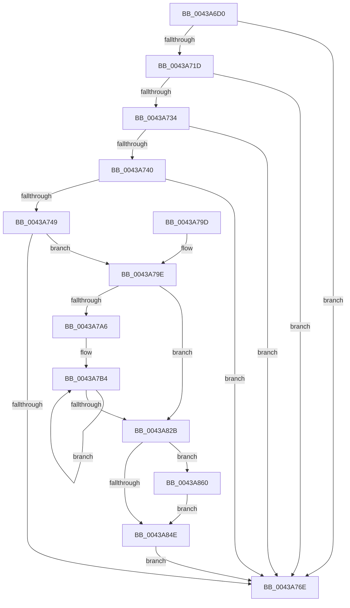

# PpmEventTraceProcessorIdleAccounting

- RVA: `0x0043A6D0`–`0x0043A91E` (길이 `590` bytes)
- VA: `0x000000014043A6D0`
- 실행 섹션: `.text`
- PDB 이름 있음: `예`; PDB Function 태그: `아니요`
- unwind 정보 RVA: `0x000A4330`
- 디코드: `140`개 명령, `590/590` bytes 표시
- 미해석 바이트: `0` (있으면 어셈블리에 `.byte`로 보존)

> 이 문서는 커널 이미지의 기계어와 PDB 기호를 분석해 생성했습니다. 4번과 5번은 함수 원형과 자료형을 바이너리 사용 방식에서 추정한 C 해석이며 원본 소스 복구 결과는 아닙니다.

## 1. Dependencies

- 직접 호출 지점: **8**; 고유 호출 대상: **6**
- 직접 호출자로 확인된 함수: **0**
- RIP 상대 이미지 참조: **4**

### Outgoing calls
- `0x0043A72B` → [EtwEventEnabled](../39/EtwEventEnabled_function_00392450.md) (function, `0x00392450`)
- `0x0043A761` → [ExAllocatePool2](../../poolcode/B8/ExAllocatePool2_function_00B820F0.md) (function, `0x00B820F0`)
- `0x0043A777` → [_security_check_cookie](../6A/_security_check_cookie_function_006AC640.md) (function, `0x006AC640`)
- `0x0043A841` → [ExAllocatePool2](../../poolcode/B8/ExAllocatePool2_function_00B820F0.md) (function, `0x00B820F0`)
- `0x0043A856` → [ExFreePoolWithTag](../../poolcode/B8/ExFreePoolWithTag_function_00B82870.md) (function, `0x00B82870`)
- `0x0043A86A` → [PpmTranslateIdleAccounting](PpmTranslateIdleAccounting_function_0043A924.md) (function, `0x0043A924`)
- `0x0043A907` → [EtwWriteEx](../25/EtwWriteEx_function_0025F0D0.md) (function, `0x0025F0D0`)
- `0x0043A914` → [ExFreePoolWithTag](../../poolcode/B8/ExFreePoolWithTag_function_00B82870.md) (function, `0x00B82870`)

### Direct callers
- 이 함수 시작 RVA로 연결되는 직접 call은 확인되지 않았습니다. 간접 호출은 완전히 역산할 수 없습니다.

### Static image references
- `0x0043A6F3` → RVA `0x00E0A740` (`.data`; read)
- `0x0043A707` → RVA `0x00E67A39` (`.data`; read)
- `0x0043A71D` → RVA `0x00F083E8` (`.data`; read)
- `0x0043A724` → RVA `0x000146B0` (`.rdata`; read)

## 2. Other-region calls and transfers

- 다른 실행 섹션으로 향하는 call: **4**
  - `0x0043A761` → [ExAllocatePool2](../../poolcode/B8/ExAllocatePool2_function_00B820F0.md) (`.text` → `POOLCODE`)
  - `0x0043A841` → [ExAllocatePool2](../../poolcode/B8/ExAllocatePool2_function_00B820F0.md) (`.text` → `POOLCODE`)
  - `0x0043A856` → [ExFreePoolWithTag](../../poolcode/B8/ExFreePoolWithTag_function_00B82870.md) (`.text` → `POOLCODE`)
  - `0x0043A914` → [ExFreePoolWithTag](../../poolcode/B8/ExFreePoolWithTag_function_00B82870.md) (`.text` → `POOLCODE`)
- 별도 외부 분기/꼬리 이동을 확인하지 못했습니다.

## 3. Assembly (complete function range)

```asm
0043A6D0  48 8B C4                        mov rax, rsp
0043A6D3  48 89 58 10                     mov qword ptr [rax + 0x10], rbx
0043A6D7  48 89 70 18                     mov qword ptr [rax + 0x18], rsi
0043A6DB  48 89 78 20                     mov qword ptr [rax + 0x20], rdi
0043A6DF  55                              push rbp
0043A6E0  41 54                           push r12
0043A6E2  41 55                           push r13
0043A6E4  41 56                           push r14
0043A6E6  41 57                           push r15
0043A6E8  48 8D 68 A1                     lea rbp, [rax - 0x5f]
0043A6EC  48 81 EC C0 00 00 00            sub rsp, 0xc0
0043A6F3  48 8B 05 46 00 9D 00            mov rax, qword ptr [rip + 0x9d0046]
0043A6FA  48 33 C4                        xor rax, rsp
0043A6FD  48 89 45 27                     mov qword ptr [rbp + 0x27], rax
0043A701  45 33 E4                        xor r12d, r12d
0043A704  4C 8B E9                        mov r13, rcx
0043A707  44 38 25 2B D3 A2 00            cmp byte ptr [rip + 0xa2d32b], r12b
0043A70E  66 44 89 65 B7                  mov word ptr [rbp - 0x49], r12w
0043A713  44 89 65 BB                     mov dword ptr [rbp - 0x45], r12d
0043A717  4C 89 65 BF                     mov qword ptr [rbp - 0x41], r12
0043A71B  74 51                           je 0x14043a76e
0043A71D  48 8B 0D C4 DC AC 00            mov rcx, qword ptr [rip + 0xacdcc4]
0043A724  48 8D 15 85 9F BD FF            lea rdx, [rip - 0x42607b]
0043A72B  E8 20 7D F5 FF                  call 0x140392450
0043A730  84 C0                           test al, al
0043A732  74 3A                           je 0x14043a76e
0043A734  49 8D B5 40 88 00 00            lea rsi, [r13 + 0x8840]
0043A73B  4C 39 26                        cmp qword ptr [rsi], r12
0043A73E  74 2E                           je 0x14043a76e
0043A740  48 8B 7E 08                     mov rdi, qword ptr [rsi + 8]
0043A744  48 85 FF                        test rdi, rdi
0043A747  74 25                           je 0x14043a76e
0043A749  8B 1F                           mov ebx, dword ptr [rdi]
0043A74B  41 8D 4C 24 40                  lea ecx, [r12 + 0x40]
0043A750  41 B8 50 50 4D 65               mov r8d, 0x654d5050
0043A756  44 8D 3C 9B                     lea r15d, [rbx + rbx*4]
0043A75A  41 C1 E7 04                     shl r15d, 4
0043A75E  41 8B D7                        mov edx, r15d
0043A761  E8 8A 79 74 00                  call 0x140b820f0
0043A766  4C 8B F0                        mov r14, rax
0043A769  48 85 C0                        test rax, rax
0043A76C  75 30                           jne 0x14043a79e
0043A76E  33 C0                           xor eax, eax
0043A770  48 8B 4D 27                     mov rcx, qword ptr [rbp + 0x27]
0043A774  48 33 CC                        xor rcx, rsp
0043A777  E8 C4 1E 27 00                  call 0x1406ac640
0043A77C  4C 8D 9C 24 C0 00 00 00         lea r11, [rsp + 0xc0]
0043A784  49 8B 5B 38                     mov rbx, qword ptr [r11 + 0x38]
0043A788  49 8B 73 40                     mov rsi, qword ptr [r11 + 0x40]
0043A78C  49 8B 7B 48                     mov rdi, qword ptr [r11 + 0x48]
0043A790  49 8B E3                        mov rsp, r11
0043A793  41 5F                           pop r15
0043A795  41 5E                           pop r14
0043A797  41 5D                           pop r13
0043A799  41 5C                           pop r12
0043A79B  5D                              pop rbp
0043A79C  C3                              ret
0043A79D  CC                              int3
0043A79E  85 DB                           test ebx, ebx
0043A7A0  0F 84 85 00 00 00               je 0x14043a82b
0043A7A6  48 8D 50 18                     lea rdx, [rax + 0x18]
0043A7AA  4C 8B CB                        mov r9, rbx
0043A7AD  4C 8D 87 98 00 00 00            lea r8, [rdi + 0x98]
0043A7B4  49 8B 48 F8                     mov rcx, qword ptr [r8 - 8]
0043A7B8  48 89 4A E8                     mov qword ptr [rdx - 0x18], rcx
0043A7BC  49 8B 00                        mov rax, qword ptr [r8]
0043A7BF  4D 8D 80 F8 03 00 00            lea r8, [r8 + 0x3f8]
0043A7C6  48 89 42 F8                     mov qword ptr [rdx - 8], rax
0043A7CA  49 8B 80 E0 FB FF FF            mov rax, qword ptr [r8 - 0x420]
0043A7D1  48 89 02                        mov qword ptr [rdx], rax
0043A7D4  48 8D 52 50                     lea rdx, [rdx + 0x50]
0043A7D8  49 8B 80 E8 FB FF FF            mov rax, qword ptr [r8 - 0x418]
0043A7DF  48 89 42 B8                     mov qword ptr [rdx - 0x48], rax
0043A7E3  49 8B 80 D0 FB FF FF            mov rax, qword ptr [r8 - 0x430]
0043A7EA  48 89 42 D0                     mov qword ptr [rdx - 0x30], rax
0043A7EE  49 8B 80 C8 FB FF FF            mov rax, qword ptr [r8 - 0x438]
0043A7F5  48 89 42 D8                     mov qword ptr [rdx - 0x28], rax
0043A7F9  49 8B 80 C0 FB FF FF            mov rax, qword ptr [r8 - 0x440]
0043A800  48 89 42 E0                     mov qword ptr [rdx - 0x20], rax
0043A804  49 8B 80 10 FC FF FF            mov rax, qword ptr [r8 - 0x3f0]
0043A80B  48 89 42 A0                     mov qword ptr [rdx - 0x60], rax
0043A80F  49 8B 80 20 FC FF FF            mov rax, qword ptr [r8 - 0x3e0]
0043A816  48 89 42 C0                     mov qword ptr [rdx - 0x40], rax
0043A81A  49 8B 80 18 FC FF FF            mov rax, qword ptr [r8 - 0x3e8]
0043A821  48 89 42 C8                     mov qword ptr [rdx - 0x38], rax
0043A825  49 83 E9 01                     sub r9, 1
0043A829  75 89                           jne 0x14043a7b4
0043A82B  69 FB A0 01 00 00               imul edi, ebx, 0x1a0
0043A831  B9 40 00 00 00                  mov ecx, 0x40
0043A836  41 B8 50 50 4D 65               mov r8d, 0x654d5050
0043A83C  83 C7 18                        add edi, 0x18
0043A83F  8B D7                           mov edx, edi
0043A841  E8 AA 78 74 00                  call 0x140b820f0
0043A846  4C 8B E0                        mov r12, rax
0043A849  48 85 C0                        test rax, rax
0043A84C  75 12                           jne 0x14043a860
0043A84E  BA 50 50 4D 65                  mov edx, 0x654d5050
0043A853  49 8B CE                        mov rcx, r14
0043A856  E8 15 80 74 00                  call 0x140b82870
0043A85B  E9 0E FF FF FF                  jmp 0x14043a76e
0043A860  4C 8D 45 BF                     lea r8, [rbp - 0x41]
0043A864  49 8B D4                        mov rdx, r12
0043A867  48 8B CE                        mov rcx, rsi
0043A86A  E8 B5 00 00 00                  call 0x14043a924
0043A86F  41 0F B6 8D D0 00 00 00         movzx ecx, byte ptr [r13 + 0xd0]
0043A877  48 8D 45 B7                     lea rax, [rbp - 0x49]
0043A87B  33 D2                           xor edx, edx
0043A87D  48 89 45 D7                     mov qword ptr [rbp - 0x29], rax
0043A881  49 8D 85 D1 00 00 00            lea rax, [r13 + 0xd1]
0043A888  89 55 D3                        mov dword ptr [rbp - 0x2d], edx
0043A88B  48 89 45 E7                     mov qword ptr [rbp - 0x19], rax
0043A88F  45 33 C9                        xor r9d, r9d
0043A892  48 8D 45 BF                     lea rax, [rbp - 0x41]
0043A896  66 89 4D B7                     mov word ptr [rbp - 0x49], cx
0043A89A  48 8B 0D 47 DB AC 00            mov rcx, qword ptr [rip + 0xacdb47]
0043A8A1  45 33 C0                        xor r8d, r8d
0043A8A4  48 89 45 F7                     mov qword ptr [rbp - 9], rax
0043A8A8  48 8D 45 BB                     lea rax, [rbp - 0x45]
0043A8AC  48 89 45 07                     mov qword ptr [rbp + 7], rax
0043A8B0  48 8D 45 C7                     lea rax, [rbp - 0x39]
0043A8B4  48 89 44 24 38                  mov qword ptr [rsp + 0x38], rax
0043A8B9  C7 44 24 30 06 00 00 00         mov dword ptr [rsp + 0x30], 6
0043A8C1  48 89 54 24 28                  mov qword ptr [rsp + 0x28], rdx
0043A8C6  48 89 54 24 20                  mov qword ptr [rsp + 0x20], rdx
0043A8CB  89 55 23                        mov dword ptr [rbp + 0x23], edx
0043A8CE  48 8D 15 DB 9D BD FF            lea rdx, [rip - 0x426225]
0043A8D5  4C 89 65 C7                     mov qword ptr [rbp - 0x39], r12
0043A8D9  89 7D CF                        mov dword ptr [rbp - 0x31], edi
0043A8DC  48 C7 45 DF 02 00 00 00         mov qword ptr [rbp - 0x21], 2
0043A8E4  48 C7 45 EF 01 00 00 00         mov qword ptr [rbp - 0x11], 1
0043A8EC  48 C7 45 FF 08 00 00 00         mov qword ptr [rbp - 1], 8
0043A8F4  4C 89 75 17                     mov qword ptr [rbp + 0x17], r14
0043A8F8  44 89 7D 1F                     mov dword ptr [rbp + 0x1f], r15d
0043A8FC  89 5D BB                        mov dword ptr [rbp - 0x45], ebx
0043A8FF  48 C7 45 0F 04 00 00 00         mov qword ptr [rbp + 0xf], 4
0043A907  E8 C4 47 E2 FF                  call 0x14025f0d0
0043A90C  BA 50 50 4D 65                  mov edx, 0x654d5050
0043A911  49 8B CC                        mov rcx, r12
0043A914  E8 57 7F 74 00                  call 0x140b82870
0043A919  E9 30 FF FF FF                  jmp 0x14043a84e
```

## 4. C-style interpretation (structured pseudocode)

```c
__int64 __fastcall PpmEventTraceProcessorIdleAccounting(__int64 a1)
{
    __int64 result;
    __int64 v_r12;
    __int64 v_r15;
    __int64 v_rdi;
    __int64 v_rsp;
    unsigned __int64 v_stack_m28;
    unsigned __int64 v_stack_m88;
    unsigned int v_stack_m90;
    unsigned __int64 v_stack_m98;
    unsigned __int64 v_stack_mA0;

    *(unsigned __int64 *)(v_rsp + 16) = v_rbx;
    *(unsigned __int64 *)(v_rsp + 24) = v_rsi;
    *(unsigned __int64 *)(v_rsp + 32) = v_rdi;
    v_rsp = (v_rsp) - (192);
    result = (*(unsigned __int64 *)(v_rip + 10289222)) ^ (v_rsp);
    *(unsigned __int64 *)(v_rsp - 95 + 39) = result;
    v_r12 = 0;
    *(unsigned __int16 *)(v_rsp - 95 - 73) = 0;
    *(unsigned int *)(v_rsp - 95 - 69) = 0;
    *(unsigned __int64 *)(v_rsp - 95 - 65) = 0;
    if ((*(unsigned __int8 *)(v_rip + 10670891)) == 0) goto loc_0043A76E;
    result = EtwEventEnabled(*(unsigned __int64 *)(v_rip + 11328708), v_rip - 4350075, a3, a4);
    if ((unsigned __int8)(result) == 0) goto loc_0043A76E;
    if ((*(unsigned __int64 *)(a1 + 34880)) == 0) goto loc_0043A76E;
    if (*(unsigned __int64 *)(a1 + 34880 + 8) == 0) goto loc_0043A76E;
    v_r15 = (unsigned int)(((unsigned int)(*(unsigned int *)(*(unsigned __int64 *)(a1 + 34880 + 8))) + (unsigned int)(*(unsigned int *)(*(unsigned __int64 *)(a1 + 34880 + 8))) * 4) << (4));
    result = ExAllocatePool2(v_r12 + 64, (unsigned int)((unsigned int)(v_r15)), (unsigned int)(0x654D5050ULL), a4);
    if (result != 0) goto loc_0043A79E;
loc_0043A76E:
    result = 0;
    a1 = (*(unsigned __int64 *)(v_rsp - 95 + 39)) ^ (v_rsp);
    result = _security_check_cookie(a1, (unsigned int)((unsigned int)(v_r15)), (unsigned int)(0x654D5050ULL), a4);
    return result;
loc_0043A79E:
    if ((unsigned int)(*(unsigned __int64 *)(v_stack_m28 + 56)) == 0) goto loc_0043A82B;
loc_0043A7B4:
    *(unsigned __int64 *)(result + 24 - 24) = *(unsigned __int64 *)(*(unsigned __int64 *)(v_stack_m28 + 72) + 152 - 8);
    *(unsigned __int64 *)(result + 24 - 8) = *(unsigned __int64 *)(*(unsigned __int64 *)(v_stack_m28 + 72) + 152);
    *(unsigned __int64 *)(result + 24) = *(unsigned __int64 *)(*(unsigned __int64 *)(v_stack_m28 + 72) + 152 + 1016 - 1056);
    *(unsigned __int64 *)(result + 24 + 80 - 72) = *(unsigned __int64 *)(*(unsigned __int64 *)(v_stack_m28 + 72) + 152 + 1016 - 1048);
    *(unsigned __int64 *)(result + 24 + 80 - 48) = *(unsigned __int64 *)(*(unsigned __int64 *)(v_stack_m28 + 72) + 152 + 1016 - 1072);
    *(unsigned __int64 *)(result + 24 + 80 - 40) = *(unsigned __int64 *)(*(unsigned __int64 *)(v_stack_m28 + 72) + 152 + 1016 - 1080);
    *(unsigned __int64 *)(result + 24 + 80 - 32) = *(unsigned __int64 *)(*(unsigned __int64 *)(v_stack_m28 + 72) + 152 + 1016 - 1088);
    *(unsigned __int64 *)(result + 24 + 80 - 96) = *(unsigned __int64 *)(*(unsigned __int64 *)(v_stack_m28 + 72) + 152 + 1016 - 1008);
    *(unsigned __int64 *)(result + 24 + 80 - 64) = *(unsigned __int64 *)(*(unsigned __int64 *)(v_stack_m28 + 72) + 152 + 1016 - 992);
    *(unsigned __int64 *)(result + 24 + 80 - 56) = *(unsigned __int64 *)(*(unsigned __int64 *)(v_stack_m28 + 72) + 152 + 1016 - 1000);
    a4 = (*(unsigned __int64 *)(v_stack_m28 + 56)) - (1);
    if (condition_is_not_equal) goto loc_0043A7B4;
loc_0043A82B:
    v_rdi = (unsigned int)((*(unsigned __int64 *)(v_stack_m28 + 72)) * ((unsigned int)(*(unsigned __int64 *)(v_stack_m28 + 56))));
    v_rdi = (unsigned int)((v_rdi) + (24));
    result = ExAllocatePool2(64, (unsigned int)((unsigned int)(v_rdi)), (unsigned int)(0x654D5050ULL), a4);
    if (result != 0) goto loc_0043A860;
loc_0043A84E:
    result = ExFreePoolWithTag(result, (unsigned int)(0x654D5050ULL), (unsigned int)(0x654D5050ULL), a4);
    goto loc_0043A76E;
loc_0043A860:
    result = PpmTranslateIdleAccounting(*(unsigned __int64 *)(v_stack_m28 + 64), result, v_rsp - 95 - 65, a4);
    a2 = 0;
    *(unsigned __int64 *)(v_rsp - 95 - 41) = v_rsp - 95 - 73;
    *(unsigned int *)(v_rsp - 95 - 45) = 0;
    *(unsigned __int64 *)(v_rsp - 95 - 25) = a1 + 209;
    a4 = 0;
    *(unsigned __int16 *)(v_rsp - 95 - 73) = (unsigned __int16)(*(unsigned __int8 *)(a1 + 208));
    a3 = 0;
    *(unsigned __int64 *)(v_rsp - 95 - 9) = v_rsp - 95 - 65;
    *(unsigned __int64 *)(v_rsp - 95 + 7) = v_rsp - 95 - 69;
    v_stack_m88 = v_rsp - 95 - 57;
    v_stack_m90 = 6;
    v_stack_m98 = 0;
    v_stack_mA0 = 0;
    *(unsigned int *)(v_rsp - 95 + 35) = 0;
    *(unsigned __int64 *)(v_rsp - 95 - 57) = result;
    *(unsigned int *)(v_rsp - 95 - 49) = (unsigned int)(v_rdi);
    *(unsigned __int64 *)(v_rsp - 95 - 33) = 2;
    *(unsigned __int64 *)(v_rsp - 95 - 17) = 1;
    *(unsigned __int64 *)(v_rsp - 95 - 1) = 8;
    *(unsigned __int64 *)(v_rsp - 95 + 23) = result;
    *(unsigned int *)(v_rsp - 95 + 31) = (unsigned int)(v_r15);
    *(unsigned int *)(v_rsp - 95 - 69) = (unsigned int)(*(unsigned __int64 *)(v_stack_m28 + 56));
    *(unsigned __int64 *)(v_rsp - 95 + 15) = 4;
    result = EtwWriteEx(*(unsigned __int64 *)(v_rip + 11328327), v_rip - 4350501, a3, a4);
    result = ExFreePoolWithTag(result, (unsigned int)(0x654D5050ULL), a3, a4);
    goto loc_0043A84E;
}
```

## 5. (Beta) C Style

```c
int64_t PpmEventTraceProcessorIdleAccounting(void *Arg1)
{
    uint8_t *arg1 = (uint8_t *)Arg1;

    int64_t result;
    int64_t local_r12;
    int64_t local_r15;
    int64_t local_rdi;
    int64_t local_rsp;
    uint64_t v_stack_m28;
    uint64_t v_stack_m88;
    uint32_t v_stack_m90;
    uint64_t v_stack_m98;
    uint64_t v_stack_mA0;

    *(uint64_t *)(local_rsp + 0x10) = local_rbx;
    *(uint64_t *)(local_rsp + 0x18) = local_rsi;
    *(uint64_t *)(local_rsp + 0x20) = local_rdi;
    local_rsp = (local_rsp) - (192);
    result = (*(uint64_t *)(v_rip + 0x9D0046)) ^ (local_rsp);
    *(uint64_t *)(local_rsp - 0x5F + 0x27) = result;
    local_r12 = 0;
    *(uint16_t *)(local_rsp - 0x5F - 0x49) = 0;
    *(uint32_t *)(local_rsp - 0x5F - 0x45) = 0;
    *(uint64_t *)(local_rsp - 0x5F - 0x41) = 0;
    if ((*(uint8_t *)(v_rip + 0xA2D32B)) == 0) goto loc_0043A76E;
    result = EtwEventEnabled(*(uint64_t *)(v_rip + 0xACDCC4), v_rip - 4350075, a3, a4);
    if ((uint8_t)(result) == 0) goto loc_0043A76E;
    if ((*(uint64_t *)(arg1 + 0x8840)) == 0) goto loc_0043A76E;
    if (*(uint64_t *)(arg1 + 0x8840 + 0x8) == 0) goto loc_0043A76E;
    local_r15 = (uint32_t)(((uint32_t)(*(uint32_t *)(*(uint64_t *)(arg1 + 0x8840 + 0x8))) + (uint32_t)(*(uint32_t *)(*(uint64_t *)(arg1 + 0x8840 + 0x8))) * 4) << (4));
    result = ExAllocatePool2(local_r12 + 64, (uint32_t)((uint32_t)(local_r15)), (uint32_t)(0x654D5050ULL), a4);
    if (result != 0) goto loc_0043A79E;
loc_0043A76E:
    result = 0;
    Arg1 = (*(uint64_t *)(local_rsp - 0x5F + 0x27)) ^ (local_rsp);
    result = _security_check_cookie(Arg1, (uint32_t)((uint32_t)(local_r15)), (uint32_t)(0x654D5050ULL), a4);
    return result;
loc_0043A79E:
    if ((uint32_t)(*(uint64_t *)(v_stack_m28 + 0x38)) == 0) goto loc_0043A82B;
loc_0043A7B4:
    *(uint64_t *)(result + 0x18 - 0x18) = *(uint64_t *)(*(uint64_t *)(v_stack_m28 + 0x48) + 0x98 - 0x8);
    *(uint64_t *)(result + 0x18 - 0x8) = *(uint64_t *)(*(uint64_t *)(v_stack_m28 + 0x48) + 0x98);
    *(uint64_t *)(result + 0x18) = *(uint64_t *)(*(uint64_t *)(v_stack_m28 + 0x48) + 0x98 + 0x3F8 - 0x420);
    *(uint64_t *)(result + 0x18 + 0x50 - 0x48) = *(uint64_t *)(*(uint64_t *)(v_stack_m28 + 0x48) + 0x98 + 0x3F8 - 0x418);
    *(uint64_t *)(result + 0x18 + 0x50 - 0x30) = *(uint64_t *)(*(uint64_t *)(v_stack_m28 + 0x48) + 0x98 + 0x3F8 - 0x430);
    *(uint64_t *)(result + 0x18 + 0x50 - 0x28) = *(uint64_t *)(*(uint64_t *)(v_stack_m28 + 0x48) + 0x98 + 0x3F8 - 0x438);
    *(uint64_t *)(result + 0x18 + 0x50 - 0x20) = *(uint64_t *)(*(uint64_t *)(v_stack_m28 + 0x48) + 0x98 + 0x3F8 - 0x440);
    *(uint64_t *)(result + 0x18 + 0x50 - 0x60) = *(uint64_t *)(*(uint64_t *)(v_stack_m28 + 0x48) + 0x98 + 0x3F8 - 0x3F0);
    *(uint64_t *)(result + 0x18 + 0x50 - 0x40) = *(uint64_t *)(*(uint64_t *)(v_stack_m28 + 0x48) + 0x98 + 0x3F8 - 0x3E0);
    *(uint64_t *)(result + 0x18 + 0x50 - 0x38) = *(uint64_t *)(*(uint64_t *)(v_stack_m28 + 0x48) + 0x98 + 0x3F8 - 0x3E8);
    a4 = (*(uint64_t *)(v_stack_m28 + 0x38)) - (1);
    if (condition_is_not_equal) goto loc_0043A7B4;
loc_0043A82B:
    local_rdi = (uint32_t)((*(uint64_t *)(v_stack_m28 + 0x48)) * ((uint32_t)(*(uint64_t *)(v_stack_m28 + 0x38))));
    local_rdi = (uint32_t)((local_rdi) + (24));
    result = ExAllocatePool2(64, (uint32_t)((uint32_t)(local_rdi)), (uint32_t)(0x654D5050ULL), a4);
    if (result != 0) goto loc_0043A860;
loc_0043A84E:
    result = ExFreePoolWithTag(result, (uint32_t)(0x654D5050ULL), (uint32_t)(0x654D5050ULL), a4);
    goto loc_0043A76E;
loc_0043A860:
    result = PpmTranslateIdleAccounting(*(uint64_t *)(v_stack_m28 + 0x40), result, local_rsp - 95 - 65, a4);
    a2 = 0;
    *(uint64_t *)(local_rsp - 0x5F - 0x29) = local_rsp - 95 - 73;
    *(uint32_t *)(local_rsp - 0x5F - 0x2D) = 0;
    *(void **)(local_rsp - 0x5F - 0x19) = Arg1 + 209;
    a4 = 0;
    *(uint16_t *)(local_rsp - 0x5F - 0x49) = (uint16_t)(*(uint8_t *)(arg1 + 0xD0));
    a3 = 0;
    *(uint64_t *)(local_rsp - 0x5F - 0x9) = local_rsp - 95 - 65;
    *(uint64_t *)(local_rsp - 0x5F + 0x7) = local_rsp - 95 - 69;
    v_stack_m88 = local_rsp - 95 - 57;
    v_stack_m90 = 6;
    v_stack_m98 = 0;
    v_stack_mA0 = 0;
    *(uint32_t *)(local_rsp - 0x5F + 0x23) = 0;
    *(uint64_t *)(local_rsp - 0x5F - 0x39) = result;
    *(uint32_t *)(local_rsp - 0x5F - 0x31) = (uint32_t)(local_rdi);
    *(uint64_t *)(local_rsp - 0x5F - 0x21) = 2;
    *(uint64_t *)(local_rsp - 0x5F - 0x11) = 1;
    *(uint64_t *)(local_rsp - 0x5F - 0x1) = 8;
    *(uint64_t *)(local_rsp - 0x5F + 0x17) = result;
    *(uint32_t *)(local_rsp - 0x5F + 0x1F) = (uint32_t)(local_r15);
    *(uint32_t *)(local_rsp - 0x5F - 0x45) = (uint32_t)(*(uint64_t *)(v_stack_m28 + 0x38));
    *(uint64_t *)(local_rsp - 0x5F + 0xF) = 4;
    result = EtwWriteEx(*(uint64_t *)(v_rip + 0xACDB47), v_rip - 4350501, a3, a4);
    result = ExFreePoolWithTag(result, (uint32_t)(0x654D5050ULL), a3, a4);
    goto loc_0043A84E;
}
```

### 관측된 메모리 오프셋

구조체 형식이 확인되지 않은 접근은 인자 기준의 오프셋으로만 기록했습니다.

| 기준 인자 | 오프셋 표현 | 폭 (bit) | 접근 |
|---|---:|---:|---|
| `Arg1` | `+ 0x0` | `64` | `R` |
| `Arg1` | `+ 0x8` | `64` | `R` |
| `Arg1` | `+ 0xD0` | `8` | `R` |
| `Arg1` | `+ 0xD1` | `64` | `R` |
| `Arg1` | `+ 0x8840` | `64` | `R` |

## 6. Execution-region graph

[열기: 2D/3D 그래프와 함수 탐색 컨트롤 패널](../../../control-panel.html?section=text&rva=0x0043A6D0&view=graph)

- 2D 그래프는 위에서 아래로 흐르고, 3D 그래프는 빈 공간을 드래그해 회전합니다. Shift+드래그는 이동, 휠은 확대·축소, 함수 노드 선택은 대상 보고서 이동입니다.

### Static fallback


