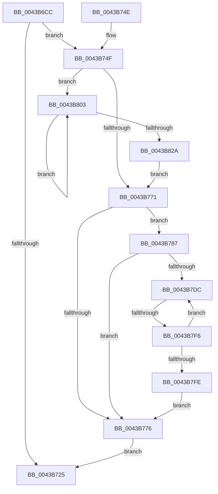

# PpmIdleCaptureCsVetoAccounting

- RVA: `0x0043B6CC`–`0x0043B82F` (길이 `355` bytes)
- VA: `0x000000014043B6CC`
- 실행 섹션: `.text`
- PDB 이름 있음: `예`; PDB Function 태그: `예`
- unwind 정보 RVA: `0x000A4424`
- 디코드: `89`개 명령, `355/355` bytes 표시
- 미해석 바이트: `0` (있으면 어셈블리에 `.byte`로 보존)

> 이 문서는 커널 이미지의 기계어와 PDB 기호를 분석해 생성했습니다. 4번과 5번은 함수 원형과 자료형을 바이너리 사용 방식에서 추정한 C 해석이며 원본 소스 복구 결과는 아닙니다.

## 1. Dependencies

- 직접 호출 지점: **4**; 고유 호출 대상: **4**
- 직접 호출자로 확인된 함수: **1**
- RIP 상대 이미지 참조: **5**

### Outgoing calls
- `0x0043B72C` → [_security_check_cookie](../6A/_security_check_cookie_function_006AC640.md) (function, `0x006AC640`)
- `0x0043B756` → [KeAcquireSpinLockRaiseToDpc](../20/KeAcquireSpinLockRaiseToDpc_function_00208470.md) (function, `0x00208470`)
- `0x0043B780` → [KeReleaseSpinLock](../39/KeReleaseSpinLock_function_00392BA0.md) (function, `0x00392BA0`)
- `0x0043B818` → [PpmIdleCsVetoAccountingUpdateBlock](../30/PpmIdleCsVetoAccountingUpdateBlock_function_003040B0.md) (function, `0x003040B0`)

### Direct callers
- [PopCaptureSleepStudyStatistics](PopCaptureSleepStudyStatistics_function_004399F4.md) at `0x00439F37`

### Static image references
- `0x0043B6EB` → RVA `0x00E0A740` (`.data`; read)
- `0x0043B6F9` → RVA `0x00F0B6B0` (`.data`; read)
- `0x0043B703` → RVA `0x00FC6AD0` (`ALMOSTRO`; read)
- `0x0043B74F` → RVA `0x00F0CA68` (`.data`; read)
- `0x0043B798` → RVA `0x000146F0` (`.rdata`; read)

## 2. Other-region calls and transfers

- 다른 실행 섹션으로 향하는 call: **0**
- call이 아닌 외부 분기/꼬리 이동: **1**
  - `0x0043B7F0` → [sub_006EF506](../6E/Unknown_function_006EF506.md) (`tail-transfer`)

## 3. Assembly (complete function range)

```asm
0043B6CC  48 8B C4                        mov rax, rsp
0043B6CF  48 89 58 08                     mov qword ptr [rax + 8], rbx
0043B6D3  48 89 70 10                     mov qword ptr [rax + 0x10], rsi
0043B6D7  48 89 78 18                     mov qword ptr [rax + 0x18], rdi
0043B6DB  55                              push rbp
0043B6DC  41 56                           push r14
0043B6DE  41 57                           push r15
0043B6E0  48 8D 68 A1                     lea rbp, [rax - 0x5f]
0043B6E4  48 81 EC E0 00 00 00            sub rsp, 0xe0
0043B6EB  48 8B 05 4E F0 9C 00            mov rax, qword ptr [rip + 0x9cf04e]
0043B6F2  48 33 C4                        xor rax, rsp
0043B6F5  48 89 45 37                     mov qword ptr [rbp + 0x37], rax
0043B6F9  48 8B 05 B0 FF AC 00            mov rax, qword ptr [rip + 0xacffb0]
0043B700  45 33 FF                        xor r15d, r15d
0043B703  4C 39 3D C6 B3 B8 00            cmp qword ptr [rip + 0xb8b3c6], r15
0043B70A  0F 57 C0                        xorps xmm0, xmm0
0043B70D  8B F2                           mov esi, edx
0043B70F  48 89 45 8F                     mov qword ptr [rbp - 0x71], rax
0043B713  4C 89 7D 97                     mov qword ptr [rbp - 0x69], r15
0043B717  0F 11 45 9F                     movups xmmword ptr [rbp - 0x61], xmm0
0043B71B  44 88 7D 87                     mov byte ptr [rbp - 0x79], r15b
0043B71F  44 89 7D 8B                     mov dword ptr [rbp - 0x75], r15d
0043B723  75 2A                           jne 0x14043b74f
0043B725  48 8B 4D 37                     mov rcx, qword ptr [rbp + 0x37]
0043B729  48 33 CC                        xor rcx, rsp
0043B72C  E8 0F 0F 27 00                  call 0x1406ac640
0043B731  4C 8D 9C 24 E0 00 00 00         lea r11, [rsp + 0xe0]
0043B739  49 8B 5B 20                     mov rbx, qword ptr [r11 + 0x20]
0043B73D  49 8B 73 28                     mov rsi, qword ptr [r11 + 0x28]
0043B741  49 8B 7B 30                     mov rdi, qword ptr [r11 + 0x30]
0043B745  49 8B E3                        mov rsp, r11
0043B748  41 5F                           pop r15
0043B74A  41 5E                           pop r14
0043B74C  5D                              pop rbp
0043B74D  C3                              ret
0043B74E  CC                              int3
0043B74F  48 8D 0D 12 13 AD 00            lea rcx, [rip + 0xad1312]
0043B756  E8 15 CD DC FF                  call 0x140208470
0043B75B  48 8B 1D 6E B3 B8 00            mov rbx, qword ptr [rip + 0xb8b36e]
0043B762  44 8A F0                        mov r14b, al
0043B765  41 8B FF                        mov edi, r15d
0043B768  44 39 3B                        cmp dword ptr [rbx], r15d
0043B76B  0F 87 92 00 00 00               ja 0x14043b803
0043B771  83 FE FF                        cmp esi, -1
0043B774  75 11                           jne 0x14043b787
0043B776  41 8A D6                        mov dl, r14b
0043B779  48 8D 0D E8 12 AD 00            lea rcx, [rip + 0xad12e8]
0043B780  E8 1B 74 F5 FF                  call 0x140392ba0
0043B785  EB 9E                           jmp 0x14043b725
0043B787  8A 45 8F                        mov al, byte ptr [rbp - 0x71]
0043B78A  41 8B FF                        mov edi, r15d
0043B78D  88 45 87                        mov byte ptr [rbp - 0x79], al
0043B790  48 8D 45 87                     lea rax, [rbp - 0x79]
0043B794  48 89 45 B7                     mov qword ptr [rbp - 0x49], rax
0043B798  48 8D 05 51 8F BD FF            lea rax, [rip - 0x4270af]
0043B79F  66 89 75 A3                     mov word ptr [rbp - 0x5d], si
0043B7A3  48 89 45 C7                     mov qword ptr [rbp - 0x39], rax
0043B7A7  48 8D 45 9F                     lea rax, [rbp - 0x61]
0043B7AB  48 69 F6 C0 01 00 00            imul rsi, rsi, 0x1c0
0043B7B2  C7 45 9F CC AA CC AA            mov dword ptr [rbp - 0x61], 0xaaccaacc
0043B7B9  48 C7 45 BF 01 00 00 00         mov qword ptr [rbp - 0x41], 1
0043B7C1  48 C7 45 CF 10 00 00 00         mov qword ptr [rbp - 0x31], 0x10
0043B7C9  48 89 45 F7                     mov qword ptr [rbp - 9], rax
0043B7CD  48 C7 45 FF 10 00 00 00         mov qword ptr [rbp - 1], 0x10
0043B7D5  44 39 7C 1E 6C                  cmp dword ptr [rsi + rbx + 0x6c], r15d
0043B7DA  76 9A                           jbe 0x14043b776
0043B7DC  8B C7                           mov eax, edi
0043B7DE  48 C1 E0 06                     shl rax, 6
0043B7E2  48 03 44 1E 70                  add rax, qword ptr [rsi + rbx + 0x70]
0043B7E7  8B CF                           mov ecx, edi
0043B7E9  4C 8D 48 38                     lea r9, [rax + 0x38]
0043B7ED  4D 39 39                        cmp qword ptr [r9], r15
0043B7F0  0F 87 10 3D 2B 00               ja 0x1406ef506
0043B7F6  FF C7                           inc edi
0043B7F8  3B 7C 1E 6C                     cmp edi, dword ptr [rsi + rbx + 0x6c]
0043B7FC  72 DE                           jb 0x14043b7dc
0043B7FE  E9 73 FF FF FF                  jmp 0x14043b776
0043B803  8B CF                           mov ecx, edi
0043B805  45 33 C0                        xor r8d, r8d
0043B808  48 69 D1 C0 01 00 00            imul rdx, rcx, 0x1c0
0043B80F  48 8D 4B 50                     lea rcx, [rbx + 0x50]
0043B813  48 03 CA                        add rcx, rdx
0043B816  B2 04                           mov dl, 4
0043B818  E8 93 88 EC FF                  call 0x1403040b0
0043B81D  48 8B 1D AC B2 B8 00            mov rbx, qword ptr [rip + 0xb8b2ac]
0043B824  FF C7                           inc edi
0043B826  3B 3B                           cmp edi, dword ptr [rbx]
0043B828  72 D9                           jb 0x14043b803
0043B82A  E9 42 FF FF FF                  jmp 0x14043b771
```

## 4. C-style interpretation (structured pseudocode)

```c
__int64 __fastcall PpmIdleCaptureCsVetoAccounting(__int64 a1, int a2, int a3)
{
    __int64 result;
    __int64 v_r15;
    __int64 v_rdi;
    __int64 v_rsi;
    __int64 v_rsp;
    unsigned __int64 v_stack_m18;

    *(unsigned __int64 *)(v_rsp + 8) = v_rbx;
    *(unsigned __int64 *)(v_rsp + 16) = v_rsi;
    *(unsigned __int64 *)(v_rsp + 24) = v_rdi;
    v_rsp = (v_rsp) - (224);
    result = (*(unsigned __int64 *)(v_rip + 10285134)) ^ (v_rsp);
    *(unsigned __int64 *)(v_rsp - 95 + 55) = result;
    v_r15 = 0;
    *(unsigned __int64 *)(v_rsp - 95 - 113) = *(unsigned __int64 *)(v_rip + 11337648);
    *(unsigned __int64 *)(v_rsp - 95 - 105) = 0;
    *(unsigned __int64 *)(v_rsp - 95 - 97) = v_xmm0;
    *(unsigned __int8 *)(v_rsp - 95 - 121) = 0;
    *(unsigned int *)(v_rsp - 95 - 117) = 0;
    if ((*(unsigned __int64 *)(v_rip + 12104646)) != 0) goto loc_0043B74F;
loc_0043B725:
    a1 = (*(unsigned __int64 *)(v_rsp - 95 + 55)) ^ (v_rsp);
    result = _security_check_cookie(a1, a2, a3, a4);
    return result;
loc_0043B74F:
    result = KeAcquireSpinLockRaiseToDpc(v_rip + 11342610, a2, a3, a4);
    if ((*(unsigned int *)(*(unsigned __int64 *)(v_rip + 12104558))) > 0) goto loc_0043B803;
loc_0043B771:
    if (((unsigned int)(*(unsigned __int64 *)(v_stack_m18 + 40))) != -1) goto loc_0043B787;
loc_0043B776:
    result = KeReleaseSpinLock(v_rip + 11342568, (unsigned __int8)((unsigned __int8)(result)), a3, a4);
    goto loc_0043B725;
loc_0043B787:
    *(unsigned __int8 *)(v_rsp - 95 - 121) = (unsigned __int8)(*(unsigned __int8 *)(v_rsp - 95 - 113));
    *(unsigned __int64 *)(v_rsp - 95 - 73) = v_rsp - 95 - 121;
    *(unsigned __int16 *)(v_rsp - 95 - 93) = (unsigned __int16)(*(unsigned __int64 *)(v_stack_m18 + 40));
    *(unsigned __int64 *)(v_rsp - 95 - 57) = v_rip - 4354223;
    v_rsi = (*(unsigned __int64 *)(v_stack_m18 + 40)) * (*(unsigned __int64 *)(v_stack_m18 + 40));
    *(unsigned int *)(v_rsp - 95 - 97) = 0xAACCAACCULL;
    *(unsigned __int64 *)(v_rsp - 95 - 65) = 1;
    *(unsigned __int64 *)(v_rsp - 95 - 49) = 16;
    *(unsigned __int64 *)(v_rsp - 95 - 9) = v_rsp - 95 - 97;
    *(unsigned __int64 *)(v_rsp - 95 - 1) = 16;
    if ((*(unsigned int *)(v_rsi + *(unsigned __int64 *)(v_rip + 12104558) * 1 + 108)) <= 0) goto loc_0043B776;
loc_0043B7DC:
    result = (0) << (6);
    result = (result) + (*(unsigned __int64 *)(v_rsi + *(unsigned __int64 *)(v_rip + 12104558) * 1 + 112));
    v_rdi = (unsigned int)((0) + 1);
    if (((unsigned int)(v_rdi)) < (*(unsigned int *)(v_rsi + *(unsigned __int64 *)(v_rip + 12104558) * 1 + 108))) goto loc_0043B7DC;
    goto loc_0043B776;
loc_0043B803:
    a3 = 0;
    a2 = ((unsigned __int8)((unsigned __int8)(result))) * ((unsigned int)((unsigned int)(v_rdi)));
    a1 = (*(unsigned __int64 *)(v_rip + 12104558) + 80) + (a2);
    result = PpmIdleCsVetoAccountingUpdateBlock(a1, 4, a3, result + 56);
    v_rdi = (unsigned int)((v_rdi) + 1);
    if (((unsigned int)(v_rdi)) < (*(unsigned int *)(*(unsigned __int64 *)(v_rip + 12104364)))) goto loc_0043B803;
    goto loc_0043B771;
}
```

## 5. (Beta) C Style

```c
int64_t PpmIdleCaptureCsVetoAccounting(int64_t Arg1, int32_t Arg2, int32_t Arg3)
{
    int64_t result;
    int64_t local_r15;
    int64_t local_rdi;
    int64_t local_rsi;
    int64_t local_rsp;
    uint64_t v_stack_m18;

    *(uint64_t *)(local_rsp + 0x8) = local_rbx;
    *(uint64_t *)(local_rsp + 0x10) = local_rsi;
    *(uint64_t *)(local_rsp + 0x18) = local_rdi;
    local_rsp = (local_rsp) - (224);
    result = (*(uint64_t *)(v_rip + 0x9CF04E)) ^ (local_rsp);
    *(uint64_t *)(local_rsp - 0x5F + 0x37) = result;
    local_r15 = 0;
    *(uint64_t *)(local_rsp - 0x5F - 0x71) = *(uint64_t *)(v_rip + 0xACFFB0);
    *(uint64_t *)(local_rsp - 0x5F - 0x69) = 0;
    *(uint64_t *)(local_rsp - 0x5F - 0x61) = v_xmm0;
    *(uint8_t *)(local_rsp - 0x5F - 0x79) = 0;
    *(uint32_t *)(local_rsp - 0x5F - 0x75) = 0;
    if ((*(uint64_t *)(v_rip + 0xB8B3C6)) != 0) goto loc_0043B74F;
loc_0043B725:
    Arg1 = (*(uint64_t *)(local_rsp - 0x5F + 0x37)) ^ (local_rsp);
    result = _security_check_cookie(Arg1, Arg2, Arg3, a4);
    return result;
loc_0043B74F:
    result = KeAcquireSpinLockRaiseToDpc(v_rip + 11342610, Arg2, Arg3, a4);
    if ((*(uint32_t *)(*(uint64_t *)(v_rip + 0xB8B36E))) > 0) goto loc_0043B803;
loc_0043B771:
    if (((uint32_t)(*(uint64_t *)(v_stack_m18 + 0x28))) != -1) goto loc_0043B787;
loc_0043B776:
    result = KeReleaseSpinLock(v_rip + 11342568, (uint8_t)((uint8_t)(result)), Arg3, a4);
    goto loc_0043B725;
loc_0043B787:
    *(uint8_t *)(local_rsp - 0x5F - 0x79) = (uint8_t)(*(uint8_t *)(local_rsp - 0x5F - 0x71));
    *(uint64_t *)(local_rsp - 0x5F - 0x49) = local_rsp - 95 - 121;
    *(uint16_t *)(local_rsp - 0x5F - 0x5D) = (uint16_t)(*(uint64_t *)(v_stack_m18 + 0x28));
    *(uint64_t *)(local_rsp - 0x5F - 0x39) = v_rip - 4354223;
    local_rsi = (*(uint64_t *)(v_stack_m18 + 0x28)) * (*(uint64_t *)(v_stack_m18 + 0x28));
    *(uint32_t *)(local_rsp - 0x5F - 0x61) = 0xAACCAACCULL;
    *(uint64_t *)(local_rsp - 0x5F - 0x41) = 1;
    *(uint64_t *)(local_rsp - 0x5F - 0x31) = 16;
    *(uint64_t *)(local_rsp - 0x5F - 0x9) = local_rsp - 95 - 97;
    *(uint64_t *)(local_rsp - 0x5F - 0x1) = 16;
    if ((*(uint32_t *)(local_rsi + *(uint64_t *)(v_rip + 0xB8B36E) * 1 + 0x6C)) <= 0) goto loc_0043B776;
loc_0043B7DC:
    result = (0) << (6);
    result = (result) + (*(uint64_t *)(local_rsi + *(uint64_t *)(v_rip + 0xB8B36E) * 1 + 0x70));
    local_rdi = (uint32_t)((0) + 1);
    if (((uint32_t)(local_rdi)) < (*(uint32_t *)(local_rsi + *(uint64_t *)(v_rip + 0xB8B36E) * 1 + 0x6C))) goto loc_0043B7DC;
    goto loc_0043B776;
loc_0043B803:
    Arg3 = 0;
    Arg2 = ((uint8_t)((uint8_t)(result))) * ((uint32_t)((uint32_t)(local_rdi)));
    Arg1 = (*(uint64_t *)(v_rip + 0xB8B36E) + 80) + (Arg2);
    result = PpmIdleCsVetoAccountingUpdateBlock(Arg1, 4, Arg3, result + 56);
    local_rdi = (uint32_t)((local_rdi) + 1);
    if (((uint32_t)(local_rdi)) < (*(uint32_t *)(*(uint64_t *)(v_rip + 0xB8B2AC)))) goto loc_0043B803;
    goto loc_0043B771;
}
```

## 6. Execution-region graph

[열기: 2D/3D 그래프와 함수 탐색 컨트롤 패널](../../../control-panel.html?section=text&rva=0x0043B6CC&view=graph)

- 2D 그래프는 위에서 아래로 흐르고, 3D 그래프는 빈 공간을 드래그해 회전합니다. Shift+드래그는 이동, 휠은 확대·축소, 함수 노드 선택은 대상 보고서 이동입니다.

### Static fallback


