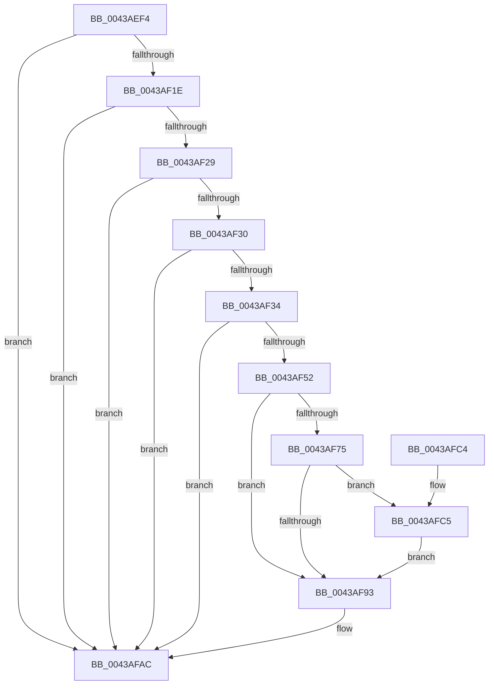

# PpmQueryPlatformStateResidency

- RVA: `0x0043AEF4`–`0x0043AFD2` (길이 `222` bytes)
- VA: `0x000000014043AEF4`
- 실행 섹션: `.text`
- PDB 이름 있음: `예`; PDB Function 태그: `아니요`
- unwind 정보 RVA: `0x00069BF8`
- 디코드: `57`개 명령, `222/222` bytes 표시
- 미해석 바이트: `0` (있으면 어셈블리에 `.byte`로 보존)

> 이 문서는 커널 이미지의 기계어와 PDB 기호를 분석해 생성했습니다. 4번과 5번은 함수 원형과 자료형을 바이너리 사용 방식에서 추정한 C 해석이며 원본 소스 복구 결과는 아닙니다.

## 1. Dependencies

- 직접 호출 지점: **5**; 고유 호출 대상: **5**
- 직접 호출자로 확인된 함수: **3**
- RIP 상대 이미지 참조: **2**

### Outgoing calls
- `0x0043AF45` → [ExAllocatePool2](../../poolcode/B8/ExAllocatePool2_function_00B820F0.md) (function, `0x00B820F0`)
- `0x0043AF5B` → [PopAcquireRwLockShared](../2D/PopAcquireRwLockShared_function_002D9A40.md) (function, `0x002D9A40`)
- `0x0043AF8A` → [guard_dispatch_icall](../6B/guard_dispatch_icall_function_006BAAD0.md) (function, `0x006BAAD0`)
- `0x0043AF9A` → [PopReleaseRwLock](../2D/PopReleaseRwLock_function_002DFBBC.md) (function, `0x002DFBBC`)
- `0x0043AFA7` → [ExFreePoolWithTag](../../poolcode/B8/ExFreePoolWithTag_function_00B82870.md) (function, `0x00B82870`)

### Direct callers
- [PopQueryBootSessionStandbyActivationInfo](PopQueryBootSessionStandbyActivationInfo_function_0043AD74.md) at `0x0043ADA5`
- [PpmQueryDripsResidency](PpmQueryDripsResidency_function_0043ADD0.md) at `0x0043ADDA`
- [PopCalculateIdleInformation](PopCalculateIdleInformation_function_0043ADEC.md) at `0x0043AE31`

### Static image references
- `0x0043AF08` → RVA `0x00FC6AD0` (`ALMOSTRO`; read)
- `0x0043AF52` → RVA `0x00F0CA70` (`.data`; read)

## 2. Other-region calls and transfers

- 다른 실행 섹션으로 향하는 call: **2**
  - `0x0043AF45` → [ExAllocatePool2](../../poolcode/B8/ExAllocatePool2_function_00B820F0.md) (`.text` → `POOLCODE`)
  - `0x0043AFA7` → [ExFreePoolWithTag](../../poolcode/B8/ExFreePoolWithTag_function_00B82870.md) (`.text` → `POOLCODE`)
- 별도 외부 분기/꼬리 이동을 확인하지 못했습니다.

## 3. Assembly (complete function range)

```asm
0043AEF4  48 89 5C 24 08                  mov qword ptr [rsp + 8], rbx
0043AEF9  48 89 6C 24 10                  mov qword ptr [rsp + 0x10], rbp
0043AEFE  48 89 74 24 18                  mov qword ptr [rsp + 0x18], rsi
0043AF03  57                              push rdi
0043AF04  48 83 EC 20                     sub rsp, 0x20
0043AF08  48 8B 05 C1 BB B8 00            mov rax, qword ptr [rip + 0xb8bbc1]
0043AF0F  48 83 CD FF                     or rbp, 0xffffffffffffffff
0043AF13  8B F9                           mov edi, ecx
0043AF15  48 85 C0                        test rax, rax
0043AF18  0F 84 8E 00 00 00               je 0x14043afac
0043AF1E  48 83 78 28 00                  cmp qword ptr [rax + 0x28], 0
0043AF23  0F 84 83 00 00 00               je 0x14043afac
0043AF29  8B 30                           mov esi, dword ptr [rax]
0043AF2B  83 FF FF                        cmp edi, -1
0043AF2E  74 7C                           je 0x14043afac
0043AF30  3B FE                           cmp edi, esi
0043AF32  73 78                           jae 0x14043afac
0043AF34  8B D6                           mov edx, esi
0043AF36  8D 4D 41                        lea ecx, [rbp + 0x41]
0043AF39  C1 E2 04                        shl edx, 4
0043AF3C  41 B8 50 50 4D 69               mov r8d, 0x694d5050
0043AF42  83 C2 08                        add edx, 8
0043AF45  E8 A6 71 74 00                  call 0x140b820f0
0043AF4A  48 8B D8                        mov rbx, rax
0043AF4D  48 85 C0                        test rax, rax
0043AF50  74 5A                           je 0x14043afac
0043AF52  48 8D 0D 17 1B AD 00            lea rcx, [rip + 0xad1b17]
0043AF59  89 30                           mov dword ptr [rax], esi
0043AF5B  E8 E0 EA E9 FF                  call 0x1402d9a40
0043AF60  65 48 8B 04 25 20 00 00 00      mov rax, qword ptr gs:[0x20]
0043AF69  48 8B 88 40 88 00 00            mov rcx, qword ptr [rax + 0x8840]
0043AF70  48 85 C9                        test rcx, rcx
0043AF73  74 1E                           je 0x14043af93
0043AF75  48 8B 05 54 BB B8 00            mov rax, qword ptr [rip + 0xb8bb54]
0043AF7C  48 8B D3                        mov rdx, rbx
0043AF7F  48 8B 89 98 02 00 00            mov rcx, qword ptr [rcx + 0x298]
0043AF86  48 8B 40 28                     mov rax, qword ptr [rax + 0x28]
0043AF8A  E8 41 FB 27 00                  call 0x1406baad0
0043AF8F  85 C0                           test eax, eax
0043AF91  79 32                           jns 0x14043afc5
0043AF93  48 8D 0D D6 1A AD 00            lea rcx, [rip + 0xad1ad6]
0043AF9A  E8 1D 4C EA FF                  call 0x1402dfbbc
0043AF9F  BA 50 50 4D 69                  mov edx, 0x694d5050
0043AFA4  48 8B CB                        mov rcx, rbx
0043AFA7  E8 C4 78 74 00                  call 0x140b82870
0043AFAC  48 8B 5C 24 30                  mov rbx, qword ptr [rsp + 0x30]
0043AFB1  48 8B C5                        mov rax, rbp
0043AFB4  48 8B 6C 24 38                  mov rbp, qword ptr [rsp + 0x38]
0043AFB9  48 8B 74 24 40                  mov rsi, qword ptr [rsp + 0x40]
0043AFBE  48 83 C4 20                     add rsp, 0x20
0043AFC2  5F                              pop rdi
0043AFC3  C3                              ret
0043AFC4  CC                              int3
0043AFC5  48 8B C7                        mov rax, rdi
0043AFC8  48 03 C0                        add rax, rax
0043AFCB  48 8B 6C C3 08                  mov rbp, qword ptr [rbx + rax*8 + 8]
0043AFD0  EB C1                           jmp 0x14043af93
```

## 4. C-style interpretation (structured pseudocode)

```c
__int64 __fastcall PpmQueryPlatformStateResidency(int a1)
{
    __int64 result;
    __int64 v_rbp;
    __int64 v_rsp;
    unsigned __int64 v_stack_p10;
    unsigned __int64 v_stack_p18;
    unsigned __int64 v_stack_p8;

    v_stack_p8 = v_rbx;
    v_stack_p10 = v_rbp;
    v_stack_p18 = v_rsi;
    v_rsp = (v_rsp) - (32);
    v_rbp = (v_rbp) | (-1);
    if (*(unsigned __int64 *)(v_rip + 12106689) == 0) goto loc_0043AFAC;
    if ((*(unsigned __int64 *)(*(unsigned __int64 *)(v_rip + 12106689) + 40)) == 0) goto loc_0043AFAC;
    if (((unsigned int)((unsigned int)(a1))) == -1) goto loc_0043AFAC;
    if (((unsigned int)((unsigned int)(a1))) >= ((unsigned int)((unsigned int)(*(unsigned int *)(*(unsigned __int64 *)(v_rip + 12106689)))))) goto loc_0043AFAC;
    a2 = (unsigned int)(((unsigned int)((unsigned int)((unsigned int)(*(unsigned int *)(*(unsigned __int64 *)(v_rip + 12106689)))))) << (4));
    a2 = (unsigned int)((a2) + (8));
    result = ExAllocatePool2(v_rbp + 65, a2, (unsigned int)(0x694D5050ULL), a4);
    if (result == 0) goto loc_0043AFAC;
    *(unsigned int *)(result) = (unsigned int)((unsigned int)(*(unsigned int *)(*(unsigned __int64 *)(v_rip + 12106689))));
    result = PopAcquireRwLockShared(v_rip + 11344663, a2, (unsigned int)(0x694D5050ULL), a4);
    if (*(unsigned __int64 *)(*(unsigned __int64 *)(gs_base + (0 + 32)) + 34880) == 0) goto loc_0043AF93;
    result = guard_dispatch_icall(*(unsigned __int64 *)(*(unsigned __int64 *)(*(unsigned __int64 *)(gs_base + (0 + 32)) + 34880) + 664), result, (unsigned int)(0x694D5050ULL), a4);
    if (!sign_flag) goto loc_0043AFC5;
loc_0043AF93:
    result = PopReleaseRwLock(v_rip + 11344598, result, (unsigned int)(0x694D5050ULL), a4);
    result = ExFreePoolWithTag(result, (unsigned int)(0x694D5050ULL), (unsigned int)(0x694D5050ULL), a4);
loc_0043AFAC:
    v_rsp = (v_rsp) + (32);
    return v_rbp;
loc_0043AFC5:
    result = ((unsigned int)(a1)) + ((unsigned int)(a1));
    goto loc_0043AF93;
}
```

## 5. (Beta) C Style

```c
int64_t PpmQueryPlatformStateResidency(int32_t Arg1)
{
    int64_t result;
    int64_t local_rbp;
    int64_t local_rsp;
    uint64_t v_stack_p10;
    uint64_t v_stack_p18;
    uint64_t v_stack_p8;

    v_stack_p8 = local_rbx;
    v_stack_p10 = local_rbp;
    v_stack_p18 = local_rsi;
    local_rsp = (local_rsp) - (32);
    local_rbp = (local_rbp) | (-1);
    if (*(uint64_t *)(v_rip + 0xB8BBC1) == 0) goto loc_0043AFAC;
    if ((*(uint64_t *)(*(uint64_t *)(v_rip + 0xB8BBC1) + 0x28)) == 0) goto loc_0043AFAC;
    if (((uint32_t)((uint32_t)(Arg1))) == -1) goto loc_0043AFAC;
    if (((uint32_t)((uint32_t)(Arg1))) >= ((uint32_t)((uint32_t)(*(uint32_t *)(*(uint64_t *)(v_rip + 0xB8BBC1)))))) goto loc_0043AFAC;
    a2 = (uint32_t)(((uint32_t)((uint32_t)((uint32_t)(*(uint32_t *)(*(uint64_t *)(v_rip + 0xB8BBC1)))))) << (4));
    a2 = (uint32_t)((a2) + (8));
    result = ExAllocatePool2(local_rbp + 65, a2, (uint32_t)(0x694D5050ULL), a4);
    if (result == 0) goto loc_0043AFAC;
    *(uint32_t *)(result) = (uint32_t)((uint32_t)(*(uint32_t *)(*(uint64_t *)(v_rip + 0xB8BBC1))));
    result = PopAcquireRwLockShared(v_rip + 11344663, a2, (uint32_t)(0x694D5050ULL), a4);
    if (*(uint64_t *)(*(uint64_t *)(gs_base + (0 + 0x20)) + 0x8840) == 0) goto loc_0043AF93;
    result = guard_dispatch_icall(*(uint64_t *)(*(uint64_t *)(*(uint64_t *)(gs_base + (0 + 0x20)) + 0x8840) + 0x298), result, (uint32_t)(0x694D5050ULL), a4);
    if (!sign_flag) goto loc_0043AFC5;
loc_0043AF93:
    result = PopReleaseRwLock(v_rip + 11344598, result, (uint32_t)(0x694D5050ULL), a4);
    result = ExFreePoolWithTag(result, (uint32_t)(0x694D5050ULL), (uint32_t)(0x694D5050ULL), a4);
loc_0043AFAC:
    local_rsp = (local_rsp) + (32);
    return local_rbp;
loc_0043AFC5:
    result = ((uint32_t)(Arg1)) + ((uint32_t)(Arg1));
    goto loc_0043AF93;
}
```

## 6. Execution-region graph

[열기: 2D/3D 그래프와 함수 탐색 컨트롤 패널](../../../control-panel.html?section=text&rva=0x0043AEF4&view=graph)

- 2D 그래프는 위에서 아래로 흐르고, 3D 그래프는 빈 공간을 드래그해 회전합니다. Shift+드래그는 이동, 휠은 확대·축소, 함수 노드 선택은 대상 보고서 이동입니다.

### Static fallback


