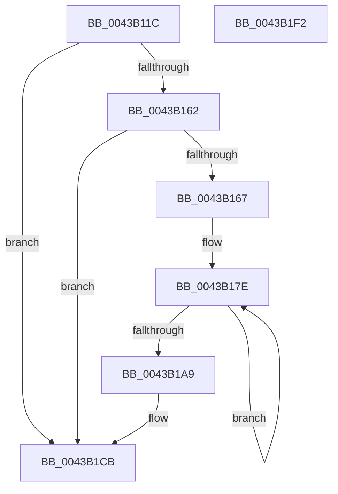

# PpmSnapDripsAccountingSnapshot

- RVA: `0x0043B11C`–`0x0043B1F3` (길이 `215` bytes)
- VA: `0x000000014043B11C`
- 실행 섹션: `.text`
- PDB 이름 있음: `예`; PDB Function 태그: `아니요`
- unwind 정보 RVA: `0x000A43B8`
- 디코드: `56`개 명령, `215/215` bytes 표시
- 미해석 바이트: `0` (있으면 어셈블리에 `.byte`로 보존)

> 이 문서는 커널 이미지의 기계어와 PDB 기호를 분석해 생성했습니다. 4번과 5번은 함수 원형과 자료형을 바이너리 사용 방식에서 추정한 C 해석이며 원본 소스 복구 결과는 아닙니다.

## 1. Dependencies

- 직접 호출 지점: **4**; 고유 호출 대상: **4**
- 직접 호출자로 확인된 함수: **1**
- RIP 상대 이미지 참조: **5**

### Outgoing calls
- `0x0043B191` → [PpmConvertTimeTo](PpmConvertTimeTo_function_0043B3CC.md) (function, `0x0043B3CC`)
- `0x0043B1AE` → [PpmEventTraceDripsAccountingSnapshot](../../page/AC/PpmEventTraceDripsAccountingSnapshot_function_00AC0010.md) (function, `0x00AC0010`)
- `0x0043B1C6` → [PopDiagTraceDripsHistogram](PopDiagTraceDripsHistogram_function_0043B430.md) (function, `0x0043B430`)
- `0x0043B1D6` → [_security_check_cookie](../6A/_security_check_cookie_function_006AC640.md) (function, `0x006AC640`)

### Direct callers
- [PopCaptureSleepStudyStatistics](PopCaptureSleepStudyStatistics_function_004399F4.md) at `0x00439F60`

### Static image references
- `0x0043B12F` → RVA `0x00E0A740` (`.data`; read)
- `0x0043B141` → RVA `0x00E27EC0` (`.data`; read)
- `0x0043B14A` → RVA `0x00FC6AD0` (`ALMOSTRO`; read)
- `0x0043B153` → RVA `0x00F0B6B0` (`.data`; read)
- `0x0043B181` → RVA `0x00F0BB80` (`.data`; read)

## 2. Other-region calls and transfers

- 다른 실행 섹션으로 향하는 call: **1**
  - `0x0043B1AE` → [PpmEventTraceDripsAccountingSnapshot](../../page/AC/PpmEventTraceDripsAccountingSnapshot_function_00AC0010.md) (`.text` → `PAGE`)
- 별도 외부 분기/꼬리 이동을 확인하지 못했습니다.

## 3. Assembly (complete function range)

```asm
0043B11C  48 89 5C 24 08                  mov qword ptr [rsp + 8], rbx
0043B121  55                              push rbp
0043B122  56                              push rsi
0043B123  57                              push rdi
0043B124  41 56                           push r14
0043B126  41 57                           push r15
0043B128  48 81 EC 10 01 00 00            sub rsp, 0x110
0043B12F  48 8B 05 0A F6 9C 00            mov rax, qword ptr [rip + 0x9cf60a]
0043B136  48 33 C4                        xor rax, rsp
0043B139  48 89 84 24 00 01 00 00         mov qword ptr [rsp + 0x100], rax
0043B141  8B 05 79 CD 9E 00               mov eax, dword ptr [rip + 0x9ecd79]
0043B147  48 8B EA                        mov rbp, rdx
0043B14A  48 8B 15 7F B9 B8 00            mov rdx, qword ptr [rip + 0xb8b97f]
0043B151  33 DB                           xor ebx, ebx
0043B153  4C 8B 3D 56 05 AD 00            mov r15, qword ptr [rip + 0xad0556]
0043B15A  4D 8B F0                        mov r14, r8
0043B15D  48 85 D2                        test rdx, rdx
0043B160  74 69                           je 0x14043b1cb
0043B162  83 F8 FF                        cmp eax, -1
0043B165  74 64                           je 0x14043b1cb
0043B167  48 8B 7A 30                     mov rdi, qword ptr [rdx + 0x30]
0043B16B  8D 73 1A                        lea esi, [rbx + 0x1a]
0043B16E  8B C8                           mov ecx, eax
0043B170  48 81 C7 E8 00 00 00            add rdi, 0xe8
0043B177  48 C1 E1 0A                     shl rcx, 0xa
0043B17B  48 03 F9                        add rdi, rcx
0043B17E  48 8B 0F                        mov rcx, qword ptr [rdi]
0043B181  48 8D 05 F8 09 AD 00            lea rax, [rip + 0xad09f8]
0043B188  48 2B 0C 03                     sub rcx, qword ptr [rbx + rax]
0043B18C  BA 80 96 98 00                  mov edx, 0x989680
0043B191  E8 36 02 00 00                  call 0x14043b3cc
0043B196  48 89 44 1C 30                  mov qword ptr [rsp + rbx + 0x30], rax
0043B19B  48 8D 5B 08                     lea rbx, [rbx + 8]
0043B19F  48 8D 7F 20                     lea rdi, [rdi + 0x20]
0043B1A3  48 83 EE 01                     sub rsi, 1
0043B1A7  75 D5                           jne 0x14043b17e
0043B1A9  48 8D 54 24 30                  lea rdx, [rsp + 0x30]
0043B1AE  E8 5D 4E 68 00                  call 0x140ac0010
0043B1B3  48 8D 44 24 30                  lea rax, [rsp + 0x30]
0043B1B8  4D 8B C6                        mov r8, r14
0043B1BB  48 8B D5                        mov rdx, rbp
0043B1BE  48 89 44 24 20                  mov qword ptr [rsp + 0x20], rax
0043B1C3  49 8B CF                        mov rcx, r15
0043B1C6  E8 65 02 00 00                  call 0x14043b430
0043B1CB  48 8B 8C 24 00 01 00 00         mov rcx, qword ptr [rsp + 0x100]
0043B1D3  48 33 CC                        xor rcx, rsp
0043B1D6  E8 65 14 27 00                  call 0x1406ac640
0043B1DB  48 8B 9C 24 40 01 00 00         mov rbx, qword ptr [rsp + 0x140]
0043B1E3  48 81 C4 10 01 00 00            add rsp, 0x110
0043B1EA  41 5F                           pop r15
0043B1EC  41 5E                           pop r14
0043B1EE  5F                              pop rdi
0043B1EF  5E                              pop rsi
0043B1F0  5D                              pop rbp
0043B1F1  C3                              ret
0043B1F2  CC                              int3
```

## 4. C-style interpretation (structured pseudocode)

```c
__int64 __fastcall PpmSnapDripsAccountingSnapshot(__int64 a1, __int64 a2, __int64 a3)
{
    __int64 result;
    __int64 v_rbx;
    __int64 v_rdi;
    __int64 v_rsi;
    __int64 v_rsp;
    unsigned __int64 v_stack_m108;
    unsigned __int64 v_stack_m118;
    unsigned __int64 v_stack_m38;
    unsigned __int64 v_stack_p8;

    v_stack_p8 = v_rbx;
    v_rsp = (v_rsp) - (272);
    result = (*(unsigned __int64 *)(v_rip + 10286602)) ^ (v_rsp);
    v_stack_m38 = result;
    v_rbx = 0;
    if (*(unsigned __int64 *)(v_rip + 12106111) == 0) goto loc_0043B1CB;
    if (((unsigned int)((unsigned int)(*(unsigned int *)(v_rip + 10407289)))) == -1) goto loc_0043B1CB;
    v_rdi = (*(unsigned __int64 *)(*(unsigned __int64 *)(v_rip + 12106111) + 48)) + (232);
    a1 = ((unsigned int)((unsigned int)((unsigned int)(*(unsigned int *)(v_rip + 10407289))))) << (10);
    v_rdi = (v_rdi) + (a1);
loc_0043B17E:
    a1 = (*(unsigned __int64 *)(v_rdi)) - (*(unsigned __int64 *)(v_rbx + v_rip + 11340280 * 1));
    result = PpmConvertTimeTo(a1, (unsigned int)(0x989680ULL), a3, a4);
    *(unsigned __int64 *)(v_rsp + v_rbx * 1 + 48) = result;
    v_rsi = (v_rbx + 26) - (1);
    if (condition_is_not_equal) goto loc_0043B17E;
    result = PpmEventTraceDripsAccountingSnapshot(a1, v_stack_m108, a3, a4);
    v_stack_m118 = v_stack_m108;
    result = PopDiagTraceDripsHistogram(*(unsigned __int64 *)(v_rip + 11339094), a2, a3, a4);
loc_0043B1CB:
    a1 = (v_stack_m38) ^ (v_rsp);
    result = _security_check_cookie(a1, a2, a3, a4);
    v_rsp = (v_rsp) + (272);
    return result;
}
```

## 5. (Beta) C Style

```c
int64_t PpmSnapDripsAccountingSnapshot(int64_t Arg1, int64_t Arg2, int64_t Arg3)
{
    int64_t result;
    int64_t local_rbx;
    int64_t local_rdi;
    int64_t local_rsi;
    int64_t local_rsp;
    uint64_t v_stack_m108;
    uint64_t v_stack_m118;
    uint64_t v_stack_m38;
    uint64_t v_stack_p8;

    v_stack_p8 = local_rbx;
    local_rsp = (local_rsp) - (272);
    result = (*(uint64_t *)(v_rip + 0x9CF60A)) ^ (local_rsp);
    v_stack_m38 = result;
    local_rbx = 0;
    if (*(uint64_t *)(v_rip + 0xB8B97F) == 0) goto loc_0043B1CB;
    if (((uint32_t)((uint32_t)(*(uint32_t *)(v_rip + 0x9ECD79)))) == -1) goto loc_0043B1CB;
    local_rdi = (*(uint64_t *)(*(uint64_t *)(v_rip + 0xB8B97F) + 0x30)) + (232);
    Arg1 = ((uint32_t)((uint32_t)((uint32_t)(*(uint32_t *)(v_rip + 0x9ECD79))))) << (10);
    local_rdi = (local_rdi) + (Arg1);
loc_0043B17E:
    Arg1 = (*(uint64_t *)(local_rdi)) - (*(uint64_t *)(local_rbx + v_rip + 0xAD09F8 * 1));
    result = PpmConvertTimeTo(Arg1, (uint32_t)(0x989680ULL), Arg3, a4);
    *(uint64_t *)(local_rsp + local_rbx * 1 + 0x30) = result;
    local_rsi = (local_rbx + 26) - (1);
    if (condition_is_not_equal) goto loc_0043B17E;
    result = PpmEventTraceDripsAccountingSnapshot(Arg1, v_stack_m108, Arg3, a4);
    v_stack_m118 = v_stack_m108;
    result = PopDiagTraceDripsHistogram(*(uint64_t *)(v_rip + 0xAD0556), Arg2, Arg3, a4);
loc_0043B1CB:
    Arg1 = (v_stack_m38) ^ (local_rsp);
    result = _security_check_cookie(Arg1, Arg2, Arg3, a4);
    local_rsp = (local_rsp) + (272);
    return result;
}
```

## 6. Execution-region graph

[열기: 2D/3D 그래프와 함수 탐색 컨트롤 패널](../../../control-panel.html?section=text&rva=0x0043B11C&view=graph)

- 2D 그래프는 위에서 아래로 흐르고, 3D 그래프는 빈 공간을 드래그해 회전합니다. Shift+드래그는 이동, 휠은 확대·축소, 함수 노드 선택은 대상 보고서 이동입니다.

### Static fallback


