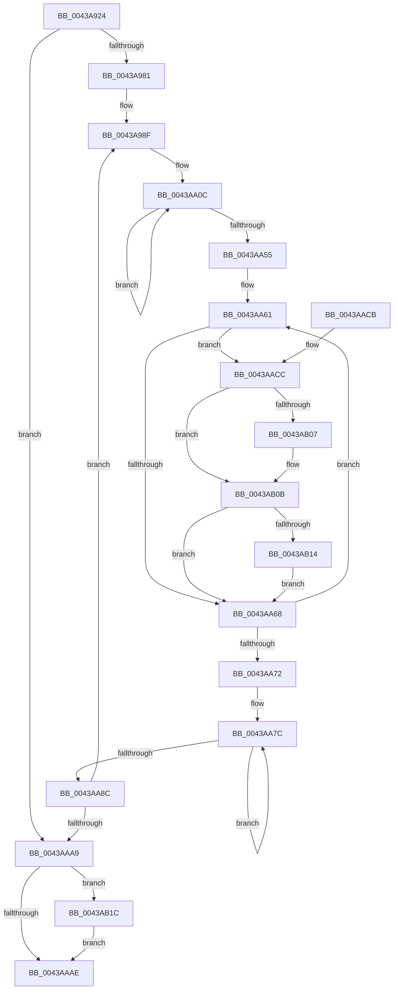

# PpmTranslateIdleAccounting

- RVA: `0x0043A924`–`0x0043AB2D` (길이 `521` bytes)
- VA: `0x000000014043A924`
- 실행 섹션: `.text`
- PDB 이름 있음: `예`; PDB Function 태그: `아니요`
- unwind 정보 RVA: `0x000A435C`
- 디코드: `134`개 명령, `521/521` bytes 표시
- 미해석 바이트: `0` (있으면 어셈블리에 `.byte`로 보존)

> 이 문서는 커널 이미지의 기계어와 PDB 기호를 분석해 생성했습니다. 4번과 5번은 함수 원형과 자료형을 바이너리 사용 방식에서 추정한 C 해석이며 원본 소스 복구 결과는 아닙니다.

## 1. Dependencies

- 직접 호출 지점: **11**; 고유 호출 대상: **2**
- 직접 호출자로 확인된 함수: **2**
- RIP 상대 이미지 참조: **0**

### Outgoing calls
- `0x0043A949` → [PpmUpdateProcessorIdleAccounting](../2C/PpmUpdateProcessorIdleAccounting_function_002CFF18.md) (function, `0x002CFF18`)
- `0x0043A9CF` → [PpmConvertTimeTo](PpmConvertTimeTo_function_0043B3CC.md) (function, `0x0043B3CC`)
- `0x0043A9E2` → [PpmConvertTimeTo](PpmConvertTimeTo_function_0043B3CC.md) (function, `0x0043B3CC`)
- `0x0043A9F4` → [PpmConvertTimeTo](PpmConvertTimeTo_function_0043B3CC.md) (function, `0x0043B3CC`)
- `0x0043AA15` → [PpmConvertTimeTo](PpmConvertTimeTo_function_0043B3CC.md) (function, `0x0043B3CC`)
- `0x0043AA27` → [PpmConvertTimeTo](PpmConvertTimeTo_function_0043B3CC.md) (function, `0x0043B3CC`)
- `0x0043AA38` → [PpmConvertTimeTo](PpmConvertTimeTo_function_0043B3CC.md) (function, `0x0043B3CC`)
- `0x0043AADC` → [PpmConvertTimeTo](PpmConvertTimeTo_function_0043B3CC.md) (function, `0x0043B3CC`)
- `0x0043AAEB` → [PpmConvertTimeTo](PpmConvertTimeTo_function_0043B3CC.md) (function, `0x0043B3CC`)
- `0x0043AAFC` → [PpmConvertTimeTo](PpmConvertTimeTo_function_0043B3CC.md) (function, `0x0043B3CC`)
- `0x0043AB22` → [PpmConvertTimeTo](PpmConvertTimeTo_function_0043B3CC.md) (function, `0x0043B3CC`)

### Direct callers
- [PpmEventTraceProcessorIdleAccounting](PpmEventTraceProcessorIdleAccounting_function_0043A6D0.md) at `0x0043A86A`
- [PpmWmiFireIdleAccountingEvent](../5D/PpmWmiFireIdleAccountingEvent_function_005D9700.md) at `0x005D9762`

### Static image references
- 디코드된 RIP-relative 메모리 참조가 없습니다.

## 2. Other-region calls and transfers

- 다른 실행 섹션으로 향하는 call: **0**
- 별도 외부 분기/꼬리 이동을 확인하지 못했습니다.

## 3. Assembly (complete function range)

```asm
0043A924  48 89 5C 24 08                  mov qword ptr [rsp + 8], rbx
0043A929  48 89 6C 24 10                  mov qword ptr [rsp + 0x10], rbp
0043A92E  48 89 74 24 18                  mov qword ptr [rsp + 0x18], rsi
0043A933  57                              push rdi
0043A934  41 54                           push r12
0043A936  41 55                           push r13
0043A938  41 56                           push r14
0043A93A  41 57                           push r15
0043A93C  48 83 EC 20                     sub rsp, 0x20
0043A940  4D 8B E0                        mov r12, r8
0043A943  48 8B FA                        mov rdi, rdx
0043A946  48 8B D9                        mov rbx, rcx
0043A949  E8 CA 55 E9 FF                  call 0x1402cff18
0043A94E  48 8B 4B 08                     mov rcx, qword ptr [rbx + 8]
0043A952  BE 40 42 0F 00                  mov esi, 0xf4240
0043A957  8B 11                           mov edx, dword ptr [rcx]
0043A959  89 17                           mov dword ptr [rdi], edx
0043A95B  8B 41 04                        mov eax, dword ptr [rcx + 4]
0043A95E  89 47 04                        mov dword ptr [rdi + 4], eax
0043A961  8B 41 08                        mov eax, dword ptr [rcx + 8]
0043A964  89 47 08                        mov dword ptr [rdi + 8], eax
0043A967  8B 41 0C                        mov eax, dword ptr [rcx + 0xc]
0043A96A  89 47 0C                        mov dword ptr [rdi + 0xc], eax
0043A96D  48 8B 41 10                     mov rax, qword ptr [rcx + 0x10]
0043A971  48 89 47 10                     mov qword ptr [rdi + 0x10], rax
0043A975  4C 8B 69 18                     mov r13, qword ptr [rcx + 0x18]
0043A979  85 D2                           test edx, edx
0043A97B  0F 84 28 01 00 00               je 0x14043aaa9
0043A981  48 8D 5F 20                     lea rbx, [rdi + 0x20]
0043A985  44 8B FA                        mov r15d, edx
0043A988  48 8D B9 78 03 00 00            lea rdi, [rcx + 0x378]
0043A98F  8B 87 C0 FC FF FF               mov eax, dword ptr [rdi - 0x340]
0043A995  48 8B D6                        mov rdx, rsi
0043A998  03 87 BC FC FF FF               add eax, dword ptr [rdi - 0x344]
0043A99E  03 87 B8 FC FF FF               add eax, dword ptr [rdi - 0x348]
0043A9A4  4C 03 AF B0 FC FF FF            add r13, qword ptr [rdi - 0x350]
0043A9AB  89 03                           mov dword ptr [rbx], eax
0043A9AD  8B 87 BC FC FF FF               mov eax, dword ptr [rdi - 0x344]
0043A9B3  89 43 04                        mov dword ptr [rbx + 4], eax
0043A9B6  8B 87 B8 FC FF FF               mov eax, dword ptr [rdi - 0x348]
0043A9BC  89 43 14                        mov dword ptr [rbx + 0x14], eax
0043A9BF  8B 87 C4 FC FF FF               mov eax, dword ptr [rdi - 0x33c]
0043A9C5  89 43 08                        mov dword ptr [rbx + 8], eax
0043A9C8  48 8B 8F B0 FC FF FF            mov rcx, qword ptr [rdi - 0x350]
0043A9CF  E8 F8 09 00 00                  call 0x14043b3cc
0043A9D4  48 89 43 F8                     mov qword ptr [rbx - 8], rax
0043A9D8  48 8B D6                        mov rdx, rsi
0043A9DB  48 8B 8F C8 FC FF FF            mov rcx, qword ptr [rdi - 0x338]
0043A9E2  E8 E5 09 00 00                  call 0x14043b3cc
0043A9E7  89 43 0C                        mov dword ptr [rbx + 0xc], eax
0043A9EA  48 8B D6                        mov rdx, rsi
0043A9ED  48 8B 8F D0 FC FF FF            mov rcx, qword ptr [rdi - 0x330]
0043A9F4  E8 D3 09 00 00                  call 0x14043b3cc
0043A9F9  89 43 10                        mov dword ptr [rbx + 0x10], eax
0043A9FC  48 8D B7 F8 FD FF FF            lea rsi, [rdi - 0x208]
0043AA03  4C 8D 73 24                     lea r14, [rbx + 0x24]
0043AA07  BD 10 00 00 00                  mov ebp, 0x10
0043AA0C  48 8B 4E F0                     mov rcx, qword ptr [rsi - 0x10]
0043AA10  BA 40 42 0F 00                  mov edx, 0xf4240
0043AA15  E8 B2 09 00 00                  call 0x14043b3cc
0043AA1A  49 89 46 F4                     mov qword ptr [r14 - 0xc], rax
0043AA1E  BA 40 42 0F 00                  mov edx, 0xf4240
0043AA23  48 8B 4E F8                     mov rcx, qword ptr [rsi - 8]
0043AA27  E8 A0 09 00 00                  call 0x14043b3cc
0043AA2C  41 89 46 FC                     mov dword ptr [r14 - 4], eax
0043AA30  BA 40 42 0F 00                  mov edx, 0xf4240
0043AA35  48 8B 0E                        mov rcx, qword ptr [rsi]
0043AA38  E8 8F 09 00 00                  call 0x14043b3cc
0043AA3D  41 89 06                        mov dword ptr [r14], eax
0043AA40  4D 8D 76 18                     lea r14, [r14 + 0x18]
0043AA44  8B 46 08                        mov eax, dword ptr [rsi + 8]
0043AA47  48 8D 76 20                     lea rsi, [rsi + 0x20]
0043AA4B  41 89 46 EC                     mov dword ptr [r14 - 0x14], eax
0043AA4F  48 83 ED 01                     sub rbp, 1
0043AA53  75 B7                           jne 0x14043aa0c
0043AA55  48 8D B7 70 FD FF FF            lea rsi, [rdi - 0x290]
0043AA5C  BD 04 00 00 00                  mov ebp, 4
0043AA61  8B 46 10                        mov eax, dword ptr [rsi + 0x10]
0043AA64  85 C0                           test eax, eax
0043AA66  75 64                           jne 0x14043aacc
0043AA68  48 83 C6 20                     add rsi, 0x20
0043AA6C  48 83 ED 01                     sub rbp, 1
0043AA70  75 EF                           jne 0x14043aa61
0043AA72  8B 43 08                        mov eax, dword ptr [rbx + 8]
0043AA75  44 8D 4D 06                     lea r9d, [rbp + 6]
0043AA79  4C 8B C7                        mov r8, rdi
0043AA7C  41 03 00                        add eax, dword ptr [r8]
0043AA7F  4D 8D 40 20                     lea r8, [r8 + 0x20]
0043AA83  89 43 08                        mov dword ptr [rbx + 8], eax
0043AA86  49 83 E9 01                     sub r9, 1
0043AA8A  75 F0                           jne 0x14043aa7c
0043AA8C  48 81 C3 A0 01 00 00            add rbx, 0x1a0
0043AA93  48 81 C7 F8 03 00 00            add rdi, 0x3f8
0043AA9A  BE 40 42 0F 00                  mov esi, 0xf4240
0043AA9F  49 83 EF 01                     sub r15, 1
0043AAA3  0F 85 E6 FE FF FF               jne 0x14043a98f
0043AAA9  4D 85 E4                        test r12, r12
0043AAAC  75 6E                           jne 0x14043ab1c
0043AAAE  48 8B 5C 24 50                  mov rbx, qword ptr [rsp + 0x50]
0043AAB3  48 8B 6C 24 58                  mov rbp, qword ptr [rsp + 0x58]
0043AAB8  48 8B 74 24 60                  mov rsi, qword ptr [rsp + 0x60]
0043AABD  48 83 C4 20                     add rsp, 0x20
0043AAC1  41 5F                           pop r15
0043AAC3  41 5E                           pop r14
0043AAC5  41 5D                           pop r13
0043AAC7  41 5C                           pop r12
0043AAC9  5F                              pop rdi
0043AACA  C3                              ret
0043AACB  CC                              int3
0043AACC  01 43 28                        add dword ptr [rbx + 0x28], eax
0043AACF  41 BE 40 42 0F 00               mov r14d, 0xf4240
0043AAD5  48 8B 4E F8                     mov rcx, qword ptr [rsi - 8]
0043AAD9  41 8B D6                        mov edx, r14d
0043AADC  E8 EB 08 00 00                  call 0x14043b3cc
0043AAE1  48 01 43 18                     add qword ptr [rbx + 0x18], rax
0043AAE5  41 8B D6                        mov edx, r14d
0043AAE8  48 8B 0E                        mov rcx, qword ptr [rsi]
0043AAEB  E8 DC 08 00 00                  call 0x14043b3cc
0043AAF0  48 8B 4E 08                     mov rcx, qword ptr [rsi + 8]
0043AAF4  BA 40 42 0F 00                  mov edx, 0xf4240
0043AAF9  4C 8B F0                        mov r14, rax
0043AAFC  E8 CB 08 00 00                  call 0x14043b3cc
0043AB01  44 39 73 20                     cmp dword ptr [rbx + 0x20], r14d
0043AB05  76 04                           jbe 0x14043ab0b
0043AB07  44 89 73 20                     mov dword ptr [rbx + 0x20], r14d
0043AB0B  39 43 24                        cmp dword ptr [rbx + 0x24], eax
0043AB0E  0F 83 54 FF FF FF               jae 0x14043aa68
0043AB14  89 43 24                        mov dword ptr [rbx + 0x24], eax
0043AB17  E9 4C FF FF FF                  jmp 0x14043aa68
0043AB1C  48 8B D6                        mov rdx, rsi
0043AB1F  49 8B CD                        mov rcx, r13
0043AB22  E8 A5 08 00 00                  call 0x14043b3cc
0043AB27  49 89 04 24                     mov qword ptr [r12], rax
0043AB2B  EB 81                           jmp 0x14043aaae
```

## 4. C-style interpretation (structured pseudocode)

```c
__int64 __fastcall PpmTranslateIdleAccounting(__int64 a1, __int64 a2, __int64 a3)
{
    __int64 result;
    __int64 v_r13;
    __int64 v_r15;
    __int64 v_rbp;
    __int64 v_rbx;
    __int64 v_rdi;
    __int64 v_rsi;
    __int64 v_rsp;
    unsigned __int64 v_stack_p10;
    unsigned __int64 v_stack_p18;
    unsigned __int64 v_stack_p8;

    v_stack_p8 = v_rbx;
    v_stack_p10 = v_rbp;
    v_stack_p18 = v_rsi;
    v_rsp = (v_rsp) - (32);
    result = PpmUpdateProcessorIdleAccounting(a1, a2, a3, a4);
    *(unsigned int *)(a2) = (unsigned int)((unsigned int)(*(unsigned int *)(*(unsigned __int64 *)(a1 + 8))));
    *(unsigned int *)(a2 + 4) = (unsigned int)((unsigned int)(*(unsigned int *)(*(unsigned __int64 *)(a1 + 8) + 4)));
    *(unsigned int *)(a2 + 8) = (unsigned int)((unsigned int)(*(unsigned int *)(*(unsigned __int64 *)(a1 + 8) + 8)));
    *(unsigned int *)(a2 + 12) = (unsigned int)((unsigned int)(*(unsigned int *)(*(unsigned __int64 *)(a1 + 8) + 12)));
    *(unsigned __int64 *)(a2 + 16) = *(unsigned __int64 *)(*(unsigned __int64 *)(a1 + 8) + 16);
    if ((unsigned int)((unsigned int)(*(unsigned int *)(*(unsigned __int64 *)(a1 + 8)))) == 0) goto loc_0043AAA9;
loc_0043A98F:
    result = (unsigned int)(((unsigned int)(*(unsigned int *)(*(unsigned __int64 *)(a1 + 8) + 888 - 832))) + (*(unsigned int *)(*(unsigned __int64 *)(a1 + 8) + 888 - 836)));
    result = (unsigned int)((result) + (*(unsigned int *)(*(unsigned __int64 *)(a1 + 8) + 888 - 840)));
    v_r13 = (*(unsigned __int64 *)(*(unsigned __int64 *)(a1 + 8) + 24)) + (*(unsigned __int64 *)(*(unsigned __int64 *)(a1 + 8) + 888 - 848));
    *(unsigned int *)(a2 + 32) = (unsigned int)(result);
    *(unsigned int *)(a2 + 32 + 4) = (unsigned int)((unsigned int)(*(unsigned int *)(*(unsigned __int64 *)(a1 + 8) + 888 - 836)));
    *(unsigned int *)(a2 + 32 + 20) = (unsigned int)((unsigned int)(*(unsigned int *)(*(unsigned __int64 *)(a1 + 8) + 888 - 840)));
    *(unsigned int *)(a2 + 32 + 8) = (unsigned int)((unsigned int)(*(unsigned int *)(*(unsigned __int64 *)(a1 + 8) + 888 - 828)));
    result = PpmConvertTimeTo(*(unsigned __int64 *)(*(unsigned __int64 *)(a1 + 8) + 888 - 848), (unsigned int)(0xF4240ULL), a3, a4);
    *(unsigned __int64 *)(a2 + 32 - 8) = result;
    result = PpmConvertTimeTo(*(unsigned __int64 *)(*(unsigned __int64 *)(a1 + 8) + 888 - 824), (unsigned int)(0xF4240ULL), a3, a4);
    *(unsigned int *)(a2 + 32 + 12) = (unsigned int)(result);
    result = PpmConvertTimeTo(*(unsigned __int64 *)(*(unsigned __int64 *)(a1 + 8) + 888 - 816), (unsigned int)(0xF4240ULL), a3, a4);
    *(unsigned int *)(a2 + 32 + 16) = (unsigned int)(result);
loc_0043AA0C:
    result = PpmConvertTimeTo(*(unsigned __int64 *)(*(unsigned __int64 *)(a1 + 8) + 888 - 520 - 16), (unsigned int)(0xF4240ULL), a3, a4);
    *(unsigned __int64 *)(a2 + 32 + 36 - 12) = result;
    result = PpmConvertTimeTo(*(unsigned __int64 *)(*(unsigned __int64 *)(a1 + 8) + 888 - 520 - 8), (unsigned int)(0xF4240ULL), a3, a4);
    *(unsigned int *)(a2 + 32 + 36 - 4) = (unsigned int)(result);
    result = PpmConvertTimeTo(*(unsigned __int64 *)(*(unsigned __int64 *)(a1 + 8) + 888 - 520), (unsigned int)(0xF4240ULL), a3, a4);
    *(unsigned int *)(a2 + 32 + 36) = (unsigned int)(result);
    *(unsigned int *)(a2 + 32 + 36 + 24 - 20) = (unsigned int)((unsigned int)(*(unsigned int *)(*(unsigned __int64 *)(a1 + 8) + 888 - 520 + 8)));
    v_rbp = (16) - (1);
    if (condition_is_not_equal) goto loc_0043AA0C;
loc_0043AA61:
    if ((unsigned int)((unsigned int)(*(unsigned int *)(*(unsigned __int64 *)(a1 + 8) + 888 - 656 + 16))) != 0) goto loc_0043AACC;
loc_0043AA68:
    v_rsi = (*(unsigned __int64 *)(a1 + 8) + 888 - 656) + (32);
    v_rbp = (4) - (1);
    if (condition_is_not_equal) goto loc_0043AA61;
loc_0043AA7C:
    result = (unsigned int)(((unsigned int)(*(unsigned int *)(a2 + 32 + 8))) + (*(unsigned int *)(*(unsigned __int64 *)(a1 + 8) + 888)));
    *(unsigned int *)(a2 + 32 + 8) = (unsigned int)(result);
    a4 = (v_rbp + 6) - (1);
    if (condition_is_not_equal) goto loc_0043AA7C;
    v_rbx = (a2 + 32) + (416);
    v_rdi = (*(unsigned __int64 *)(a1 + 8) + 888) + (0x3F8ULL);
    v_r15 = ((unsigned int)((unsigned int)((unsigned int)(*(unsigned int *)(*(unsigned __int64 *)(a1 + 8)))))) - (1);
    if (condition_is_not_equal) goto loc_0043A98F;
loc_0043AAA9:
    if (a3 != 0) goto loc_0043AB1C;
loc_0043AAAE:
    v_rsp = (v_rsp) + (32);
    return result;
loc_0043AACC:
    result = PpmConvertTimeTo(*(unsigned __int64 *)(v_stack_p18 - 8), (unsigned int)((unsigned int)((unsigned int)(0xF4240ULL))), *(unsigned __int64 *)(a1 + 8) + 888 + 32, a4);
    result = PpmConvertTimeTo(*(unsigned __int64 *)(v_stack_p18), (unsigned int)((unsigned int)((unsigned int)(0xF4240ULL))), *(unsigned __int64 *)(a1 + 8) + 888 + 32, a4);
    result = PpmConvertTimeTo(*(unsigned __int64 *)(v_stack_p18 + 8), (unsigned int)(0xF4240ULL), *(unsigned __int64 *)(a1 + 8) + 888 + 32, a4);
    if ((*(unsigned int *)(v_stack_p8 + 32)) >= = ((unsigned int)(result))) {
        *(unsigned int *)(v_stack_p8 + 32) = (unsigned int)(result);
    }
    if ((*(unsigned int *)(v_stack_p8 + 36)) >= ((unsigned int)(result))) goto loc_0043AA68;
    *(unsigned int *)(v_stack_p8 + 36) = (unsigned int)(result);
    goto loc_0043AA68;
loc_0043AB1C:
    result = PpmConvertTimeTo(v_r13, v_stack_p18, *(unsigned __int64 *)(a1 + 8) + 888 + 32, a4);
    *(unsigned __int64 *)(a3) = result;
    goto loc_0043AAAE;
}
```

## 5. (Beta) C Style

```c
int64_t PpmTranslateIdleAccounting(void *Arg1, void *Arg2, int64_t Arg3)
{
    uint8_t *arg1 = (uint8_t *)Arg1;
    uint8_t *arg2 = (uint8_t *)Arg2;

    int64_t result;
    int64_t local_r13;
    int64_t local_r15;
    int64_t local_rbp;
    int64_t local_rbx;
    int64_t local_rdi;
    int64_t local_rsi;
    int64_t local_rsp;
    uint64_t v_stack_p10;
    uint64_t v_stack_p18;
    uint64_t v_stack_p8;

    v_stack_p8 = local_rbx;
    v_stack_p10 = local_rbp;
    v_stack_p18 = local_rsi;
    local_rsp = (local_rsp) - (32);
    result = PpmUpdateProcessorIdleAccounting(Arg1, Arg2, Arg3, a4);
    *(uint32_t *)(arg2) = (uint32_t)((uint32_t)(*(uint32_t *)(*(uint64_t *)(arg1 + 0x8))));
    *(uint32_t *)(arg2 + 0x4) = (uint32_t)((uint32_t)(*(uint32_t *)(*(uint64_t *)(arg1 + 0x8) + 0x4)));
    *(uint32_t *)(arg2 + 0x8) = (uint32_t)((uint32_t)(*(uint32_t *)(*(uint64_t *)(arg1 + 0x8) + 0x8)));
    *(uint32_t *)(arg2 + 0xC) = (uint32_t)((uint32_t)(*(uint32_t *)(*(uint64_t *)(arg1 + 0x8) + 0xC)));
    *(uint64_t *)(arg2 + 0x10) = *(uint64_t *)(*(uint64_t *)(arg1 + 0x8) + 0x10);
    if ((uint32_t)((uint32_t)(*(uint32_t *)(*(uint64_t *)(arg1 + 0x8)))) == 0) goto loc_0043AAA9;
loc_0043A98F:
    result = (uint32_t)(((uint32_t)(*(uint32_t *)(*(uint64_t *)(arg1 + 0x8) + 0x378 - 0x340))) + (*(uint32_t *)(*(uint64_t *)(arg1 + 0x8) + 0x378 - 0x344)));
    result = (uint32_t)((result) + (*(uint32_t *)(*(uint64_t *)(arg1 + 0x8) + 0x378 - 0x348)));
    local_r13 = (*(uint64_t *)(*(uint64_t *)(arg1 + 0x8) + 0x18)) + (*(uint64_t *)(*(uint64_t *)(arg1 + 0x8) + 0x378 - 0x350));
    *(uint32_t *)(arg2 + 0x20) = (uint32_t)(result);
    *(uint32_t *)(arg2 + 0x20 + 0x4) = (uint32_t)((uint32_t)(*(uint32_t *)(*(uint64_t *)(arg1 + 0x8) + 0x378 - 0x344)));
    *(uint32_t *)(arg2 + 0x20 + 0x14) = (uint32_t)((uint32_t)(*(uint32_t *)(*(uint64_t *)(arg1 + 0x8) + 0x378 - 0x348)));
    *(uint32_t *)(arg2 + 0x20 + 0x8) = (uint32_t)((uint32_t)(*(uint32_t *)(*(uint64_t *)(arg1 + 0x8) + 0x378 - 0x33C)));
    result = PpmConvertTimeTo(*(uint64_t *)(*(uint64_t *)(arg1 + 0x8) + 0x378 - 0x350), (uint32_t)(0xF4240ULL), Arg3, a4);
    *(uint64_t *)(arg2 + 0x20 - 0x8) = result;
    result = PpmConvertTimeTo(*(uint64_t *)(*(uint64_t *)(arg1 + 0x8) + 0x378 - 0x338), (uint32_t)(0xF4240ULL), Arg3, a4);
    *(uint32_t *)(arg2 + 0x20 + 0xC) = (uint32_t)(result);
    result = PpmConvertTimeTo(*(uint64_t *)(*(uint64_t *)(arg1 + 0x8) + 0x378 - 0x330), (uint32_t)(0xF4240ULL), Arg3, a4);
    *(uint32_t *)(arg2 + 0x20 + 0x10) = (uint32_t)(result);
loc_0043AA0C:
    result = PpmConvertTimeTo(*(uint64_t *)(*(uint64_t *)(arg1 + 0x8) + 0x378 - 0x208 - 0x10), (uint32_t)(0xF4240ULL), Arg3, a4);
    *(uint64_t *)(arg2 + 0x20 + 0x24 - 0xC) = result;
    result = PpmConvertTimeTo(*(uint64_t *)(*(uint64_t *)(arg1 + 0x8) + 0x378 - 0x208 - 0x8), (uint32_t)(0xF4240ULL), Arg3, a4);
    *(uint32_t *)(arg2 + 0x20 + 0x24 - 0x4) = (uint32_t)(result);
    result = PpmConvertTimeTo(*(uint64_t *)(*(uint64_t *)(arg1 + 0x8) + 0x378 - 0x208), (uint32_t)(0xF4240ULL), Arg3, a4);
    *(uint32_t *)(arg2 + 0x20 + 0x24) = (uint32_t)(result);
    *(uint32_t *)(arg2 + 0x20 + 0x24 + 0x18 - 0x14) = (uint32_t)((uint32_t)(*(uint32_t *)(*(uint64_t *)(arg1 + 0x8) + 0x378 - 0x208 + 0x8)));
    local_rbp = (16) - (1);
    if (condition_is_not_equal) goto loc_0043AA0C;
loc_0043AA61:
    if ((uint32_t)((uint32_t)(*(uint32_t *)(*(uint64_t *)(arg1 + 0x8) + 0x378 - 0x290 + 0x10))) != 0) goto loc_0043AACC;
loc_0043AA68:
    local_rsi = (*(uint64_t *)(arg1 + 0x8) + 888 - 656) + (32);
    local_rbp = (4) - (1);
    if (condition_is_not_equal) goto loc_0043AA61;
loc_0043AA7C:
    result = (uint32_t)(((uint32_t)(*(uint32_t *)(arg2 + 0x20 + 0x8))) + (*(uint32_t *)(*(uint64_t *)(arg1 + 0x8) + 0x378)));
    *(uint32_t *)(arg2 + 0x20 + 0x8) = (uint32_t)(result);
    a4 = (local_rbp + 6) - (1);
    if (condition_is_not_equal) goto loc_0043AA7C;
    local_rbx = (Arg2 + 32) + (416);
    local_rdi = (*(uint64_t *)(arg1 + 0x8) + 888) + (0x3F8ULL);
    local_r15 = ((uint32_t)((uint32_t)((uint32_t)(*(uint32_t *)(*(uint64_t *)(arg1 + 0x8)))))) - (1);
    if (condition_is_not_equal) goto loc_0043A98F;
loc_0043AAA9:
    if (Arg3 != 0) goto loc_0043AB1C;
loc_0043AAAE:
    local_rsp = (local_rsp) + (32);
    return result;
loc_0043AACC:
    result = PpmConvertTimeTo(*(uint64_t *)(v_stack_p18 - 0x8), (uint32_t)((uint32_t)((uint32_t)(0xF4240ULL))), *(uint64_t *)(arg1 + 0x8) + 888 + 32, a4);
    result = PpmConvertTimeTo(*(uint64_t *)(v_stack_p18), (uint32_t)((uint32_t)((uint32_t)(0xF4240ULL))), *(uint64_t *)(arg1 + 0x8) + 888 + 32, a4);
    result = PpmConvertTimeTo(*(uint64_t *)(v_stack_p18 + 0x8), (uint32_t)(0xF4240ULL), *(uint64_t *)(arg1 + 0x8) + 888 + 32, a4);
    if ((*(uint32_t *)(v_stack_p8 + 0x20)) >= = ((uint32_t)(result))) {
        *(uint32_t *)(v_stack_p8 + 0x20) = (uint32_t)(result);
    }
    if ((*(uint32_t *)(v_stack_p8 + 0x24)) >= ((uint32_t)(result))) goto loc_0043AA68;
    *(uint32_t *)(v_stack_p8 + 0x24) = (uint32_t)(result);
    goto loc_0043AA68;
loc_0043AB1C:
    result = PpmConvertTimeTo(local_r13, v_stack_p18, *(uint64_t *)(arg1 + 0x8) + 888 + 32, a4);
    *(uint64_t *)(Arg3) = result;
    goto loc_0043AAAE;
}
```

### 관측된 메모리 오프셋

구조체 형식이 확인되지 않은 접근은 인자 기준의 오프셋으로만 기록했습니다.

| 기준 인자 | 오프셋 표현 | 폭 (bit) | 접근 |
|---|---:|---:|---|
| `Arg1` | `+ 0x8` | `64` | `R` |
| `Arg2` | `- 0x14` | `32` | `W` |
| `Arg2` | `- 0xC` | `64` | `W` |
| `Arg2` | `- 0x8` | `64` | `W` |
| `Arg2` | `- 0x4` | `32` | `W` |
| `Arg2` | `+ 0x0` | `32` | `W` |
| `Arg2` | `+ 0x4` | `32` | `W` |
| `Arg2` | `+ 0x8` | `32` | `R` |
| `Arg2` | `+ 0x8` | `32` | `W` |
| `Arg2` | `+ 0xC` | `32` | `W` |
| `Arg2` | `+ 0x10` | `32` | `W` |
| `Arg2` | `+ 0x10` | `64` | `W` |
| `Arg2` | `+ 0x14` | `32` | `W` |
| `Arg2` | `+ 0x18` | `64` | `R` |
| `Arg2` | `+ 0x18` | `64` | `R/W` |
| `Arg2` | `+ 0x20` | `32` | `R` |
| `Arg2` | `+ 0x20` | `32` | `W` |
| `Arg2` | `+ 0x20` | `64` | `R` |
| `Arg2` | `+ 0x24` | `32` | `R` |
| `Arg2` | `+ 0x24` | `32` | `W` |
| `Arg2` | `+ 0x24` | `64` | `R` |
| `Arg2` | `+ 0x28` | `32` | `R/W` |

## 6. Execution-region graph

[열기: 2D/3D 그래프와 함수 탐색 컨트롤 패널](../../../control-panel.html?section=text&rva=0x0043A924&view=graph)

- 2D 그래프는 위에서 아래로 흐르고, 3D 그래프는 빈 공간을 드래그해 회전합니다. Shift+드래그는 이동, 휠은 확대·축소, 함수 노드 선택은 대상 보고서 이동입니다.

### Static fallback


