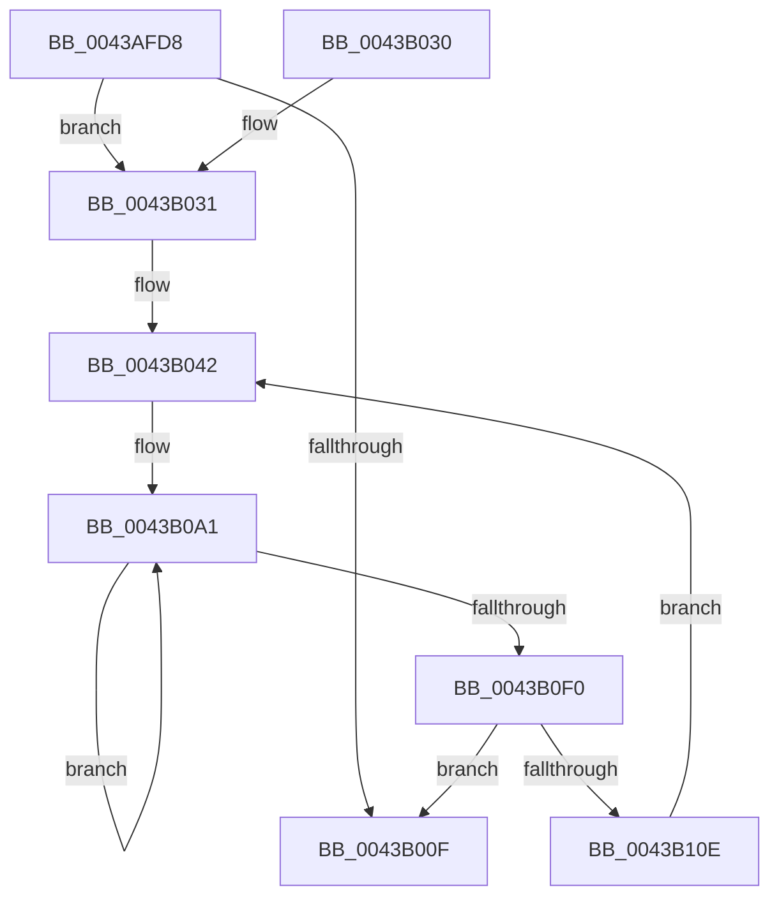

# PpmTranslatePlatformIdleAccounting

- RVA: `0x0043AFD8`–`0x0043B113` (길이 `315` bytes)
- VA: `0x000000014043AFD8`
- 실행 섹션: `.text`
- PDB 이름 있음: `예`; PDB Function 태그: `아니요`
- unwind 정보 RVA: `0x000A4398`
- 디코드: `86`개 명령, `315/315` bytes 표시
- 미해석 바이트: `0` (있으면 어셈블리에 `.byte`로 보존)

> 이 문서는 커널 이미지의 기계어와 PDB 기호를 분석해 생성했습니다. 4번과 5번은 함수 원형과 자료형을 바이너리 사용 방식에서 추정한 C 해석이며 원본 소스 복구 결과는 아닙니다.

## 1. Dependencies

- 직접 호출 지점: **6**; 고유 호출 대상: **1**
- 직접 호출자로 확인된 함수: **1**
- RIP 상대 이미지 참조: **0**

### Outgoing calls
- `0x0043B069` → [PpmConvertTimeTo](PpmConvertTimeTo_function_0043B3CC.md) (function, `0x0043B3CC`)
- `0x0043B079` → [PpmConvertTimeTo](PpmConvertTimeTo_function_0043B3CC.md) (function, `0x0043B3CC`)
- `0x0043B088` → [PpmConvertTimeTo](PpmConvertTimeTo_function_0043B3CC.md) (function, `0x0043B3CC`)
- `0x0043B0AB` → [PpmConvertTimeTo](PpmConvertTimeTo_function_0043B3CC.md) (function, `0x0043B3CC`)
- `0x0043B0BE` → [PpmConvertTimeTo](PpmConvertTimeTo_function_0043B3CC.md) (function, `0x0043B3CC`)
- `0x0043B0D0` → [PpmConvertTimeTo](PpmConvertTimeTo_function_0043B3CC.md) (function, `0x0043B3CC`)

### Direct callers
- [PpmEventTracePlatformIdleAccounting](../../page/AB/PpmEventTracePlatformIdleAccounting_function_00AB6128.md) at `0x00AB62A8`

### Static image references
- 디코드된 RIP-relative 메모리 참조가 없습니다.

## 2. Other-region calls and transfers

- 다른 실행 섹션으로 향하는 call: **0**
- 별도 외부 분기/꼬리 이동을 확인하지 못했습니다.

## 3. Assembly (complete function range)

```asm
0043AFD8  48 89 5C 24 08                  mov qword ptr [rsp + 8], rbx
0043AFDD  48 89 6C 24 10                  mov qword ptr [rsp + 0x10], rbp
0043AFE2  48 89 74 24 18                  mov qword ptr [rsp + 0x18], rsi
0043AFE7  57                              push rdi
0043AFE8  41 54                           push r12
0043AFEA  41 55                           push r13
0043AFEC  41 56                           push r14
0043AFEE  41 57                           push r15
0043AFF0  48 83 EC 20                     sub rsp, 0x20
0043AFF4  48 8B DA                        mov rbx, rdx
0043AFF7  33 ED                           xor ebp, ebp
0043AFF9  8B 51 04                        mov edx, dword ptr [rcx + 4]
0043AFFC  89 13                           mov dword ptr [rbx], edx
0043AFFE  8B 01                           mov eax, dword ptr [rcx]
0043B000  89 43 04                        mov dword ptr [rbx + 4], eax
0043B003  48 8B 41 20                     mov rax, qword ptr [rcx + 0x20]
0043B007  48 89 43 10                     mov qword ptr [rbx + 0x10], rax
0043B00B  85 D2                           test edx, edx
0043B00D  75 22                           jne 0x14043b031
0043B00F  48 8B 74 24 60                  mov rsi, qword ptr [rsp + 0x60]
0043B014  48 89 6B 08                     mov qword ptr [rbx + 8], rbp
0043B018  48 8B 5C 24 50                  mov rbx, qword ptr [rsp + 0x50]
0043B01D  48 8B 6C 24 58                  mov rbp, qword ptr [rsp + 0x58]
0043B022  48 83 C4 20                     add rsp, 0x20
0043B026  41 5F                           pop r15
0043B028  41 5E                           pop r14
0043B02A  41 5D                           pop r13
0043B02C  41 5C                           pop r12
0043B02E  5F                              pop rdi
0043B02F  C3                              ret
0043B030  CC                              int3
0043B031  48 8D 73 28                     lea rsi, [rbx + 0x28]
0043B035  4C 8B F2                        mov r14, rdx
0043B038  48 8D 79 2C                     lea rdi, [rcx + 0x2c]
0043B03C  41 BF 40 42 0F 00               mov r15d, 0xf4240
0043B042  8B 4F 04                        mov ecx, dword ptr [rdi + 4]
0043B045  49 8B D7                        mov rdx, r15
0043B048  03 4F FC                        add ecx, dword ptr [rdi - 4]
0043B04B  03 0F                           add ecx, dword ptr [rdi]
0043B04D  89 4E F8                        mov dword ptr [rsi - 8], ecx
0043B050  8B C1                           mov eax, ecx
0043B052  48 03 E8                        add rbp, rax
0043B055  8B 07                           mov eax, dword ptr [rdi]
0043B057  89 46 FC                        mov dword ptr [rsi - 4], eax
0043B05A  8B 47 FC                        mov eax, dword ptr [rdi - 4]
0043B05D  89 06                           mov dword ptr [rsi], eax
0043B05F  8B 47 24                        mov eax, dword ptr [rdi + 0x24]
0043B062  89 46 0C                        mov dword ptr [rsi + 0xc], eax
0043B065  48 8B 4F 1C                     mov rcx, qword ptr [rdi + 0x1c]
0043B069  E8 5E 03 00 00                  call 0x14043b3cc
0043B06E  48 89 46 10                     mov qword ptr [rsi + 0x10], rax
0043B072  49 8B D7                        mov rdx, r15
0043B075  48 8B 4F 14                     mov rcx, qword ptr [rdi + 0x14]
0043B079  E8 4E 03 00 00                  call 0x14043b3cc
0043B07E  89 46 08                        mov dword ptr [rsi + 8], eax
0043B081  49 8B D7                        mov rdx, r15
0043B084  48 8B 4F 0C                     mov rcx, qword ptr [rdi + 0xc]
0043B088  E8 3F 03 00 00                  call 0x14043b3cc
0043B08D  89 46 04                        mov dword ptr [rsi + 4], eax
0043B090  4C 8D 7E 2C                     lea r15, [rsi + 0x2c]
0043B094  4C 8D A7 CC 00 00 00            lea r12, [rdi + 0xcc]
0043B09B  41 BD 1A 00 00 00               mov r13d, 0x1a
0043B0A1  49 8B 4C 24 F0                  mov rcx, qword ptr [r12 - 0x10]
0043B0A6  BA 40 42 0F 00                  mov edx, 0xf4240
0043B0AB  E8 1C 03 00 00                  call 0x14043b3cc
0043B0B0  49 89 47 F4                     mov qword ptr [r15 - 0xc], rax
0043B0B4  BA 40 42 0F 00                  mov edx, 0xf4240
0043B0B9  49 8B 4C 24 F8                  mov rcx, qword ptr [r12 - 8]
0043B0BE  E8 09 03 00 00                  call 0x14043b3cc
0043B0C3  41 89 47 FC                     mov dword ptr [r15 - 4], eax
0043B0C7  BA 40 42 0F 00                  mov edx, 0xf4240
0043B0CC  49 8B 0C 24                     mov rcx, qword ptr [r12]
0043B0D0  E8 F7 02 00 00                  call 0x14043b3cc
0043B0D5  41 89 07                        mov dword ptr [r15], eax
0043B0D8  4D 8D 7F 18                     lea r15, [r15 + 0x18]
0043B0DC  41 8B 44 24 08                  mov eax, dword ptr [r12 + 8]
0043B0E1  4D 8D 64 24 20                  lea r12, [r12 + 0x20]
0043B0E6  41 89 47 EC                     mov dword ptr [r15 - 0x14], eax
0043B0EA  49 83 ED 01                     sub r13, 1
0043B0EE  75 B1                           jne 0x14043b0a1
0043B0F0  48 81 C6 98 02 00 00            add rsi, 0x298
0043B0F7  48 81 C7 00 04 00 00            add rdi, 0x400
0043B0FE  41 BF 40 42 0F 00               mov r15d, 0xf4240
0043B104  49 83 EE 01                     sub r14, 1
0043B108  0F 84 01 FF FF FF               je 0x14043b00f
0043B10E  E9 2F FF FF FF                  jmp 0x14043b042
```

## 4. C-style interpretation (structured pseudocode)

```c
__int64 __fastcall PpmTranslatePlatformIdleAccounting(__int64 a1, __int64 a2)
{
    __int64 result;
    __int64 v_r13;
    __int64 v_r14;
    __int64 v_rbp;
    __int64 v_rdi;
    __int64 v_rsi;
    __int64 v_rsp;
    unsigned __int64 v_stack_p10;
    unsigned __int64 v_stack_p18;
    unsigned __int64 v_stack_p8;

    v_stack_p8 = v_rbx;
    v_stack_p10 = v_rbp;
    v_stack_p18 = v_rsi;
    v_rsp = (v_rsp) - (32);
    v_rbp = 0;
    *(unsigned int *)(a2) = (unsigned int)((unsigned int)(*(unsigned int *)(a1 + 4)));
    *(unsigned int *)(a2 + 4) = (unsigned int)((unsigned int)(*(unsigned int *)(a1)));
    *(unsigned __int64 *)(a2 + 16) = *(unsigned __int64 *)(a1 + 32);
    if ((unsigned int)((unsigned int)(*(unsigned int *)(a1 + 4))) != 0) goto loc_0043B031;
loc_0043B00F:
    *(unsigned __int64 *)(a2 + 8) = 0;
    v_rsp = (v_rsp) + (32);
    return *(unsigned __int64 *)(a1 + 32);
loc_0043B031:
loc_0043B042:
    a1 = (unsigned int)(((unsigned int)(*(unsigned int *)(a1 + 44 + 4))) + (*(unsigned int *)(a1 + 44 - 4)));
    a1 = (unsigned int)((a1) + (*(unsigned int *)(a1 + 44)));
    *(unsigned int *)(v_stack_p8 + 40 - 8) = (unsigned int)(a1);
    v_rbp = (v_stack_p10) + ((unsigned int)((unsigned int)(a1)));
    *(unsigned int *)(v_stack_p8 + 40 - 4) = (unsigned int)((unsigned int)(*(unsigned int *)(a1 + 44)));
    *(unsigned int *)(v_stack_p8 + 40) = (unsigned int)((unsigned int)(*(unsigned int *)(a1 + 44 - 4)));
    *(unsigned int *)(v_stack_p8 + 40 + 12) = (unsigned int)((unsigned int)(*(unsigned int *)(a1 + 44 + 36)));
    result = PpmConvertTimeTo(*(unsigned __int64 *)(a1 + 44 + 28), (unsigned int)(0xF4240ULL), a3, a4);
    *(unsigned __int64 *)(v_stack_p8 + 40 + 16) = result;
    result = PpmConvertTimeTo(*(unsigned __int64 *)(a1 + 44 + 20), (unsigned int)(0xF4240ULL), a3, a4);
    *(unsigned int *)(v_stack_p8 + 40 + 8) = (unsigned int)(result);
    result = PpmConvertTimeTo(*(unsigned __int64 *)(a1 + 44 + 12), (unsigned int)(0xF4240ULL), a3, a4);
    *(unsigned int *)(v_stack_p8 + 40 + 4) = (unsigned int)(result);
loc_0043B0A1:
    result = PpmConvertTimeTo(*(unsigned __int64 *)(a1 + 44 + 204 - 16), (unsigned int)(0xF4240ULL), a3, a4);
    *(unsigned __int64 *)(v_stack_p8 + 40 + 44 - 12) = result;
    result = PpmConvertTimeTo(*(unsigned __int64 *)(a1 + 44 + 204 - 8), (unsigned int)(0xF4240ULL), a3, a4);
    *(unsigned int *)(v_stack_p8 + 40 + 44 - 4) = (unsigned int)(result);
    result = PpmConvertTimeTo(*(unsigned __int64 *)(a1 + 44 + 204), (unsigned int)(0xF4240ULL), a3, a4);
    *(unsigned int *)(v_stack_p8 + 40 + 44) = (unsigned int)(result);
    *(unsigned int *)(v_stack_p8 + 40 + 44 + 24 - 20) = (unsigned int)((unsigned int)(*(unsigned int *)(a1 + 44 + 204 + 8)));
    v_r13 = (26) - (1);
    if (condition_is_not_equal) goto loc_0043B0A1;
    v_rsi = (v_stack_p8 + 40) + (664);
    v_rdi = (a1 + 44) + (0x400ULL);
    v_r14 = ((unsigned int)(*(unsigned int *)(a1 + 4))) - (1);
    if (condition_is_equal) goto loc_0043B00F;
    goto loc_0043B042;
}
```

## 5. (Beta) C Style

```c
int64_t PpmTranslatePlatformIdleAccounting(void *Arg1, void *Arg2)
{
    uint8_t *arg1 = (uint8_t *)Arg1;
    uint8_t *arg2 = (uint8_t *)Arg2;

    int64_t result;
    int64_t local_r13;
    int64_t local_r14;
    int64_t local_rbp;
    int64_t local_rdi;
    int64_t local_rsi;
    int64_t local_rsp;
    uint64_t v_stack_p10;
    uint64_t v_stack_p18;
    uint64_t v_stack_p8;

    v_stack_p8 = local_rbx;
    v_stack_p10 = local_rbp;
    v_stack_p18 = local_rsi;
    local_rsp = (local_rsp) - (32);
    local_rbp = 0;
    *(uint32_t *)(arg2) = (uint32_t)((uint32_t)(*(uint32_t *)(arg1 + 0x4)));
    *(uint32_t *)(arg2 + 0x4) = (uint32_t)((uint32_t)(*(uint32_t *)(arg1)));
    *(uint64_t *)(arg2 + 0x10) = *(uint64_t *)(arg1 + 0x20);
    if ((uint32_t)((uint32_t)(*(uint32_t *)(arg1 + 0x4))) != 0) goto loc_0043B031;
loc_0043B00F:
    *(uint64_t *)(arg2 + 0x8) = 0;
    local_rsp = (local_rsp) + (32);
    return *(uint64_t *)(arg1 + 0x20);
loc_0043B031:
loc_0043B042:
    Arg1 = (uint32_t)(((uint32_t)(*(uint32_t *)(arg1 + 0x2C + 0x4))) + (*(uint32_t *)(arg1 + 0x2C - 0x4)));
    Arg1 = (uint32_t)((Arg1) + (*(uint32_t *)(arg1 + 0x2C)));
    *(uint32_t *)(v_stack_p8 + 0x28 - 0x8) = (uint32_t)(Arg1);
    local_rbp = (v_stack_p10) + ((uint32_t)((uint32_t)(Arg1)));
    *(uint32_t *)(v_stack_p8 + 0x28 - 0x4) = (uint32_t)((uint32_t)(*(uint32_t *)(arg1 + 0x2C)));
    *(uint32_t *)(v_stack_p8 + 0x28) = (uint32_t)((uint32_t)(*(uint32_t *)(arg1 + 0x2C - 0x4)));
    *(uint32_t *)(v_stack_p8 + 0x28 + 0xC) = (uint32_t)((uint32_t)(*(uint32_t *)(arg1 + 0x2C + 0x24)));
    result = PpmConvertTimeTo(*(uint64_t *)(arg1 + 0x2C + 0x1C), (uint32_t)(0xF4240ULL), a3, a4);
    *(uint64_t *)(v_stack_p8 + 0x28 + 0x10) = result;
    result = PpmConvertTimeTo(*(uint64_t *)(arg1 + 0x2C + 0x14), (uint32_t)(0xF4240ULL), a3, a4);
    *(uint32_t *)(v_stack_p8 + 0x28 + 0x8) = (uint32_t)(result);
    result = PpmConvertTimeTo(*(uint64_t *)(arg1 + 0x2C + 0xC), (uint32_t)(0xF4240ULL), a3, a4);
    *(uint32_t *)(v_stack_p8 + 0x28 + 0x4) = (uint32_t)(result);
loc_0043B0A1:
    result = PpmConvertTimeTo(*(uint64_t *)(arg1 + 0x2C + 0xCC - 0x10), (uint32_t)(0xF4240ULL), a3, a4);
    *(uint64_t *)(v_stack_p8 + 0x28 + 0x2C - 0xC) = result;
    result = PpmConvertTimeTo(*(uint64_t *)(arg1 + 0x2C + 0xCC - 0x8), (uint32_t)(0xF4240ULL), a3, a4);
    *(uint32_t *)(v_stack_p8 + 0x28 + 0x2C - 0x4) = (uint32_t)(result);
    result = PpmConvertTimeTo(*(uint64_t *)(arg1 + 0x2C + 0xCC), (uint32_t)(0xF4240ULL), a3, a4);
    *(uint32_t *)(v_stack_p8 + 0x28 + 0x2C) = (uint32_t)(result);
    *(uint32_t *)(v_stack_p8 + 0x28 + 0x2C + 0x18 - 0x14) = (uint32_t)((uint32_t)(*(uint32_t *)(arg1 + 0x2C + 0xCC + 0x8)));
    local_r13 = (26) - (1);
    if (condition_is_not_equal) goto loc_0043B0A1;
    local_rsi = (v_stack_p8 + 40) + (664);
    local_rdi = (Arg1 + 44) + (0x400ULL);
    local_r14 = ((uint32_t)(*(uint32_t *)(arg1 + 0x4))) - (1);
    if (condition_is_equal) goto loc_0043B00F;
    goto loc_0043B042;
}
```

### 관측된 메모리 오프셋

구조체 형식이 확인되지 않은 접근은 인자 기준의 오프셋으로만 기록했습니다.

| 기준 인자 | 오프셋 표현 | 폭 (bit) | 접근 |
|---|---:|---:|---|
| `Arg1` | `- 0x10` | `64` | `R` |
| `Arg1` | `- 0x8` | `64` | `R` |
| `Arg1` | `- 0x4` | `32` | `R` |
| `Arg1` | `+ 0x0` | `32` | `R` |
| `Arg1` | `+ 0x0` | `64` | `R` |
| `Arg1` | `+ 0x4` | `32` | `R` |
| `Arg1` | `+ 0x8` | `32` | `R` |
| `Arg1` | `+ 0xC` | `64` | `R` |
| `Arg1` | `+ 0x14` | `64` | `R` |
| `Arg1` | `+ 0x1C` | `64` | `R` |
| `Arg1` | `+ 0x20` | `64` | `R` |
| `Arg1` | `+ 0x24` | `32` | `R` |
| `Arg1` | `+ 0x2C` | `64` | `R` |
| `Arg1` | `+ 0xCC` | `64` | `R` |
| `Arg2` | `- 0x14` | `32` | `W` |
| `Arg2` | `- 0xC` | `64` | `W` |
| `Arg2` | `- 0x8` | `32` | `W` |
| `Arg2` | `- 0x4` | `32` | `W` |
| `Arg2` | `+ 0x0` | `32` | `W` |
| `Arg2` | `+ 0x4` | `32` | `W` |
| `Arg2` | `+ 0x8` | `32` | `W` |
| `Arg2` | `+ 0x8` | `64` | `W` |
| `Arg2` | `+ 0xC` | `32` | `W` |
| `Arg2` | `+ 0x10` | `64` | `W` |
| `Arg2` | `+ 0x18` | `64` | `R` |
| `Arg2` | `+ 0x28` | `64` | `R` |
| `Arg2` | `+ 0x2C` | `64` | `R` |

## 6. Execution-region graph

[열기: 2D/3D 그래프와 함수 탐색 컨트롤 패널](../../../control-panel.html?section=text&rva=0x0043AFD8&view=graph)

- 2D 그래프는 위에서 아래로 흐르고, 3D 그래프는 빈 공간을 드래그해 회전합니다. Shift+드래그는 이동, 휠은 확대·축소, 함수 노드 선택은 대상 보고서 이동입니다.

### Static fallback


