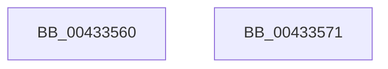

# PsGetCurrentProcessId

- RVA: `0x00433560`–`0x00433572` (길이 `18` bytes)
- VA: `0x0000000140433560`
- 실행 섹션: `.text`
- PDB 이름 있음: `예`; PDB Function 태그: `아니요`
- unwind 정보 RVA: `0x000DB714`
- 디코드: `4`개 명령, `18/18` bytes 표시
- 미해석 바이트: `0` (있으면 어셈블리에 `.byte`로 보존)

> 이 문서는 커널 이미지의 기계어와 PDB 기호를 분석해 생성했습니다. 4번과 5번은 함수 원형과 자료형을 바이너리 사용 방식에서 추정한 C 해석이며 원본 소스 복구 결과는 아닙니다.

## 1. Dependencies

- 직접 호출 지점: **0**; 고유 호출 대상: **0**
- 직접 호출자로 확인된 함수: **14**
- RIP 상대 이미지 참조: **0**

### Outgoing calls
- 직접 디코드된 call 명령이 없습니다.

### Direct callers
- [PiSwQueuedCreateInfoCreate](../../page/73/PiSwQueuedCreateInfoCreate_function_0073B1BC.md) at `0x0073B22E`
- [PoShutdownBugCheck](../../page/75/PoShutdownBugCheck_function_0075E580.md) at `0x0075E614`
- [EtwpRegisterPrivateSession](../../page/7B/EtwpRegisterPrivateSession_function_007BC92C.md) at `0x007BC9B4`
- [ObpCreateHandle](../../page/86/ObpCreateHandle_function_0086B950.md) at `0x0086D2DA`
- [sub_008C3C89](../../page/8C/Unknown_function_008C3C89.md) at `0x008C3E3C`
- [EtwpNotifyGuid](../../page/8C/EtwpNotifyGuid_function_008C8110.md) at `0x008C817F`
- [PiSwIrpStartCreateWorker](../../page/8D/PiSwIrpStartCreateWorker_function_008DB398.md) at `0x008DB5E9`
- [sub_0091EFFE](../../page/91/Unknown_function_0091EFFE.md) at `0x0091F0B6`
- [PiUEventHandleRegistration](../../page/9C/PiUEventHandleRegistration_function_009C3304.md) at `0x009C3365`
- [EtwpNotifyDisallowedGuidChange](../../page/9E/EtwpNotifyDisallowedGuidChange_function_009EAD14.md) at `0x009EADED`
- [EtwpEnableGuid](../../page/A5/EtwpEnableGuid_function_00A5CD28.md) at `0x00A5CF51`
- [NtTraceControl](../../page/A9/NtTraceControl_function_00A9ED40.md) at `0x00A9F1AC`
- [NtTraceControl](../../page/A9/NtTraceControl_function_00A9ED40.md) at `0x00A9F2EC`
- [sub_00B1C4F6](../../page/B1/Unknown_function_00B1C4F6.md) at `0x00B1C837`
- [sub_00B1C93A](../../page/B1/Unknown_function_00B1C93A.md) at `0x00B1CC7E`

### Static image references
- 디코드된 RIP-relative 메모리 참조가 없습니다.

## 2. Other-region calls and transfers

- 다른 실행 섹션으로 향하는 call: **0**
- 별도 외부 분기/꼬리 이동을 확인하지 못했습니다.

## 3. Assembly (complete function range)

```asm
00433560  65 48 8B 04 25 88 01 00 00      mov rax, qword ptr gs:[0x188]
00433569  48 8B 80 08 05 00 00            mov rax, qword ptr [rax + 0x508]
00433570  C3                              ret
00433571  CC                              int3
```

## 4. C-style interpretation (structured pseudocode)

```c
__int64 __fastcall PsGetCurrentProcessId(void)
{
    return *(unsigned __int64 *)(*(unsigned __int64 *)(gs_base + (0 + 392)) + 1288);
}
```

## 5. (Beta) C Style

```c
void PsGetCurrentProcessId(void)
{
    return *(uint64_t *)(*(uint64_t *)(gs_base + (0 + 0x188)) + 0x508);
}
```

## 6. Execution-region graph

[열기: 2D/3D 그래프와 함수 탐색 컨트롤 패널](../../../control-panel.html?section=text&rva=0x00433560&view=graph)

- 2D 그래프는 위에서 아래로 흐르고, 3D 그래프는 빈 공간을 드래그해 회전합니다. Shift+드래그는 이동, 휠은 확대·축소, 함수 노드 선택은 대상 보고서 이동입니다.

### Static fallback


