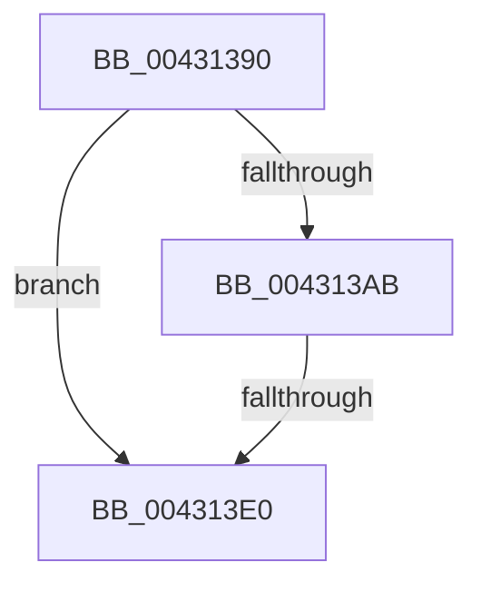

# PsGetJobProperty

- RVA: `0x00431390`–`0x004313E9` (길이 `89` bytes)
- VA: `0x0000000140431390`
- 실행 섹션: `.text`
- PDB 이름 있음: `예`; PDB Function 태그: `아니요`
- unwind 정보 RVA: `0x000A2170`
- 디코드: `23`개 명령, `89/89` bytes 표시
- 미해석 바이트: `0` (있으면 어셈블리에 `.byte`로 보존)

> 이 문서는 커널 이미지의 기계어와 PDB 기호를 분석해 생성했습니다. 4번과 5번은 함수 원형과 자료형을 바이너리 사용 방식에서 추정한 C 해석이며 원본 소스 복구 결과는 아닙니다.

## 1. Dependencies

- 직접 호출 지점: **0**; 고유 호출 대상: **0**
- 직접 호출자로 확인된 함수: **0**
- RIP 상대 이미지 참조: **3**

### Outgoing calls
- 직접 디코드된 call 명령이 없습니다.

### Direct callers
- 이 함수 시작 RVA로 연결되는 직접 call은 확인되지 않았습니다. 간접 호출은 완전히 역산할 수 없습니다.

### Static image references
- `0x004313BB` → RVA `0x00FC7800` (`ALMOSTRO`; read)
- `0x004313C5` → RVA `0x00FC6E4C` (`ALMOSTRO`; read)
- `0x004313CF` → RVA `0x00FC6C58` (`ALMOSTRO`; read)

## 2. Other-region calls and transfers

- 다른 실행 섹션으로 향하는 call: **0**
- call이 아닌 외부 분기/꼬리 이동: **2**
  - `0x004313DA` → [sub_00431544](Unknown_function_00431544.md) (`tail-transfer`)
  - `0x004313E3` → [sub_004314B5](Unknown_function_004314B5.md) (`tail-transfer`)

## 3. Assembly (complete function range)

```asm
00431390  40 53                           push rbx
00431392  41 54                           push r12
00431394  41 57                           push r15
00431396  48 83 EC 30                     sub rsp, 0x30
0043139A  4C 8B E2                        mov r12, rdx
0043139D  48 8B D9                        mov rbx, rcx
004313A0  45 33 FF                        xor r15d, r15d
004313A3  44 0F 20 C0                     mov rax, cr8
004313A7  3C 02                           cmp al, 2
004313A9  73 35                           jae 0x1404313e0
004313AB  48 8D 41 D0                     lea rax, [rcx - 0x30]
004313AF  48 C1 E8 08                     shr rax, 8
004313B3  44 0F B6 C0                     movzx r8d, al
004313B7  0F B6 41 E8                     movzx eax, byte ptr [rcx - 0x18]
004313BB  48 8D 0D 3E 64 B9 00            lea rcx, [rip + 0xb9643e]
004313C2  4C 33 C0                        xor r8, rax
004313C5  0F B6 05 80 5A B9 00            movzx eax, byte ptr [rip + 0xb95a80]
004313CC  4C 33 C0                        xor r8, rax
004313CF  48 8B 05 82 58 B9 00            mov rax, qword ptr [rip + 0xb95882]
004313D6  4A 39 04 C1                     cmp qword ptr [rcx + r8*8], rax
004313DA  0F 85 64 01 00 00               jne 0x140431544
004313E0  48 85 DB                        test rbx, rbx
004313E3  0F 84 CC 00 00 00               je 0x1404314b5
```

## 4. C-style interpretation (structured pseudocode)

```c
__int64 __fastcall PsGetJobProperty(__int64 a1, __int64 a2)
{
    __int64 result;
    __int64 v_r15;
    __int64 v_rsp;

    v_rsp = (v_rsp) - (48);
    v_r15 = 0;
    if (((unsigned __int8)(v_cr8)) >= 2) goto loc_004313E0;
    result = (a1 - 48) >> (8);
    a3 = ((unsigned __int8)(result)) ^ (*(unsigned __int8 *)(a1 - 24));
    a3 = (a3) ^ (*(unsigned __int8 *)(v_rip + 12147328));
loc_004313E0:
}
```

## 5. (Beta) C Style

```c
int64_t PsGetJobProperty(void *Arg1, int64_t Arg2)
{
    uint8_t *arg1 = (uint8_t *)Arg1;

    int64_t result;
    int64_t local_r15;
    int64_t local_rsp;

    local_rsp = (local_rsp) - (48);
    local_r15 = 0;
    if (((uint8_t)(v_cr8)) >= 2) goto loc_004313E0;
    result = (Arg1 - 48) >> (8);
    a3 = ((uint8_t)(result)) ^ (*(uint8_t *)(arg1 - 0x18));
    a3 = (a3) ^ (*(uint8_t *)(v_rip + 0xB95A80));
loc_004313E0:
}
```

### 관측된 메모리 오프셋

구조체 형식이 확인되지 않은 접근은 인자 기준의 오프셋으로만 기록했습니다.

| 기준 인자 | 오프셋 표현 | 폭 (bit) | 접근 |
|---|---:|---:|---|
| `Arg1` | `- 0x30` | `64` | `R` |
| `Arg1` | `- 0x18` | `8` | `R` |

## 6. Execution-region graph

[열기: 2D/3D 그래프와 함수 탐색 컨트롤 패널](../../../control-panel.html?section=text&rva=0x00431390&view=graph)

- 2D 그래프는 위에서 아래로 흐르고, 3D 그래프는 빈 공간을 드래그해 회전합니다. Shift+드래그는 이동, 휠은 확대·축소, 함수 노드 선택은 대상 보고서 이동입니다.

### Static fallback


