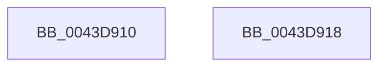

# PsGetProcessId

- RVA: `0x0043D910`–`0x0043D919` (길이 `9` bytes)
- VA: `0x000000014043D910`
- 실행 섹션: `.text`
- PDB 이름 있음: `예`; PDB Function 태그: `아니요`
- unwind 정보 RVA: `0x000DB714`
- 디코드: `3`개 명령, `9/9` bytes 표시
- 미해석 바이트: `0` (있으면 어셈블리에 `.byte`로 보존)

> 이 문서는 커널 이미지의 기계어와 PDB 기호를 분석해 생성했습니다. 4번과 5번은 함수 원형과 자료형을 바이너리 사용 방식에서 추정한 C 해석이며 원본 소스 복구 결과는 아닙니다.

## 1. Dependencies

- 직접 호출 지점: **0**; 고유 호출 대상: **0**
- 직접 호출자로 확인된 함수: **33**
- RIP 상대 이미지 참조: **0**

### Outgoing calls
- 직접 디코드된 call 명령이 없습니다.

### Direct callers
- [TtmpCloseTerminalHandle](../../page/77/TtmpCloseTerminalHandle_function_0077D390.md) at `0x0077D3E7`
- [TtmpOpenTerminalHandle](../../page/77/TtmpOpenTerminalHandle_function_0077D490.md) at `0x0077D4B7`
- [TtmpCloseQueueHandle](../../page/77/TtmpCloseQueueHandle_function_0077DF80.md) at `0x0077DF90`
- [TtmpOpenQueueHandle](../../page/77/TtmpOpenQueueHandle_function_0077E070.md) at `0x0077E094`
- [PspProcessQosChangeNotificationWorker](../../page/78/PspProcessQosChangeNotificationWorker_function_00781740.md) at `0x00781857`
- [PspProcessQosChangeNotificationWorker](../../page/78/PspProcessQosChangeNotificationWorker_function_00781740.md) at `0x007818D5`
- [VmpLogAccessFault](../../page/7A/VmpLogAccessFault_function_007AE0C4.md) at `0x007AE133`
- [VmpLogAccessFaultRange](../../page/7A/VmpLogAccessFaultRange_function_007AE28C.md) at `0x007AE2F7`
- [VmpLogCreateDeleteMemoryRange](../../page/7A/VmpLogCreateDeleteMemoryRange_function_007AE428.md) at `0x007AE498`
- [VmpLogCreateDeleteMemoryRange](../../page/7A/VmpLogCreateDeleteMemoryRange_function_007AE428.md) at `0x007AE567`
- [VmpLogCreateMemoryProcess](../../page/7A/VmpLogCreateMemoryProcess_function_007AE668.md) at `0x007AE6EE`
- [VmpLogCreateMemoryProcess](../../page/7A/VmpLogCreateMemoryProcess_function_007AE668.md) at `0x007AE73B`
- [VmpLogCreateMemoryProcess](../../page/7A/VmpLogCreateMemoryProcess_function_007AE668.md) at `0x007AE75C`
- [VmpLogPin](../../page/7A/VmpLogPin_function_007AE8A0.md) at `0x007AE910`
- [VmpLogPin](../../page/7A/VmpLogPin_function_007AE8A0.md) at `0x007AEA06`
- [VmpLogSplitMergeMemoryRange](../../page/7A/VmpLogSplitMergeMemoryRange_function_007AEAE0.md) at `0x007AEB48`
- [VmpLogSplitMergeMemoryRange](../../page/7A/VmpLogSplitMergeMemoryRange_function_007AEAE0.md) at `0x007AEBBC`
- [EtwpUpdateProcessTracingCallback](../../page/7B/EtwpUpdateProcessTracingCallback_function_007B8F40.md) at `0x007B9036`
- [EtwpObjectHandleRundown](../../page/7C/EtwpObjectHandleRundown_function_007C047C.md) at `0x007C04A1`
- [WheaTerminateProcess](../../page/7D/WheaTerminateProcess_function_007D7810.md) at `0x007D7859`
- [MiLogHotPatchManagement](../../page/80/MiLogHotPatchManagement_function_008046B8.md) at `0x00804740`
- [MiLogHotPatchManagement](../../page/80/MiLogHotPatchManagement_function_008046B8.md) at `0x00804815`
- [MiLogHotPatchManagement](../../page/80/MiLogHotPatchManagement_function_008046B8.md) at `0x00804914`
- [MiLogHotPatchOperation](../../page/80/MiLogHotPatchOperation_function_00804A04.md) at `0x00804ABB`
- [MiLogHotPatchOperation](../../page/80/MiLogHotPatchOperation_function_00804A04.md) at `0x00804C40`
- [MiLogHotPatchOperationStatus](../../page/80/MiLogHotPatchOperationStatus_function_00804E84.md) at `0x00804F65`
- [MiLogHotPatchOperationStatus](../../page/80/MiLogHotPatchOperationStatus_function_00804E84.md) at `0x008050E2`
- [MiLogHotPatchOperationStatus](../../page/80/MiLogHotPatchOperationStatus_function_00804E84.md) at `0x008052DB`
- [MiLogHotPatchOperationStatus](../../page/80/MiLogHotPatchOperationStatus_function_00804E84.md) at `0x008053E4`
- [MiLogHotPatchPagesLocked](../../page/80/MiLogHotPatchPagesLocked_function_008055FC.md) at `0x00805684`
- [MiLogHotPatchRundown](../../page/80/MiLogHotPatchRundown_function_008057A4.md) at `0x00805EB8`
- [MiLogHotPatchRundown](../../page/80/MiLogHotPatchRundown_function_008057A4.md) at `0x008060F4`
- [PsOpenProcess](../../page/89/PsOpenProcess_function_00894A30.md) at `0x00894E1C`
- [EtwpNotifyGuid](../../page/8C/EtwpNotifyGuid_function_008C8110.md) at `0x008C82F1`
- [EtwpNotifyGuid](../../page/8C/EtwpNotifyGuid_function_008C8110.md) at `0x008C83B0`
- [sub_008D3420](../../page/8D/Unknown_function_008D3420.md) at `0x008D3512`
- [PspProcessDelete](../../page/90/PspProcessDelete_function_00907B90.md) at `0x00907CA4`
- [PopEtAggregateKeyCopyFromProcess](../../page/98/PopEtAggregateKeyCopyFromProcess_function_0098D0D4.md) at `0x0098D131`
- [VmpLogFaultResolveFailure](../../page/9F/VmpLogFaultResolveFailure_function_009FFBCC.md) at `0x009FFC37`
- [EtwTraceWorkingSetSwap](../../page/A1/EtwTraceWorkingSetSwap_function_00A17D80.md) at `0x00A17DF2`
- [EtwpEnableGuid](../../page/A5/EtwpEnableGuid_function_00A5CD28.md) at `0x00A5D77C`
- [EtwTraceWorkingSetInSwapStoreFail](../../page/A6/EtwTraceWorkingSetInSwapStoreFail_function_00A61DBC.md) at `0x00A61E06`
- [PspPostFreezeOperationWorker](../../page/A9/PspPostFreezeOperationWorker_function_00A94CB0.md) at `0x00A94F57`
- [MiForceCrashForInvalidAccess](../../page/AC/MiForceCrashForInvalidAccess_function_00ACEFA4.md) at `0x00ACF074`
- [MiForceCrashForInvalidAccess](../../page/AC/MiForceCrashForInvalidAccess_function_00ACEFA4.md) at `0x00ACF093`
- [EtwQueryPerformanceTraceInformation](../../page/AF/EtwQueryPerformanceTraceInformation_function_00AF28A4.md) at `0x00AF2EC1`
- [sub_00B484E6](../../page/B4/Unknown_function_00B484E6.md) at `0x00B48551`
- [sub_00B484E6](../../page/B4/Unknown_function_00B484E6.md) at `0x00B4860B`
- [sub_00B484E6](../../page/B4/Unknown_function_00B484E6.md) at `0x00B48721`
- [EtwTraceSystemTimeChange](../../pagelk/B7/EtwTraceSystemTimeChange_function_00B7C93C.md) at `0x00B7C9AB`

### Static image references
- 디코드된 RIP-relative 메모리 참조가 없습니다.

## 2. Other-region calls and transfers

- 다른 실행 섹션으로 향하는 call: **0**
- 별도 외부 분기/꼬리 이동을 확인하지 못했습니다.

## 3. Assembly (complete function range)

```asm
0043D910  48 8B 81 D0 01 00 00            mov rax, qword ptr [rcx + 0x1d0]
0043D917  C3                              ret
0043D918  CC                              int3
```

## 4. C-style interpretation (structured pseudocode)

```c
__int64 __fastcall PsGetProcessId(__int64 a1)
{
    return *(unsigned __int64 *)(a1 + 464);
}
```

## 5. (Beta) C Style

```c
int64_t PsGetProcessId(void *Arg1)
{
    uint8_t *arg1 = (uint8_t *)Arg1;

    return *(uint64_t *)(arg1 + 0x1D0);
}
```

### 관측된 메모리 오프셋

구조체 형식이 확인되지 않은 접근은 인자 기준의 오프셋으로만 기록했습니다.

| 기준 인자 | 오프셋 표현 | 폭 (bit) | 접근 |
|---|---:|---:|---|
| `Arg1` | `+ 0x1D0` | `64` | `R` |

## 6. Execution-region graph

[열기: 2D/3D 그래프와 함수 탐색 컨트롤 패널](../../../control-panel.html?section=text&rva=0x0043D910&view=graph)

- 2D 그래프는 위에서 아래로 흐르고, 3D 그래프는 빈 공간을 드래그해 회전합니다. Shift+드래그는 이동, 휠은 확대·축소, 함수 노드 선택은 대상 보고서 이동입니다.

### Static fallback


