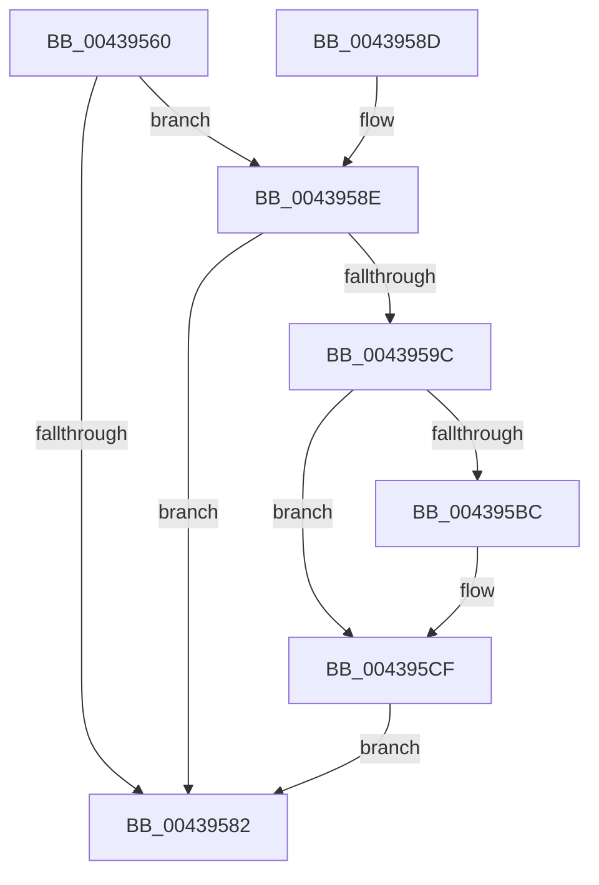

# PsGetWorkOnBehalfThread

- RVA: `0x00439560`–`0x004395E9` (길이 `137` bytes)
- VA: `0x0000000140439560`
- 실행 섹션: `.text`
- PDB 이름 있음: `예`; PDB Function 태그: `아니요`
- unwind 정보 RVA: `0x000A4130`
- 디코드: `34`개 명령, `137/137` bytes 표시
- 미해석 바이트: `0` (있으면 어셈블리에 `.byte`로 보존)

> 이 문서는 커널 이미지의 기계어와 PDB 기호를 분석해 생성했습니다. 4번과 5번은 함수 원형과 자료형을 바이너리 사용 방식에서 추정한 C 해석이며 원본 소스 복구 결과는 아닙니다.

## 1. Dependencies

- 직접 호출 지점: **3**; 고유 호출 대상: **3**
- 직접 호출자로 확인된 함수: **3**
- RIP 상대 이미지 참조: **1**

### Outgoing calls
- `0x004395A8` → [ExAcquireSpinLockShared](../24/ExAcquireSpinLockShared_function_0024DCE0.md) (function, `0x0024DCE0`)
- `0x004395C4` → [ObfReferenceObjectWithTag](../21/ObfReferenceObjectWithTag_function_00210710.md) (function, `0x00210710`)
- `0x004395DA` → [ExReleaseSpinLockShared](../2F/ExReleaseSpinLockShared_function_002F0EF0.md) (function, `0x002F0EF0`)

### Direct callers
- [NtAlpcImpersonateClientContainerOfPort](../../page/74/NtAlpcImpersonateClientContainerOfPort_function_0074C1B0.md) at `0x0074C300`
- [AlpcpCaptureWorkOnBehalfAttribute](../../page/9D/AlpcpCaptureWorkOnBehalfAttribute_function_009D6D10.md) at `0x009D6D3E`
- [NtQueryInformationThread](../../page/AE/NtQueryInformationThread_function_00AE3760.md) at `0x00AE4D8F`

### Static image references
- `0x0043959C` → RVA `0x00F06590` (`.data`; read)

## 2. Other-region calls and transfers

- 다른 실행 섹션으로 향하는 call: **0**
- 별도 외부 분기/꼬리 이동을 확인하지 못했습니다.

## 3. Assembly (complete function range)

```asm
00439560  48 89 5C 24 10                  mov qword ptr [rsp + 0x10], rbx
00439565  57                              push rdi
00439566  48 83 EC 20                     sub rsp, 0x20
0043956A  48 8B 81 50 06 00 00            mov rax, qword ptr [rcx + 0x650]
00439571  48 8B FA                        mov rdi, rdx
00439574  C7 02 00 00 00 00               mov dword ptr [rdx], 0
0043957A  48 8B D9                        mov rbx, rcx
0043957D  48 85 C0                        test rax, rax
00439580  75 0C                           jne 0x14043958e
00439582  48 8B 5C 24 38                  mov rbx, qword ptr [rsp + 0x38]
00439587  48 83 C4 20                     add rsp, 0x20
0043958B  5F                              pop rdi
0043958C  C3                              ret
0043958D  CC                              int3
0043958E  65 4C 8B 04 25 88 01 00 00      mov r8, qword ptr gs:[0x188]
00439597  49 3B D8                        cmp rbx, r8
0043959A  74 E6                           je 0x140439582
0043959C  48 8D 0D ED CF AC 00            lea rcx, [rip + 0xaccfed]
004395A3  48 89 74 24 30                  mov qword ptr [rsp + 0x30], rsi
004395A8  E8 33 47 E1 FF                  call 0x14024dce0
004395AD  48 8B 9B 50 06 00 00            mov rbx, qword ptr [rbx + 0x650]
004395B4  0F B6 F0                        movzx esi, al
004395B7  48 85 DB                        test rbx, rbx
004395BA  74 13                           je 0x1404395cf
004395BC  BA 44 66 6C 74                  mov edx, 0x746c6644
004395C1  48 8B CB                        mov rcx, rbx
004395C4  E8 47 71 DD FF                  call 0x140210710
004395C9  C7 07 01 00 00 00               mov dword ptr [rdi], 1
004395CF  40 0F B6 D6                     movzx edx, sil
004395D3  48 8D 0D B6 CF AC 00            lea rcx, [rip + 0xaccfb6]
004395DA  E8 11 79 EB FF                  call 0x1402f0ef0
004395DF  48 8B 74 24 30                  mov rsi, qword ptr [rsp + 0x30]
004395E4  48 8B C3                        mov rax, rbx
004395E7  EB 99                           jmp 0x140439582
```

## 4. C-style interpretation (structured pseudocode)

```c
__int64 __fastcall PsGetWorkOnBehalfThread(__int64 a1, __int64 a2)
{
    __int64 result;
    __int64 v_rsp;
    unsigned __int64 v_stack_p10;
    unsigned __int64 v_stack_p30;

    v_stack_p10 = v_rbx;
    v_rsp = (v_rsp) - (32);
    *(unsigned int *)(a2) = 0;
    if (*(unsigned __int64 *)(a1 + 1616) != 0) goto loc_0043958E;
loc_00439582:
    v_rsp = (v_rsp) + (32);
    return *(unsigned __int64 *)(a1 + 1616);
loc_0043958E:
    if (v_stack_p10 == (*(unsigned __int64 *)(gs_base + (0 + 392)))) goto loc_00439582;
    v_stack_p30 = v_rsi;
    result = ExAcquireSpinLockShared(v_rip + 11325421, a2, *(unsigned __int64 *)(gs_base + (0 + 392)), a4);
    if (*(unsigned __int64 *)(v_stack_p10 + 1616) != 0) {
        a2 = 0x746C6644ULL;
        a1 = *(unsigned __int64 *)(v_stack_p10 + 1616);
        result = ObfReferenceObjectWithTag(a1, a2, *(unsigned __int64 *)(gs_base + (0 + 392)), a4);
        *(unsigned int *)(a2) = 1;
    }
    result = ExReleaseSpinLockShared(v_rip + 11325366, (unsigned __int8)((unsigned __int8)(result)), *(unsigned __int64 *)(gs_base + (0 + 392)), a4);
    goto loc_00439582;
}
```

## 5. (Beta) C Style

```c
int64_t PsGetWorkOnBehalfThread(void *Arg1, void *Arg2)
{
    uint8_t *arg1 = (uint8_t *)Arg1;
    uint8_t *arg2 = (uint8_t *)Arg2;

    int64_t result;
    int64_t local_rsp;
    uint64_t v_stack_p10;
    uint64_t v_stack_p30;

    v_stack_p10 = local_rbx;
    local_rsp = (local_rsp) - (32);
    *(uint32_t *)(arg2) = 0;
    if (*(uint64_t *)(arg1 + 0x650) != 0) goto loc_0043958E;
loc_00439582:
    local_rsp = (local_rsp) + (32);
    return *(uint64_t *)(arg1 + 0x650);
loc_0043958E:
    if (v_stack_p10 == (*(uint64_t *)(gs_base + (0 + 0x188)))) goto loc_00439582;
    v_stack_p30 = local_rsi;
    result = ExAcquireSpinLockShared(v_rip + 11325421, Arg2, *(uint64_t *)(gs_base + (0 + 0x188)), a4);
    if (*(uint64_t *)(v_stack_p10 + 0x650) != 0) {
        Arg2 = 0x746C6644ULL;
        Arg1 = *(uint64_t *)(v_stack_p10 + 0x650);
        result = ObfReferenceObjectWithTag(Arg1, Arg2, *(uint64_t *)(gs_base + (0 + 0x188)), a4);
        *(uint32_t *)(arg2) = 1;
    }
    result = ExReleaseSpinLockShared(v_rip + 11325366, (uint8_t)((uint8_t)(result)), *(uint64_t *)(gs_base + (0 + 0x188)), a4);
    goto loc_00439582;
}
```

### 관측된 메모리 오프셋

구조체 형식이 확인되지 않은 접근은 인자 기준의 오프셋으로만 기록했습니다.

| 기준 인자 | 오프셋 표현 | 폭 (bit) | 접근 |
|---|---:|---:|---|
| `Arg1` | `+ 0x650` | `64` | `R` |
| `Arg2` | `+ 0x0` | `32` | `W` |

## 6. Execution-region graph

[열기: 2D/3D 그래프와 함수 탐색 컨트롤 패널](../../../control-panel.html?section=text&rva=0x00439560&view=graph)

- 2D 그래프는 위에서 아래로 흐르고, 3D 그래프는 빈 공간을 드래그해 회전합니다. Shift+드래그는 이동, 휠은 확대·축소, 함수 노드 선택은 대상 보고서 이동입니다.

### Static fallback


