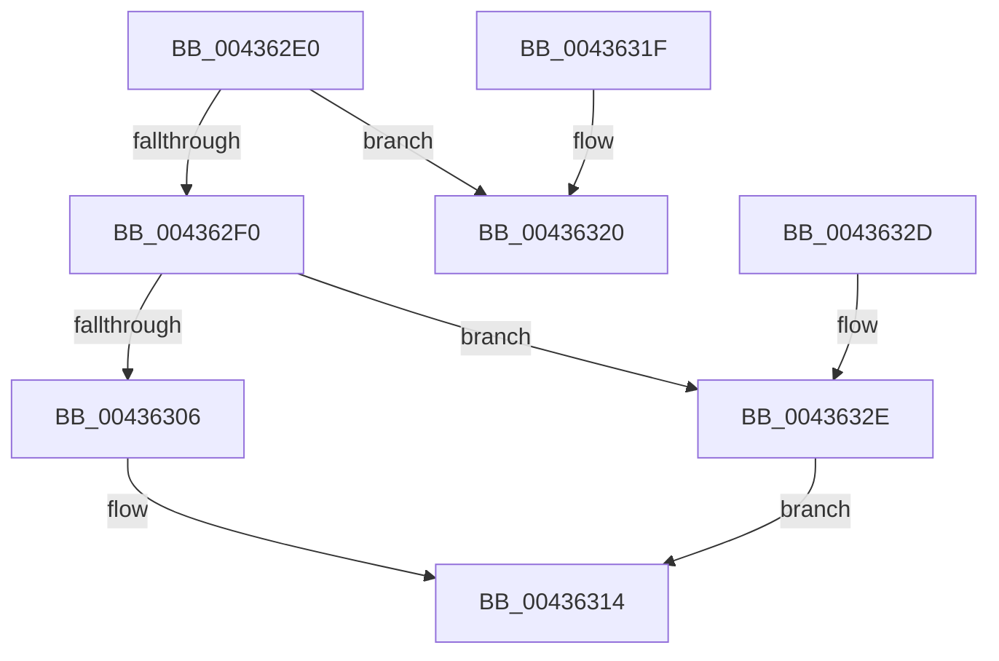

# PsIsCurrentThreadInServerSilo

- RVA: `0x004362E0`–`0x00436335` (길이 `85` bytes)
- VA: `0x00000001404362E0`
- 실행 섹션: `.text`
- PDB 이름 있음: `예`; PDB Function 태그: `아니요`
- unwind 정보 RVA: `0x000A2DB4`
- 디코드: `23`개 명령, `85/85` bytes 표시
- 미해석 바이트: `0` (있으면 어셈블리에 `.byte`로 보존)

> 이 문서는 커널 이미지의 기계어와 PDB 기호를 분석해 생성했습니다. 4번과 5번은 함수 원형과 자료형을 바이너리 사용 방식에서 추정한 C 해석이며 원본 소스 복구 결과는 아닙니다.

## 1. Dependencies

- 직접 호출 지점: **1**; 고유 호출 대상: **1**
- 직접 호출자로 확인된 함수: **72**
- RIP 상대 이미지 참조: **0**

### Outgoing calls
- `0x0043632E` → [PsGetEffectiveServerSilo](../22/PsGetEffectiveServerSilo_function_002257F0.md) (function, `0x002257F0`)

### Direct callers
- [RtlSetSystemGlobalData](RtlSetSystemGlobalData_function_00435AF0.md) at `0x00435B8E`
- [RtlGetActiveConsoleId](RtlGetActiveConsoleId_function_00436230.md) at `0x00436234`
- [RtlGetNtProductType](RtlGetNtProductType_function_00436270.md) at `0x00436279`
- [IopLoadDriverImage](../4F/IopLoadDriverImage_function_004FA0FC.md) at `0x004FA16E`
- [SepRmProcessCreationCommandLineAuditSettingsWrkr](../60/SepRmProcessCreationCommandLineAuditSettingsWrkr_function_00609F60.md) at `0x00609F6D`
- [EtwpGetPmcOwnership](../64/EtwpGetPmcOwnership_function_0064E960.md) at `0x0064E99B`
- [sub_006F213A](../6F/Unknown_function_006F213A.md) at `0x006F21B5`
- [sub_006F213A](../6F/Unknown_function_006F213A.md) at `0x006F222D`
- [PspInitializeSessionGlobals](../../page/70/PspInitializeSessionGlobals_function_007005B8.md) at `0x00700609`
- [PoUserShutdownCancelled](../../page/70/PoUserShutdownCancelled_function_007051C0.md) at `0x007051C4`
- [NtSetInformationSymbolicLink](../../page/74/NtSetInformationSymbolicLink_function_0074E910.md) at `0x0074E9A6`
- [NtSetInformationSymbolicLink](../../page/74/NtSetInformationSymbolicLink_function_0074E910.md) at `0x0074EA21`
- [NtInitiatePowerAction](../../page/75/NtInitiatePowerAction_function_0075FCB0.md) at `0x0075FD71`
- [PspConvertSiloToServerSilo](../../page/77/PspConvertSiloToServerSilo_function_0077F9B4.md) at `0x0077F9D8`
- [PsShutdownSystem](../../page/78/PsShutdownSystem_function_00785E94.md) at `0x00785F08`
- [RtlGetConsoleSessionForegroundProcessId](../../page/78/RtlGetConsoleSessionForegroundProcessId_function_0078A5C0.md) at `0x0078A5C4`
- [SepInitializationPhase1](../../page/79/SepInitializationPhase1_function_0079C580.md) at `0x0079C5CB`
- [EtwShutdown](../../page/7B/EtwShutdown_function_007B50B0.md) at `0x007B50F1`
- [EtwpGetSoftRestartInformation](../../page/7B/EtwpGetSoftRestartInformation_function_007BEC70.md) at `0x007BECA3`
- [ExpSetTimeZoneInformation](../../page/7C/ExpSetTimeZoneInformation_function_007C5240.md) at `0x007C5480`
- [ExpSetTimeZoneInformation](../../page/7C/ExpSetTimeZoneInformation_function_007C5240.md) at `0x007C5506`
- [NtSetSystemTime](../../page/7C/NtSetSystemTime_function_007C65F0.md) at `0x007C66A3`
- [NtSetSystemTime](../../page/7C/NtSetSystemTime_function_007C65F0.md) at `0x007C6788`
- [ExpSetBootEntry](../../page/7C/ExpSetBootEntry_function_007CBD2C.md) at `0x007CBDED`
- [ExpSetDriverEntry](../../page/7C/ExpSetDriverEntry_function_007CC424.md) at `0x007CC4D4`
- [NtDeleteBootEntry](../../page/7C/NtDeleteBootEntry_function_007CD2B0.md) at `0x007CD2D8`
- [NtDeleteDriverEntry](../../page/7C/NtDeleteDriverEntry_function_007CD440.md) at `0x007CD47A`
- [NtEnumerateDriverEntries](../../page/7C/NtEnumerateDriverEntries_function_007CD5D0.md) at `0x007CD620`
- [NtEnumerateSystemEnvironmentValuesEx](../../page/7C/NtEnumerateSystemEnvironmentValuesEx_function_007CDA30.md) at `0x007CDA69`
- [NtQueryDriverEntryOrder](../../page/7C/NtQueryDriverEntryOrder_function_007CDCE0.md) at `0x007CDD10`
- [NtQuerySystemEnvironmentValue](../../page/7C/NtQuerySystemEnvironmentValue_function_007CDFB0.md) at `0x007CDFEF`
- [NtSetBootOptions](../../page/7C/NtSetBootOptions_function_007CE2B0.md) at `0x007CE2DA`
- [NtSetDriverEntryOrder](../../page/7C/NtSetDriverEntryOrder_function_007CE490.md) at `0x007CE4C9`
- [NtSetSystemEnvironmentValue](../../page/7C/NtSetSystemEnvironmentValue_function_007CE650.md) at `0x007CE689`
- [NtSetSystemEnvironmentValueEx](../../page/7C/NtSetSystemEnvironmentValueEx_function_007CE990.md) at `0x007CE9DC`
- [NtSetDefaultHardErrorPort](../../page/7D/NtSetDefaultHardErrorPort_function_007D0340.md) at `0x007D03D5`
- [CmpAcceptBoot](../../page/7D/CmpAcceptBoot_function_007DF574.md) at `0x007DF581`
- [MiCreatePagingFile](../../page/7F/MiCreatePagingFile_function_007FEFF4.md) at `0x007FF0D7`
- [NtDisableLastKnownGood](../../page/83/NtDisableLastKnownGood_function_0083C560.md) at `0x0083C5B6`
- [NtEnableLastKnownGood](../../page/83/NtEnableLastKnownGood_function_0083C680.md) at `0x0083C70A`
- [CmpDoParseKey](../../page/85/CmpDoParseKey_function_0085F750.md) at `0x008603AF`
- [CmpDoParseKey](../../page/85/CmpDoParseKey_function_0085F750.md) at `0x008609F2`
- [sub_00891D68](../../page/89/Unknown_function_00891D68.md) at `0x00891DB6`
- [ObpParseSymbolicLinkEx](../../page/8B/ObpParseSymbolicLinkEx_function_008B35C0.md) at `0x008B38E0`
- [NtPlugPlayControl](../../page/8E/NtPlugPlayControl_function_008E3EF0.md) at `0x008E3F6A`
- [TtmIsEnabled](../../page/91/TtmIsEnabled_function_009143D8.md) at `0x009143F6`
- [NtQuerySystemEnvironmentValueEx](../../page/95/NtQuerySystemEnvironmentValueEx_function_00952180.md) at `0x009521D8`
- [NtPowerInformation](../../page/95/NtPowerInformation_function_00955D80.md) at `0x0095600C`
- [NtPowerInformation](../../page/95/NtPowerInformation_function_00955D80.md) at `0x0095763F`
- [NtQueryInformationProcess](../../page/9A/NtQueryInformationProcess_function_009AA250.md) at `0x009ADE73`
- [RtlGetSuiteMask](../../page/A1/RtlGetSuiteMask_function_00A191E0.md) at `0x00A191E4`
- [RtlGetNtSystemRoot](../../page/A1/RtlGetNtSystemRoot_function_00A1DCD0.md) at `0x00A1DCD4`
- [RtlCapabilityCheck](../../page/A2/RtlCapabilityCheck_function_00A20340.md) at `0x00A20632`
- [RtlIsMultiSessionSku](../../page/A2/RtlIsMultiSessionSku_function_00A20730.md) at `0x00A20734`
- [PsQueryCurrentApiSetSchema](../../page/A2/PsQueryCurrentApiSetSchema_function_00A24300.md) at `0x00A2430A`
- [NtTranslateFilePath](../../page/A2/NtTranslateFilePath_function_00A24D50.md) at `0x00A24DA4`
- [NtEnumerateBootEntries](../../page/A2/NtEnumerateBootEntries_function_00A25040.md) at `0x00A25086`
- [NtImpersonateAnonymousToken](../../page/A3/NtImpersonateAnonymousToken_function_00A3A150.md) at `0x00A3A27A`
- [EtwSetPerformanceTraceInformation](../../page/A5/EtwSetPerformanceTraceInformation_function_00A53928.md) at `0x00A53AE8`
- [EtwpSetSoftRestartInformation](../../page/A5/EtwpSetSoftRestartInformation_function_00A53DB8.md) at `0x00A53DF4`
- [ExpRefreshTimeZoneInformation](../../page/A6/ExpRefreshTimeZoneInformation_function_00A6B46C.md) at `0x00A6B546`
- [ExpWriteTimeZoneBias](../../page/A6/ExpWriteTimeZoneBias_function_00A6C028.md) at `0x00A6C031`
- [ExpWriteTimeZoneBiasStartEnd](../../page/A6/ExpWriteTimeZoneBiasStartEnd_function_00A6C410.md) at `0x00A6C420`
- [RtlSetConsoleSessionForegroundProcessId](../../page/A8/RtlSetConsoleSessionForegroundProcessId_function_00A87380.md) at `0x00A87389`
- [PspCreateSilo](../../page/A8/PspCreateSilo_function_00A89CFC.md) at `0x00A89D22`
- [NtQueryBootEntryOrder](../../page/A9/NtQueryBootEntryOrder_function_00A91720.md) at `0x00A91751`
- [NtSetBootEntryOrder](../../page/A9/NtSetBootEntryOrder_function_00A91930.md) at `0x00A91963`
- [NtQueryBootOptions](../../page/AA/NtQueryBootOptions_function_00AAFBC0.md) at `0x00AAFBF6`
- [SepRmSetAuditEventWrkr](../../page/AB/SepRmSetAuditEventWrkr_function_00AB1460.md) at `0x00AB1489`
- [PoUserShutdownInitiated](../../page/AB/PoUserShutdownInitiated_function_00AB81D0.md) at `0x00AB81D4`
- [IopUnloadDriver](../../page/AB/IopUnloadDriver_function_00ABF868.md) at `0x00ABF9D3`
- [RtlSetActiveConsoleId](../../page/AC/RtlSetActiveConsoleId_function_00ACAB40.md) at `0x00ACAB48`
- [EtwQueryPerformanceTraceInformation](../../page/AF/EtwQueryPerformanceTraceInformation_function_00AF28A4.md) at `0x00AF2D7C`
- [EtwQueryPerformanceTraceInformation](../../page/AF/EtwQueryPerformanceTraceInformation_function_00AF28A4.md) at `0x00AF2E72`
- [NtSetSystemInformation](../../page/AF/NtSetSystemInformation_function_00AF4A60.md) at `0x00AF4D4D`
- [NtSetSystemInformation](../../page/AF/NtSetSystemInformation_function_00AF4A60.md) at `0x00AF509A`
- [NtSetSystemInformation](../../page/AF/NtSetSystemInformation_function_00AF4A60.md) at `0x00AF51E1`
- [NtSetSystemInformation](../../page/AF/NtSetSystemInformation_function_00AF4A60.md) at `0x00AF64C6`
- [sub_00B3C988](../../page/B3/Unknown_function_00B3C988.md) at `0x00B3C9E3`
- [sub_00B3C988](../../page/B3/Unknown_function_00B3C988.md) at `0x00B3CA6D`
- [sub_00B3C988](../../page/B3/Unknown_function_00B3C988.md) at `0x00B3CB3E`
- [sub_00B3C988](../../page/B3/Unknown_function_00B3C988.md) at `0x00B3CC8A`
- [sub_00B3C988](../../page/B3/Unknown_function_00B3C988.md) at `0x00B3CD87`
- [sub_00B3C988](../../page/B3/Unknown_function_00B3C988.md) at `0x00B3CE37`
- [sub_00B3E4E0](../../page/B3/Unknown_function_00B3E4E0.md) at `0x00B3E4E0`
- [sub_00B3F842](../../page/B3/Unknown_function_00B3F842.md) at `0x00B3F842`
- [PopDetectSimulatedHeteroProcessors](../../init/C4/PopDetectSimulatedHeteroProcessors_function_00C40DD8.md) at `0x00C40E09`

### Static image references
- 디코드된 RIP-relative 메모리 참조가 없습니다.

## 2. Other-region calls and transfers

- 다른 실행 섹션으로 향하는 call: **0**
- 별도 외부 분기/꼬리 이동을 확인하지 못했습니다.

## 3. Assembly (complete function range)

```asm
004362E0  48 83 EC 28                     sub rsp, 0x28
004362E4  65 8A 04 25 A0 01 00 00         mov al, byte ptr gs:[0x1a0]
004362EC  84 C0                           test al, al
004362EE  75 30                           jne 0x140436320
004362F0  65 48 8B 04 25 88 01 00 00      mov rax, qword ptr gs:[0x188]
004362F9  48 8B 88 98 06 00 00            mov rcx, qword ptr [rax + 0x698]
00436300  48 83 F9 FD                     cmp rcx, -3
00436304  75 28                           jne 0x14043632e
00436306  48 8B 88 20 02 00 00            mov rcx, qword ptr [rax + 0x220]
0043630D  48 8B 81 F0 05 00 00            mov rax, qword ptr [rcx + 0x5f0]
00436314  48 85 C0                        test rax, rax
00436317  0F 95 C0                        setne al
0043631A  48 83 C4 28                     add rsp, 0x28
0043631E  C3                              ret
0043631F  CC                              int3
00436320  33 C0                           xor eax, eax
00436322  48 85 C0                        test rax, rax
00436325  0F 95 C0                        setne al
00436328  48 83 C4 28                     add rsp, 0x28
0043632C  C3                              ret
0043632D  CC                              int3
0043632E  E8 BD F4 DE FF                  call 0x1402257f0
00436333  EB DF                           jmp 0x140436314
```

## 4. C-style interpretation (structured pseudocode)

```c
__int64 __fastcall PsIsCurrentThreadInServerSilo(void)
{
    __int64 result;
    __int64 v_rsp;

    v_rsp = (v_rsp) - (40);
    if ((unsigned __int8)(*(unsigned __int8 *)(gs_base + (0 + 416))) != 0) goto loc_00436320;
    if ((*(unsigned __int64 *)(*(unsigned __int64 *)(gs_base + (0 + 392)) + 1688)) != -3) goto loc_0043632E;
loc_00436314:
    result = (*(unsigned __int64 *)(*(unsigned __int64 *)(*(unsigned __int64 *)(gs_base + (0 + 392)) + 544) + 1520) != 0) ? 1 : 0;
    v_rsp = (v_rsp) + (40);
    return result;
loc_00436320:
    result = 0;
    result = (0 != 0) ? 1 : 0;
    v_rsp = (v_rsp) + (40);
    return result;
loc_0043632E:
    result = PsGetEffectiveServerSilo(*(unsigned __int64 *)(*(unsigned __int64 *)(gs_base + (0 + 392)) + 544), a2, a3, a4);
    goto loc_00436314;
}
```

## 5. (Beta) C Style

```c
void PsIsCurrentThreadInServerSilo(void)
{
    int64_t result;
    int64_t local_rsp;

    local_rsp = (local_rsp) - (40);
    if ((uint8_t)(*(uint8_t *)(gs_base + (0 + 0x1A0))) != 0) goto loc_00436320;
    if ((*(uint64_t *)(*(uint64_t *)(gs_base + (0 + 0x188)) + 0x698)) != -3) goto loc_0043632E;
loc_00436314:
    result = (*(uint64_t *)(*(uint64_t *)(*(uint64_t *)(gs_base + (0 + 0x188)) + 0x220) + 0x5F0) != 0) ? 1 : 0;
    local_rsp = (local_rsp) + (40);
    return result;
loc_00436320:
    result = 0;
    result = (0 != 0) ? 1 : 0;
    local_rsp = (local_rsp) + (40);
    return result;
loc_0043632E:
    result = PsGetEffectiveServerSilo(*(uint64_t *)(*(uint64_t *)(gs_base + (0 + 0x188)) + 0x220), a2, a3, a4);
    goto loc_00436314;
}
```

## 6. Execution-region graph

[열기: 2D/3D 그래프와 함수 탐색 컨트롤 패널](../../../control-panel.html?section=text&rva=0x004362E0&view=graph)

- 2D 그래프는 위에서 아래로 흐르고, 3D 그래프는 빈 공간을 드래그해 회전합니다. Shift+드래그는 이동, 휠은 확대·축소, 함수 노드 선택은 대상 보고서 이동입니다.

### Static fallback


