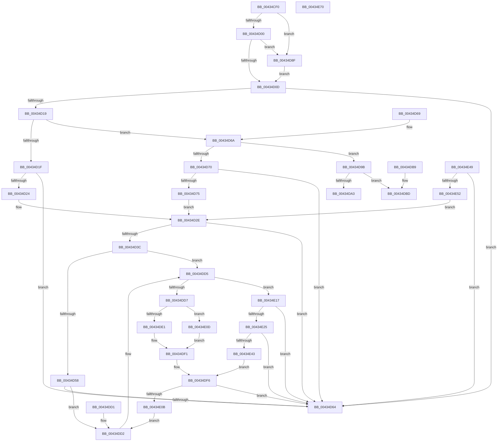

# PsUpdateComponentPower

- RVA: `0x00434CF0`–`0x00434EA0` (길이 `432` bytes)
- VA: `0x0000000140434CF0`
- 실행 섹션: `.text`
- PDB 이름 있음: `예`; PDB Function 태그: `아니요`
- unwind 정보 RVA: `0x000A2B68`
- 디코드: `119`개 명령, `432/432` bytes 표시
- 미해석 바이트: `3` (있으면 어셈블리에 `.byte`로 보존)

> 이 문서는 커널 이미지의 기계어와 PDB 기호를 분석해 생성했습니다. 4번과 5번은 함수 원형과 자료형을 바이너리 사용 방식에서 추정한 C 해석이며 원본 소스 복구 결과는 아닙니다.

## 1. Dependencies

- 직접 호출 지점: **1**; 고유 호출 대상: **1**
- 직접 호출자로 확인된 함수: **2**
- RIP 상대 이미지 참조: **4**

### Outgoing calls
- `0x00434DC7` → [PoEnergyContextUpdateComponentPower](../../page/98/PoEnergyContextUpdateComponentPower_function_0098CA08.md) (function, `0x0098CA08`)

### Direct callers
- [PspApplyJobChainLimitsToProcess](../../page/87/PspApplyJobChainLimitsToProcess_function_0087EB5C.md) at `0x0087EC3A`
- [PspSetProcessEnergyTrackingStateCallback](../../page/A9/PspSetProcessEnergyTrackingStateCallback_function_00A95120.md) at `0x00A9512C`

### Static image references
- `0x00434D00` → RVA `0x00FC6B70` (`ALMOSTRO`; read)
- `0x00434D3F` → RVA `0x00F10A44` (`.data`; read)
- `0x00434D8F` → RVA `0x00FC6AB0` (`ALMOSTRO`; read)
- `0x00434DA3` → RVA `0x00000000` (`image boundary/outside`; read)

## 2. Other-region calls and transfers

- 다른 실행 섹션으로 향하는 call: **1**
  - `0x00434DC7` → [PoEnergyContextUpdateComponentPower](../../page/98/PoEnergyContextUpdateComponentPower_function_0098CA08.md) (`.text` → `PAGE`)
- 별도 외부 분기/꼬리 이동을 확인하지 못했습니다.

## 3. Assembly (complete function range)

```asm
00434CF0  48 83 EC 28                     sub rsp, 0x28
00434CF4  44 8B D2                        mov r10d, edx
00434CF7  48 85 C9                        test rcx, rcx
00434CFA  0F 84 8F 00 00 00               je 0x140434d8f
00434D00  48 3B 0D 69 1E B9 00            cmp rcx, qword ptr [rip + 0xb91e69]
00434D07  0F 84 82 00 00 00               je 0x140434d8f
00434D0D  4C 8B 89 68 06 00 00            mov r9, qword ptr [rcx + 0x668]
00434D14  4D 85 C9                        test r9, r9
00434D17  74 4B                           je 0x140434d64
00434D19  41 83 FA 01                     cmp r10d, 1
00434D1D  75 4B                           jne 0x140434d6a
00434D1F  4D 85 C0                        test r8, r8
00434D22  74 40                           je 0x140434d64
00434D24  B8 18 01 00 00                  mov eax, 0x118
00434D29  B9 40 00 00 00                  mov ecx, 0x40
00434D2E  4D 8D 14 01                     lea r10, [r9 + rax]
00434D32  F0 4D 01 04 09                  lock add qword ptr [r9 + rcx], r8
00434D37  4D 85 D2                        test r10, r10
00434D3A  74 28                           je 0x140434d64
00434D3C  49 8B 02                        mov rax, qword ptr [r10]
00434D3F  44 8B 0D FE BC AD 00            mov r9d, dword ptr [rip + 0xadbcfe]
00434D46  48 C7 44 24 30 00 00 00 00      mov qword ptr [rsp + 0x30], 0
00434D4F  44 3B C8                        cmp r9d, eax
00434D52  0F 85 7D 00 00 00               jne 0x140434dd5
00434D58  48 8B C8                        mov rcx, rax
00434D5B  48 C1 E9 20                     shr rcx, 0x20
00434D5F  F6 C1 01                        test cl, 1
00434D62  74 6E                           je 0x140434dd2
00434D64  48 83 C4 28                     add rsp, 0x28
00434D68  C3                              ret
00434D69  CC                              int3
00434D6A  41 83 FA 02                     cmp r10d, 2
00434D6E  75 2B                           jne 0x140434d9b
00434D70  4D 85 C0                        test r8, r8
00434D73  74 EF                           je 0x140434d64
00434D75  49 8B C0                        mov rax, r8
00434D78  48 C1 E8 20                     shr rax, 0x20
00434D7C  F0 49 01 41 48                  lock add qword ptr [r9 + 0x48], rax
00434D81  45 8B C0                        mov r8d, r8d
00434D84  41 8D 4A 56                     lea ecx, [r10 + 0x56]
00434D88  B8 20 01 00 00                  mov eax, 0x120
00434D8D  EB 9F                           jmp 0x140434d2e
00434D8F  48 8B 0D 1A 1D B9 00            mov rcx, qword ptr [rip + 0xb91d1a]
00434D96  E9 72 FF FF FF                  jmp 0x140434d0d
00434D9B  8D 42 FD                        lea eax, [rdx - 3]
00434D9E  83 F8 0B                        cmp eax, 0xb
00434DA1  77 1A                           ja 0x140434dbd
00434DA3  4C 8D 1D 56 B2 BC FF            lea r11, [rip - 0x434daa]
00434DAA  48 98                           cdqe
00434DAC  41 8B 94 83 70 4E 43 00         mov edx, dword ptr [r11 + rax*4 + 0x434e70]
00434DB4  49 03 D3                        add rdx, r11
00434DB7  FF E2                           jmp rdx
00434DB9  CC                              int3
00434DBA  CC                              int3
00434DBB  CC                              int3
00434DBC  CC                              int3
00434DBD  B9 25 00 00 00                  mov ecx, 0x25
00434DC2  CD 29                           int 0x29
00434DC4  41 8B D2                        mov edx, r10d
00434DC7  E8 3C 7C 55 00                  call 0x14098ca08
00434DCC  48 83 C4 28                     add rsp, 0x28
00434DD0  C3                              ret
00434DD1  CC                              int3
00434DD2  44 3B C8                        cmp r9d, eax
00434DD5  76 40                           jbe 0x140434e17
00434DD7  41 8B C9                        mov ecx, r9d
00434DDA  2B C8                           sub ecx, eax
00434DDC  83 F9 20                        cmp ecx, 0x20
00434DDF  73 2C                           jae 0x140434e0d
00434DE1  48 8B D0                        mov rdx, rax
00434DE4  48 C1 EA 20                     shr rdx, 0x20
00434DE8  D3 E2                           shl edx, cl
00434DEA  83 CA 01                        or edx, 1
00434DED  89 54 24 34                     mov dword ptr [rsp + 0x34], edx
00434DF1  44 89 4C 24 30                  mov dword ptr [rsp + 0x30], r9d
00434DF6  48 8B 4C 24 30                  mov rcx, qword ptr [rsp + 0x30]
00434DFB  F0 49 0F B1 0A                  lock cmpxchg qword ptr [r10], rcx
00434E00  48 89 44 24 30                  mov qword ptr [rsp + 0x30], rax
00434E05  0F 84 59 FF FF FF               je 0x140434d64
00434E0B  EB C5                           jmp 0x140434dd2
00434E0D  C7 44 24 34 01 00 00 00         mov dword ptr [rsp + 0x34], 1
00434E15  EB DA                           jmp 0x140434df1
00434E17  8B C8                           mov ecx, eax
00434E19  41 2B C9                        sub ecx, r9d
00434E1C  83 F9 20                        cmp ecx, 0x20
00434E1F  0F 83 3F FF FF FF               jae 0x140434d64
00434E25  4C 8B C0                        mov r8, rax
00434E28  BA 01 00 00 00                  mov edx, 1
00434E2D  49 C1 E8 20                     shr r8, 0x20
00434E31  D3 E2                           shl edx, cl
00434E33  41 0B D0                        or edx, r8d
00434E36  89 54 24 34                     mov dword ptr [rsp + 0x34], edx
00434E3A  41 3B D0                        cmp edx, r8d
00434E3D  0F 84 21 FF FF FF               je 0x140434d64
00434E43  89 44 24 30                     mov dword ptr [rsp + 0x30], eax
00434E47  EB AD                           jmp 0x140434df6
00434E49  4D 85 C0                        test r8, r8
00434E4C  0F 84 12 FF FF FF               je 0x140434d64
00434E52  49 8B C0                        mov rax, r8
00434E55  48 C1 E8 20                     shr rax, 0x20
00434E59  F0 49 01 41 50                  lock add qword ptr [r9 + 0x50], rax
00434E5E  45 8B C0                        mov r8d, r8d
00434E61  B8 28 01 00 00                  mov eax, 0x128
00434E66  B9 60 00 00 00                  mov ecx, 0x60
00434E6B  E9 BE FE FF FF                  jmp 0x140434d2e
00434E70  49 4E 43 00 C4                  add r12b, al
00434E75  4D 43 00 C4                     add r12b, al
00434E79  4D 43 00 C4                     add r12b, al
00434E7D  4D 43 00 C4                     add r12b, al
00434E81  4D 43 00 C4                     add r12b, al
00434E85  4D 43 00 C4                     add r12b, al
00434E89  4D 43 00 C4                     add r12b, al
00434E8D  4D 43 00 C4                     add r12b, al
00434E91  4D 43 00 C4                     add r12b, al
00434E95  4D 43 00 C4                     add r12b, al
00434E99  4D 43 00 C4                     add r12b, al
00434E9D  4D                              .byte 0x4d
00434E9E  43                              .byte 0x43
00434E9F  00                              .byte 0x00
```

## 4. C-style interpretation (structured pseudocode)

```c
__int64 __fastcall PsUpdateComponentPower(__int64 a1, __int64 a2, __int64 a3)
{
    __int64 result;
    __int64 v_rsp;
    unsigned int v_stack_p58;
    unsigned int v_stack_p5C;
    unsigned __int64 v_stack_p8;

    v_rsp = (v_rsp) - (40);
    if (a1 == 0) goto loc_00434D8F;
    if (a1 == (*(unsigned __int64 *)(v_rip + 12131945))) goto loc_00434D8F;
loc_00434D0D:
    if (*(unsigned __int64 *)(a1 + 1640) == 0) goto loc_00434D64;
    if (((unsigned int)((unsigned int)((unsigned int)(a2)))) != 1) goto loc_00434D6A;
    if (a3 == 0) goto loc_00434D64;
loc_00434D2E:
    if (*(unsigned __int64 *)(a1 + 1640) + 280 * 1 == 0) goto loc_00434D64;
    v_stack_p8 = 0;
    if (((unsigned int)((unsigned int)(*(unsigned int *)(v_rip + 11386110)))) != ((unsigned int)(*(unsigned __int64 *)(*(unsigned __int64 *)(a1 + 1640) + 280 * 1)))) goto loc_00434DD5;
    a1 = (*(unsigned __int64 *)(*(unsigned __int64 *)(a1 + 1640) + 280 * 1)) >> (32);
    if ((((unsigned __int8)(a1)) & (1)) == 0) goto loc_00434DD2;
loc_00434D64:
    v_rsp = (v_rsp) + (40);
    return *(unsigned __int64 *)(*(unsigned __int64 *)(a1 + 1640) + 280 * 1);
loc_00434D6A:
    if (((unsigned int)(*(unsigned __int64 *)(a1 + 1640) + 280 * 1)) != 2) goto loc_00434D9B;
    if (a3 == 0) goto loc_00434D64;
    result = (a3) >> (32);
    goto loc_00434D2E;
loc_00434D8F:
    goto loc_00434D0D;
loc_00434D9B:
    if (((unsigned int)(a2 - 3)) > 11) goto loc_00434DBD;
    a2 = ((unsigned int)(*(unsigned int *)(v_rip - 4410794 + a2 - 3 * 4 + 4410992))) + (v_rip - 4410794);
loc_00434DBD:
    result = PoEnergyContextUpdateComponentPower(37, (unsigned int)((unsigned int)(*(unsigned __int64 *)(a1 + 1640) + 280 * 1)), (unsigned int)((unsigned int)(a3)), (unsigned int)(*(unsigned int *)(v_rip + 11386110)));
    v_rsp = (v_rsp) + (40);
    return result;
loc_00434DD2:
loc_00434DD5:
    if (((unsigned int)((unsigned int)(*(unsigned int *)(v_rip + 11386110)))) <= ((unsigned int)(result))) goto loc_00434E17;
    a1 = (unsigned int)(((unsigned int)((unsigned int)((unsigned int)(*(unsigned int *)(v_rip + 11386110))))) - ((unsigned int)(result)));
    if (((unsigned int)(a1)) >= 32) goto loc_00434E0D;
    a2 = (result) >> (32);
    a2 = (unsigned int)((a2) << ((unsigned __int8)(a1)));
    a2 = (unsigned int)((a2) | (1));
    v_stack_p5C = (unsigned int)(a2);
loc_00434DF1:
    v_stack_p58 = (unsigned int)((unsigned int)(*(unsigned int *)(v_rip + 11386110)));
loc_00434DF6:
    v_stack_p58 = result;
    if (condition_is_equal) goto loc_00434D64;
    goto loc_00434DD2;
loc_00434E0D:
    v_stack_p5C = 1;
    goto loc_00434DF1;
loc_00434E17:
    a1 = (unsigned int)(((unsigned int)((unsigned int)(result))) - ((unsigned int)((unsigned int)(*(unsigned int *)(v_rip + 11386110)))));
    if (((unsigned int)(a1)) >= 32) goto loc_00434D64;
    a3 = (result) >> (32);
    a2 = (unsigned int)((1) << ((unsigned __int8)(a1)));
    a2 = (unsigned int)((a2) | ((unsigned int)(a3)));
    v_stack_p5C = (unsigned int)(a2);
    if (((unsigned int)(a2)) == ((unsigned int)(a3))) goto loc_00434D64;
    v_stack_p58 = (unsigned int)(result);
    goto loc_00434DF6;
}
```

## 5. (Beta) C Style

```c
int64_t PsUpdateComponentPower(int64_t Arg1, void *Arg2, int64_t Arg3)
{
    uint8_t *arg2 = (uint8_t *)Arg2;

    int64_t result;
    int64_t local_rsp;
    uint32_t v_stack_p58;
    uint32_t v_stack_p5C;
    uint64_t v_stack_p8;

    local_rsp = (local_rsp) - (40);
    if (Arg1 == 0) goto loc_00434D8F;
    if (Arg1 == (*(uint64_t *)(v_rip + 0xB91E69))) goto loc_00434D8F;
loc_00434D0D:
    if (*(uint64_t *)(Arg1 + 0x668) == 0) goto loc_00434D64;
    if (((uint32_t)((uint32_t)((uint32_t)(Arg2)))) != 1) goto loc_00434D6A;
    if (Arg3 == 0) goto loc_00434D64;
loc_00434D2E:
    if (*(uint64_t *)(Arg1 + 0x668) + 280 * 1 == 0) goto loc_00434D64;
    v_stack_p8 = 0;
    if (((uint32_t)((uint32_t)(*(uint32_t *)(v_rip + 0xADBCFE)))) != ((uint32_t)(*(uint64_t *)(*(uint64_t *)(Arg1 + 0x668) + 0x118 * 1)))) goto loc_00434DD5;
    Arg1 = (*(uint64_t *)(*(uint64_t *)(Arg1 + 0x668) + 0x118 * 1)) >> (32);
    if ((((uint8_t)(Arg1)) & (1)) == 0) goto loc_00434DD2;
loc_00434D64:
    local_rsp = (local_rsp) + (40);
    return *(uint64_t *)(*(uint64_t *)(Arg1 + 0x668) + 0x118 * 1);
loc_00434D6A:
    if (((uint32_t)(*(uint64_t *)(Arg1 + 0x668) + 280 * 1)) != 2) goto loc_00434D9B;
    if (Arg3 == 0) goto loc_00434D64;
    result = (Arg3) >> (32);
    goto loc_00434D2E;
loc_00434D8F:
    goto loc_00434D0D;
loc_00434D9B:
    if (((uint32_t)(Arg2 - 3)) > 11) goto loc_00434DBD;
    Arg2 = ((uint32_t)(*(uint32_t *)(v_rip - 0x434DAA + arg2 - 0x3 * 4 + 0x434E70))) + (v_rip - 4410794);
loc_00434DBD:
    result = PoEnergyContextUpdateComponentPower(37, (uint32_t)((uint32_t)(*(uint64_t *)(Arg1 + 0x668) + 280 * 1)), (uint32_t)((uint32_t)(Arg3)), (uint32_t)(*(uint32_t *)(v_rip + 0xADBCFE)));
    local_rsp = (local_rsp) + (40);
    return result;
loc_00434DD2:
loc_00434DD5:
    if (((uint32_t)((uint32_t)(*(uint32_t *)(v_rip + 0xADBCFE)))) <= ((uint32_t)(result))) goto loc_00434E17;
    Arg1 = (uint32_t)(((uint32_t)((uint32_t)((uint32_t)(*(uint32_t *)(v_rip + 0xADBCFE))))) - ((uint32_t)(result)));
    if (((uint32_t)(Arg1)) >= 32) goto loc_00434E0D;
    Arg2 = (result) >> (32);
    Arg2 = (uint32_t)((Arg2) << ((uint8_t)(Arg1)));
    Arg2 = (uint32_t)((Arg2) | (1));
    v_stack_p5C = (uint32_t)(Arg2);
loc_00434DF1:
    v_stack_p58 = (uint32_t)((uint32_t)(*(uint32_t *)(v_rip + 0xADBCFE)));
loc_00434DF6:
    v_stack_p58 = result;
    if (condition_is_equal) goto loc_00434D64;
    goto loc_00434DD2;
loc_00434E0D:
    v_stack_p5C = 1;
    goto loc_00434DF1;
loc_00434E17:
    Arg1 = (uint32_t)(((uint32_t)((uint32_t)(result))) - ((uint32_t)((uint32_t)(*(uint32_t *)(v_rip + 0xADBCFE)))));
    if (((uint32_t)(Arg1)) >= 32) goto loc_00434D64;
    Arg3 = (result) >> (32);
    Arg2 = (uint32_t)((1) << ((uint8_t)(Arg1)));
    Arg2 = (uint32_t)((Arg2) | ((uint32_t)(Arg3)));
    v_stack_p5C = (uint32_t)(Arg2);
    if (((uint32_t)(Arg2)) == ((uint32_t)(Arg3))) goto loc_00434D64;
    v_stack_p58 = (uint32_t)(result);
    goto loc_00434DF6;
}
```

### 관측된 메모리 오프셋

구조체 형식이 확인되지 않은 접근은 인자 기준의 오프셋으로만 기록했습니다.

| 기준 인자 | 오프셋 표현 | 폭 (bit) | 접근 |
|---|---:|---:|---|
| `Arg2` | `- 0x3` | `32` | `R` |

## 6. Execution-region graph

[열기: 2D/3D 그래프와 함수 탐색 컨트롤 패널](../../../control-panel.html?section=text&rva=0x00434CF0&view=graph)

- 2D 그래프는 위에서 아래로 흐르고, 3D 그래프는 빈 공간을 드래그해 회전합니다. Shift+드래그는 이동, 휠은 확대·축소, 함수 노드 선택은 대상 보고서 이동입니다.

### Static fallback


