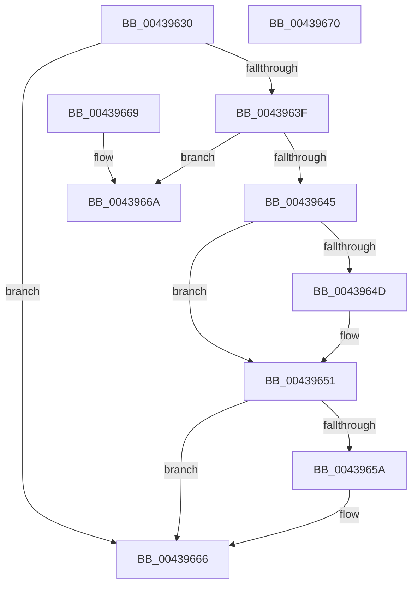

# PsUpdateNetworkCounters

- RVA: `0x00439630`–`0x00439671` (길이 `65` bytes)
- VA: `0x0000000140439630`
- 실행 섹션: `.text`
- PDB 이름 있음: `예`; PDB Function 태그: `아니요`
- unwind 정보 RVA: `0x000DB714`
- 디코드: `21`개 명령, `65/65` bytes 표시
- 미해석 바이트: `0` (있으면 어셈블리에 `.byte`로 보존)

> 이 문서는 커널 이미지의 기계어와 PDB 기호를 분석해 생성했습니다. 4번과 5번은 함수 원형과 자료형을 바이너리 사용 방식에서 추정한 C 해석이며 원본 소스 복구 결과는 아닙니다.

## 1. Dependencies

- 직접 호출 지점: **0**; 고유 호출 대상: **0**
- 직접 호출자로 확인된 함수: **0**
- RIP 상대 이미지 참조: **0**

### Outgoing calls
- 직접 디코드된 call 명령이 없습니다.

### Direct callers
- 이 함수 시작 RVA로 연결되는 직접 call은 확인되지 않았습니다. 간접 호출은 완전히 역산할 수 없습니다.

### Static image references
- 디코드된 RIP-relative 메모리 참조가 없습니다.

## 2. Other-region calls and transfers

- 다른 실행 섹션으로 향하는 call: **0**
- 별도 외부 분기/꼬리 이동을 확인하지 못했습니다.

## 3. Assembly (complete function range)

```asm
00439630  48 8B 81 F0 07 00 00            mov rax, qword ptr [rcx + 0x7f0]
00439637  4C 8B C9                        mov r9, rcx
0043963A  48 85 C0                        test rax, rax
0043963D  74 27                           je 0x140439666
0043963F  41 83 F8 10                     cmp r8d, 0x10
00439643  72 25                           jb 0x14043966a
00439645  48 8B 0A                        mov rcx, qword ptr [rdx]
00439648  48 85 C9                        test rcx, rcx
0043964B  74 04                           je 0x140439651
0043964D  F0 48 01 08                     lock add qword ptr [rax], rcx
00439651  48 8B 4A 08                     mov rcx, qword ptr [rdx + 8]
00439655  48 85 C9                        test rcx, rcx
00439658  74 0C                           je 0x140439666
0043965A  49 8B 91 F0 07 00 00            mov rdx, qword ptr [r9 + 0x7f0]
00439661  F0 48 01 4A 08                  lock add qword ptr [rdx + 8], rcx
00439666  33 C0                           xor eax, eax
00439668  C3                              ret
00439669  CC                              int3
0043966A  B8 0D 00 00 C0                  mov eax, 0xc000000d
0043966F  C3                              ret
00439670  CC                              int3
```

## 4. C-style interpretation (structured pseudocode)

```c
__int64 __fastcall PsUpdateNetworkCounters(__int64 a1, __int64 a2, int a3)
{
    __int64 result;

    if (*(unsigned __int64 *)(a1 + 2032) == 0) goto loc_00439666;
    if (a3 < 16) goto loc_0043966A;
    if (*(unsigned __int64 *)(a2) != 0) {
    }
    if (*(unsigned __int64 *)(a2 + 8) != 0) {
        a2 = *(unsigned __int64 *)(a1 + 2032);
    }
    result = 0;
    return result;
loc_0043966A:
    return (unsigned int)(0xC000000DULL);
}
```

## 5. (Beta) C Style

```c
int64_t PsUpdateNetworkCounters(void *Arg1, void *Arg2, int32_t Arg3)
{
    uint8_t *arg1 = (uint8_t *)Arg1;
    uint8_t *arg2 = (uint8_t *)Arg2;

    int64_t result;

    if (*(uint64_t *)(arg1 + 0x7F0) == 0) goto loc_00439666;
    if (Arg3 < 16) goto loc_0043966A;
    if (*(uint64_t *)(arg2) != 0) {
    }
    if (*(uint64_t *)(arg2 + 0x8) != 0) {
        Arg2 = *(uint64_t *)(arg1 + 0x7F0);
    }
    result = 0;
    return result;
loc_0043966A:
    return (uint32_t)(0xC000000DULL);
}
```

### 관측된 메모리 오프셋

구조체 형식이 확인되지 않은 접근은 인자 기준의 오프셋으로만 기록했습니다.

| 기준 인자 | 오프셋 표현 | 폭 (bit) | 접근 |
|---|---:|---:|---|
| `Arg1` | `+ 0x7F0` | `64` | `R` |
| `Arg2` | `+ 0x0` | `64` | `R` |
| `Arg2` | `+ 0x8` | `64` | `R` |

## 6. Execution-region graph

[열기: 2D/3D 그래프와 함수 탐색 컨트롤 패널](../../../control-panel.html?section=text&rva=0x00439630&view=graph)

- 2D 그래프는 위에서 아래로 흐르고, 3D 그래프는 빈 공간을 드래그해 회전합니다. Shift+드래그는 이동, 휠은 확대·축소, 함수 노드 선택은 대상 보고서 이동입니다.

### Static fallback


