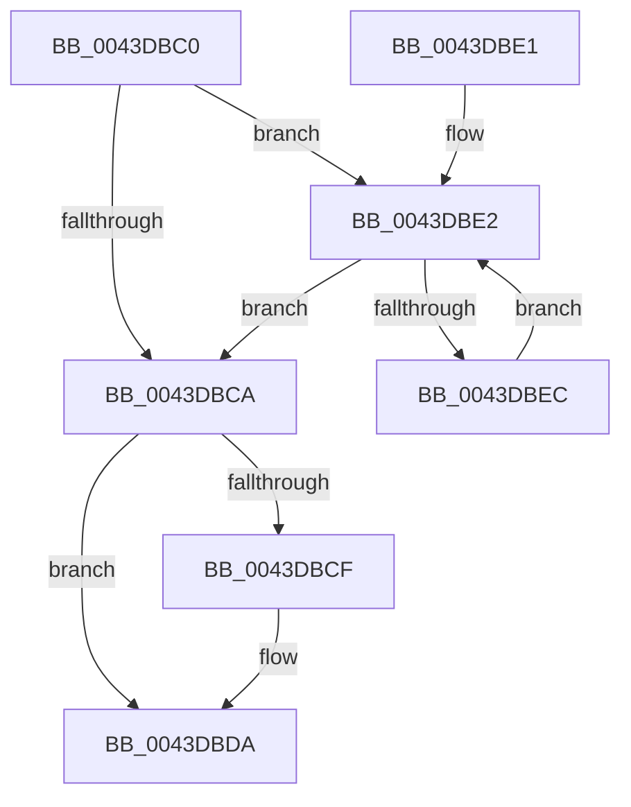

# PspGetBaseTrapFrame

- RVA: `0x0043DBC0`–`0x0043DBEE` (길이 `46` bytes)
- VA: `0x000000014043DBC0`
- 실행 섹션: `.text`
- PDB 이름 있음: `예`; PDB Function 태그: `아니요`
- unwind 정보 RVA: `0x000DB714`
- 디코드: `16`개 명령, `46/46` bytes 표시
- 미해석 바이트: `0` (있으면 어셈블리에 `.byte`로 보존)

> 이 문서는 커널 이미지의 기계어와 PDB 기호를 분석해 생성했습니다. 4번과 5번은 함수 원형과 자료형을 바이너리 사용 방식에서 추정한 C 해석이며 원본 소스 복구 결과는 아닙니다.

## 1. Dependencies

- 직접 호출 지점: **0**; 고유 호출 대상: **0**
- 직접 호출자로 확인된 함수: **3**
- RIP 상대 이미지 참조: **0**

### Outgoing calls
- 직접 디코드된 call 명령이 없습니다.

### Direct callers
- [KiRollbackSlistPops](../4C/KiRollbackSlistPops_function_004CDDF0.md) at `0x004CDE25`
- [PspInitializeThunkContext](../../page/8D/PspInitializeThunkContext_function_008D5418.md) at `0x008D57B3`
- [PspInitializeThunkContext](../../page/8D/PspInitializeThunkContext_function_008D5418.md) at `0x008D57C0`
- [sub_00B18BDE](../../page/B1/Unknown_function_00B18BDE.md) at `0x00B18C21`
- [sub_00B18BDE](../../page/B1/Unknown_function_00B18BDE.md) at `0x00B18C2E`

### Static image references
- 디코드된 RIP-relative 메모리 참조가 없습니다.

## 2. Other-region calls and transfers

- 다른 실행 섹션으로 향하는 call: **0**
- 별도 외부 분기/꼬리 이동을 확인하지 못했습니다.

## 3. Assembly (complete function range)

```asm
0043DBC0  48 8B 41 28                     mov rax, qword ptr [rcx + 0x28]
0043DBC4  F6 40 08 01                     test byte ptr [rax + 8], 1
0043DBC8  75 18                           jne 0x14043dbe2
0043DBCA  48 85 D2                        test rdx, rdx
0043DBCD  74 0B                           je 0x14043dbda
0043DBCF  33 C9                           xor ecx, ecx
0043DBD1  48 39 48 20                     cmp qword ptr [rax + 0x20], rcx
0043DBD5  0F 95 C1                        setne cl
0043DBD8  89 0A                           mov dword ptr [rdx], ecx
0043DBDA  48 05 70 FE FF FF               add rax, -0x190
0043DBE0  C3                              ret
0043DBE1  CC                              int3
0043DBE2  48 8B 40 28                     mov rax, qword ptr [rax + 0x28]
0043DBE6  F6 40 08 01                     test byte ptr [rax + 8], 1
0043DBEA  74 DE                           je 0x14043dbca
0043DBEC  EB F4                           jmp 0x14043dbe2
```

## 4. C-style interpretation (structured pseudocode)

```c
__int64 __fastcall PspGetBaseTrapFrame(__int64 a1, __int64 a2)
{
    __int64 result;

    if (((*(unsigned __int8 *)(*(unsigned __int64 *)(a1 + 40) + 8)) & (1)) != 0) goto loc_0043DBE2;
loc_0043DBCA:
    if (a2 != 0) {
        a1 = 0;
        a1 = ((*(unsigned __int64 *)(*(unsigned __int64 *)(a1 + 40) + 32)) != 0) ? 1 : 0;
        *(unsigned int *)(a2) = (unsigned int)(a1);
    }
    result = (*(unsigned __int64 *)(a1 + 40)) + (-400);
    return result;
loc_0043DBE2:
    if (((*(unsigned __int8 *)(*(unsigned __int64 *)(result + 40) + 8)) & (1)) == 0) goto loc_0043DBCA;
    goto loc_0043DBE2;
}
```

## 5. (Beta) C Style

```c
int64_t PspGetBaseTrapFrame(void *Arg1, int64_t Arg2)
{
    uint8_t *arg1 = (uint8_t *)Arg1;

    int64_t result;

    if (((*(uint8_t *)(*(uint64_t *)(arg1 + 0x28) + 0x8)) & (1)) != 0) goto loc_0043DBE2;
loc_0043DBCA:
    if (Arg2 != 0) {
        Arg1 = 0;
        Arg1 = ((*(uint64_t *)(*(uint64_t *)(arg1 + 0x28) + 0x20)) != 0) ? 1 : 0;
        *(uint32_t *)(Arg2) = (uint32_t)(Arg1);
    }
    result = (*(uint64_t *)(arg1 + 0x28)) + (-400);
    return result;
loc_0043DBE2:
    if (((*(uint8_t *)(*(uint64_t *)(result + 0x28) + 0x8)) & (1)) == 0) goto loc_0043DBCA;
    goto loc_0043DBE2;
}
```

### 관측된 메모리 오프셋

구조체 형식이 확인되지 않은 접근은 인자 기준의 오프셋으로만 기록했습니다.

| 기준 인자 | 오프셋 표현 | 폭 (bit) | 접근 |
|---|---:|---:|---|
| `Arg1` | `+ 0x28` | `64` | `R` |

## 6. Execution-region graph

[열기: 2D/3D 그래프와 함수 탐색 컨트롤 패널](../../../control-panel.html?section=text&rva=0x0043DBC0&view=graph)

- 2D 그래프는 위에서 아래로 흐르고, 3D 그래프는 빈 공간을 드래그해 회전합니다. Shift+드래그는 이동, 휠은 확대·축소, 함수 노드 선택은 대상 보고서 이동입니다.

### Static fallback


