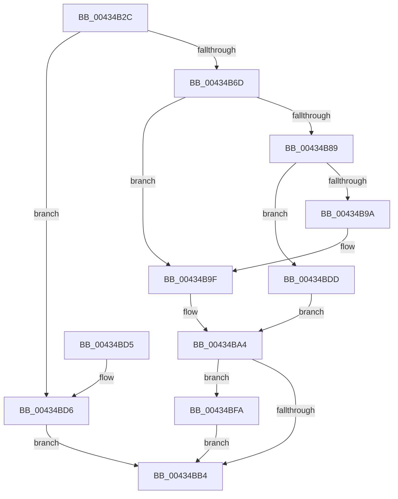

# PspInsertProperty

- RVA: `0x00434B2C`–`0x00434C09` (길이 `221` bytes)
- VA: `0x0000000140434B2C`
- 실행 섹션: `.text`
- PDB 이름 있음: `예`; PDB Function 태그: `아니요`
- unwind 정보 RVA: `0x000A2B48`
- 디코드: `66`개 명령, `221/221` bytes 표시
- 미해석 바이트: `0` (있으면 어셈블리에 `.byte`로 보존)

> 이 문서는 커널 이미지의 기계어와 PDB 기호를 분석해 생성했습니다. 4번과 5번은 함수 원형과 자료형을 바이너리 사용 방식에서 추정한 C 해석이며 원본 소스 복구 결과는 아닙니다.

## 1. Dependencies

- 직접 호출 지점: **6**; 고유 호출 대상: **6**
- 직접 호출자로 확인된 함수: **1**
- RIP 상대 이미지 참조: **0**

### Outgoing calls
- `0x00434B60` → [ExAllocatePool2](../../poolcode/B8/ExAllocatePool2_function_00B820F0.md) (function, `0x00B820F0`)
- `0x00434B71` → [KeAcquireSpinLockRaiseToDpc](../20/KeAcquireSpinLockRaiseToDpc_function_00208470.md) (function, `0x00208470`)
- `0x00434B7F` → [PspFindPropertySetEntry](PspFindPropertySetEntry_function_00434CD0.md) (function, `0x00434CD0`)
- `0x00434BAB` → [KeReleaseSpinLock](../39/KeReleaseSpinLock_function_00392BA0.md) (function, `0x00392BA0`)
- `0x00434BF3` → [ObfReferenceObjectWithTag](../21/ObfReferenceObjectWithTag_function_00210710.md) (function, `0x00210710`)
- `0x00434C02` → [ExFreePoolWithTag](../../poolcode/B8/ExFreePoolWithTag_function_00B82870.md) (function, `0x00B82870`)

### Direct callers
- [PspSetPropertyHelper](PspSetPropertyHelper_function_00434B08.md) at `0x00434B11`

### Static image references
- 디코드된 RIP-relative 메모리 참조가 없습니다.

## 2. Other-region calls and transfers

- 다른 실행 섹션으로 향하는 call: **2**
  - `0x00434B60` → [ExAllocatePool2](../../poolcode/B8/ExAllocatePool2_function_00B820F0.md) (`.text` → `POOLCODE`)
  - `0x00434C02` → [ExFreePoolWithTag](../../poolcode/B8/ExFreePoolWithTag_function_00B82870.md) (`.text` → `POOLCODE`)
- 별도 외부 분기/꼬리 이동을 확인하지 못했습니다.

## 3. Assembly (complete function range)

```asm
00434B2C  48 8B C4                        mov rax, rsp
00434B2F  48 89 58 08                     mov qword ptr [rax + 8], rbx
00434B33  48 89 68 10                     mov qword ptr [rax + 0x10], rbp
00434B37  48 89 70 18                     mov qword ptr [rax + 0x18], rsi
00434B3B  48 89 78 20                     mov qword ptr [rax + 0x20], rdi
00434B3F  41 54                           push r12
00434B41  41 56                           push r14
00434B43  41 57                           push r15
00434B45  48 83 EC 20                     sub rsp, 0x20
00434B49  33 FF                           xor edi, edi
00434B4B  49 8B E8                        mov rbp, r8
00434B4E  4C 8B F2                        mov r14, rdx
00434B51  48 8B F1                        mov rsi, rcx
00434B54  41 B8 50 70 73 50               mov r8d, 0x50737050
00434B5A  8D 57 20                        lea edx, [rdi + 0x20]
00434B5D  8D 4F 40                        lea ecx, [rdi + 0x40]
00434B60  E8 8B D5 74 00                  call 0x140b820f0
00434B65  48 8B D8                        mov rbx, rax
00434B68  48 85 C0                        test rax, rax
00434B6B  74 69                           je 0x140434bd6
00434B6D  48 8D 4E 10                     lea rcx, [rsi + 0x10]
00434B71  E8 FA 38 DD FF                  call 0x140208470
00434B76  49 8B D6                        mov rdx, r14
00434B79  48 8B CE                        mov rcx, rsi
00434B7C  44 8A E0                        mov r12b, al
00434B7F  E8 4C 01 00 00                  call 0x140434cd0
00434B84  48 85 C0                        test rax, rax
00434B87  75 16                           jne 0x140434b9f
00434B89  4C 89 73 10                     mov qword ptr [rbx + 0x10], r14
00434B8D  48 89 6B 18                     mov qword ptr [rbx + 0x18], rbp
00434B91  48 8B 06                        mov rax, qword ptr [rsi]
00434B94  48 39 70 08                     cmp qword ptr [rax + 8], rsi
00434B98  74 43                           je 0x140434bdd
00434B9A  8D 4F 03                        lea ecx, [rdi + 3]
00434B9D  CD 29                           int 0x29
00434B9F  BF 35 00 00 C0                  mov edi, 0xc0000035
00434BA4  41 8A D4                        mov dl, r12b
00434BA7  48 8D 4E 10                     lea rcx, [rsi + 0x10]
00434BAB  E8 F0 DF F5 FF                  call 0x140392ba0
00434BB0  85 FF                           test edi, edi
00434BB2  78 46                           js 0x140434bfa
00434BB4  48 8B 5C 24 40                  mov rbx, qword ptr [rsp + 0x40]
00434BB9  8B C7                           mov eax, edi
00434BBB  48 8B 7C 24 58                  mov rdi, qword ptr [rsp + 0x58]
00434BC0  48 8B 6C 24 48                  mov rbp, qword ptr [rsp + 0x48]
00434BC5  48 8B 74 24 50                  mov rsi, qword ptr [rsp + 0x50]
00434BCA  48 83 C4 20                     add rsp, 0x20
00434BCE  41 5F                           pop r15
00434BD0  41 5E                           pop r14
00434BD2  41 5C                           pop r12
00434BD4  C3                              ret
00434BD5  CC                              int3
00434BD6  BF 17 00 00 C0                  mov edi, 0xc0000017
00434BDB  EB D7                           jmp 0x140434bb4
00434BDD  48 89 03                        mov qword ptr [rbx], rax
00434BE0  BA 50 73 50 72                  mov edx, 0x72507350
00434BE5  48 89 73 08                     mov qword ptr [rbx + 8], rsi
00434BE9  48 8B CD                        mov rcx, rbp
00434BEC  48 89 58 08                     mov qword ptr [rax + 8], rbx
00434BF0  48 89 1E                        mov qword ptr [rsi], rbx
00434BF3  E8 18 BB DD FF                  call 0x140210710
00434BF8  EB AA                           jmp 0x140434ba4
00434BFA  BA 50 70 73 50                  mov edx, 0x50737050
00434BFF  48 8B CB                        mov rcx, rbx
00434C02  E8 69 DC 74 00                  call 0x140b82870
00434C07  EB AB                           jmp 0x140434bb4
```

## 4. C-style interpretation (structured pseudocode)

```c
__int64 __fastcall PspInsertProperty(__int64 a1, __int64 a2, __int64 a3)
{
    __int64 result;
    __int64 v_rdi;
    __int64 v_rsp;
    unsigned __int64 v_stack_p10;
    unsigned __int64 v_stack_p18;
    unsigned __int64 v_stack_p20;
    unsigned __int64 v_stack_p8;

    *(unsigned __int64 *)(v_rsp + 8) = v_rbx;
    *(unsigned __int64 *)(v_rsp + 16) = v_rbp;
    *(unsigned __int64 *)(v_rsp + 24) = v_rsi;
    *(unsigned __int64 *)(v_rsp + 32) = v_rdi;
    v_rsp = (v_rsp) - (32);
    v_rdi = 0;
    result = ExAllocatePool2(v_rdi + 64, v_rdi + 32, (unsigned int)(0x50737050ULL), a4);
    if (result == 0) goto loc_00434BD6;
    result = KeAcquireSpinLockRaiseToDpc(a1 + 16, v_rdi + 32, (unsigned int)(0x50737050ULL), a4);
    result = PspFindPropertySetEntry(a1, a2, (unsigned int)(0x50737050ULL), a4);
    if (result != 0) goto loc_00434B9F;
    *(unsigned __int64 *)(result + 16) = a2;
    *(unsigned __int64 *)(result + 24) = a3;
    if ((*(unsigned __int64 *)(*(unsigned __int64 *)(a1) + 8)) == a1) goto loc_00434BDD;
loc_00434B9F:
loc_00434BA4:
    result = KeReleaseSpinLock(a1 + 16, (unsigned __int8)((unsigned __int8)(result)), (unsigned int)(0x50737050ULL), a4);
    if (sign_flag) goto loc_00434BFA;
loc_00434BB4:
    v_rsp = (v_rsp) + (32);
    return (unsigned int)((unsigned int)((unsigned int)(0xC0000035ULL)));
loc_00434BD6:
    goto loc_00434BB4;
loc_00434BDD:
    *(unsigned __int64 *)(v_stack_p8) = (unsigned int)((unsigned int)((unsigned int)(0xC0000035ULL)));
    *(unsigned __int64 *)(v_stack_p8 + 8) = v_stack_p18;
    *(unsigned __int64 *)((unsigned int)((unsigned int)((unsigned int)(0xC0000035ULL))) + 8) = v_stack_p8;
    *(unsigned __int64 *)(v_stack_p18) = v_stack_p8;
    result = ObfReferenceObjectWithTag(v_stack_p10, (unsigned int)(0x72507350ULL), (unsigned int)(0x50737050ULL), a4);
    goto loc_00434BA4;
loc_00434BFA:
    result = ExFreePoolWithTag(v_stack_p8, (unsigned int)(0x50737050ULL), (unsigned int)(0x50737050ULL), a4);
    goto loc_00434BB4;
}
```

## 5. (Beta) C Style

```c
int64_t PspInsertProperty(void *Arg1, int64_t Arg2, int64_t Arg3)
{
    uint8_t *arg1 = (uint8_t *)Arg1;

    int64_t result;
    int64_t local_rdi;
    int64_t local_rsp;
    uint64_t v_stack_p10;
    uint64_t v_stack_p18;
    uint64_t v_stack_p20;
    uint64_t v_stack_p8;

    *(uint64_t *)(local_rsp + 0x8) = local_rbx;
    *(uint64_t *)(local_rsp + 0x10) = local_rbp;
    *(uint64_t *)(local_rsp + 0x18) = local_rsi;
    *(uint64_t *)(local_rsp + 0x20) = local_rdi;
    local_rsp = (local_rsp) - (32);
    local_rdi = 0;
    result = ExAllocatePool2(local_rdi + 64, local_rdi + 32, (uint32_t)(0x50737050ULL), a4);
    if (result == 0) goto loc_00434BD6;
    result = KeAcquireSpinLockRaiseToDpc(Arg1 + 16, local_rdi + 32, (uint32_t)(0x50737050ULL), a4);
    result = PspFindPropertySetEntry(Arg1, Arg2, (uint32_t)(0x50737050ULL), a4);
    if (result != 0) goto loc_00434B9F;
    *(uint64_t *)(result + 0x10) = Arg2;
    *(uint64_t *)(result + 0x18) = Arg3;
    if ((*(uint64_t *)(*(uint64_t *)(arg1) + 0x8)) == Arg1) goto loc_00434BDD;
loc_00434B9F:
loc_00434BA4:
    result = KeReleaseSpinLock(Arg1 + 16, (uint8_t)((uint8_t)(result)), (uint32_t)(0x50737050ULL), a4);
    if (sign_flag) goto loc_00434BFA;
loc_00434BB4:
    local_rsp = (local_rsp) + (32);
    return (uint32_t)((uint32_t)((uint32_t)(0xC0000035ULL)));
loc_00434BD6:
    goto loc_00434BB4;
loc_00434BDD:
    *(uint64_t *)(v_stack_p8) = (uint32_t)((uint32_t)((uint32_t)(0xC0000035ULL)));
    *(uint64_t *)(v_stack_p8 + 0x8) = v_stack_p18;
    *(uint64_t *)((uint32_t)((uint32_t)((uint32_t)(0xC0000035ULL))) + 0x8) = v_stack_p8;
    *(uint64_t *)(v_stack_p18) = v_stack_p8;
    result = ObfReferenceObjectWithTag(v_stack_p10, (uint32_t)(0x72507350ULL), (uint32_t)(0x50737050ULL), a4);
    goto loc_00434BA4;
loc_00434BFA:
    result = ExFreePoolWithTag(v_stack_p8, (uint32_t)(0x50737050ULL), (uint32_t)(0x50737050ULL), a4);
    goto loc_00434BB4;
}
```

### 관측된 메모리 오프셋

구조체 형식이 확인되지 않은 접근은 인자 기준의 오프셋으로만 기록했습니다.

| 기준 인자 | 오프셋 표현 | 폭 (bit) | 접근 |
|---|---:|---:|---|
| `Arg1` | `+ 0x0` | `64` | `R` |
| `Arg1` | `+ 0x0` | `64` | `W` |
| `Arg1` | `+ 0x10` | `64` | `R` |

## 6. Execution-region graph

[열기: 2D/3D 그래프와 함수 탐색 컨트롤 패널](../../../control-panel.html?section=text&rva=0x00434B2C&view=graph)

- 2D 그래프는 위에서 아래로 흐르고, 3D 그래프는 빈 공간을 드래그해 회전합니다. Shift+드래그는 이동, 휠은 확대·축소, 함수 노드 선택은 대상 보고서 이동입니다.

### Static fallback


