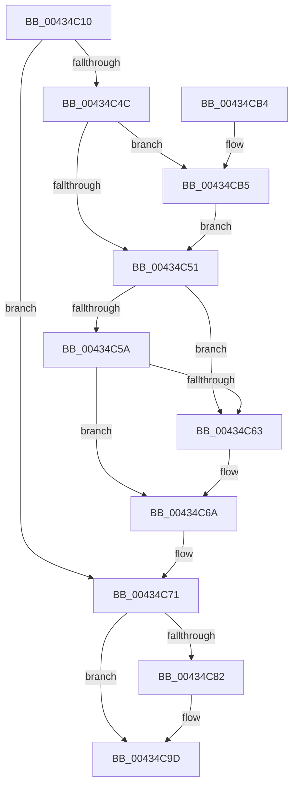

# PspRemoveProperty

- RVA: `0x00434C10`–`0x00434CBE` (길이 `174` bytes)
- VA: `0x0000000140434C10`
- 실행 섹션: `.text`
- PDB 이름 있음: `예`; PDB Function 태그: `아니요`
- unwind 정보 RVA: `0x00078298`
- 디코드: `51`개 명령, `174/174` bytes 표시
- 미해석 바이트: `0` (있으면 어셈블리에 `.byte`로 보존)

> 이 문서는 커널 이미지의 기계어와 PDB 기호를 분석해 생성했습니다. 4번과 5번은 함수 원형과 자료형을 바이너리 사용 방식에서 추정한 C 해석이며 원본 소스 복구 결과는 아닙니다.

## 1. Dependencies

- 직접 호출 지점: **5**; 고유 호출 대상: **5**
- 직접 호출자로 확인된 함수: **2**
- RIP 상대 이미지 참조: **0**

### Outgoing calls
- `0x00434C31` → [KeAcquireSpinLockRaiseToDpc](../20/KeAcquireSpinLockRaiseToDpc_function_00208470.md) (function, `0x00208470`)
- `0x00434C3F` → [PspFindPropertySetEntry](PspFindPropertySetEntry_function_00434CD0.md) (function, `0x00434CD0`)
- `0x00434C78` → [KeReleaseSpinLock](../39/KeReleaseSpinLock_function_00392BA0.md) (function, `0x00392BA0`)
- `0x00434C8B` → [ObfDereferenceObjectWithTag](../2F/ObfDereferenceObjectWithTag_function_002F78E0.md) (function, `0x002F78E0`)
- `0x00434C98` → [ExFreePoolWithTag](../../poolcode/B8/ExFreePoolWithTag_function_00B82870.md) (function, `0x00B82870`)

### Direct callers
- [PspSetPropertyHelper](PspSetPropertyHelper_function_00434B08.md) at `0x00434B1C`
- [PspEmptyPropertySet](../../page/90/PspEmptyPropertySet_function_00905D04.md) at `0x00905D26`

### Static image references
- 디코드된 RIP-relative 메모리 참조가 없습니다.

## 2. Other-region calls and transfers

- 다른 실행 섹션으로 향하는 call: **1**
  - `0x00434C98` → [ExFreePoolWithTag](../../poolcode/B8/ExFreePoolWithTag_function_00B82870.md) (`.text` → `POOLCODE`)
- 별도 외부 분기/꼬리 이동을 확인하지 못했습니다.

## 3. Assembly (complete function range)

```asm
00434C10  48 89 5C 24 08                  mov qword ptr [rsp + 8], rbx
00434C15  48 89 6C 24 10                  mov qword ptr [rsp + 0x10], rbp
00434C1A  48 89 74 24 18                  mov qword ptr [rsp + 0x18], rsi
00434C1F  57                              push rdi
00434C20  48 83 EC 20                     sub rsp, 0x20
00434C24  48 8B F9                        mov rdi, rcx
00434C27  49 8B F0                        mov rsi, r8
00434C2A  48 83 C1 10                     add rcx, 0x10
00434C2E  48 8B DA                        mov rbx, rdx
00434C31  E8 3A 38 DD FF                  call 0x140208470
00434C36  48 8B D3                        mov rdx, rbx
00434C39  48 8B CF                        mov rcx, rdi
00434C3C  44 8A C0                        mov r8b, al
00434C3F  E8 8C 00 00 00                  call 0x140434cd0
00434C44  48 8B D8                        mov rbx, rax
00434C47  48 85 C0                        test rax, rax
00434C4A  74 25                           je 0x140434c71
00434C4C  48 85 F6                        test rsi, rsi
00434C4F  75 64                           jne 0x140434cb5
00434C51  48 8B 08                        mov rcx, qword ptr [rax]
00434C54  48 39 59 08                     cmp qword ptr [rcx + 8], rbx
00434C58  75 09                           jne 0x140434c63
00434C5A  48 8B 40 08                     mov rax, qword ptr [rax + 8]
00434C5E  48 39 18                        cmp qword ptr [rax], rbx
00434C61  74 07                           je 0x140434c6a
00434C63  B9 03 00 00 00                  mov ecx, 3
00434C68  CD 29                           int 0x29
00434C6A  48 89 08                        mov qword ptr [rax], rcx
00434C6D  48 89 41 08                     mov qword ptr [rcx + 8], rax
00434C71  41 8A D0                        mov dl, r8b
00434C74  48 8D 4F 10                     lea rcx, [rdi + 0x10]
00434C78  E8 23 DF F5 FF                  call 0x140392ba0
00434C7D  48 85 DB                        test rbx, rbx
00434C80  74 1B                           je 0x140434c9d
00434C82  48 8B 4B 18                     mov rcx, qword ptr [rbx + 0x18]
00434C86  BA 50 73 50 72                  mov edx, 0x72507350
00434C8B  E8 50 2C EC FF                  call 0x1402f78e0
00434C90  BA 50 70 73 50                  mov edx, 0x50737050
00434C95  48 8B CB                        mov rcx, rbx
00434C98  E8 D3 DB 74 00                  call 0x140b82870
00434C9D  48 8B 5C 24 30                  mov rbx, qword ptr [rsp + 0x30]
00434CA2  33 C0                           xor eax, eax
00434CA4  48 8B 6C 24 38                  mov rbp, qword ptr [rsp + 0x38]
00434CA9  48 8B 74 24 40                  mov rsi, qword ptr [rsp + 0x40]
00434CAE  48 83 C4 20                     add rsp, 0x20
00434CB2  5F                              pop rdi
00434CB3  C3                              ret
00434CB4  CC                              int3
00434CB5  48 8B 48 18                     mov rcx, qword ptr [rax + 0x18]
00434CB9  48 89 0E                        mov qword ptr [rsi], rcx
00434CBC  EB 93                           jmp 0x140434c51
```

## 4. C-style interpretation (structured pseudocode)

```c
__int64 __fastcall PspRemoveProperty(__int64 a1, __int64 a2, __int64 a3)
{
    __int64 result;
    __int64 v_rsp;
    unsigned __int64 v_stack_p10;
    unsigned __int64 v_stack_p18;
    unsigned __int64 v_stack_p8;

    v_stack_p8 = v_rbx;
    v_stack_p10 = v_rbp;
    v_stack_p18 = v_rsi;
    v_rsp = (v_rsp) - (32);
    a1 = (a1) + (16);
    result = KeAcquireSpinLockRaiseToDpc(a1, a2, a3, a4);
    result = PspFindPropertySetEntry(a1, a2, (unsigned __int8)(result), a4);
    if (result == 0) goto loc_00434C71;
    if (a3 != 0) goto loc_00434CB5;
loc_00434C51:
    if ((*(unsigned __int64 *)(*(unsigned __int64 *)(result) + 8)) != result) goto loc_00434C63;
    if ((*(unsigned __int64 *)(*(unsigned __int64 *)(result + 8))) != result) {
        a1 = 3;
    }
    *(unsigned __int64 *)(*(unsigned __int64 *)(result + 8)) = a1;
    *(unsigned __int64 *)(a1 + 8) = *(unsigned __int64 *)(result + 8);
loc_00434C71:
    result = KeReleaseSpinLock(a1 + 16, (unsigned __int8)((unsigned __int8)(result)), (unsigned __int8)(result), a4);
    if (result != 0) {
        a1 = *(unsigned __int64 *)(result + 24);
        a2 = 0x72507350ULL;
        result = ObfDereferenceObjectWithTag(a1, a2, (unsigned __int8)(result), a4);
        a2 = 0x50737050ULL;
        a1 = result;
        result = ExFreePoolWithTag(a1, a2, (unsigned __int8)(result), a4);
    }
    result = 0;
    v_rsp = (v_rsp) + (32);
    return result;
loc_00434CB5:
    *(unsigned __int64 *)(v_stack_p18) = *(unsigned __int64 *)(result + 24);
    goto loc_00434C51;
}
```

## 5. (Beta) C Style

```c
int64_t PspRemoveProperty(void *Arg1, int64_t Arg2, int64_t Arg3)
{
    uint8_t *arg1 = (uint8_t *)Arg1;

    int64_t result;
    int64_t local_rsp;
    uint64_t v_stack_p10;
    uint64_t v_stack_p18;
    uint64_t v_stack_p8;

    v_stack_p8 = local_rbx;
    v_stack_p10 = local_rbp;
    v_stack_p18 = local_rsi;
    local_rsp = (local_rsp) - (32);
    Arg1 = (Arg1) + (16);
    result = KeAcquireSpinLockRaiseToDpc(Arg1, Arg2, Arg3, a4);
    result = PspFindPropertySetEntry(Arg1, Arg2, (uint8_t)(result), a4);
    if (result == 0) goto loc_00434C71;
    if (Arg3 != 0) goto loc_00434CB5;
loc_00434C51:
    if ((*(uint64_t *)(*(uint64_t *)(result) + 0x8)) != result) goto loc_00434C63;
    if ((*(uint64_t *)(*(uint64_t *)(result + 0x8))) != result) {
        Arg1 = 3;
    }
    *(void **)(*(uint64_t *)(result + 0x8)) = Arg1;
    *(uint64_t *)(arg1 + 0x8) = *(uint64_t *)(result + 0x8);
loc_00434C71:
    result = KeReleaseSpinLock(Arg1 + 16, (uint8_t)((uint8_t)(result)), (uint8_t)(result), a4);
    if (result != 0) {
        Arg1 = *(uint64_t *)(result + 0x18);
        Arg2 = 0x72507350ULL;
        result = ObfDereferenceObjectWithTag(Arg1, Arg2, (uint8_t)(result), a4);
        Arg2 = 0x50737050ULL;
        Arg1 = result;
        result = ExFreePoolWithTag(Arg1, Arg2, (uint8_t)(result), a4);
    }
    result = 0;
    local_rsp = (local_rsp) + (32);
    return result;
loc_00434CB5:
    *(uint64_t *)(v_stack_p18) = *(uint64_t *)(result + 0x18);
    goto loc_00434C51;
}
```

### 관측된 메모리 오프셋

구조체 형식이 확인되지 않은 접근은 인자 기준의 오프셋으로만 기록했습니다.

| 기준 인자 | 오프셋 표현 | 폭 (bit) | 접근 |
|---|---:|---:|---|
| `Arg1` | `+ 0x10` | `64` | `R` |

## 6. Execution-region graph

[열기: 2D/3D 그래프와 함수 탐색 컨트롤 패널](../../../control-panel.html?section=text&rva=0x00434C10&view=graph)

- 2D 그래프는 위에서 아래로 흐르고, 3D 그래프는 빈 공간을 드래그해 회전합니다. Shift+드래그는 이동, 휠은 확대·축소, 함수 노드 선택은 대상 보고서 이동입니다.

### Static fallback


