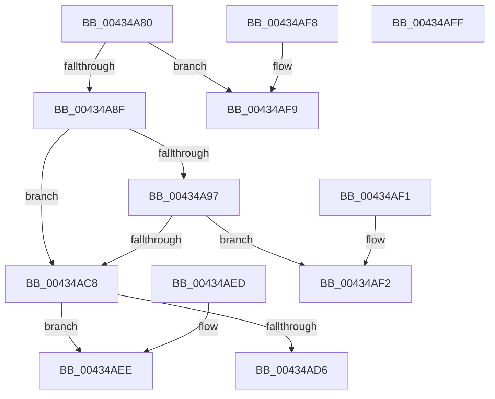

# PspValidateThread

- RVA: `0x00434A80`–`0x00434B00` (길이 `128` bytes)
- VA: `0x0000000140434A80`
- 실행 섹션: `.text`
- PDB 이름 있음: `예`; PDB Function 태그: `아니요`
- unwind 정보 RVA: `0x000DB714`
- 디코드: `36`개 명령, `128/128` bytes 표시
- 미해석 바이트: `0` (있으면 어셈블리에 `.byte`로 보존)

> 이 문서는 커널 이미지의 기계어와 PDB 기호를 분석해 생성했습니다. 4번과 5번은 함수 원형과 자료형을 바이너리 사용 방식에서 추정한 C 해석이며 원본 소스 복구 결과는 아닙니다.

## 1. Dependencies

- 직접 호출 지점: **0**; 고유 호출 대상: **0**
- 직접 호출자로 확인된 함수: **1**
- RIP 상대 이미지 참조: **3**

### Outgoing calls
- 직접 디코드된 call 명령이 없습니다.

### Direct callers
- [PsSetThreadProperty](PsSetThreadProperty_function_00434A40.md) at `0x00434A4A`

### Static image references
- `0x00434A9F` → RVA `0x00FC7800` (`ALMOSTRO`; read)
- `0x00434AB1` → RVA `0x00FC6E4C` (`ALMOSTRO`; read)
- `0x00434ABB` → RVA `0x00FC6AC8` (`ALMOSTRO`; read)

## 2. Other-region calls and transfers

- 다른 실행 섹션으로 향하는 call: **0**
- 별도 외부 분기/꼬리 이동을 확인하지 못했습니다.

## 3. Assembly (complete function range)

```asm
00434A80  65 48 8B 04 25 20 00 00 00      mov rax, qword ptr gs:[0x20]
00434A89  48 3B 48 18                     cmp rcx, qword ptr [rax + 0x18]
00434A8D  74 6A                           je 0x140434af9
00434A8F  44 0F 20 C0                     mov rax, cr8
00434A93  3C 02                           cmp al, 2
00434A95  73 31                           jae 0x140434ac8
00434A97  48 8D 41 D0                     lea rax, [rcx - 0x30]
00434A9B  48 C1 E8 08                     shr rax, 8
00434A9F  48 8D 15 5A 2D B9 00            lea rdx, [rip + 0xb92d5a]
00434AA6  44 0F B6 C0                     movzx r8d, al
00434AAA  0F B6 41 E8                     movzx eax, byte ptr [rcx - 0x18]
00434AAE  4C 33 C0                        xor r8, rax
00434AB1  0F B6 05 94 23 B9 00            movzx eax, byte ptr [rip + 0xb92394]
00434AB8  4C 33 C0                        xor r8, rax
00434ABB  48 8B 05 06 20 B9 00            mov rax, qword ptr [rip + 0xb92006]
00434AC2  4A 39 04 C2                     cmp qword ptr [rdx + r8*8], rax
00434AC6  75 2A                           jne 0x140434af2
00434AC8  65 48 8B 04 25 88 01 00 00      mov rax, qword ptr gs:[0x188]
00434AD1  48 3B C8                        cmp rcx, rax
00434AD4  75 18                           jne 0x140434aee
00434AD6  65 8B 04 25 3C 3A 00 00         mov eax, dword ptr gs:[0x3a3c]
00434ADE  25 01 00 01 00                  and eax, 0x10001
00434AE3  F7 D8                           neg eax
00434AE5  1B C0                           sbb eax, eax
00434AE7  25 BB 00 00 C0                  and eax, 0xc00000bb
00434AEC  C3                              ret
00434AED  CC                              int3
00434AEE  33 C0                           xor eax, eax
00434AF0  C3                              ret
00434AF1  CC                              int3
00434AF2  B8 0D 00 00 C0                  mov eax, 0xc000000d
00434AF7  C3                              ret
00434AF8  CC                              int3
00434AF9  B8 BB 00 00 C0                  mov eax, 0xc00000bb
00434AFE  C3                              ret
00434AFF  CC                              int3
```

## 4. C-style interpretation (structured pseudocode)

```c
__int64 __fastcall PspValidateThread(__int64 a1)
{
    __int64 result;

    if (a1 == (*(unsigned __int64 *)(*(unsigned __int64 *)(gs_base + (0 + 32)) + 24))) goto loc_00434AF9;
    if (((unsigned __int8)(v_cr8)) >= 2) goto loc_00434AC8;
    result = (a1 - 48) >> (8);
    a3 = ((unsigned __int8)(result)) ^ (*(unsigned __int8 *)(a1 - 24));
    a3 = (a3) ^ (*(unsigned __int8 *)(v_rip + 12133268));
    if ((*(unsigned __int64 *)(v_rip + 12135770 + a3 * 8)) != (*(unsigned __int64 *)(v_rip + 12132358))) goto loc_00434AF2;
loc_00434AC8:
    if (a1 != (*(unsigned __int64 *)(gs_base + (0 + 392)))) goto loc_00434AEE;
    result = (unsigned int)(((unsigned int)(*(unsigned int *)(gs_base + (0 + 14908)))) & (0x10001ULL));
    result = (unsigned int)(-(result));
    result = (unsigned int)((result) & (0xC00000BBULL));
    return result;
loc_00434AEE:
    result = 0;
    return result;
loc_00434AF2:
    return (unsigned int)(0xC000000DULL);
loc_00434AF9:
    return (unsigned int)(0xC00000BBULL);
}
```

## 5. (Beta) C Style

```c
int64_t PspValidateThread(int64_t Arg1)
{
    int64_t result;

    if (Arg1 == (*(uint64_t *)(*(uint64_t *)(gs_base + (0 + 0x20)) + 0x18))) goto loc_00434AF9;
    if (((uint8_t)(v_cr8)) >= 2) goto loc_00434AC8;
    result = (Arg1 - 48) >> (8);
    a3 = ((uint8_t)(result)) ^ (*(uint8_t *)(Arg1 - 0x18));
    a3 = (a3) ^ (*(uint8_t *)(v_rip + 0xB92394));
    if ((*(uint64_t *)(v_rip + 0xB92D5A + a3 * 8)) != (*(uint64_t *)(v_rip + 0xB92006))) goto loc_00434AF2;
loc_00434AC8:
    if (Arg1 != (*(uint64_t *)(gs_base + (0 + 0x188)))) goto loc_00434AEE;
    result = (uint32_t)(((uint32_t)(*(uint32_t *)(gs_base + (0 + 0x3A3C)))) & (0x10001ULL));
    result = (uint32_t)(-(result));
    result = (uint32_t)((result) & (0xC00000BBULL));
    return result;
loc_00434AEE:
    result = 0;
    return result;
loc_00434AF2:
    return (uint32_t)(0xC000000DULL);
loc_00434AF9:
    return (uint32_t)(0xC00000BBULL);
}
```

## 6. Execution-region graph

[열기: 2D/3D 그래프와 함수 탐색 컨트롤 패널](../../../control-panel.html?section=text&rva=0x00434A80&view=graph)

- 2D 그래프는 위에서 아래로 흐르고, 3D 그래프는 빈 공간을 드래그해 회전합니다. Shift+드래그는 이동, 휠은 확대·축소, 함수 노드 선택은 대상 보고서 이동입니다.

### Static fallback


