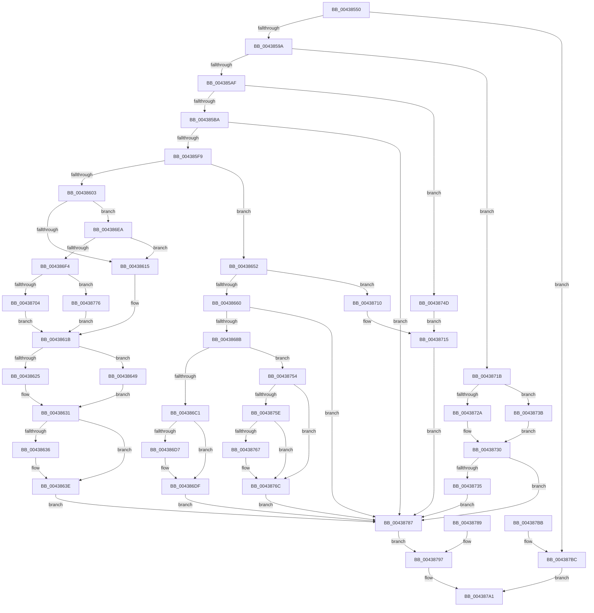

# RtlAddAtomToAtomTableEx

- RVA: `0x00438550`–`0x004387C3` (길이 `627` bytes)
- VA: `0x0000000140438550`
- 실행 섹션: `.text`
- PDB 이름 있음: `예`; PDB Function 태그: `아니요`
- unwind 정보 RVA: `0x000A34B8`
- 디코드: `171`개 명령, `627/627` bytes 표시
- 미해석 바이트: `0` (있으면 어셈블리에 `.byte`로 보존)

> 이 문서는 커널 이미지의 기계어와 PDB 기호를 분석해 생성했습니다. 4번과 5번은 함수 원형과 자료형을 바이너리 사용 방식에서 추정한 C 해석이며 원본 소스 복구 결과는 아닙니다.

## 1. Dependencies

- 직접 호출 지점: **9**; 고유 호출 대상: **8**
- 직접 호출자로 확인된 함수: **2**
- RIP 상대 이미지 참조: **0**

### Outgoing calls
- `0x0043858D` → [RtlpLockAtomTable](../../page/9C/RtlpLockAtomTable_function_009C4A10.md) (function, `0x009C4A10`)
- `0x004385A2` → [RtlGetIntegerAtom](../../page/99/RtlGetIntegerAtom_function_009933B0.md) (function, `0x009933B0`)
- `0x004385E6` → [RtlpHashStringToAtom](../../page/99/RtlpHashStringToAtom_function_0099E760.md) (function, `0x0099E760`)
- `0x00438675` → [RtlpAllocateAtomTableEntry](RtlpAllocateAtomTableEntry_function_004387CC.md) (function, `0x004387CC`)
- `0x00438699` → [memcpy](../6C/memcpy_function_006C6840.md) (function, `0x006C6840`)
- `0x004386B4` → [RtlpInsertStringAtom](../../page/A3/RtlpInsertStringAtom_function_00A3ACAC.md) (function, `0x00A3ACAC`)
- `0x00438767` → [RtlpFreeAtom](../../page/8B/RtlpFreeAtom_function_008BD87C.md) (function, `0x008BD87C`)
- `0x0043876F` → [RtlpFreeAtom](../../page/8B/RtlpFreeAtom_function_008BD87C.md) (function, `0x008BD87C`)
- `0x0043879A` → [RtlpUnlockAtomTable](../../page/9C/RtlpUnlockAtomTable_function_009C4A8C.md) (function, `0x009C4A8C`)

### Direct callers
- [RtlAddAtomToAtomTable](../../page/A7/RtlAddAtomToAtomTable_function_00A71350.md) at `0x00A71357`
- [NtAddAtomEx](../../page/AF/NtAddAtomEx_function_00AF7320.md) at `0x00AF745A`

### Static image references
- 디코드된 RIP-relative 메모리 참조가 없습니다.

## 2. Other-region calls and transfers

- 다른 실행 섹션으로 향하는 call: **7**
  - `0x0043858D` → [RtlpLockAtomTable](../../page/9C/RtlpLockAtomTable_function_009C4A10.md) (`.text` → `PAGE`)
  - `0x004385A2` → [RtlGetIntegerAtom](../../page/99/RtlGetIntegerAtom_function_009933B0.md) (`.text` → `PAGE`)
  - `0x004385E6` → [RtlpHashStringToAtom](../../page/99/RtlpHashStringToAtom_function_0099E760.md) (`.text` → `PAGE`)
  - `0x004386B4` → [RtlpInsertStringAtom](../../page/A3/RtlpInsertStringAtom_function_00A3ACAC.md) (`.text` → `PAGE`)
  - `0x00438767` → [RtlpFreeAtom](../../page/8B/RtlpFreeAtom_function_008BD87C.md) (`.text` → `PAGE`)
  - `0x0043876F` → [RtlpFreeAtom](../../page/8B/RtlpFreeAtom_function_008BD87C.md) (`.text` → `PAGE`)
  - `0x0043879A` → [RtlpUnlockAtomTable](../../page/9C/RtlpUnlockAtomTable_function_009C4A8C.md) (`.text` → `PAGE`)
- 별도 외부 분기/꼬리 이동을 확인하지 못했습니다.

## 3. Assembly (complete function range)

```asm
00438550  48 8B C4                        mov rax, rsp
00438553  48 89 58 10                     mov qword ptr [rax + 0x10], rbx
00438557  48 89 70 18                     mov qword ptr [rax + 0x18], rsi
0043855B  48 89 48 08                     mov qword ptr [rax + 8], rcx
0043855F  57                              push rdi
00438560  41 54                           push r12
00438562  41 55                           push r13
00438564  41 56                           push r14
00438566  41 57                           push r15
00438568  48 83 EC 70                     sub rsp, 0x70
0043856C  41 8B D9                        mov ebx, r9d
0043856F  4D 8B F0                        mov r14, r8
00438572  4C 8B E2                        mov r12, rdx
00438575  4C 8B F9                        mov r15, rcx
00438578  33 F6                           xor esi, esi
0043857A  48 89 70 C0                     mov qword ptr [rax - 0x40], rsi
0043857E  48 89 70 C8                     mov qword ptr [rax - 0x38], rsi
00438582  89 70 B0                        mov dword ptr [rax - 0x50], esi
00438585  66 89 70 A8                     mov word ptr [rax - 0x58], si
00438589  48 89 70 B8                     mov qword ptr [rax - 0x48], rsi
0043858D  E8 7E C4 58 00                  call 0x1409c4a10
00438592  84 C0                           test al, al
00438594  0F 84 22 02 00 00               je 0x1404387bc
0043859A  48 8D 54 24 40                  lea rdx, [rsp + 0x40]
0043859F  49 8B CC                        mov rcx, r12
004385A2  E8 09 AE 55 00                  call 0x1409933b0
004385A7  84 C0                           test al, al
004385A9  0F 85 6C 01 00 00               jne 0x14043871b
004385AF  66 41 39 34 24                  cmp word ptr [r12], si
004385B4  0F 84 93 01 00 00               je 0x14043874d
004385BA  48 8D 44 24 58                  lea rax, [rsp + 0x58]
004385BF  48 89 44 24 30                  mov qword ptr [rsp + 0x30], rax
004385C4  48 8D 44 24 50                  lea rax, [rsp + 0x50]
004385C9  48 89 44 24 28                  mov qword ptr [rsp + 0x28], rax
004385CE  48 8D 44 24 48                  lea rax, [rsp + 0x48]
004385D3  48 89 44 24 20                  mov qword ptr [rsp + 0x20], rax
004385D8  4C 8D 4C 24 60                  lea r9, [rsp + 0x60]
004385DD  45 33 C0                        xor r8d, r8d
004385E0  49 8B D4                        mov rdx, r12
004385E3  49 8B CF                        mov rcx, r15
004385E6  E8 75 61 56 00                  call 0x14099e760
004385EB  8B F8                           mov edi, eax
004385ED  89 44 24 44                     mov dword ptr [rsp + 0x44], eax
004385F1  85 C0                           test eax, eax
004385F3  0F 88 8E 01 00 00               js 0x140438787
004385F9  48 8B 4C 24 58                  mov rcx, qword ptr [rsp + 0x58]
004385FE  48 85 C9                        test rcx, rcx
00438601  74 4F                           je 0x140438652
00438603  48 8D 41 10                     lea rax, [rcx + 0x10]
00438607  48 8B 54 24 50                  mov rdx, qword ptr [rsp + 0x50]
0043860C  48 3B D0                        cmp rdx, rax
0043860F  0F 85 D5 00 00 00               jne 0x1404386ea
00438615  41 B8 FF FF 00 00               mov r8d, 0xffff
0043861B  0F B7 42 14                     movzx eax, word ptr [rdx + 0x14]
0043861F  66 41 3B C0                     cmp ax, r8w
00438623  75 24                           jne 0x140438649
00438625  0F B7 42 16                     movzx eax, word ptr [rdx + 0x16]
00438629  66 83 C8 01                     or ax, 1
0043862D  66 89 42 16                     mov word ptr [rdx + 0x16], ax
00438631  4D 85 F6                        test r14, r14
00438634  74 08                           je 0x14043863e
00438636  0F B7 41 0A                     movzx eax, word ptr [rcx + 0xa]
0043863A  66 41 89 06                     mov word ptr [r14], ax
0043863E  8B FE                           mov edi, esi
00438640  89 74 24 44                     mov dword ptr [rsp + 0x44], esi
00438644  E9 3E 01 00 00                  jmp 0x140438787
00438649  66 FF C0                        inc ax
0043864C  66 89 42 14                     mov word ptr [rdx + 0x14], ax
00438650  EB DF                           jmp 0x140438631
00438652  4C 8B 6C 24 60                  mov r13, qword ptr [rsp + 0x60]
00438657  4D 85 ED                        test r13, r13
0043865A  0F 84 B0 00 00 00               je 0x140438710
00438660  BF 17 00 00 C0                  mov edi, 0xc0000017
00438665  89 7C 24 44                     mov dword ptr [rsp + 0x44], edi
00438669  44 8B C3                        mov r8d, ebx
0043866C  48 8D 54 24 50                  lea rdx, [rsp + 0x50]
00438671  8B 4C 24 48                     mov ecx, dword ptr [rsp + 0x48]
00438675  E8 52 01 00 00                  call 0x1404387cc
0043867A  48 8B F0                        mov rsi, rax
0043867D  48 89 44 24 58                  mov qword ptr [rsp + 0x58], rax
00438682  48 85 C0                        test rax, rax
00438685  0F 84 FC 00 00 00               je 0x140438787
0043868B  8B 5C 24 48                     mov ebx, dword ptr [rsp + 0x48]
0043868F  48 8D 48 2A                     lea rcx, [rax + 0x2a]
00438693  44 8B C3                        mov r8d, ebx
00438696  49 8B D4                        mov rdx, r12
00438699  E8 A2 E1 28 00                  call 0x1406c6840
0043869E  48 D1 EB                        shr rbx, 1
004386A1  0F B6 C3                        movzx eax, bl
004386A4  88 46 28                        mov byte ptr [rsi + 0x28], al
004386A7  33 DB                           xor ebx, ebx
004386A9  66 89 5C 46 2A                  mov word ptr [rsi + rax*2 + 0x2a], bx
004386AE  48 8B D6                        mov rdx, rsi
004386B1  49 8B CF                        mov rcx, r15
004386B4  E8 F3 25 60 00                  call 0x140a3acac
004386B9  84 C0                           test al, al
004386BB  0F 84 93 00 00 00               je 0x140438754
004386C1  B8 00 C0 00 00                  mov eax, 0xc000
004386C6  66 0B 46 08                     or ax, word ptr [rsi + 8]
004386CA  66 89 46 0A                     mov word ptr [rsi + 0xa], ax
004386CE  49 89 75 00                     mov qword ptr [r13], rsi
004386D2  4D 85 F6                        test r14, r14
004386D5  74 08                           je 0x1404386df
004386D7  0F B7 46 0A                     movzx eax, word ptr [rsi + 0xa]
004386DB  66 41 89 06                     mov word ptr [r14], ax
004386DF  8B FB                           mov edi, ebx
004386E1  89 5C 24 44                     mov dword ptr [rsp + 0x44], ebx
004386E5  E9 9D 00 00 00                  jmp 0x140438787
004386EA  66 39 72 14                     cmp word ptr [rdx + 0x14], si
004386EE  0F 85 21 FF FF FF               jne 0x140438615
004386F4  0F B7 41 24                     movzx eax, word ptr [rcx + 0x24]
004386F8  41 B8 FF FF 00 00               mov r8d, 0xffff
004386FE  66 41 3B C0                     cmp ax, r8w
00438702  74 72                           je 0x140438776
00438704  66 FF C0                        inc ax
00438707  66 89 41 24                     mov word ptr [rcx + 0x24], ax
0043870B  E9 0B FF FF FF                  jmp 0x14043861b
00438710  BF 0D 00 00 C0                  mov edi, 0xc000000d
00438715  89 7C 24 44                     mov dword ptr [rsp + 0x44], edi
00438719  EB 6C                           jmp 0x140438787
0043871B  B8 00 C0 00 00                  mov eax, 0xc000
00438720  0F B7 4C 24 40                  movzx ecx, word ptr [rsp + 0x40]
00438725  66 3B C8                        cmp cx, ax
00438728  73 11                           jae 0x14043873b
0043872A  8B FE                           mov edi, esi
0043872C  89 74 24 44                     mov dword ptr [rsp + 0x44], esi
00438730  4D 85 F6                        test r14, r14
00438733  74 52                           je 0x140438787
00438735  66 41 89 0E                     mov word ptr [r14], cx
00438739  EB 4C                           jmp 0x140438787
0043873B  8B CE                           mov ecx, esi
0043873D  66 89 4C 24 40                  mov word ptr [rsp + 0x40], cx
00438742  BF 0D 00 00 C0                  mov edi, 0xc000000d
00438747  89 7C 24 44                     mov dword ptr [rsp + 0x44], edi
0043874B  EB E3                           jmp 0x140438730
0043874D  BF 33 00 00 C0                  mov edi, 0xc0000033
00438752  EB C1                           jmp 0x140438715
00438754  48 8B 4C 24 50                  mov rcx, qword ptr [rsp + 0x50]
00438759  48 85 C9                        test rcx, rcx
0043875C  74 0E                           je 0x14043876c
0043875E  48 8D 46 10                     lea rax, [rsi + 0x10]
00438762  48 3B C8                        cmp rcx, rax
00438765  74 05                           je 0x14043876c
00438767  E8 10 51 48 00                  call 0x1408bd87c
0043876C  48 8B CE                        mov rcx, rsi
0043876F  E8 08 51 48 00                  call 0x1408bd87c
00438774  EB 11                           jmp 0x140438787
00438776  0F B7 41 26                     movzx eax, word ptr [rcx + 0x26]
0043877A  66 83 C8 01                     or ax, 1
0043877E  66 89 41 26                     mov word ptr [rcx + 0x26], ax
00438782  E9 94 FE FF FF                  jmp 0x14043861b
00438787  EB 0E                           jmp 0x140438797
00438789  8B F8                           mov edi, eax
0043878B  89 44 24 44                     mov dword ptr [rsp + 0x44], eax
0043878F  4C 8B BC 24 A0 00 00 00         mov r15, qword ptr [rsp + 0xa0]
00438797  49 8B CF                        mov rcx, r15
0043879A  E8 ED C2 58 00                  call 0x1409c4a8c
0043879F  8B C7                           mov eax, edi
004387A1  4C 8D 5C 24 70                  lea r11, [rsp + 0x70]
004387A6  49 8B 5B 38                     mov rbx, qword ptr [r11 + 0x38]
004387AA  49 8B 73 40                     mov rsi, qword ptr [r11 + 0x40]
004387AE  49 8B E3                        mov rsp, r11
004387B1  41 5F                           pop r15
004387B3  41 5E                           pop r14
004387B5  41 5D                           pop r13
004387B7  41 5C                           pop r12
004387B9  5F                              pop rdi
004387BA  C3                              ret
004387BB  CC                              int3
004387BC  B8 0D 00 00 C0                  mov eax, 0xc000000d
004387C1  EB DE                           jmp 0x1404387a1
```

## 4. C-style interpretation (structured pseudocode)

```c
__int64 __fastcall RtlAddAtomToAtomTableEx(__int64 a1, __int64 a2, __int64 a3, int a4)
{
    __int64 result;
    __int64 v_rbx;
    __int64 v_rsi;
    __int64 v_rsp;
    unsigned __int64 v_stack_m28;
    unsigned __int64 v_stack_m38;
    unsigned __int64 v_stack_m40;
    unsigned __int64 v_stack_m48;
    unsigned __int64 v_stack_m50;
    unsigned int v_stack_m54;
    unsigned __int64 v_stack_m58;
    unsigned __int64 v_stack_m68;
    unsigned __int64 v_stack_m70;
    unsigned __int64 v_stack_m78;
    unsigned __int64 v_stack_p8;

    *(unsigned __int64 *)(v_rsp + 16) = v_rbx;
    *(unsigned __int64 *)(v_rsp + 24) = v_rsi;
    *(unsigned __int64 *)(v_rsp + 8) = a1;
    v_rsp = (v_rsp) - (112);
    v_rsi = 0;
    *(unsigned __int64 *)(v_rsp - 64) = 0;
    *(unsigned __int64 *)(v_rsp - 56) = 0;
    *(unsigned int *)(v_rsp - 80) = 0;
    *(unsigned __int16 *)(v_rsp - 88) = 0;
    *(unsigned __int64 *)(v_rsp - 72) = 0;
    result = RtlpLockAtomTable(a1, a2, a3, a4);
    if ((unsigned __int8)(result) == 0) goto loc_004387BC;
    result = RtlGetIntegerAtom(a2, v_stack_m58, a3, a4);
    if ((unsigned __int8)(result) != 0) goto loc_0043871B;
    if ((*(unsigned __int16 *)(a2)) == 0) goto loc_0043874D;
    v_stack_m68 = v_stack_m40;
    v_stack_m70 = v_stack_m48;
    v_stack_m78 = v_stack_m50;
    a3 = 0;
    result = RtlpHashStringToAtom(a1, a2, a3, v_stack_m38);
    v_stack_m54 = (unsigned int)(result);
    if (sign_flag) goto loc_00438787;
    if (v_stack_m40 == 0) goto loc_00438652;
    if (v_stack_m48 != (v_stack_m40 + 16)) goto loc_004386EA;
loc_00438615:
loc_0043861B:
    if (((unsigned __int16)(*(unsigned __int16 *)(v_stack_m48 + 20))) != ((unsigned __int16)((unsigned int)(0xFFFFULL)))) goto loc_00438649;
    result = (unsigned __int16)((*(unsigned __int16 *)(v_stack_m48 + 22)) | (1));
    *(unsigned __int16 *)(v_stack_m48 + 22) = (unsigned __int16)(result);
loc_00438631:
    if (0 != 0) {
        result = *(unsigned __int16 *)(v_stack_m40 + 10);
        *(unsigned __int16 *)(a3) = (unsigned __int16)(result);
    }
    v_stack_m54 = 0;
    goto loc_00438787;
loc_00438649:
    result = (unsigned __int16)((result) + 1);
    *(unsigned __int16 *)(v_stack_m48 + 20) = (unsigned __int16)(result);
    goto loc_00438631;
loc_00438652:
    if (v_stack_m38 == 0) goto loc_00438710;
    v_stack_m54 = (unsigned int)((unsigned int)(0xC0000017ULL));
    result = RtlpAllocateAtomTableEntry((unsigned int)(v_stack_m50), v_stack_m48, (unsigned int)((unsigned int)((unsigned int)(a4))), v_stack_m38);
    v_stack_m40 = result;
    if (result == 0) goto loc_00438787;
    result = memcpy(result + 42, a2, (unsigned int)((unsigned int)((unsigned int)(v_stack_m50))), v_stack_m38);
    v_rbx = ((unsigned int)(v_stack_m50)) >> (1);
    *(unsigned __int8 *)(result + 40) = (unsigned __int8)((unsigned __int8)(v_rbx));
    v_rbx = 0;
    *(unsigned __int16 *)(result + (unsigned __int8)(v_rbx) * 2 + 42) = 0;
    result = RtlpInsertStringAtom(a1, result, (unsigned int)((unsigned int)((unsigned int)(v_stack_m50))), v_stack_m38);
    if ((unsigned __int8)(result) == 0) goto loc_00438754;
    result = (unsigned __int16)(((unsigned int)(0xC000ULL)) | (*(unsigned __int16 *)(result + 8)));
    *(unsigned __int16 *)(result + 10) = (unsigned __int16)(result);
    *(unsigned __int64 *)(v_stack_m38) = result;
    if (0 != 0) {
        result = *(unsigned __int16 *)(result + 10);
        *(unsigned __int16 *)(a3) = (unsigned __int16)(result);
    }
    v_stack_m54 = 0;
    goto loc_00438787;
loc_004386EA:
    if ((*(unsigned __int16 *)(result + 20)) != ((unsigned __int16)(result))) goto loc_00438615;
    if (((unsigned __int16)(*(unsigned __int16 *)(a1 + 36))) == ((unsigned __int16)((unsigned int)(0xFFFFULL)))) goto loc_00438776;
    result = (unsigned __int16)((*(unsigned __int16 *)(a1 + 36)) + 1);
    *(unsigned __int16 *)(a1 + 36) = (unsigned __int16)(result);
    goto loc_0043861B;
loc_00438710:
loc_00438715:
    v_stack_m54 = (unsigned int)((unsigned int)(0xC000000DULL));
    goto loc_00438787;
loc_0043871B:
    if (((unsigned __int16)(v_stack_m58)) >= ((unsigned __int16)((unsigned int)(0xC000ULL)))) goto loc_0043873B;
    v_stack_m54 = (unsigned int)(result);
loc_00438730:
    if (0 == 0) goto loc_00438787;
    *(unsigned __int16 *)(a3) = (unsigned __int16)(v_stack_m58);
    goto loc_00438787;
loc_0043873B:
    v_stack_m58 = (unsigned __int16)((unsigned int)((unsigned int)(result)));
    v_stack_m54 = (unsigned int)((unsigned int)(0xC000000DULL));
    goto loc_00438730;
loc_0043874D:
    goto loc_00438715;
loc_00438754:
    if (v_stack_m48 == 0) goto loc_0043876C;
    result = result + 16;
    if (v_stack_m48 != (result + 16)) {
        result = RtlpFreeAtom(v_stack_m48, result, (unsigned int)(0xFFFFULL), v_stack_m38);
    }
    result = RtlpFreeAtom(result, result, (unsigned int)(0xFFFFULL), v_stack_m38);
    goto loc_00438787;
loc_00438776:
    result = (unsigned __int16)((*(unsigned __int16 *)(result + 38)) | (1));
    *(unsigned __int16 *)(result + 38) = (unsigned __int16)(result);
    goto loc_0043861B;
loc_00438787:
    goto loc_00438797;
loc_00438797:
    result = RtlpUnlockAtomTable(a1, result, (unsigned int)(0xFFFFULL), v_stack_m38);
loc_004387A1:
    return (unsigned int)((unsigned int)((unsigned int)(0xC0000033ULL)));
loc_004387BC:
    goto loc_004387A1;
}
```

## 5. (Beta) C Style

```c
int64_t RtlAddAtomToAtomTableEx(int64_t Arg1, void *Arg2, int64_t Arg3, int32_t Arg4)
{
    uint8_t *arg2 = (uint8_t *)Arg2;

    int64_t result;
    int64_t local_rbx;
    int64_t local_rsi;
    int64_t local_rsp;
    uint64_t v_stack_m28;
    uint64_t v_stack_m38;
    uint64_t v_stack_m40;
    uint64_t v_stack_m48;
    uint64_t v_stack_m50;
    uint32_t v_stack_m54;
    uint64_t v_stack_m58;
    uint64_t v_stack_m68;
    uint64_t v_stack_m70;
    uint64_t v_stack_m78;
    uint64_t v_stack_p8;

    *(uint64_t *)(local_rsp + 0x10) = local_rbx;
    *(uint64_t *)(local_rsp + 0x18) = local_rsi;
    *(uint64_t *)(local_rsp + 0x8) = Arg1;
    local_rsp = (local_rsp) - (112);
    local_rsi = 0;
    *(uint64_t *)(local_rsp - 0x40) = 0;
    *(uint64_t *)(local_rsp - 0x38) = 0;
    *(uint32_t *)(local_rsp - 0x50) = 0;
    *(uint16_t *)(local_rsp - 0x58) = 0;
    *(uint64_t *)(local_rsp - 0x48) = 0;
    result = RtlpLockAtomTable(Arg1, Arg2, Arg3, Arg4);
    if ((uint8_t)(result) == 0) goto loc_004387BC;
    result = RtlGetIntegerAtom(Arg2, v_stack_m58, Arg3, Arg4);
    if ((uint8_t)(result) != 0) goto loc_0043871B;
    if ((*(uint16_t *)(arg2)) == 0) goto loc_0043874D;
    v_stack_m68 = v_stack_m40;
    v_stack_m70 = v_stack_m48;
    v_stack_m78 = v_stack_m50;
    Arg3 = 0;
    result = RtlpHashStringToAtom(Arg1, Arg2, Arg3, v_stack_m38);
    v_stack_m54 = (uint32_t)(result);
    if (sign_flag) goto loc_00438787;
    if (v_stack_m40 == 0) goto loc_00438652;
    if (v_stack_m48 != (v_stack_m40 + 16)) goto loc_004386EA;
loc_00438615:
loc_0043861B:
    if (((uint16_t)(*(uint16_t *)(v_stack_m48 + 0x14))) != ((uint16_t)((uint32_t)(0xFFFFULL)))) goto loc_00438649;
    result = (uint16_t)((*(uint16_t *)(v_stack_m48 + 0x16)) | (1));
    *(uint16_t *)(v_stack_m48 + 0x16) = (uint16_t)(result);
loc_00438631:
    if (0 != 0) {
        result = *(uint16_t *)(v_stack_m40 + 0xA);
        *(uint16_t *)(Arg3) = (uint16_t)(result);
    }
    v_stack_m54 = 0;
    goto loc_00438787;
loc_00438649:
    result = (uint16_t)((result) + 1);
    *(uint16_t *)(v_stack_m48 + 0x14) = (uint16_t)(result);
    goto loc_00438631;
loc_00438652:
    if (v_stack_m38 == 0) goto loc_00438710;
    v_stack_m54 = (uint32_t)((uint32_t)(0xC0000017ULL));
    result = RtlpAllocateAtomTableEntry((uint32_t)(v_stack_m50), v_stack_m48, (uint32_t)((uint32_t)((uint32_t)(Arg4))), v_stack_m38);
    v_stack_m40 = result;
    if (result == 0) goto loc_00438787;
    result = memcpy(result + 42, Arg2, (uint32_t)((uint32_t)((uint32_t)(v_stack_m50))), v_stack_m38);
    local_rbx = ((uint32_t)(v_stack_m50)) >> (1);
    *(uint8_t *)(result + 0x28) = (uint8_t)((uint8_t)(local_rbx));
    local_rbx = 0;
    *(uint16_t *)(result + (uint8_t)(local_rbx) * 2 + 0x2A) = 0;
    result = RtlpInsertStringAtom(Arg1, result, (uint32_t)((uint32_t)((uint32_t)(v_stack_m50))), v_stack_m38);
    if ((uint8_t)(result) == 0) goto loc_00438754;
    result = (uint16_t)(((uint32_t)(0xC000ULL)) | (*(uint16_t *)(result + 0x8)));
    *(uint16_t *)(result + 0xA) = (uint16_t)(result);
    *(uint64_t *)(v_stack_m38) = result;
    if (0 != 0) {
        result = *(uint16_t *)(result + 0xA);
        *(uint16_t *)(Arg3) = (uint16_t)(result);
    }
    v_stack_m54 = 0;
    goto loc_00438787;
loc_004386EA:
    if ((*(uint16_t *)(result + 0x14)) != ((uint16_t)(result))) goto loc_00438615;
    if (((uint16_t)(*(uint16_t *)(Arg1 + 0x24))) == ((uint16_t)((uint32_t)(0xFFFFULL)))) goto loc_00438776;
    result = (uint16_t)((*(uint16_t *)(Arg1 + 0x24)) + 1);
    *(uint16_t *)(Arg1 + 0x24) = (uint16_t)(result);
    goto loc_0043861B;
loc_00438710:
loc_00438715:
    v_stack_m54 = (uint32_t)((uint32_t)(0xC000000DULL));
    goto loc_00438787;
loc_0043871B:
    if (((uint16_t)(v_stack_m58)) >= ((uint16_t)((uint32_t)(0xC000ULL)))) goto loc_0043873B;
    v_stack_m54 = (uint32_t)(result);
loc_00438730:
    if (0 == 0) goto loc_00438787;
    *(uint16_t *)(Arg3) = (uint16_t)(v_stack_m58);
    goto loc_00438787;
loc_0043873B:
    v_stack_m58 = (uint16_t)((uint32_t)((uint32_t)(result)));
    v_stack_m54 = (uint32_t)((uint32_t)(0xC000000DULL));
    goto loc_00438730;
loc_0043874D:
    goto loc_00438715;
loc_00438754:
    if (v_stack_m48 == 0) goto loc_0043876C;
    result = result + 16;
    if (v_stack_m48 != (result + 16)) {
        result = RtlpFreeAtom(v_stack_m48, result, (uint32_t)(0xFFFFULL), v_stack_m38);
    }
    result = RtlpFreeAtom(result, result, (uint32_t)(0xFFFFULL), v_stack_m38);
    goto loc_00438787;
loc_00438776:
    result = (uint16_t)((*(uint16_t *)(result + 0x26)) | (1));
    *(uint16_t *)(result + 0x26) = (uint16_t)(result);
    goto loc_0043861B;
loc_00438787:
    goto loc_00438797;
loc_00438797:
    result = RtlpUnlockAtomTable(Arg1, result, (uint32_t)(0xFFFFULL), v_stack_m38);
loc_004387A1:
    return (uint32_t)((uint32_t)((uint32_t)(0xC0000033ULL)));
loc_004387BC:
    goto loc_004387A1;
}
```

### 관측된 메모리 오프셋

구조체 형식이 확인되지 않은 접근은 인자 기준의 오프셋으로만 기록했습니다.

| 기준 인자 | 오프셋 표현 | 폭 (bit) | 접근 |
|---|---:|---:|---|
| `Arg2` | `+ 0x0` | `16` | `R` |

## 6. Execution-region graph

[열기: 2D/3D 그래프와 함수 탐색 컨트롤 패널](../../../control-panel.html?section=text&rva=0x00438550&view=graph)

- 2D 그래프는 위에서 아래로 흐르고, 3D 그래프는 빈 공간을 드래그해 회전합니다. Shift+드래그는 이동, 휠은 확대·축소, 함수 노드 선택은 대상 보고서 이동입니다.

### Static fallback


