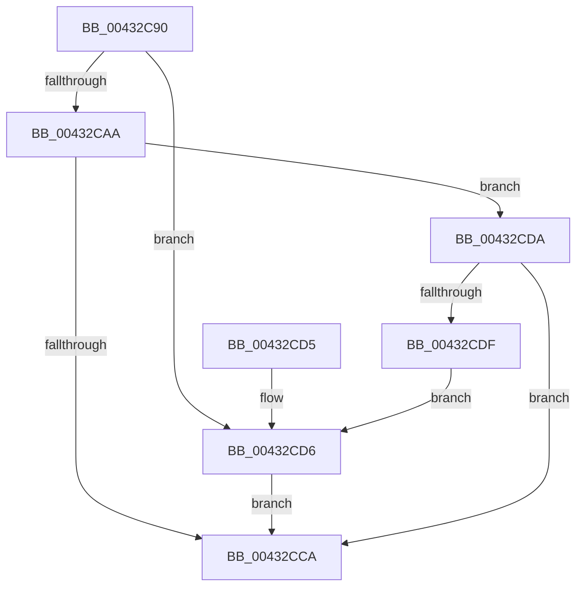

# RtlAddressInSectionTable

- RVA: `0x00432C90`–`0x00432CE1` (길이 `81` bytes)
- VA: `0x0000000140432C90`
- 실행 섹션: `.text`
- PDB 이름 있음: `예`; PDB Function 태그: `아니요`
- unwind 정보 RVA: `0x00069334`
- 디코드: `27`개 명령, `81/81` bytes 표시
- 미해석 바이트: `0` (있으면 어셈블리에 `.byte`로 보존)

> 이 문서는 커널 이미지의 기계어와 PDB 기호를 분석해 생성했습니다. 4번과 5번은 함수 원형과 자료형을 바이너리 사용 방식에서 추정한 C 해석이며 원본 소스 복구 결과는 아닙니다.

## 1. Dependencies

- 직접 호출 지점: **1**; 고유 호출 대상: **1**
- 직접 호출자로 확인된 함수: **4**
- RIP 상대 이미지 참조: **0**

### Outgoing calls
- `0x00432CA0` → [RtlSectionTableFromVirtualAddress](RtlSectionTableFromVirtualAddress_function_00432CF0.md) (function, `0x00432CF0`)

### Direct callers
- [RtlImageDirectoryEntryToData](RtlImageDirectoryEntryToData_function_004328D0.md) at `0x00432A37`
- [sub_00432B5C](Unknown_function_00432B5C.md) at `0x00432B6F`
- [RtlpImageDirectoryEntryToData32](RtlpImageDirectoryEntryToData32_function_00432BE4.md) at `0x00432C37`
- [LdrpAccessResourceDataNoMultipleLanguage](../../page/99/LdrpAccessResourceDataNoMultipleLanguage_function_0099BF00.md) at `0x0099C110`

### Static image references
- 디코드된 RIP-relative 메모리 참조가 없습니다.

## 2. Other-region calls and transfers

- 다른 실행 섹션으로 향하는 call: **0**
- 별도 외부 분기/꼬리 이동을 확인하지 못했습니다.

## 3. Assembly (complete function range)

```asm
00432C90  48 89 5C 24 08                  mov qword ptr [rsp + 8], rbx
00432C95  57                              push rdi
00432C96  48 83 EC 20                     sub rsp, 0x20
00432C9A  41 8B F8                        mov edi, r8d
00432C9D  48 8B DA                        mov rbx, rdx
00432CA0  E8 4B 00 00 00                  call 0x140432cf0
00432CA5  48 85 C0                        test rax, rax
00432CA8  74 2C                           je 0x140432cd6
00432CAA  8B 48 14                        mov ecx, dword ptr [rax + 0x14]
00432CAD  8B 40 0C                        mov eax, dword ptr [rax + 0xc]
00432CB0  90                              nop
00432CB1  48 2B C8                        sub rcx, rax
00432CB4  48 8D 04 0B                     lea rax, [rbx + rcx]
00432CB8  48 B9 FF FF FE FF FF 7F 00 00   movabs rcx, 0x7ffffffeffff
00432CC2  48 03 C7                        add rax, rdi
00432CC5  48 3B D9                        cmp rbx, rcx
00432CC8  76 10                           jbe 0x140432cda
00432CCA  48 8B 5C 24 30                  mov rbx, qword ptr [rsp + 0x30]
00432CCF  48 83 C4 20                     add rsp, 0x20
00432CD3  5F                              pop rdi
00432CD4  C3                              ret
00432CD5  CC                              int3
00432CD6  33 C0                           xor eax, eax
00432CD8  EB F0                           jmp 0x140432cca
00432CDA  48 3B C1                        cmp rax, rcx
00432CDD  76 EB                           jbe 0x140432cca
00432CDF  EB F5                           jmp 0x140432cd6
```

## 4. C-style interpretation (structured pseudocode)

```c
__int64 __fastcall RtlAddressInSectionTable(__int64 a1, __int64 a2, int a3)
{
    __int64 result;
    __int64 v_rsp;
    unsigned __int64 v_stack_p8;

    v_stack_p8 = v_rbx;
    v_rsp = (v_rsp) - (32);
    result = RtlSectionTableFromVirtualAddress(a1, a2, a3, a4);
    if (result == 0) goto loc_00432CD6;
    a1 = ((unsigned int)(*(unsigned int *)(result + 20))) - ((unsigned int)(*(unsigned int *)(result + 12)));
    result = (a2 + a1 * 1) + ((unsigned int)(a3));
    if (a2 <= a1) goto loc_00432CDA;
loc_00432CCA:
    v_rsp = (v_rsp) + (32);
    return result;
loc_00432CD6:
    result = 0;
    goto loc_00432CCA;
loc_00432CDA:
    if (0 <= a1) goto loc_00432CCA;
    goto loc_00432CD6;
}
```

## 5. (Beta) C Style

```c
int64_t RtlAddressInSectionTable(int64_t Arg1, void *Arg2, int32_t Arg3)
{
    uint8_t *arg2 = (uint8_t *)Arg2;

    int64_t result;
    int64_t local_rsp;
    uint64_t v_stack_p8;

    v_stack_p8 = local_rbx;
    local_rsp = (local_rsp) - (32);
    result = RtlSectionTableFromVirtualAddress(Arg1, Arg2, Arg3, a4);
    if (result == 0) goto loc_00432CD6;
    Arg1 = ((uint32_t)(*(uint32_t *)(result + 0x14))) - ((uint32_t)(*(uint32_t *)(result + 0xC)));
    result = (Arg2 + Arg1 * 1) + ((uint32_t)(Arg3));
    if (Arg2 <= Arg1) goto loc_00432CDA;
loc_00432CCA:
    local_rsp = (local_rsp) + (32);
    return result;
loc_00432CD6:
    result = 0;
    goto loc_00432CCA;
loc_00432CDA:
    if (0 <= Arg1) goto loc_00432CCA;
    goto loc_00432CD6;
}
```

### 관측된 메모리 오프셋

구조체 형식이 확인되지 않은 접근은 인자 기준의 오프셋으로만 기록했습니다.

| 기준 인자 | 오프셋 표현 | 폭 (bit) | 접근 |
|---|---:|---:|---|
| `Arg2` | `+ 0x0 + rcx*1` | `64` | `R` |

## 6. Execution-region graph

[열기: 2D/3D 그래프와 함수 탐색 컨트롤 패널](../../../control-panel.html?section=text&rva=0x00432C90&view=graph)

- 2D 그래프는 위에서 아래로 흐르고, 3D 그래프는 빈 공간을 드래그해 회전합니다. Shift+드래그는 이동, 휠은 확대·축소, 함수 노드 선택은 대상 보고서 이동입니다.

### Static fallback


