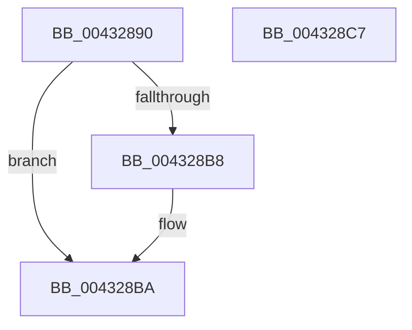

# RtlCaptureImageExceptionValues

- RVA: `0x00432890`–`0x004328C8` (길이 `56` bytes)
- VA: `0x0000000140432890`
- 실행 섹션: `.text`
- PDB 이름 있음: `예`; PDB Function 태그: `아니요`
- unwind 정보 RVA: `0x0005CAAC`
- 디코드: `19`개 명령, `56/56` bytes 표시
- 미해석 바이트: `0` (있으면 어셈블리에 `.byte`로 보존)

> 이 문서는 커널 이미지의 기계어와 PDB 기호를 분석해 생성했습니다. 4번과 5번은 함수 원형과 자료형을 바이너리 사용 방식에서 추정한 C 해석이며 원본 소스 복구 결과는 아닙니다.

## 1. Dependencies

- 직접 호출 지점: **1**; 고유 호출 대상: **1**
- 직접 호출자로 확인된 함수: **5**
- RIP 상대 이미지 참조: **0**

### Outgoing calls
- `0x004328AB` → [RtlImageDirectoryEntryToData](RtlImageDirectoryEntryToData_function_004328D0.md) (function, `0x004328D0`)

### Direct callers
- [KiLockExtendedServiceTable](../50/KiLockExtendedServiceTable_function_00509F48.md) at `0x00509FEF`
- [KiLockServiceTable](../69/KiLockServiceTable_function_0069BC98.md) at `0x0069BCF8`
- [sub_00BF16D0](../../init/BF/Unknown_function_00BF16D0.md) at `0x00BF60F8`
- [KiFatalExceptionFilter](../../init/C6/KiFatalExceptionFilter_function_00C6CFB4.md) at `0x00C6CFEC`
- [sub_00C7EB3D](../../init/C7/Unknown_function_00C7EB3D.md) at `0x00C7EC9E`
- [sub_00C7EB3D](../../init/C7/Unknown_function_00C7EB3D.md) at `0x00C7F195`

### Static image references
- 디코드된 RIP-relative 메모리 참조가 없습니다.

## 2. Other-region calls and transfers

- 다른 실행 섹션으로 향하는 call: **0**
- 별도 외부 분기/꼬리 이동을 확인하지 못했습니다.

## 3. Assembly (complete function range)

```asm
00432890  48 89 5C 24 08                  mov qword ptr [rsp + 8], rbx
00432895  57                              push rdi
00432896  48 83 EC 20                     sub rsp, 0x20
0043289A  49 8B F8                        mov rdi, r8
0043289D  48 8B DA                        mov rbx, rdx
004328A0  4C 8B CF                        mov r9, rdi
004328A3  41 B8 03 00 00 00               mov r8d, 3
004328A9  B2 01                           mov dl, 1
004328AB  E8 20 00 00 00                  call 0x1404328d0
004328B0  48 89 03                        mov qword ptr [rbx], rax
004328B3  48 85 C0                        test rax, rax
004328B6  75 02                           jne 0x1404328ba
004328B8  21 07                           and dword ptr [rdi], eax
004328BA  48 8B 5C 24 30                  mov rbx, qword ptr [rsp + 0x30]
004328BF  33 C0                           xor eax, eax
004328C1  48 83 C4 20                     add rsp, 0x20
004328C5  5F                              pop rdi
004328C6  C3                              ret
004328C7  CC                              int3
```

## 4. C-style interpretation (structured pseudocode)

```c
__int64 __fastcall RtlCaptureImageExceptionValues(__int64 a1, __int64 a2, __int64 a3)
{
    __int64 result;
    __int64 v_rsp;
    unsigned __int64 v_stack_p8;

    v_stack_p8 = v_rbx;
    v_rsp = (v_rsp) - (32);
    result = RtlImageDirectoryEntryToData(a1, 1, 3, a3);
    *(unsigned __int64 *)(a2) = result;
    if (result == 0) {
    }
    result = 0;
    v_rsp = (v_rsp) + (32);
    return result;
}
```

## 5. (Beta) C Style

```c
int64_t RtlCaptureImageExceptionValues(int64_t Arg1, void *Arg2, void *Arg3)
{
    uint8_t *arg2 = (uint8_t *)Arg2;
    uint8_t *arg3 = (uint8_t *)Arg3;

    int64_t result;
    int64_t local_rsp;
    uint64_t v_stack_p8;

    v_stack_p8 = local_rbx;
    local_rsp = (local_rsp) - (32);
    result = RtlImageDirectoryEntryToData(Arg1, 1, 3, Arg3);
    *(uint64_t *)(arg2) = result;
    if (result == 0) {
    }
    result = 0;
    local_rsp = (local_rsp) + (32);
    return result;
}
```

### 관측된 메모리 오프셋

구조체 형식이 확인되지 않은 접근은 인자 기준의 오프셋으로만 기록했습니다.

| 기준 인자 | 오프셋 표현 | 폭 (bit) | 접근 |
|---|---:|---:|---|
| `Arg2` | `+ 0x0` | `64` | `W` |
| `Arg3` | `+ 0x0` | `32` | `R/W` |

## 6. Execution-region graph

[열기: 2D/3D 그래프와 함수 탐색 컨트롤 패널](../../../control-panel.html?section=text&rva=0x00432890&view=graph)

- 2D 그래프는 위에서 아래로 흐르고, 3D 그래프는 빈 공간을 드래그해 회전합니다. Shift+드래그는 이동, 휠은 확대·축소, 함수 노드 선택은 대상 보고서 이동입니다.

### Static fallback


