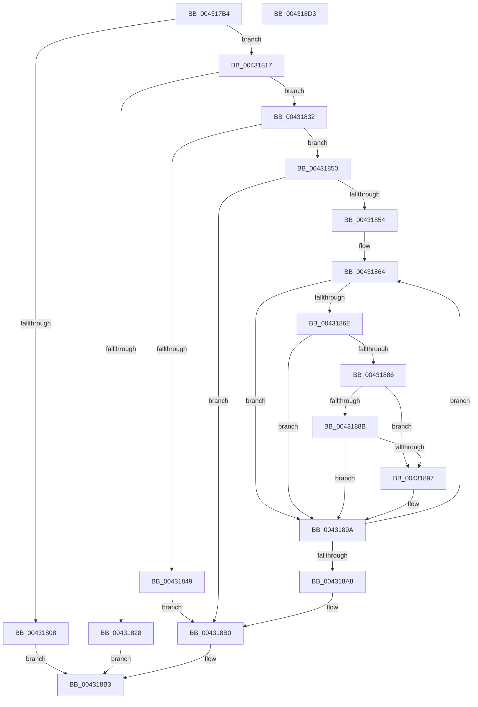

# RtlCaptureRetpolineImportRvas

- RVA: `0x004317B4`–`0x004318D4` (길이 `288` bytes)
- VA: `0x00000001404317B4`
- 실행 섹션: `.text`
- PDB 이름 있음: `예`; PDB Function 태그: `아니요`
- unwind 정보 RVA: `0x0007FEE0`
- 디코드: `85`개 명령, `288/288` bytes 표시
- 미해석 바이트: `0` (있으면 어셈블리에 `.byte`로 보존)

> 이 문서는 커널 이미지의 기계어와 PDB 기호를 분석해 생성했습니다. 4번과 5번은 함수 원형과 자료형을 바이너리 사용 방식에서 추정한 C 해석이며 원본 소스 복구 결과는 아닙니다.

## 1. Dependencies

- 직접 호출 지점: **2**; 고유 호출 대상: **2**
- 직접 호출자로 확인된 함수: **3**
- RIP 상대 이미지 참조: **0**

### Outgoing calls
- `0x004317F9` → [RtlpImageDirectoryEntryToDataEx](RtlpImageDirectoryEntryToDataEx_function_00432A60.md) (function, `0x00432A60`)
- `0x0043188E` → [guard_dispatch_icall](../6B/guard_dispatch_icall_function_006BAAD0.md) (function, `0x006BAAD0`)

### Direct callers
- [RtlUpdateImportRelocationsInImage](../6A/RtlUpdateImportRelocationsInImage_function_006A9E1C.md) at `0x006A9ED8`
- [RtlUpdateImportRelocationsInImage](../6A/RtlUpdateImportRelocationsInImage_function_006A9E1C.md) at `0x006A9F35`
- [MiCaptureRetpolineImportInfo](../../page/A9/MiCaptureRetpolineImportInfo_function_00A9FB00.md) at `0x00A9FB61`
- [sub_00B4928C](../../page/B4/Unknown_function_00B4928C.md) at `0x00B492A9`

### Static image references
- 디코드된 RIP-relative 메모리 참조가 없습니다.

## 2. Other-region calls and transfers

- 다른 실행 섹션으로 향하는 call: **0**
- 별도 외부 분기/꼬리 이동을 확인하지 못했습니다.

## 3. Assembly (complete function range)

```asm
004317B4  4C 8B DC                        mov r11, rsp
004317B7  49 89 5B 08                     mov qword ptr [r11 + 8], rbx
004317BB  49 89 6B 18                     mov qword ptr [r11 + 0x18], rbp
004317BF  49 89 73 20                     mov qword ptr [r11 + 0x20], rsi
004317C3  49 89 53 10                     mov qword ptr [r11 + 0x10], rdx
004317C7  57                              push rdi
004317C8  41 54                           push r12
004317CA  41 55                           push r13
004317CC  41 56                           push r14
004317CE  41 57                           push r15
004317D0  48 83 EC 40                     sub rsp, 0x40
004317D4  33 DB                           xor ebx, ebx
004317D6  49 8D 43 D0                     lea rax, [r11 - 0x30]
004317DA  4D 8B E9                        mov r13, r9
004317DD  89 5C 24 30                     mov dword ptr [rsp + 0x30], ebx
004317E1  49 8B E8                        mov rbp, r8
004317E4  49 89 5B D0                     mov qword ptr [r11 - 0x30], rbx
004317E8  4D 8D 4B C8                     lea r9, [r11 - 0x38]
004317EC  49 89 43 B8                     mov qword ptr [r11 - 0x48], rax
004317F0  44 8D 43 0C                     lea r8d, [rbx + 0xc]
004317F4  B2 01                           mov dl, 1
004317F6  48 8B F9                        mov rdi, rcx
004317F9  E8 62 12 00 00                  call 0x140432a60
004317FE  48 8B 74 24 38                  mov rsi, qword ptr [rsp + 0x38]
00431803  48 85 F6                        test rsi, rsi
00431806  75 0F                           jne 0x140431817
00431808  48 8B 84 24 98 00 00 00         mov rax, qword ptr [rsp + 0x98]
00431810  89 18                           mov dword ptr [rax], ebx
00431812  E9 9C 00 00 00                  jmp 0x1404318b3
00431817  8B 54 24 30                     mov edx, dword ptr [rsp + 0x30]
0043181B  48 8D 04 2F                     lea rax, [rdi + rbp]
0043181F  48 8D 0C 16                     lea rcx, [rsi + rdx]
00431823  48 3B C8                        cmp rcx, rax
00431826  76 0A                           jbe 0x140431832
00431828  BB 7B 00 00 C0                  mov ebx, 0xc000007b
0043182D  E9 81 00 00 00                  jmp 0x1404318b3
00431832  4C 8B B4 24 98 00 00 00         mov r14, qword ptr [rsp + 0x98]
0043183A  C1 EA 03                        shr edx, 3
0043183D  8D 2C 95 00 00 00 00            lea ebp, [rdx*4]
00431844  41 3B 2E                        cmp ebp, dword ptr [r14]
00431847  76 07                           jbe 0x140431850
00431849  BB 23 00 00 C0                  mov ebx, 0xc0000023
0043184E  EB 60                           jmp 0x1404318b0
00431850  85 D2                           test edx, edx
00431852  74 5C                           je 0x1404318b0
00431854  48 8B BC 24 90 00 00 00         mov rdi, qword ptr [rsp + 0x90]
0043185C  4C 8B 74 24 78                  mov r14, qword ptr [rsp + 0x78]
00431861  44 8B E2                        mov r12d, edx
00431864  89 1F                           mov dword ptr [rdi], ebx
00431866  48 8B 0E                        mov rcx, qword ptr [rsi]
00431869  48 85 C9                        test rcx, rcx
0043186C  74 2C                           je 0x14043189a
0043186E  4C 8B F9                        mov r15, rcx
00431871  B8 00 00 00 80                  mov eax, 0x80000000
00431876  4D 2B FE                        sub r15, r14
00431879  BA FF FF FF FF                  mov edx, 0xffffffff
0043187E  49 03 C7                        add rax, r15
00431881  48 3B C2                        cmp rax, rdx
00431884  77 14                           ja 0x14043189a
00431886  4D 85 ED                        test r13, r13
00431889  74 0C                           je 0x140431897
0043188B  49 8B C5                        mov rax, r13
0043188E  E8 3D 92 28 00                  call 0x1406baad0
00431893  85 C0                           test eax, eax
00431895  74 03                           je 0x14043189a
00431897  44 89 3F                        mov dword ptr [rdi], r15d
0043189A  48 83 C6 08                     add rsi, 8
0043189E  48 83 C7 04                     add rdi, 4
004318A2  49 83 EC 01                     sub r12, 1
004318A6  75 BC                           jne 0x140431864
004318A8  4C 8B B4 24 98 00 00 00         mov r14, qword ptr [rsp + 0x98]
004318B0  41 89 2E                        mov dword ptr [r14], ebp
004318B3  4C 8D 5C 24 40                  lea r11, [rsp + 0x40]
004318B8  8B C3                           mov eax, ebx
004318BA  49 8B 5B 30                     mov rbx, qword ptr [r11 + 0x30]
004318BE  49 8B 6B 40                     mov rbp, qword ptr [r11 + 0x40]
004318C2  49 8B 73 48                     mov rsi, qword ptr [r11 + 0x48]
004318C6  49 8B E3                        mov rsp, r11
004318C9  41 5F                           pop r15
004318CB  41 5E                           pop r14
004318CD  41 5D                           pop r13
004318CF  41 5C                           pop r12
004318D1  5F                              pop rdi
004318D2  C3                              ret
004318D3  CC                              int3
```

## 4. C-style interpretation (structured pseudocode)

```c
__int64 __fastcall RtlCaptureRetpolineImportRvas(__int64 a1, __int64 a2, __int64 a3, __int64 a4, __int64 a5, __int64 a6)
{
    __int64 result;
    __int64 v_r12;
    __int64 v_r15;
    __int64 v_rbx;
    __int64 v_rdi;
    __int64 v_rsi;
    __int64 v_rsp;
    unsigned __int64 v_stack_m28;
    unsigned __int64 v_stack_m30;
    unsigned int v_stack_m38;
    unsigned __int64 v_stack_p10;

    *(unsigned __int64 *)(v_rsp + 8) = v_rbx;
    *(unsigned __int64 *)(v_rsp + 24) = v_rbp;
    *(unsigned __int64 *)(v_rsp + 32) = v_rsi;
    *(unsigned __int64 *)(v_rsp + 16) = a2;
    v_rsp = (v_rsp) - (64);
    v_rbx = 0;
    v_stack_m38 = 0;
    *(unsigned __int64 *)(v_rsp - 48) = 0;
    *(unsigned __int64 *)(v_rsp - 72) = v_rsp - 48;
    result = RtlpImageDirectoryEntryToDataEx(a1, 1, v_rbx + 12, v_rsp - 56);
    if (v_stack_m30 != 0) goto loc_00431817;
    *(unsigned int *)(a6) = 0;
    goto loc_004318B3;
loc_00431817:
    if ((v_stack_m30 + (unsigned int)(v_stack_m38) * 1) <= (a1 + a3 * 1)) goto loc_00431832;
    goto loc_004318B3;
loc_00431832:
    a2 = (unsigned int)(((unsigned int)(v_stack_m38)) >> (3));
    if (((unsigned int)(a2 * 4)) <= (*(unsigned int *)(a6))) goto loc_00431850;
    goto loc_004318B0;
loc_00431850:
    if ((unsigned int)(a2) == 0) goto loc_004318B0;
loc_00431864:
    *(unsigned int *)(a5) = (unsigned int)((unsigned int)(0xC0000023ULL));
    if (*(unsigned __int64 *)(v_stack_m30) == 0) goto loc_0043189A;
    v_r15 = (*(unsigned __int64 *)(v_stack_m30)) - (v_stack_p10);
    result = ((unsigned int)(0x80000000ULL)) + (v_r15);
    if (result > ((unsigned int)(0xFFFFFFFFULL))) goto loc_0043189A;
    if (a4 == 0) goto loc_00431897;
    result = guard_dispatch_icall(*(unsigned __int64 *)(v_stack_m30), (unsigned int)(0xFFFFFFFFULL), v_rbx + 12, v_rsp - 56);
    if ((unsigned int)(result) != 0) {
        *(unsigned int *)(a5) = (unsigned int)(v_r15);
    }
    v_rsi = (v_stack_m30) + (8);
    v_rdi = (a5) + (4);
    v_r12 = ((unsigned int)((unsigned int)(a2))) - (1);
    if (condition_is_not_equal) goto loc_00431864;
loc_004318B0:
    *(unsigned int *)(a6) = (unsigned int)(a2 * 4);
loc_004318B3:
    return (unsigned int)((unsigned int)((unsigned int)(0xC0000023ULL)));
}
```

## 5. (Beta) C Style

```c
int64_t RtlCaptureRetpolineImportRvas(void *Arg1, int64_t Arg2, int64_t Arg3, int64_t Arg4, void *Arg5, void *Arg6)
{
    uint8_t *arg1 = (uint8_t *)Arg1;
    uint8_t *arg5 = (uint8_t *)Arg5;
    uint8_t *arg6 = (uint8_t *)Arg6;

    int64_t result;
    int64_t local_r12;
    int64_t local_r15;
    int64_t local_rbx;
    int64_t local_rdi;
    int64_t local_rsi;
    int64_t local_rsp;
    uint64_t v_stack_m28;
    uint64_t v_stack_m30;
    uint32_t v_stack_m38;
    uint64_t v_stack_p10;

    *(uint64_t *)(local_rsp + 0x8) = local_rbx;
    *(uint64_t *)(local_rsp + 0x18) = local_rbp;
    *(uint64_t *)(local_rsp + 0x20) = local_rsi;
    *(uint64_t *)(local_rsp + 0x10) = Arg2;
    local_rsp = (local_rsp) - (64);
    local_rbx = 0;
    v_stack_m38 = 0;
    *(uint64_t *)(local_rsp - 0x30) = 0;
    *(uint64_t *)(local_rsp - 0x48) = local_rsp - 48;
    result = RtlpImageDirectoryEntryToDataEx(Arg1, 1, local_rbx + 12, local_rsp - 56);
    if (v_stack_m30 != 0) goto loc_00431817;
    *(uint32_t *)(arg6) = 0;
    goto loc_004318B3;
loc_00431817:
    if ((v_stack_m30 + (uint32_t)(v_stack_m38) * 1) <= (Arg1 + Arg3 * 1)) goto loc_00431832;
    goto loc_004318B3;
loc_00431832:
    Arg2 = (uint32_t)(((uint32_t)(v_stack_m38)) >> (3));
    if (((uint32_t)(Arg2 * 4)) <= (*(uint32_t *)(arg6))) goto loc_00431850;
    goto loc_004318B0;
loc_00431850:
    if ((uint32_t)(Arg2) == 0) goto loc_004318B0;
loc_00431864:
    *(uint32_t *)(arg5) = (uint32_t)((uint32_t)(0xC0000023ULL));
    if (*(uint64_t *)(v_stack_m30) == 0) goto loc_0043189A;
    local_r15 = (*(uint64_t *)(v_stack_m30)) - (v_stack_p10);
    result = ((uint32_t)(0x80000000ULL)) + (local_r15);
    if (result > ((uint32_t)(0xFFFFFFFFULL))) goto loc_0043189A;
    if (Arg4 == 0) goto loc_00431897;
    result = guard_dispatch_icall(*(uint64_t *)(v_stack_m30), (uint32_t)(0xFFFFFFFFULL), local_rbx + 12, local_rsp - 56);
    if ((uint32_t)(result) != 0) {
        *(uint32_t *)(arg5) = (uint32_t)(local_r15);
    }
    local_rsi = (v_stack_m30) + (8);
    local_rdi = (Arg5) + (4);
    local_r12 = ((uint32_t)((uint32_t)(Arg2))) - (1);
    if (condition_is_not_equal) goto loc_00431864;
loc_004318B0:
    *(uint32_t *)(arg6) = (uint32_t)(Arg2 * 4);
loc_004318B3:
    return (uint32_t)((uint32_t)((uint32_t)(0xC0000023ULL)));
}
```

### 관측된 메모리 오프셋

구조체 형식이 확인되지 않은 접근은 인자 기준의 오프셋으로만 기록했습니다.

| 기준 인자 | 오프셋 표현 | 폭 (bit) | 접근 |
|---|---:|---:|---|
| `Arg1` | `+ 0x0 + rbp*1` | `64` | `R` |
| `Arg5` | `+ 0x0` | `32` | `W` |
| `Arg6` | `+ 0x0` | `32` | `R` |
| `Arg6` | `+ 0x0` | `32` | `W` |

## 6. Execution-region graph

[열기: 2D/3D 그래프와 함수 탐색 컨트롤 패널](../../../control-panel.html?section=text&rva=0x004317B4&view=graph)

- 2D 그래프는 위에서 아래로 흐르고, 3D 그래프는 빈 공간을 드래그해 회전합니다. Shift+드래그는 이동, 휠은 확대·축소, 함수 노드 선택은 대상 보고서 이동입니다.

### Static fallback


