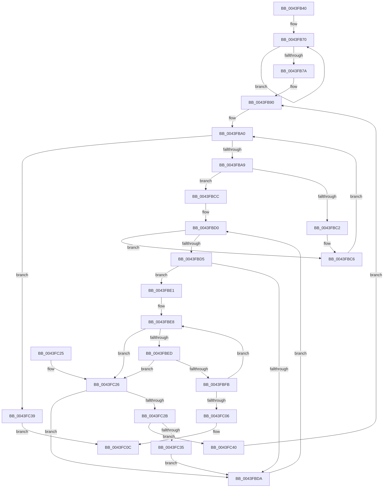

# RtlFindNextAlignedForwardRunClear

- RVA: `0x0043FB40`–`0x0043FC48` (길이 `264` bytes)
- VA: `0x000000014043FB40`
- 실행 섹션: `.text`
- PDB 이름 있음: `예`; PDB Function 태그: `아니요`
- unwind 정보 RVA: `0x000A4D88`
- 디코드: `84`개 명령, `264/264` bytes 표시
- 미해석 바이트: `0` (있으면 어셈블리에 `.byte`로 보존)

> 이 문서는 커널 이미지의 기계어와 PDB 기호를 분석해 생성했습니다. 4번과 5번은 함수 원형과 자료형을 바이너리 사용 방식에서 추정한 C 해석이며 원본 소스 복구 결과는 아닙니다.

## 1. Dependencies

- 직접 호출 지점: **0**; 고유 호출 대상: **0**
- 직접 호출자로 확인된 함수: **1**
- RIP 상대 이미지 참조: **1**

### Outgoing calls
- 직접 디코드된 call 명령이 없습니다.

### Direct callers
- [EtwpFindUserBufferSpace](../../page/9B/EtwpFindUserBufferSpace_function_009BFB14.md) at `0x009BFB55`

### Static image references
- `0x0043FB7E` → RVA `0x00012C50` (`.rdata`; read)

## 2. Other-region calls and transfers

- 다른 실행 섹션으로 향하는 call: **0**
- 별도 외부 분기/꼬리 이동을 확인하지 못했습니다.

## 3. Assembly (complete function range)

```asm
0043FB40  48 89 5C 24 08                  mov qword ptr [rsp + 8], rbx
0043FB45  48 89 6C 24 10                  mov qword ptr [rsp + 0x10], rbp
0043FB4A  48 89 74 24 18                  mov qword ptr [rsp + 0x18], rsi
0043FB4F  48 89 7C 24 20                  mov qword ptr [rsp + 0x20], rdi
0043FB54  41 56                           push r14
0043FB56  41 57                           push r15
0043FB58  8B 29                           mov ebp, dword ptr [rcx]
0043FB5A  BA 01 00 00 00                  mov edx, 1
0043FB5F  8B C2                           mov eax, edx
0043FB61  41 8B F0                        mov esi, r8d
0043FB64  4C 8B F1                        mov r14, rcx
0043FB67  45 33 C9                        xor r9d, r9d
0043FB6A  66 0F 1F 44 00 00               nop word ptr [rax + rax]
0043FB70  0F AB C2                        bts edx, eax
0043FB73  FF C0                           inc eax
0043FB75  83 F8 20                        cmp eax, 0x20
0043FB78  72 F6                           jb 0x14043fb70
0043FB7A  4C 8B 59 08                     mov r11, qword ptr [rcx + 8]
0043FB7E  4C 8D 3D CB 30 BD FF            lea r15, [rip - 0x42cf35]
0043FB85  8D 4D FF                        lea ecx, [rbp - 1]
0043FB88  48 C1 E9 05                     shr rcx, 5
0043FB8C  49 8D 3C 8B                     lea rdi, [r11 + rcx*4]
0043FB90  41 8B C1                        mov eax, r9d
0043FB93  48 C1 E8 05                     shr rax, 5
0043FB97  4D 8D 14 83                     lea r10, [r11 + rax*4]
0043FB9B  0F 1F 44 00 00                  nop dword ptr [rax + rax]
0043FBA0  4C 3B D7                        cmp r10, rdi
0043FBA3  0F 87 90 00 00 00               ja 0x14043fc39
0043FBA9  41 8B 1A                        mov ebx, dword ptr [r10]
0043FBAC  41 8B C1                        mov eax, r9d
0043FBAF  83 E0 1F                        and eax, 0x1f
0043FBB2  41 83 E1 E0                     and r9d, 0xffffffe0
0043FBB6  41 0B 1C 87                     or ebx, dword ptr [r15 + rax*4]
0043FBBA  8B C2                           mov eax, edx
0043FBBC  23 C3                           and eax, ebx
0043FBBE  3B C2                           cmp eax, edx
0043FBC0  75 0A                           jne 0x14043fbcc
0043FBC2  41 83 C1 20                     add r9d, 0x20
0043FBC6  49 83 C2 04                     add r10, 4
0043FBCA  EB D4                           jmp 0x14043fba0
0043FBCC  33 C9                           xor ecx, ecx
0043FBCE  66 90                           nop
0043FBD0  83 F9 20                        cmp ecx, 0x20
0043FBD3  73 F1                           jae 0x14043fbc6
0043FBD5  0F A3 CB                        bt ebx, ecx
0043FBD8  73 07                           jae 0x14043fbe1
0043FBDA  FF C1                           inc ecx
0043FBDC  41 FF C1                        inc r9d
0043FBDF  EB EF                           jmp 0x14043fbd0
0043FBE1  4D 8B 5E 08                     mov r11, qword ptr [r14 + 8]
0043FBE5  45 33 C0                        xor r8d, r8d
0043FBE8  44 3B CD                        cmp r9d, ebp
0043FBEB  73 39                           jae 0x14043fc26
0043FBED  41 8B C1                        mov eax, r9d
0043FBF0  49 0F A3 03                     bt qword ptr [r11], rax
0043FBF4  0F 92 C0                        setb al
0043FBF7  84 C0                           test al, al
0043FBF9  75 2B                           jne 0x14043fc26
0043FBFB  41 FF C1                        inc r9d
0043FBFE  41 FF C0                        inc r8d
0043FC01  44 3B C6                        cmp r8d, esi
0043FC04  75 E2                           jne 0x14043fbe8
0043FC06  45 2B C8                        sub r9d, r8d
0043FC09  41 8B C1                        mov eax, r9d
0043FC0C  48 8B 5C 24 18                  mov rbx, qword ptr [rsp + 0x18]
0043FC11  48 8B 6C 24 20                  mov rbp, qword ptr [rsp + 0x20]
0043FC16  48 8B 74 24 28                  mov rsi, qword ptr [rsp + 0x28]
0043FC1B  48 8B 7C 24 30                  mov rdi, qword ptr [rsp + 0x30]
0043FC20  41 5F                           pop r15
0043FC22  41 5E                           pop r14
0043FC24  C3                              ret
0043FC25  CC                              int3
0043FC26  45 85 C0                        test r8d, r8d
0043FC29  74 AF                           je 0x14043fbda
0043FC2B  FF C1                           inc ecx
0043FC2D  41 03 C8                        add ecx, r8d
0043FC30  83 F9 20                        cmp ecx, 0x20
0043FC33  73 0B                           jae 0x14043fc40
0043FC35  FF C9                           dec ecx
0043FC37  EB A1                           jmp 0x14043fbda
0043FC39  B8 FF FF FF FF                  mov eax, 0xffffffff
0043FC3E  EB CC                           jmp 0x14043fc0c
0043FC40  41 FF C1                        inc r9d
0043FC43  E9 48 FF FF FF                  jmp 0x14043fb90
```

## 4. C-style interpretation (structured pseudocode)

```c
__int64 __fastcall RtlFindNextAlignedForwardRunClear(__int64 a1, __int64 a2, int a3, int a4)
{
    __int64 result;
    __int64 v_r10;
    __int64 v_rbx;
    unsigned __int64 v_stack_p10;
    unsigned __int64 v_stack_p18;
    unsigned __int64 v_stack_p20;
    unsigned __int64 v_stack_p8;

    v_stack_p8 = v_rbx;
    v_stack_p10 = v_rbp;
    v_stack_p18 = v_rsi;
    v_stack_p20 = v_rdi;
    a4 = 0;
loc_0043FB70:
    result = (unsigned int)((1) + 1);
    if (((unsigned int)(result)) < 32) goto loc_0043FB70;
    a1 = ((unsigned int)(*(unsigned int *)(a1)) - 1) >> (5);
loc_0043FB90:
    result = (0) >> (5);
loc_0043FBA0:
    if ((*(unsigned __int64 *)(a1 + 8) + result * 4) > (*(unsigned __int64 *)(a1 + 8) + a1 * 4)) goto loc_0043FC39;
    result = (unsigned int)((0) & (31));
    a4 = (unsigned int)((a4) & (0xFFFFFFE0ULL));
    v_rbx = (unsigned int)(((unsigned int)(*(unsigned int *)(*(unsigned __int64 *)(a1 + 8) + result * 4))) | (*(unsigned int *)(v_rip - 4378421 + result * 4)));
    result = (unsigned int)((1) & ((unsigned int)(v_rbx)));
    if (((unsigned int)(result)) != 1) goto loc_0043FBCC;
    a4 = (unsigned int)((a4) + (32));
loc_0043FBC6:
    v_r10 = (*(unsigned __int64 *)(a1 + 8) + result * 4) + (4);
    goto loc_0043FBA0;
loc_0043FBCC:
    a1 = 0;
loc_0043FBD0:
    if (0 >= 32) goto loc_0043FBC6;
    if (0 >= 32) goto loc_0043FBE1;
loc_0043FBDA:
    a1 = (unsigned int)((a1) + 1);
    a4 = (unsigned int)((a4) + 1);
    goto loc_0043FBD0;
loc_0043FBE1:
    a3 = 0;
loc_0043FBE8:
    if (a4 >= ((unsigned int)((unsigned int)(*(unsigned int *)(a1))))) goto loc_0043FC26;
    result = (a4 < ((unsigned int)((unsigned int)(*(unsigned int *)(a1))))) ? 1 : 0;
    if ((unsigned __int8)(result) != 0) goto loc_0043FC26;
    a4 = (unsigned int)((a4) + 1);
    a3 = (unsigned int)((a3) + 1);
    if (a3 != ((unsigned int)((unsigned int)(a3)))) goto loc_0043FBE8;
    a4 = (unsigned int)((a4) - (a3));
loc_0043FC0C:
    return (unsigned int)(a4);
loc_0043FC26:
    if (a3 == 0) goto loc_0043FBDA;
    a1 = (unsigned int)((a1) + 1);
    a1 = (unsigned int)((a1) + (a3));
    if (((unsigned int)(a1)) >= 32) goto loc_0043FC40;
    a1 = (unsigned int)((a1) - 1);
    goto loc_0043FBDA;
loc_0043FC39:
    goto loc_0043FC0C;
loc_0043FC40:
    a4 = (unsigned int)((a4) + 1);
    goto loc_0043FB90;
}
```

## 5. (Beta) C Style

```c
int64_t RtlFindNextAlignedForwardRunClear(void *Arg1, int64_t Arg2, int32_t Arg3, int32_t Arg4)
{
    uint8_t *arg1 = (uint8_t *)Arg1;

    int64_t result;
    int64_t local_r10;
    int64_t local_rbx;
    uint64_t v_stack_p10;
    uint64_t v_stack_p18;
    uint64_t v_stack_p20;
    uint64_t v_stack_p8;

    v_stack_p8 = local_rbx;
    v_stack_p10 = local_rbp;
    v_stack_p18 = local_rsi;
    v_stack_p20 = local_rdi;
    Arg4 = 0;
loc_0043FB70:
    result = (uint32_t)((1) + 1);
    if (((uint32_t)(result)) < 32) goto loc_0043FB70;
    Arg1 = ((uint32_t)(*(uint32_t *)(arg1)) - 1) >> (5);
loc_0043FB90:
    result = (0) >> (5);
loc_0043FBA0:
    if ((*(uint64_t *)(arg1 + 0x8) + result * 4) > (*(uint64_t *)(arg1 + 0x8) + Arg1 * 4)) goto loc_0043FC39;
    result = (uint32_t)((0) & (31));
    Arg4 = (uint32_t)((Arg4) & (0xFFFFFFE0ULL));
    local_rbx = (uint32_t)(((uint32_t)(*(uint32_t *)(*(uint64_t *)(arg1 + 0x8) + result * 4))) | (*(uint32_t *)(v_rip - 0x42CF35 + result * 4)));
    result = (uint32_t)((1) & ((uint32_t)(local_rbx)));
    if (((uint32_t)(result)) != 1) goto loc_0043FBCC;
    Arg4 = (uint32_t)((Arg4) + (32));
loc_0043FBC6:
    local_r10 = (*(uint64_t *)(arg1 + 0x8) + result * 4) + (4);
    goto loc_0043FBA0;
loc_0043FBCC:
    Arg1 = 0;
loc_0043FBD0:
    if (0 >= 32) goto loc_0043FBC6;
    if (0 >= 32) goto loc_0043FBE1;
loc_0043FBDA:
    Arg1 = (uint32_t)((Arg1) + 1);
    Arg4 = (uint32_t)((Arg4) + 1);
    goto loc_0043FBD0;
loc_0043FBE1:
    Arg3 = 0;
loc_0043FBE8:
    if (Arg4 >= ((uint32_t)((uint32_t)(*(uint32_t *)(arg1))))) goto loc_0043FC26;
    result = (Arg4 < ((uint32_t)((uint32_t)(*(uint32_t *)(arg1))))) ? 1 : 0;
    if ((uint8_t)(result) != 0) goto loc_0043FC26;
    Arg4 = (uint32_t)((Arg4) + 1);
    Arg3 = (uint32_t)((Arg3) + 1);
    if (Arg3 != ((uint32_t)((uint32_t)(Arg3)))) goto loc_0043FBE8;
    Arg4 = (uint32_t)((Arg4) - (Arg3));
loc_0043FC0C:
    return (uint32_t)(Arg4);
loc_0043FC26:
    if (Arg3 == 0) goto loc_0043FBDA;
    Arg1 = (uint32_t)((Arg1) + 1);
    Arg1 = (uint32_t)((Arg1) + (Arg3));
    if (((uint32_t)(Arg1)) >= 32) goto loc_0043FC40;
    Arg1 = (uint32_t)((Arg1) - 1);
    goto loc_0043FBDA;
loc_0043FC39:
    goto loc_0043FC0C;
loc_0043FC40:
    Arg4 = (uint32_t)((Arg4) + 1);
    goto loc_0043FB90;
}
```

### 관측된 메모리 오프셋

구조체 형식이 확인되지 않은 접근은 인자 기준의 오프셋으로만 기록했습니다.

| 기준 인자 | 오프셋 표현 | 폭 (bit) | 접근 |
|---|---:|---:|---|
| `Arg1` | `+ 0x0` | `32` | `R` |
| `Arg1` | `+ 0x8` | `64` | `R` |

## 6. Execution-region graph

[열기: 2D/3D 그래프와 함수 탐색 컨트롤 패널](../../../control-panel.html?section=text&rva=0x0043FB40&view=graph)

- 2D 그래프는 위에서 아래로 흐르고, 3D 그래프는 빈 공간을 드래그해 회전합니다. Shift+드래그는 이동, 휠은 확대·축소, 함수 노드 선택은 대상 보고서 이동입니다.

### Static fallback


