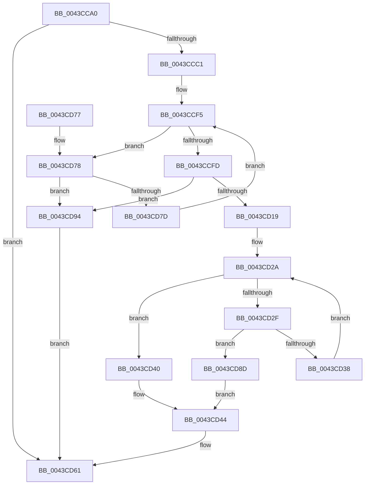

# RtlFindNextForwardRunClearEx

- RVA: `0x0043CCA0`–`0x0043CD99` (길이 `249` bytes)
- VA: `0x000000014043CCA0`
- 실행 섹션: `.text`
- PDB 이름 있음: `예`; PDB Function 태그: `아니요`
- unwind 정보 RVA: `0x000A47D4`
- 디코드: `75`개 명령, `249/249` bytes 표시
- 미해석 바이트: `0` (있으면 어셈블리에 `.byte`로 보존)

> 이 문서는 커널 이미지의 기계어와 PDB 기호를 분석해 생성했습니다. 4번과 5번은 함수 원형과 자료형을 바이너리 사용 방식에서 추정한 C 해석이며 원본 소스 복구 결과는 아닙니다.

## 1. Dependencies

- 직접 호출 지점: **0**; 고유 호출 대상: **0**
- 직접 호출자로 확인된 함수: **2**
- RIP 상대 이미지 참조: **0**

### Outgoing calls
- 직접 디코드된 call 명령이 없습니다.

### Direct callers
- [MmQueryMemoryRanges](../../page/7F/MmQueryMemoryRanges_function_007FC3A0.md) at `0x007FC4A3`
- [MiDeleteAweInfoPages](../../page/80/MiDeleteAweInfoPages_function_0080AA40.md) at `0x0080AAF5`

### Static image references
- 디코드된 RIP-relative 메모리 참조가 없습니다.

## 2. Other-region calls and transfers

- 다른 실행 섹션으로 향하는 call: **0**
- 별도 외부 분기/꼬리 이동을 확인하지 못했습니다.

## 3. Assembly (complete function range)

```asm
0043CCA0  48 89 5C 24 10                  mov qword ptr [rsp + 0x10], rbx
0043CCA5  48 89 74 24 18                  mov qword ptr [rsp + 0x18], rsi
0043CCAA  48 89 7C 24 20                  mov qword ptr [rsp + 0x20], rdi
0043CCAF  4C 8B 11                        mov r10, qword ptr [rcx]
0043CCB2  45 33 C9                        xor r9d, r9d
0043CCB5  49 8B F8                        mov rdi, r8
0043CCB8  4C 3B D2                        cmp r10, rdx
0043CCBB  0F 86 A0 00 00 00               jbe 0x14043cd61
0043CCC1  48 8B 71 08                     mov rsi, qword ptr [rcx + 8]
0043CCC5  49 8D 42 FF                     lea rax, [r10 - 1]
0043CCC9  48 C1 E8 06                     shr rax, 6
0043CCCD  8A CA                           mov cl, dl
0043CCCF  80 E1 3F                        and cl, 0x3f
0043CCD2  48 8D 1C C6                     lea rbx, [rsi + rax*8]
0043CCD6  48 8B C2                        mov rax, rdx
0043CCD9  48 C1 E8 06                     shr rax, 6
0043CCDD  4C 8D 04 C6                     lea r8, [rsi + rax*8]
0043CCE1  4D 8B 18                        mov r11, qword ptr [r8]
0043CCE4  41 8D 41 01                     lea eax, [r9 + 1]
0043CCE8  48 D3 E0                        shl rax, cl
0043CCEB  48 FF C8                        dec rax
0043CCEE  4C 0B D8                        or r11, rax
0043CCF1  49 8D 40 08                     lea rax, [r8 + 8]
0043CCF5  49 F7 D3                        not r11
0043CCF8  4D 85 DB                        test r11, r11
0043CCFB  74 7B                           je 0x14043cd78
0043CCFD  49 0F BC CB                     bsf rcx, r11
0043CD01  49 8B D0                        mov rdx, r8
0043CD04  48 2B D6                        sub rdx, rsi
0043CD07  8B C1                           mov eax, ecx
0043CD09  48 C1 FA 03                     sar rdx, 3
0043CD0D  48 C1 E2 06                     shl rdx, 6
0043CD11  48 03 D0                        add rdx, rax
0043CD14  49 3B D2                        cmp rdx, r10
0043CD17  77 7B                           ja 0x14043cd94
0043CD19  B8 01 00 00 00                  mov eax, 1
0043CD1E  48 D3 E0                        shl rax, cl
0043CD21  48 FF C8                        dec rax
0043CD24  49 0B C3                        or rax, r11
0043CD27  48 F7 D0                        not rax
0043CD2A  48 85 C0                        test rax, rax
0043CD2D  75 11                           jne 0x14043cd40
0043CD2F  49 8D 40 08                     lea rax, [r8 + 8]
0043CD33  48 3B C3                        cmp rax, rbx
0043CD36  77 55                           ja 0x14043cd8d
0043CD38  4C 8B C0                        mov r8, rax
0043CD3B  48 8B 00                        mov rax, qword ptr [rax]
0043CD3E  EB EA                           jmp 0x14043cd2a
0043CD40  48 0F BC C0                     bsf rax, rax
0043CD44  4C 2B C6                        sub r8, rsi
0043CD47  8B C8                           mov ecx, eax
0043CD49  49 C1 F8 03                     sar r8, 3
0043CD4D  4D 8B CA                        mov r9, r10
0043CD50  49 C1 E0 06                     shl r8, 6
0043CD54  49 03 C8                        add rcx, r8
0043CD57  49 3B CA                        cmp rcx, r10
0043CD5A  4C 0F 46 C9                     cmovbe r9, rcx
0043CD5E  4C 2B CA                        sub r9, rdx
0043CD61  48 89 17                        mov qword ptr [rdi], rdx
0043CD64  49 8B C1                        mov rax, r9
0043CD67  48 8B 5C 24 10                  mov rbx, qword ptr [rsp + 0x10]
0043CD6C  48 8B 74 24 18                  mov rsi, qword ptr [rsp + 0x18]
0043CD71  48 8B 7C 24 20                  mov rdi, qword ptr [rsp + 0x20]
0043CD76  C3                              ret
0043CD77  CC                              int3
0043CD78  48 3B C3                        cmp rax, rbx
0043CD7B  77 17                           ja 0x14043cd94
0043CD7D  49 83 C0 08                     add r8, 8
0043CD81  48 83 C0 08                     add rax, 8
0043CD85  4D 8B 18                        mov r11, qword ptr [r8]
0043CD88  E9 68 FF FF FF                  jmp 0x14043ccf5
0043CD8D  B8 40 00 00 00                  mov eax, 0x40
0043CD92  EB B0                           jmp 0x14043cd44
0043CD94  49 8B D2                        mov rdx, r10
0043CD97  EB C8                           jmp 0x14043cd61
```

## 4. C-style interpretation (structured pseudocode)

```c
__int64 __fastcall RtlFindNextForwardRunClearEx(__int64 a1, __int64 a2, __int64 a3, int a4)
{
    __int64 result;
    __int64 v_r11;
    unsigned __int64 v_stack_p10;
    unsigned __int64 v_stack_p18;
    unsigned __int64 v_stack_p20;

    v_stack_p10 = v_rbx;
    v_stack_p18 = v_rsi;
    v_stack_p20 = v_rdi;
    a4 = 0;
    if ((*(unsigned __int64 *)(a1)) <= a2) goto loc_0043CD61;
    result = (*(unsigned __int64 *)(a1) - 1) >> (6);
    a1 = (unsigned __int8)(((unsigned __int8)(a2)) & (63));
    result = (a2) >> (6);
    result = (a4 + 1) << ((unsigned __int8)(a1));
    result = (result) - 1;
    v_r11 = (*(unsigned __int64 *)(*(unsigned __int64 *)(a1 + 8) + result * 8)) | (result);
loc_0043CCF5:
    v_r11 = ~(v_r11);
    if (v_r11 == 0) goto loc_0043CD78;
    a2 = (*(unsigned __int64 *)(a1 + 8) + result * 8) - (*(unsigned __int64 *)(a1 + 8));
    a2 = (a2) >> (3);
    a2 = (a2) << (6);
    a2 = (a2) + ((unsigned int)((unsigned int)(a1)));
    if (a2 > (*(unsigned __int64 *)(a1))) goto loc_0043CD94;
    result = (1) << ((unsigned __int8)(a1));
    result = (result) - 1;
    result = (result) | (v_r11);
    result = ~(result);
loc_0043CD2A:
    if (result != 0) goto loc_0043CD40;
    if ((*(unsigned __int64 *)(a1 + 8) + result * 8 + 8) > (*(unsigned __int64 *)(a1 + 8) + result * 8)) goto loc_0043CD8D;
    goto loc_0043CD2A;
loc_0043CD40:
loc_0043CD44:
    a3 = (*(unsigned __int64 *)(a1 + 8) + result * 8 + 8) - (*(unsigned __int64 *)(a1 + 8));
    a3 = (a3) >> (3);
    a3 = (a3) << (6);
    a1 = ((unsigned int)((unsigned int)(*(unsigned __int64 *)(*(unsigned __int64 *)(a1 + 8) + result * 8 + 8)))) + (a3);
    a4 = *(unsigned __int64 *)(a1);
    if (a1 <= (*(unsigned __int64 *)(a1))) { a4 = a1; }
    a4 = (a4) - (a2);
loc_0043CD61:
    *(unsigned __int64 *)(a3) = a2;
    return a4;
loc_0043CD78:
    if (a4 > v_stack_p10) goto loc_0043CD94;
    a3 = (a3) + (8);
    result = (a4) + (8);
    goto loc_0043CCF5;
loc_0043CD8D:
    goto loc_0043CD44;
loc_0043CD94:
    goto loc_0043CD61;
}
```

## 5. (Beta) C Style

```c
int64_t RtlFindNextForwardRunClearEx(void *Arg1, int64_t Arg2, void *Arg3, int32_t Arg4)
{
    uint8_t *arg1 = (uint8_t *)Arg1;
    uint8_t *arg3 = (uint8_t *)Arg3;

    int64_t result;
    int64_t local_r11;
    uint64_t v_stack_p10;
    uint64_t v_stack_p18;
    uint64_t v_stack_p20;

    v_stack_p10 = local_rbx;
    v_stack_p18 = local_rsi;
    v_stack_p20 = local_rdi;
    Arg4 = 0;
    if ((*(uint64_t *)(arg1)) <= Arg2) goto loc_0043CD61;
    result = (*(uint64_t *)(arg1) - 1) >> (6);
    Arg1 = (uint8_t)(((uint8_t)(Arg2)) & (63));
    result = (Arg2) >> (6);
    result = (Arg4 + 1) << ((uint8_t)(Arg1));
    result = (result) - 1;
    local_r11 = (*(uint64_t *)(*(uint64_t *)(arg1 + 0x8) + result * 8)) | (result);
loc_0043CCF5:
    local_r11 = ~(local_r11);
    if (local_r11 == 0) goto loc_0043CD78;
    Arg2 = (*(uint64_t *)(arg1 + 0x8) + result * 8) - (*(uint64_t *)(arg1 + 0x8));
    Arg2 = (Arg2) >> (3);
    Arg2 = (Arg2) << (6);
    Arg2 = (Arg2) + ((uint32_t)((uint32_t)(Arg1)));
    if (Arg2 > (*(uint64_t *)(arg1))) goto loc_0043CD94;
    result = (1) << ((uint8_t)(Arg1));
    result = (result) - 1;
    result = (result) | (local_r11);
    result = ~(result);
loc_0043CD2A:
    if (result != 0) goto loc_0043CD40;
    if ((*(uint64_t *)(arg1 + 0x8) + result * 8 + 8) > (*(uint64_t *)(arg1 + 0x8) + result * 8)) goto loc_0043CD8D;
    goto loc_0043CD2A;
loc_0043CD40:
loc_0043CD44:
    Arg3 = (*(uint64_t *)(arg1 + 0x8) + result * 8 + 8) - (*(uint64_t *)(arg1 + 0x8));
    Arg3 = (Arg3) >> (3);
    Arg3 = (Arg3) << (6);
    Arg1 = ((uint32_t)((uint32_t)(*(uint64_t *)(*(uint64_t *)(arg1 + 0x8) + result * 8 + 0x8)))) + (Arg3);
    Arg4 = *(uint64_t *)(arg1);
    if (Arg1 <= (*(uint64_t *)(arg1))) { Arg4 = Arg1; }
    Arg4 = (Arg4) - (Arg2);
loc_0043CD61:
    *(uint64_t *)(arg3) = Arg2;
    return Arg4;
loc_0043CD78:
    if (Arg4 > v_stack_p10) goto loc_0043CD94;
    Arg3 = (Arg3) + (8);
    result = (Arg4) + (8);
    goto loc_0043CCF5;
loc_0043CD8D:
    goto loc_0043CD44;
loc_0043CD94:
    goto loc_0043CD61;
}
```

### 관측된 메모리 오프셋

구조체 형식이 확인되지 않은 접근은 인자 기준의 오프셋으로만 기록했습니다.

| 기준 인자 | 오프셋 표현 | 폭 (bit) | 접근 |
|---|---:|---:|---|
| `Arg1` | `+ 0x0` | `64` | `R` |
| `Arg1` | `+ 0x8` | `64` | `R` |
| `Arg3` | `+ 0x0` | `64` | `W` |

## 6. Execution-region graph

[열기: 2D/3D 그래프와 함수 탐색 컨트롤 패널](../../../control-panel.html?section=text&rva=0x0043CCA0&view=graph)

- 2D 그래프는 위에서 아래로 흐르고, 3D 그래프는 빈 공간을 드래그해 회전합니다. Shift+드래그는 이동, 휠은 확대·축소, 함수 노드 선택은 대상 보고서 이동입니다.

### Static fallback


