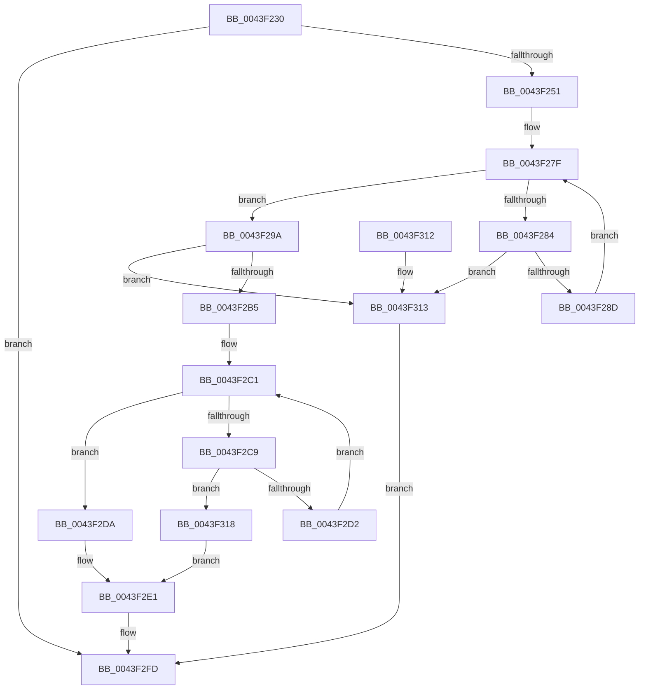

# RtlFindNextForwardRunSet

- RVA: `0x0043F230`–`0x0043F31F` (길이 `239` bytes)
- VA: `0x000000014043F230`
- 실행 섹션: `.text`
- PDB 이름 있음: `예`; PDB Function 태그: `아니요`
- unwind 정보 RVA: `0x000A4C44`
- 디코드: `73`개 명령, `239/239` bytes 표시
- 미해석 바이트: `0` (있으면 어셈블리에 `.byte`로 보존)

> 이 문서는 커널 이미지의 기계어와 PDB 기호를 분석해 생성했습니다. 4번과 5번은 함수 원형과 자료형을 바이너리 사용 방식에서 추정한 C 해석이며 원본 소스 복구 결과는 아닙니다.

## 1. Dependencies

- 직접 호출 지점: **0**; 고유 호출 대상: **0**
- 직접 호출자로 확인된 함수: **2**
- RIP 상대 이미지 참조: **0**

### Outgoing calls
- 직접 디코드된 call 명령이 없습니다.

### Direct callers
- [HvpResetPageProtection](../../page/9B/HvpResetPageProtection_function_009B5838.md) at `0x009B586D`
- [RtlpFcDrainDelayedUsageReportBuffer](../../page/A4/RtlpFcDrainDelayedUsageReportBuffer_function_00A452D0.md) at `0x00A453AA`

### Static image references
- 디코드된 RIP-relative 메모리 참조가 없습니다.

## 2. Other-region calls and transfers

- 다른 실행 섹션으로 향하는 call: **0**
- 별도 외부 분기/꼬리 이동을 확인하지 못했습니다.

## 3. Assembly (complete function range)

```asm
0043F230  48 89 5C 24 08                  mov qword ptr [rsp + 8], rbx
0043F235  48 89 74 24 18                  mov qword ptr [rsp + 0x18], rsi
0043F23A  48 89 7C 24 20                  mov qword ptr [rsp + 0x20], rdi
0043F23F  44 8B 19                        mov r11d, dword ptr [rcx]
0043F242  45 33 C9                        xor r9d, r9d
0043F245  49 8B F0                        mov rsi, r8
0043F248  44 3B DA                        cmp r11d, edx
0043F24B  0F 86 AC 00 00 00               jbe 0x14043f2fd
0043F251  48 8B 79 08                     mov rdi, qword ptr [rcx + 8]
0043F255  41 8D 4B FF                     lea ecx, [r11 - 1]
0043F259  48 C1 E9 05                     shr rcx, 5
0043F25D  8B C2                           mov eax, edx
0043F25F  83 E2 1F                        and edx, 0x1f
0043F262  48 C1 E8 05                     shr rax, 5
0043F266  48 8D 1C 8F                     lea rbx, [rdi + rcx*4]
0043F26A  8A CA                           mov cl, dl
0043F26C  4C 8D 04 87                     lea r8, [rdi + rax*4]
0043F270  83 C8 FF                        or eax, 0xffffffff
0043F273  45 8B 10                        mov r10d, dword ptr [r8]
0043F276  D3 E0                           shl eax, cl
0043F278  44 23 D0                        and r10d, eax
0043F27B  49 8D 40 04                     lea rax, [r8 + 4]
0043F27F  45 85 D2                        test r10d, r10d
0043F282  75 16                           jne 0x14043f29a
0043F284  48 3B C3                        cmp rax, rbx
0043F287  0F 87 86 00 00 00               ja 0x14043f313
0043F28D  49 83 C0 04                     add r8, 4
0043F291  48 83 C0 04                     add rax, 4
0043F295  45 8B 10                        mov r10d, dword ptr [r8]
0043F298  EB E5                           jmp 0x14043f27f
0043F29A  41 8B C2                        mov eax, r10d
0043F29D  49 8B D0                        mov rdx, r8
0043F2A0  48 2B D7                        sub rdx, rdi
0043F2A3  48 C1 FA 02                     sar rdx, 2
0043F2A7  48 0F BC C8                     bsf rcx, rax
0043F2AB  C1 E2 05                        shl edx, 5
0043F2AE  03 D1                           add edx, ecx
0043F2B0  41 3B D3                        cmp edx, r11d
0043F2B3  77 5E                           ja 0x14043f313
0043F2B5  B8 01 00 00 00                  mov eax, 1
0043F2BA  D3 E0                           shl eax, cl
0043F2BC  FF C8                           dec eax
0043F2BE  44 0B D0                        or r10d, eax
0043F2C1  41 F7 D2                        not r10d
0043F2C4  45 85 D2                        test r10d, r10d
0043F2C7  75 11                           jne 0x14043f2da
0043F2C9  49 8D 40 04                     lea rax, [r8 + 4]
0043F2CD  48 3B C3                        cmp rax, rbx
0043F2D0  77 46                           ja 0x14043f318
0043F2D2  44 8B 10                        mov r10d, dword ptr [rax]
0043F2D5  4C 8B C0                        mov r8, rax
0043F2D8  EB E7                           jmp 0x14043f2c1
0043F2DA  41 8B C2                        mov eax, r10d
0043F2DD  48 0F BC C0                     bsf rax, rax
0043F2E1  4C 2B C7                        sub r8, rdi
0043F2E4  45 8B CB                        mov r9d, r11d
0043F2E7  49 C1 F8 02                     sar r8, 2
0043F2EB  41 C1 E0 05                     shl r8d, 5
0043F2EF  41 8D 0C 00                     lea ecx, [r8 + rax]
0043F2F3  41 3B CB                        cmp ecx, r11d
0043F2F6  44 0F 46 C9                     cmovbe r9d, ecx
0043F2FA  44 2B CA                        sub r9d, edx
0043F2FD  89 16                           mov dword ptr [rsi], edx
0043F2FF  41 8B C1                        mov eax, r9d
0043F302  48 8B 5C 24 08                  mov rbx, qword ptr [rsp + 8]
0043F307  48 8B 74 24 18                  mov rsi, qword ptr [rsp + 0x18]
0043F30C  48 8B 7C 24 20                  mov rdi, qword ptr [rsp + 0x20]
0043F311  C3                              ret
0043F312  CC                              int3
0043F313  41 8B D3                        mov edx, r11d
0043F316  EB E5                           jmp 0x14043f2fd
0043F318  B8 20 00 00 00                  mov eax, 0x20
0043F31D  EB C2                           jmp 0x14043f2e1
```

## 4. C-style interpretation (structured pseudocode)

```c
__int64 __fastcall RtlFindNextForwardRunSet(__int64 a1, int a2, __int64 a3, int a4)
{
    __int64 result;
    __int64 v_r10;
    unsigned __int64 v_stack_p18;
    unsigned __int64 v_stack_p20;
    unsigned __int64 v_stack_p8;

    v_stack_p8 = v_rbx;
    v_stack_p18 = v_rsi;
    v_stack_p20 = v_rdi;
    a4 = 0;
    if (((unsigned int)((unsigned int)(*(unsigned int *)(a1)))) <= a2) goto loc_0043F2FD;
    a1 = ((unsigned int)(*(unsigned int *)(a1)) - 1) >> (5);
    a2 = (unsigned int)((a2) & (31));
    result = ((unsigned int)(a2)) >> (5);
    result = (unsigned int)((result) | (0xFFFFFFFFULL));
    result = (unsigned int)((result) << ((unsigned __int8)((unsigned __int8)(a2))));
    v_r10 = (unsigned int)(((unsigned int)(*(unsigned int *)(*(unsigned __int64 *)(a1 + 8) + result * 4))) & ((unsigned int)(result)));
loc_0043F27F:
    if ((unsigned int)(v_r10) != 0) goto loc_0043F29A;
    if ((*(unsigned __int64 *)(a1 + 8) + result * 4 + 4) > (*(unsigned __int64 *)(a1 + 8) + a1 * 4)) goto loc_0043F313;
    a3 = (*(unsigned __int64 *)(a1 + 8) + result * 4) + (4);
    result = (*(unsigned __int64 *)(a1 + 8) + result * 4 + 4) + (4);
    goto loc_0043F27F;
loc_0043F29A:
    a2 = (a3) - (*(unsigned __int64 *)(a1 + 8));
    a2 = (a2) >> (2);
    a2 = (unsigned int)((a2) << (5));
    a2 = (unsigned int)((a2) + ((unsigned int)((unsigned __int8)(a2))));
    if (a2 > ((unsigned int)((unsigned int)(*(unsigned int *)(a1))))) goto loc_0043F313;
    result = (unsigned int)((1) << ((unsigned __int8)((unsigned __int8)(a2))));
    result = (unsigned int)((result) - 1);
    v_r10 = (unsigned int)(((unsigned int)(*(unsigned int *)(a3))) | ((unsigned int)(result)));
loc_0043F2C1:
    v_r10 = (unsigned int)(~(v_r10));
    if ((unsigned int)(v_r10) != 0) goto loc_0043F2DA;
    if ((a3 + 4) > (*(unsigned __int64 *)(a1 + 8) + a1 * 4)) goto loc_0043F318;
    goto loc_0043F2C1;
loc_0043F2DA:
loc_0043F2E1:
    a3 = (a3 + 4) - (*(unsigned __int64 *)(a1 + 8));
    a3 = (a3) >> (2);
    a3 = (unsigned int)((a3) << (5));
    a4 = (unsigned int)((unsigned int)((unsigned int)(*(unsigned int *)(a1))));
    if (((unsigned int)(a3 + (unsigned int)((unsigned int)((unsigned int)(*(unsigned int *)(a3 + 4)))) * 1)) <= ((unsigned int)((unsigned int)(*(unsigned int *)(a1))))) { a4 = (unsigned int)(a3 + (unsigned int)((unsigned int)((unsigned int)(*(unsigned int *)(a3 + 4)))) * 1); }
    a4 = (unsigned int)((a4) - (a2));
loc_0043F2FD:
    *(unsigned int *)(a3) = a2;
    return (unsigned int)(a4);
loc_0043F313:
    goto loc_0043F2FD;
loc_0043F318:
    goto loc_0043F2E1;
}
```

## 5. (Beta) C Style

```c
int64_t RtlFindNextForwardRunSet(void *Arg1, int32_t Arg2, void *Arg3, int32_t Arg4)
{
    uint8_t *arg1 = (uint8_t *)Arg1;
    uint8_t *arg3 = (uint8_t *)Arg3;

    int64_t result;
    int64_t local_r10;
    uint64_t v_stack_p18;
    uint64_t v_stack_p20;
    uint64_t v_stack_p8;

    v_stack_p8 = local_rbx;
    v_stack_p18 = local_rsi;
    v_stack_p20 = local_rdi;
    Arg4 = 0;
    if (((uint32_t)((uint32_t)(*(uint32_t *)(arg1)))) <= Arg2) goto loc_0043F2FD;
    Arg1 = ((uint32_t)(*(uint32_t *)(arg1)) - 1) >> (5);
    Arg2 = (uint32_t)((Arg2) & (31));
    result = ((uint32_t)(Arg2)) >> (5);
    result = (uint32_t)((result) | (0xFFFFFFFFULL));
    result = (uint32_t)((result) << ((uint8_t)((uint8_t)(Arg2))));
    local_r10 = (uint32_t)(((uint32_t)(*(uint32_t *)(*(uint64_t *)(arg1 + 0x8) + result * 4))) & ((uint32_t)(result)));
loc_0043F27F:
    if ((uint32_t)(local_r10) != 0) goto loc_0043F29A;
    if ((*(uint64_t *)(arg1 + 0x8) + result * 4 + 4) > (*(uint64_t *)(arg1 + 0x8) + Arg1 * 4)) goto loc_0043F313;
    Arg3 = (*(uint64_t *)(arg1 + 0x8) + result * 4) + (4);
    result = (*(uint64_t *)(arg1 + 0x8) + result * 4 + 4) + (4);
    goto loc_0043F27F;
loc_0043F29A:
    Arg2 = (Arg3) - (*(uint64_t *)(arg1 + 0x8));
    Arg2 = (Arg2) >> (2);
    Arg2 = (uint32_t)((Arg2) << (5));
    Arg2 = (uint32_t)((Arg2) + ((uint32_t)((uint8_t)(Arg2))));
    if (Arg2 > ((uint32_t)((uint32_t)(*(uint32_t *)(arg1))))) goto loc_0043F313;
    result = (uint32_t)((1) << ((uint8_t)((uint8_t)(Arg2))));
    result = (uint32_t)((result) - 1);
    local_r10 = (uint32_t)(((uint32_t)(*(uint32_t *)(arg3))) | ((uint32_t)(result)));
loc_0043F2C1:
    local_r10 = (uint32_t)(~(local_r10));
    if ((uint32_t)(local_r10) != 0) goto loc_0043F2DA;
    if ((Arg3 + 4) > (*(uint64_t *)(arg1 + 0x8) + Arg1 * 4)) goto loc_0043F318;
    goto loc_0043F2C1;
loc_0043F2DA:
loc_0043F2E1:
    Arg3 = (Arg3 + 4) - (*(uint64_t *)(arg1 + 0x8));
    Arg3 = (Arg3) >> (2);
    Arg3 = (uint32_t)((Arg3) << (5));
    Arg4 = (uint32_t)((uint32_t)((uint32_t)(*(uint32_t *)(arg1))));
    if (((uint32_t)(Arg3 + (uint32_t)((uint32_t)((uint32_t)(*(uint32_t *)(arg3 + 0x4)))) * 1)) <= ((uint32_t)((uint32_t)(*(uint32_t *)(arg1))))) { Arg4 = (uint32_t)(Arg3 + (uint32_t)((uint32_t)((uint32_t)(*(uint32_t *)(arg3 + 0x4)))) * 1); }
    Arg4 = (uint32_t)((Arg4) - (Arg2));
loc_0043F2FD:
    *(uint32_t *)(arg3) = Arg2;
    return (uint32_t)(Arg4);
loc_0043F313:
    goto loc_0043F2FD;
loc_0043F318:
    goto loc_0043F2E1;
}
```

### 관측된 메모리 오프셋

구조체 형식이 확인되지 않은 접근은 인자 기준의 오프셋으로만 기록했습니다.

| 기준 인자 | 오프셋 표현 | 폭 (bit) | 접근 |
|---|---:|---:|---|
| `Arg1` | `+ 0x0` | `32` | `R` |
| `Arg1` | `+ 0x8` | `64` | `R` |
| `Arg3` | `+ 0x0` | `32` | `W` |

## 6. Execution-region graph

[열기: 2D/3D 그래프와 함수 탐색 컨트롤 패널](../../../control-panel.html?section=text&rva=0x0043F230&view=graph)

- 2D 그래프는 위에서 아래로 흐르고, 3D 그래프는 빈 공간을 드래그해 회전합니다. Shift+드래그는 이동, 휠은 확대·축소, 함수 노드 선택은 대상 보고서 이동입니다.

### Static fallback


